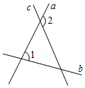
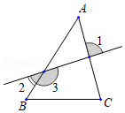
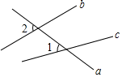
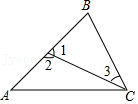
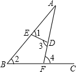
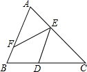

# 知识点·同位角、内错角、同旁内角的定义（同步练习）

> 教材：数学·七年级下册·沪科技版2024新教材 ｜ 来源：国家中小学智慧教育平台·在线练习 ｜ 共 6 题

## 1. 单选题（难度：简单）

如图，∠1和∠2是直线_____和直线_____被直线_____所截得到的_____．应选（　　）。

- A. ​​​\(a，b，c\)​，同旁内角
- B. ​​​\(a，c，b\)​，同位角
- C. ​​​\(a，b，c\)​，同位角
- D. ​​​\(c，b，a\)​，同位角

【答案】D

【解析】​

## 2. 单选题（难度：简单）

如图，说法正确的是（　　）。

- A. ​​​\(∠A\)​和∠1是同位角
- B. \(∠A\)和∠2是内错角
- C. \(∠A\)和∠3是同旁内角
- D. \(∠A\)和\(∠B\)​是同旁内角

【答案】D

【解析】​

## 3. 单选题（难度：非常简单）

如图，直线​​​\(b、c\)​被直线​​​\(a\)​所截，则∠1与∠2是（　　）。

- A. 内错角
- B. 同位角
- C. 同旁内角
- D. 对顶角

【答案】B

【解析】​

## 4. 填空题（难度：适中）

如图，下列结论：①∠2与∠3是内错角；②∠2与\(∠B\)​​是同位角；③\(∠A\)​​与\(∠B\)​是同旁内角；④\(∠A\)​与∠3是内错角角，其中正确的是（只填序号）。

【答案】①②③

【解析】​

## 5. 填空题（难度：适中）

根据图形填空：
（1）若直线​​​\(ED，BC\)​被直线​​​\(AB\)​所截，则∠2和是同位角；
（2）若直线​​​\(ED，BC\)​被直线​​​\(AF\)​所截，则∠3和是内错角；
（3）∠1和∠3是直线​​​\(AB，AF\)​被直线所截构成的角；
（4）∠2和∠4是直线，被直线​​​\(BC\)​所截构成的角。

【答案】&ang;1，&ang;4，<latex class="math-tex">\(ED\)</latex>，内错，<latex class="math-tex">\(AB\)</latex>，<latex class="math-tex">\(AF\)</latex>，同位

【解析】​

## 6. 填空题（难度：适中）

如图，有下列3个结论：①能与​​​\(∠DEF\)​构成内错角的角的个数是2；②能与​​​\(∠EFB\)​构成同位角的角的个数是1；③能与​​​\(∠C\)​构成同旁内角的角的个数是3，以上结论正确的是。

【答案】①②

【解析】​
