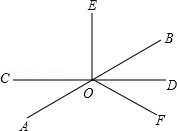
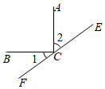

# 知识点·垂直的定义（同步练习）

> 教材：数学·七年级下册·沪科技版2024新教材 ｜ 来源：国家中小学智慧教育平台·在线练习 ｜ 共 4 题

## 1. 填空题（难度：适中）

如图，直线​​​\(AB，CD\)​相交于点​​​\(O\)​，​​​\(OD\)​平分​​​\(∠BOF\)​，​​​\(OE⊥CD\)​于​​​\(O\)​，若​​​\(∠EOF=β\)​，下列说法中：①\(∠AOC=β-90°\)​；②\(∠EOB=180°-β\)​；③\(∠AOF=360°-2β\)​，正确的是。

【答案】①②③

【解析】​

## 2. 单选题（难度：简单）

如图，​​​\(AC⊥BC\)​，直线​​​\(EF\)​经过点​​​\(C\)​，若​​​\(∠1=30°\)​，则​​​\(∠2\)​的大小为（　　）。

- A. 65°
- B. 60°
- C. 50°
- D. 40°

【答案】B

【解析】​

## 3. 填空题（难度：适中）

已知，​​​\(∠AOB\)​和​​​\(∠BOC\)​互为邻补角，且​​​\(∠BOC：∠AOB=5：1\)​，射线​​​\(OD\)​平分​​​\(∠AOB\)​，射线​​​\(OE⊥OD\)​，则​​​\(∠BOE=\)​。

【答案】75&deg;或105&deg;

【解析】​

## 4. 填空题

过平面上一点​​​\(O\)​作三条射线​​​\(OA，OB\)​和​​​\(OC\)​，已知​​​\(OA⊥OB\)​，​​​\(∠AOC：∠AOB=1：3\)​，则​​​\(∠BOC=\)​°。

【答案】120或60

【解析】​
