# 知识点·垂线、垂线段（同步练习）

> 教材：数学·七年级下册·沪科技版2024新教材 ｜ 来源：国家中小学智慧教育平台·在线练习 ｜ 共 59 题

## 1. 单选题（难度：简单）

如图，直线AB与CD相交于点O，射线OE⊥CD于点O，若∠AOE＝35°，则∠BOC的大小为（　　）

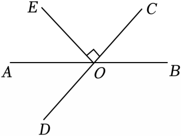

- A. 25°
- B. 35°
- C. 45°
- D. 55°

【答案】D

【解析】解：∵OE⊥CD，
∴∠DOE＝90°，
∵∠AOE＝35°，
∴∠AOD＝90°﹣35°＝55°，
∴∠BOC＝∠AOD＝55°，
故选：D．

## 2. 单选题（难度：适中）

如图，直线AB，CD相交于点O，射线OM平分∠AOC，ON⊥OM，若∠CON＝55°，则∠AOM的度数为（　　）

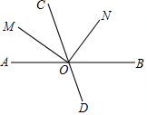

- A. 35°
- B. 45°
- C. 55°
- D. 65°

【答案】A

【解析】解：∵ON⊥OM，
∴∠NOM＝90°，
∵∠CON＝55°，
∴∠COM＝90°﹣55°＝35°，
∵射线OM平分∠AOC，
∴∠AOM＝∠COM＝35°，
故选：A．

## 3. 单选题

如图，直线AB、CD相交于点O，OF⊥CD，垂足为O，OE平分∠BOF，若∠DOE＝20°，则∠AOC的度数为（　　）

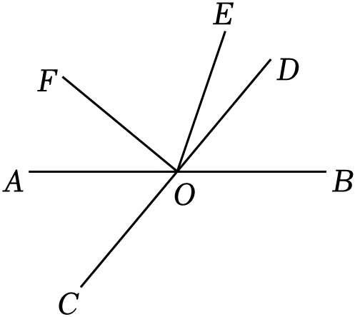

- A. 20°
- B. 40°
- C. 50°
- D. 70°

【答案】C

【解析】解：∵OF⊥CD，
∴∠DOF＝90°，
∵∠DOE＝20°，
∴∠EOF＝90°﹣20°＝70°，
∵OE平分∠BOF，
∴∠BOE＝∠EOF＝70°，
∴∠BOD＝∠BOE﹣∠DOE＝50°，
∴∠AOC＝∠BOD＝50°．
故选：C．

## 4. 单选题（难度：简单）

如图，AB⊥CD，垂足为D，直线EF经过点D．若∠1＝50°，则∠2的度数为（　　）

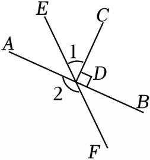

- A. 120°
- B. 130°
- C. 140°
- D. 150°

【答案】C

【解析】解：∵AB⊥CD，
∴∠ADC＝90°，
∵∠1＝50°，
∴∠ADE＝∠ADC﹣∠1＝40°，
∴∠2＝180°﹣∠ADE＝180°﹣40°＝140°，
故选：C．

## 5. 单选题（难度：非常简单）

如图，点O在直线AB上，OC⊥OD，∠BOD＝30°，则∠AOC的度数是（　　）

- A. 110°
- B. 120°
- C. 130°
- D. 150°

【答案】B

【解析】解：∵OC⊥OD，
∴∠COD＝90°．
∵∠BOD＝30°，
∴∠COB＝∠COD﹣∠BOD＝60°．
∴∠AOC＝180°﹣∠COB＝120°，
故选：B．

## 6. 单选题（难度：适中）

如图，已知直线AB和CD相交于点O，OE⊥OC，OF平分∠AOE．若∠COF＝36°，则∠BOD的度数为（　　）

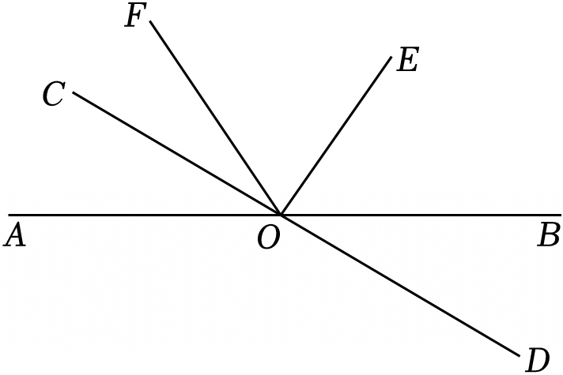

- A. 20°
- B. 18°
- C. 16°
- D. 14°

【答案】B

【解析】解：∵OE⊥OC，
∴∠COE＝90°，
∵∠COF＝36°，
∴∠EOF＝∠COE﹣∠COF＝90°﹣36°＝54°，
∵OF平分∠AOE，
∴∠AOF＝∠EOF＝54°，
∴∠AOC＝∠AOF﹣∠COF＝54°﹣36°＝18°，
∴∠BOD＝∠AOC＝18°，
故选：B．

## 7. 单选题（难度：适中）

如图，OA⊥OD，∠AOC＝3∠COD，OC平分∠BOD，则∠AOB的度数为（　　）

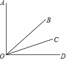

- A. 45°
- B. 46°
- C. 50°
- D. 60°

【答案】A

【解析】解：∵OA⊥OD，
∴∠AOD＝90°，
∴∠AOC+∠COD＝90°，
∵∠AOC＝3∠COD，
∴∠COD＝22.5°，
∵OC平分∠BOD，
∴∠BOD＝2∠COD＝45°，
∴∠AOB＝∠AOD﹣∠BOD＝90°﹣45°＝45°．
故选：A．

## 8. 单选题（难度：适中）

如图，直线AB，CD相交于点O，OE⊥AB于O，∠DOB＝43°，∠COE的度数是（　　）

- A. 43°
- B. 137°
- C. 57°
- D. 47°

【答案】D

【解析】解：∵OE⊥AB，
∴∠BOE＝90°，
∵∠DOB＝43°，
∴∠COE＝180°﹣∠BOE﹣∠DOB＝47°，
故选：D．

## 9. 单选题（难度：适中）

如图，平面镜MN放置在水平地面CD上，墙面PD⊥CD于点D，一束光线AO照射到镜面MN上，反射光线为OB，点B在PD上，若∠AOC＝35°，则∠OBD的度数为（　　）

- A. 35°
- B. 45°
- C. 55°
- D. 65°

【答案】C

【解析】解：依题意，∠AOC＝∠BOD，∠AOC＝35°，
∴∠BOD＝35°，
∵PD⊥CD，
∴∠OBD＝90°﹣∠BOD＝55°，
故选：C．

## 10. 单选题（难度：简单）

如图，点O在直线AB上，OC⊥OD，若∠BOD＝25°，则∠AOC的补角的大小为（　　）

- A. 25°
- B. 65°
- C. 115°
- D. 155°

【答案】B

【解析】解：∵OC⊥OD，
∴∠COD＝90°，
∵∠BOD＝25°，
∴∠COB＝∠COD﹣∠BOD＝65°，
∴∠AOC的补角的大小为65°．
故选：B．

## 11. 单选题（难度：非常简单）

如图，点O在直线AB上，OC⊥OD，∠BOD＝30°，则∠AOC的度数是（　　）

- A. 110°
- B. 120°
- C. 130°
- D. 150°

【答案】B

【解析】解：∵OC⊥OD，
∴∠COD＝90°．
∵∠BOD＝30°，
∴∠COB＝∠COD﹣∠BOD＝60°．
∴∠AOC＝180°﹣∠COB＝120°，
故选：B．

## 12. 单选题（难度：简单）

如图，O是BC上一点，AO⊥BC于点O，直线DE经过O点，∠BOD＝25°，则∠AOE的度数为（　　）

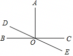

- A. 100°
- B. 105°
- C. 115°
- D. 125°

【答案】C

【解析】解：∵AO⊥BC，
∴∠AOC＝90°，
∵∠COE＝∠BOD＝25°，
∴∠AOE＝90°+25°＝115°．
故选：C．

## 13. 单选题（难度：适中）

如图，已知直线AB和CD相交于O点，EO⊥CO，OF平分∠AOE，∠COF＝28°，则∠BOD的大小为（　　）

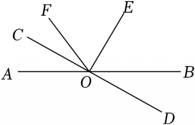

- A. 27°
- B. 34°
- C. 45°
- D. 62°

【答案】B

【解析】解：∵∠COE是直角，∠COF＝28°，
∴∠EOF＝90°﹣28°＝62°，
∵OF平分∠AOE，
∴∠AOF＝∠EOF＝62°，
∴∠AOC＝62°﹣28°＝34°，
∴∠BOD＝∠AOC＝34°．
故选：B．

## 14. 单选题（难度：适中）

如图，直线AB⊥CD于点C，射线CE在∠BCD内部，射线CF平分∠ACE．若∠BCE＝40°，则下列结论正确的是（　　）

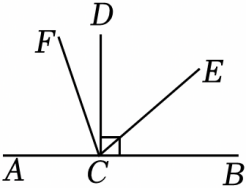

- A. ∠ECF＝60°
- B. ∠DCF＝30°
- C. ∠ACF与∠BCE互余
- D. ∠ECF与∠BCF互补

【答案】D

【解析】解：∵AB⊥CD，
∴∠BCD＝90°，
∵∠BCE＝40°，
∴∠ACE＝180°﹣∠BCE＝140°，∠DCE＝∠DCB﹣∠BCE＝50°，
∵射线CF平分∠ACE，
∴∠ACF＝∠ECF\( =\frac{1}{2}\)∠ACE＝70°，
∴∠DCF＝∠ECF﹣∠DCE＝20°，
∵∠ACF＝70°，
∴∠ACF+∠BCE＝110°，
∴∠ACF与∠BCE不互余，
∵∠ACF+∠BCF＝180°，
∴∠ECF+∠BCF＝180°，
∴∠ECF与∠BCF互补，
故A、B、C都不正确，D正确，
故选：D．

## 15. 单选题

如图，直线AB、CD相交于点O，OF⊥CD，垂足为O，OE平分∠BOF，若∠DOE＝20°，则∠AOC的度数为（　　）

- A. 20°
- B. 40°
- C. 50°
- D. 70°

【答案】C

【解析】解：∵OF⊥CD，
∴∠DOF＝90°，
∵∠DOE＝20°，
∴∠EOF＝90°﹣20°＝70°，
∵OE平分∠BOF，
∴∠BOE＝∠EOF＝70°，
∴∠BOD＝∠BOE﹣∠DOE＝50°，
∴∠AOC＝∠BOD＝50°．
故选：C．

## 16. 单选题（难度：适中）

如图，直线AB，CD相交于点O，射线OM平分∠AOC，ON⊥OM，若∠CON＝55°，则∠AOM的度数为（　　）

- A. 35°
- B. 45°
- C. 55°
- D. 65°

【答案】A

【解析】解：∵ON⊥OM，
∴∠NOM＝90°，
∵∠CON＝55°，
∴∠COM＝90°﹣55°＝35°，
∵射线OM平分∠AOC，
∴∠AOM＝∠COM＝35°，
故选：A．

## 17. 单选题（难度：简单）

如图，直线AB与CD交于点O，OE⊥AB，若∠AOD＝140°，则∠COE的度数为（　　）

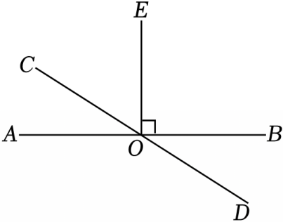

- A. 40°
- B. 50°
- C. 60°
- D. 70°

【答案】B

【解析】解：∵∠AOD＝140°，
∴∠AOC＝180°﹣∠AOD＝180°﹣140°＝40°，
∵OE⊥AB，
∴∠AOE＝90°，
∴∠COE＝∠AOE﹣∠AOC＝90°﹣40°＝50°，
故选：B．

## 18. 单选题（难度：适中）

如图，平面镜MN放置在水平地面CD上，墙面PD⊥CD于点D，一束光线AO照射到镜面MN上，反射光线为OB，点B在PD上，若∠AOC＝35°，则∠OBD的度数为（　　）

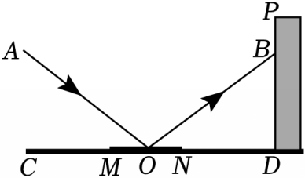

- A. 35°
- B. 45°
- C. 55°
- D. 65°

【答案】C

【解析】解：依题意，∠AOC＝∠BOD，∠AOC＝35°，
∴∠BOD＝35°，
∵PD⊥CD，
∴∠OBD＝90°﹣∠BOD＝55°，
故选：C．

## 19. 单选题（难度：简单）

如图，点O在直线AB上，OC⊥OD，若∠BOD＝25°，则∠AOC的补角的大小为（　　）

- A. 25°
- B. 65°
- C. 115°
- D. 155°

【答案】B

【解析】解：∵OC⊥OD，
∴∠COD＝90°，
∵∠BOD＝25°，
∴∠COB＝∠COD﹣∠BOD＝65°，
∴∠AOC的补角的大小为65°．
故选：B．

## 20. 单选题（难度：简单）

如图，直线AB，CD相交于点O，EO⊥AB，垂足为O，若∠AOD＝132°，则∠EOC＝（　　）

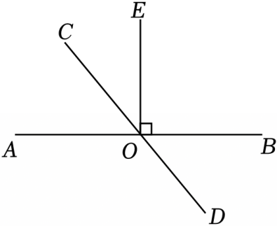

- A. 32°
- B. 42°
- C. 48°
- D. 52°

【答案】B

【解析】解：∵∠AOD＝132°，
∴∠AOC＝180°﹣∠AOD＝48°，
∵EO⊥AB，
∴∠AOE＝90°，
∴∠EOC＝∠AOE﹣∠AOC＝42°，
故选：B．

## 21. 单选题（难度：适中）

如图，已知直线AB和CD相交于点O，OE⊥OC，OF平分∠AOE．若∠COF＝36°，则∠BOD的度数为（　　）

- A. 20°
- B. 18°
- C. 16°
- D. 14°

【答案】B

【解析】解：∵OE⊥OC，
∴∠COE＝90°，
∵∠COF＝36°，
∴∠EOF＝∠COE﹣∠COF＝90°﹣36°＝54°，
∵OF平分∠AOE，
∴∠AOF＝∠EOF＝54°，
∴∠AOC＝∠AOF﹣∠COF＝54°﹣36°＝18°，
∴∠BOD＝∠AOC＝18°，
故选：B．

## 22. 单选题（难度：适中）

如图，直线AB，CD相交于点O，OE平分∠BOC，OF⊥OE，且∠AOD＝68°，则∠BOF的度数为（　　）

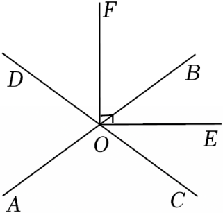

- A. 55°
- B. 56°
- C. 57°
- D. 58°

【答案】B

【解析】解：∵∠AOD＝68°，
∴∠BOC＝∠AOD＝68°，
∵OE平分∠BOC，
∴∠BOE\( =\frac{1}{2}\angle BOC=\frac{1}{2}\times 68°=34°\)，
∵OF⊥OE，
∴∠EOF＝90°，
∴∠BOF＝∠EOF﹣∠BOE＝90°﹣34°＝56°，
故选：B．

## 23. 单选题（难度：简单）

如图，AB⊥CD，垂足为D，直线EF经过点D．若∠1＝50°，则∠2的度数为（　　）

- A. 120°
- B. 130°
- C. 140°
- D. 150°

【答案】C

【解析】解：∵AB⊥CD，
∴∠ADC＝90°，
∵∠1＝50°，
∴∠ADE＝∠ADC﹣∠1＝40°，
∴∠2＝180°﹣∠ADE＝180°﹣40°＝140°，
故选：C．

## 24. 单选题（难度：简单）

如图，直线AB与CD相交于点O，射线OE⊥CD于点O，若∠AOE＝35°，则∠BOC的大小为（　　）

- A. 25°
- B. 35°
- C. 45°
- D. 55°

【答案】D

【解析】解：∵OE⊥CD，
∴∠DOE＝90°，
∵∠AOE＝35°，
∴∠AOD＝90°﹣35°＝55°，
∴∠BOC＝∠AOD＝55°，
故选：D．

## 25. 单选题（难度：适中）

如图，直线AB，CD相交于点O，OE⊥AB于O，∠DOB＝43°，∠COE的度数是（　　）

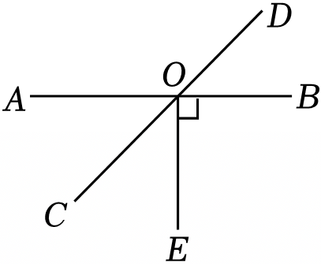

- A. 43°
- B. 137°
- C. 57°
- D. 47°

【答案】D

【解析】解：∵OE⊥AB，
∴∠BOE＝90°，
∵∠DOB＝43°，
∴∠COE＝180°﹣∠BOE﹣∠DOB＝47°，
故选：D．

## 26. 单选题（难度：适中）

如图，直线AB、CD交于点O，OE⊥AB于O．若∠1＝35.8°，则∠2的大小是（　　）

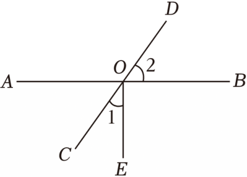

- A. 35°48'
- B. 54°12'
- C. 54°52'
- D. 55°12'

【答案】B

【解析】解：∵OE⊥AB，
∴∠AOE＝90°，
∵∠1＝35.8°，
∴∠AOC＝90°﹣35.8°＝54.2°＝54°12'，
∴∠2＝∠AOC＝54°12'．
故选：B．

## 27. 单选题（难度：适中）

如图所示，OB⊥OA，∠BOC＝40°，OD平分∠AOC，则∠BOD的度数是（　　）

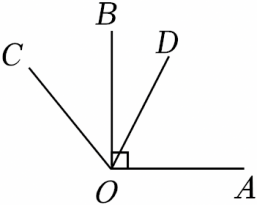

- A. 25°
- B. 35°
- C. 40°
- D. 60°

【答案】A

【解析】解：∵∠AOB＝90°，∠BOC＝40°，
∴∠AOC＝90°+40°＝130°，
∵OD平分∠AOC，
∴\( \angle AOD=\angle DOC=\frac{1}{2}\times 130°=65°\)，
∴∠BOD＝65°﹣40°＝25°．
故选：A．

## 28. 单选题（难度：简单）

如图，直线AB和CD相交于点O，OE⊥OC．若∠AOC＝40°，则∠EOB的大小为（　　）

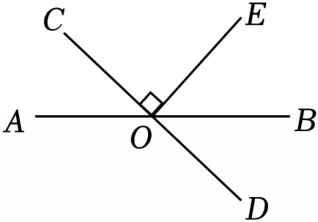

- A. 30°
- B. 40°
- C. 50°
- D. 60°

【答案】C

【解析】解：∵OE⊥OC，
∴∠COE＝90°，
∵∠AOC+∠COE+∠BOE＝180°，∠AOC＝40°，
∴∠EOB＝180°﹣90°﹣40°＝50°，
故选：C．

## 29. 单选题（难度：适中）

如图，∠AOB＝90°，射线OC在∠AOB内部，射线OA在∠COD内部，且OD⊥OC，由此可得∠1＝∠2，其依据为（　　）

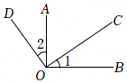

- A. 同角的余角相等
- B. 同角的补角相等
- C. 对顶角相等
- D. 所有的直角都相等

【答案】A

【解析】解：∵OD⊥OC，
∴∠DOC＝90°，
∴∠2+∠AOC＝90°，
∵∠AOB＝90°，
∴∠1+∠AOC＝90°，
∴∠1＝∠2（同角的余角相等），
故选：A．

## 30. 单选题（难度：适中）

如图，已知直线AB，CD相交于点O，OE⊥AB于点O，∠BOD＝31°40′．则∠COE的度数为（　　）

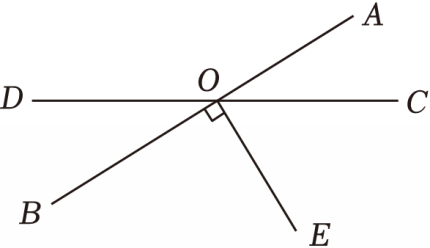

- A. 31°40′
- B. 59°20′
- C. 58°20′
- D. 48°20′

【答案】C

【解析】解：∵∠BOD＝31°40′，
∴∠AOC＝∠BOD＝31°40′
∵OE⊥AB，
∴∠COE＝90°﹣31°40′＝58°20′，
故选：C．

## 31. 单选题（难度：非常简单）

如图，O为直线AB上一点，OC⊥OD，若∠1＝40°，则∠2的度数是（　　）

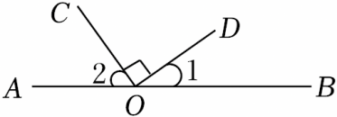

- A. 40°
- B. 50°
- C. 60°
- D. 70°

【答案】B

【解析】解：∵OC⊥OD，
∴∠COD＝90°，
∵∠1＝40°，
∴∠2＝180°﹣∠1﹣∠COD＝50°，
故选：B．

## 32. 单选题（难度：适中）

如图，OA⊥OD，∠AOC＝3∠COD，OC平分∠BOD，则∠AOB的度数为（　　）

- A. 45°
- B. 46°
- C. 50°
- D. 60°

【答案】A

【解析】解：∵OA⊥OD，
∴∠AOD＝90°，
∴∠AOC+∠COD＝90°，
∵∠AOC＝3∠COD，
∴∠COD＝22.5°，
∵OC平分∠BOD，
∴∠BOD＝2∠COD＝45°，
∴∠AOB＝∠AOD﹣∠BOD＝90°﹣45°＝45°．
故选：A．

## 33. 单选题（难度：简单）

如图，点O在直线BD上，已知∠1＝25°，OC⊥OA，则∠DOC的度数为（　　）

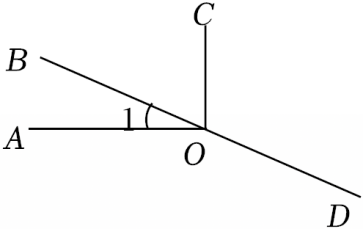

- A. 25°
- B. 75°
- C. 115°
- D. 95°

【答案】C

【解析】解：∵OC⊥OA，∠1＝25°，
∴∠BOC＝90°﹣∠1＝90°﹣25°＝65°，
∴∠DOC＝180°﹣∠BOC＝180°﹣65°＝115°，
故选：C．

## 34. 单选题（难度：简单）

如图，三条直线相交于点O．CO⊥AB，∠1＝54°，则∠2等于（　　）

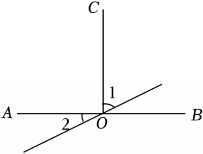

- A. 34°
- B. 36°
- C. 54°
- D. 56°

【答案】B

【解析】解：如图所示：

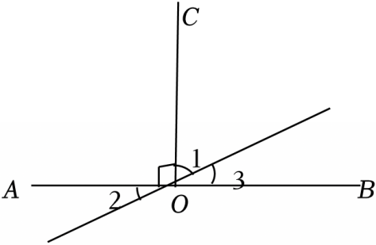
 
∵CO⊥AB，∠1＝54°，
∴∠3＝90°﹣∠1＝90°﹣54°＝36°，
∴∠2＝∠3＝36°．
故选：B．

## 35. 判断题（难度：非常简单）

在同一平面内，过一点有且只有一条直线垂直于已知直线．（    ）

- YES. √
- NO. ×

【答案】YES

【解析】解：在同一平面内，过一点有且只有一条直线垂直于已知直线．
故答案为√．

## 36. 判断题（难度：非常简单）

两条直线相交所成的四个角中，如果有三个角相等，那么这两条直线互为垂直．（    ）

- YES. √
- NO. ×

【答案】YES

【解析】解：两条直线相交所成的四个角中，如果有三个角相等，根据对顶角相等，可以断定四个角都相等，所以每个角都是90°，那么这两条直线互相垂直，
故答案为：√．

## 37. 单选题（难度：适中）

如图，直线AB，CD相交于点O，OE⊥AB，若∠AOC＝34°，则∠DOE的度数是（　　）

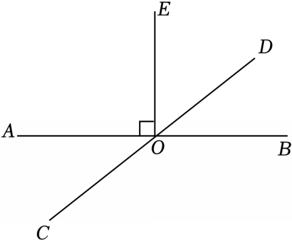

- A. 34°
- B. 56°
- C. 66°
- D. 146°

【答案】B

【解析】解：∵OE⊥AB，
∴∠BOE＝90°．
∵∠AOC＝∠BOD＝34°，
∴∠DOE＝∠BOE﹣∠DOB＝90°﹣34°＝56°．
故选：B．

## 38. 单选题（难度：适中）

如图，直线AB、CD交于点O，OE⊥CD，OF平分∠AOC，若∠AOF比∠AOE大15°，则∠BOD的度数为（　　）

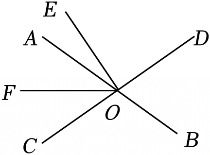

- A. 50°
- B. 60°
- C. 70°
- D. 80°

【答案】C

【解析】解：∵OE⊥CD，
∴∠EOC＝90°，
∴∠AOE＝90°﹣∠AOC，
∵OF平分∠AOC，
∴∠AOF\( =\frac{1}{2}\)∠AOC，
∴\( \frac{1}{2}\)∠AOC﹣（90°﹣∠AOC）＝15°，
∴∠AOC＝70°．
故选：C．

## 39. 单选题（难度：简单）

如图，直线AB、CD相交于点O，OE⊥CD于点O，∠AOE＝60°，则∠BOC的度数为（　　）

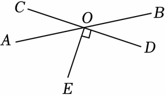

- A. 135°
- B. 145°
- C. 150°
- D. 125°

【答案】C

【解析】解：∵OE⊥CD，
∴∠DOE＝90°，
∵∠AOE＝60°，
∴∠AOD＝∠AOE+∠DOE＝150°，
∴∠BOC＝∠AOD＝150°．
故选：C．

## 40. 单选题（难度：简单）

如图，点O在直线AB上，OC⊥OD．若∠AOC＝124°，则∠BOD＝（　　）

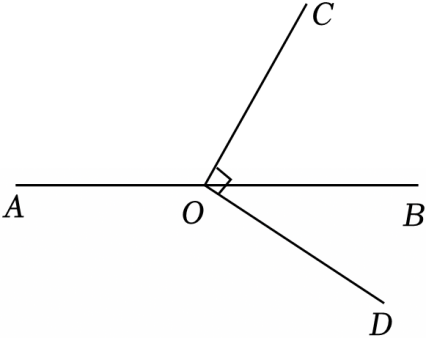

- A. 56°
- B. 46°
- C. 34°
- D. 24°

【答案】C

【解析】解：∵∠AOC+∠BOC＝180°，∠AOC＝124°，
∴∠BOC＝180°﹣124°＝56°．
又∵OC⊥OD，
∴∠COD＝90°，
∴∠BOD＝∠COD﹣∠BOC＝90°﹣56°＝34°．
故选：C．

## 41. 单选题（难度：适中）

如图，已知OC是∠BOD的平分线，OD⊥OA，∠BOC＝32°，则∠AOC的度数为（　　）

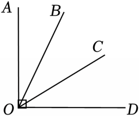

- A. 58°
- B. 64°
- C. 26°
- D. 68°

【答案】A

【解析】解：∵OC是∠BOD的平分线，∠BOC＝32°，
∴∠DOC＝∠BOC＝32°，
∵OD⊥OA，
∴∠AOD＝90°，
∴∠AOC＝∠AOD﹣∠DOC＝58°，
故选：A．

## 42. 单选题（难度：简单）

如图，直线AB⊥CD于点O，EF为过点O的一条直线，∠1＝50°，则∠2的度数是（　　）

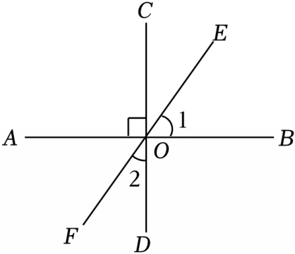

- A. 40°
- B. 50°
- C. 25°
- D. 130°

【答案】A

【解析】解：∵∠1＝50°，
∴∠AOF＝∠1＝50°，
∵AB⊥CD，
∴∠AOD＝90°，
∴∠2＝90°﹣∠AOF＝90°﹣50°＝40°．
故选：A．

## 43. 单选题

如图，已知直线AB和CD相交于点O，OE⊥CD，OF平分∠BOE，∠AOC＝18°，则∠DOF的度数为（　　）

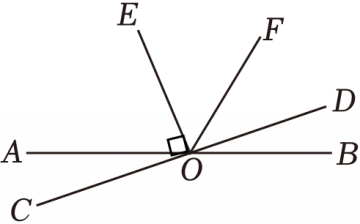

- A. 36°
- B. 45°
- C. 52°
- D. 54°

【答案】A

【解析】解：∵OE⊥CD，
∴∠EOD＝90°，
∵∠AOC＝18°，
∴∠BOD＝∠AOC＝18°，
∴∠BOE＝∠AOE+∠BOD＝108°．
又∵OF平分∠BOE，
∴\( \angle EOF=\frac{1}{2}\angle BOE=54°\)，
∴∠DOF＝90°﹣54°＝36°．
故选：A．

## 44. 单选题（难度：简单）

如图，直线AB、CD、EF相交于点O，如果∠AOC＝30°，EF⊥CD，那么∠AOF的度数为（　　）

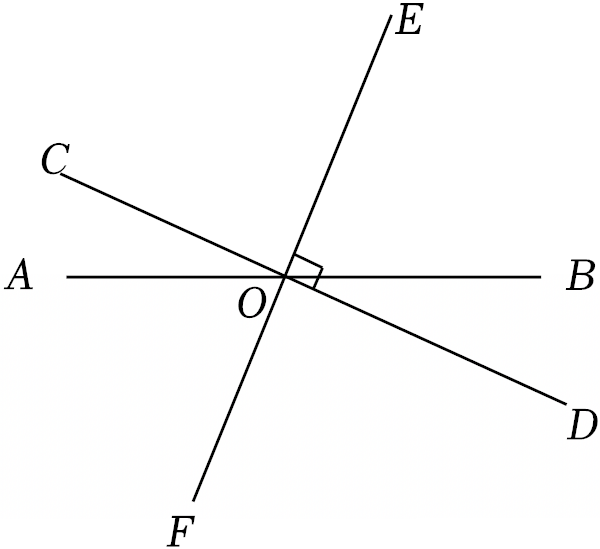

- A. 55°
- B. 60°
- C. 70°
- D. 120°

【答案】B

【解析】解：∵EF⊥CD，
∴∠COF＝90°，
∵∠AOC＝30°，
∴∠AOF＝90°﹣30°＝60°．
故选：B．

## 45. 单选题（难度：简单）

如图，直线AB，CD相交于点O，OE⊥AB，若∠EOD＝40°，则∠AOC的度数为（　　）

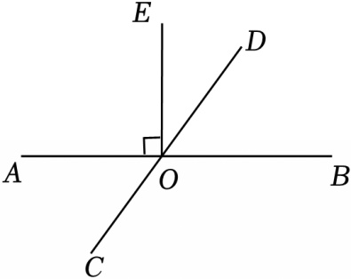

- A. 40°
- B. 45°
- C. 50°
- D. 55°

【答案】C

【解析】解：∵OE⊥AB，
∴∠EOB＝90°，
∵∠EOD＝40°，
∴∠BOD＝∠EOB﹣∠EOD＝50°，
∵直线AB，CD相交于点O，
∴∠AOC＝∠BOD＝50°．
故选：C．

## 46. 单选题（难度：适中）

如图，直线AB、CD相交于点O，EO⊥AB，垂足为O，∠COE＝36°，则∠AOD的度数为（　　）

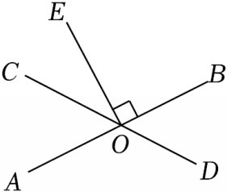

- A. 106°
- B. 116°
- C. 126°
- D. 136°

【答案】C

【解析】解：∵EO⊥AB，
∴∠EOB＝90°，
∵∠COE＝36°，
∴∠BOC＝∠COE+∠EOB＝36°+90°＝126°，
∴∠AOD＝∠BOC＝126°．
故选：C．

## 47. 单选题（难度：适中）

如图，AB，CD，EF三条直线相交于点O，且AB⊥CD，OG平分∠BOC．若∠1＝11°，则∠2的度数为（　　）

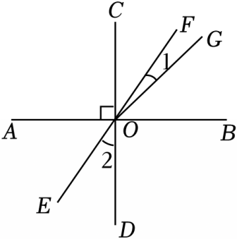

- A. 30°
- B. 34°
- C. 35°
- D. 45°

【答案】B

【解析】解：∵AB⊥CD，
∴∠BOC＝90°，
∵OG平分∠BOC．
∴∠GOC＝45°，
∵∠1＝11°，
∴∠2＝∠FOC＝45°﹣11°＝34°，
故选：B．

## 48. 单选题

如图，直线AB与CD相交于O，OE⊥AB，OF⊥CD．如果∠AOC：∠EOF＝5：13，∠AOC的度数是（　　）

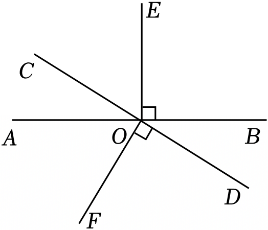

- A. 40°
- B. 45°
- C. 80°
- D. 50°

【答案】D

【解析】解：∵OE⊥AB，OF⊥CD，
∴∠AOE＝∠COF＝90°，
∴∠EOC＝∠AOF＝90°﹣∠AOC，
∵∠AOC：∠EOF＝5：13，
∴∠AOC：（90°+90°﹣∠AOC）＝5：13，
∴∠AOC＝50°．
故选：D．

## 49. 单选题

如图是光的反射规律示意图．CO是入射光线，OD是反射光线，法线EO⊥AB，∠COE是入射角，∠EOD是反射角，∠EOD＝∠COE．若∠AOC＝2∠EOD，则∠COE的度数为（　　）

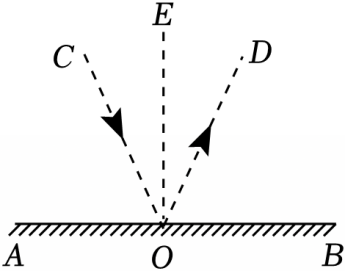

- A. 30°
- B. 40°
- C. 45°
- D. 60°

【答案】A

【解析】解：∵∠EOD＝∠COE，∠AOC＝2∠EOD，
∴∠AOC＝2∠COE，
∵EO⊥AB，
∴∠AOE＝90°，
∴∠AOC+∠COE＝90°，
即2∠COE+∠COE＝90°，
∴∠COE＝30°．
故选：A．

## 50. 单选题（难度：简单）

如图，点O在直线AB上，OC⊥OD，若∠BOD＝25°，则∠AOC的度数为（　　）

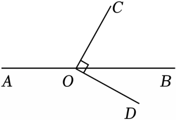

- A. 115°
- B. 155°
- C. 75°
- D. 135°

【答案】A

【解析】解：∵OC⊥OD，
∴∠COD＝90°，
∵∠BOD＝25°，
∴∠BOC＝90°﹣∠BOD＝65°，
∴∠AOC＝180°﹣∠BOC＝115°，
故选：A．

## 51. 单选题

如图，三条直线AB，CD，EF相交于点O，且CD⊥EF，∠AOE＝70°，若OG平分∠BOF．∠DOG的度数为（　　）

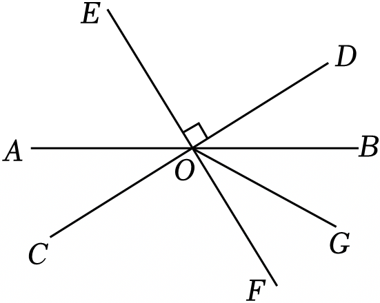

- A. 50°
- B. 55°
- C. 60°
- D. 65°

【答案】B

【解析】解：∵三条直线AB，CD，EF相交于点O，∠AOE＝70°，
∴∠BOF＝∠AOE＝70°，
∵CD⊥EF，
∴∠DOF＝90°，
∵OG平分∠BOF，
∴\( \angle GOF=\frac{1}{2}\angle BOF=35°\)，
∴∠DOG＝∠DOF﹣∠GOF＝90°﹣35°＝55°，
故选：B．

## 52. 单选题（难度：适中）

如图，直线AB和CD交于点O，EO⊥AB，垂足为O，若∠EOC＝35°，则∠AOD的度数为（　　）

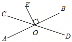

- A. 115°
- B. 125°
- C. 135°
- D. 140°

【答案】B

【解析】解：∵EO⊥AB，
∴∠AOE＝90°，
又∵∠EOC＝35°，
∴∠AOC＝90°﹣35°＝55°，
∴∠AOD＝180°﹣55°＝125°，
故选：B．

## 53. 单选题（难度：适中）

如图，直线AB，CD相交于点O，OE⊥OF，OF平分∠BOD．若∠AOC＝46°，则∠BOE的度数为（　　）

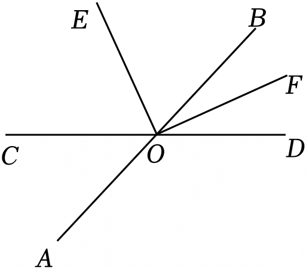

- A. 44°
- B. 67°
- C. 77°
- D. 134°

【答案】B

【解析】解：∵∠AOC＝46°，
∴∠BOD＝∠AOC＝46°，
∵OF平分∠BOD，
∴\( \angle BOF=\frac{1}{2}\angle BOD=\frac{1}{2}\times 46°=23°\)，
∵OE⊥OF，
∴∠EOF＝90°，
∴∠BOE＝∠EOF﹣∠BOF＝90°﹣23°＝67°，
故选：B．

## 54. 单选题（难度：简单）

如图，点O在直线AB上，OC⊥OD于点O，若∠BOD＝3∠BOC，则∠AOD的度数为（　　）

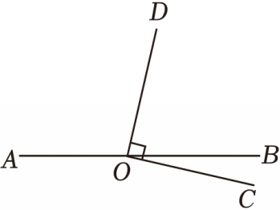

- A. 112.5°
- B. 115°
- C. 117.5°
- D. 125°

【答案】A

【解析】解：∵OC⊥OD，
∴∠BOD+∠BOC＝∠COD＝90°，
∵∠BOD＝3∠BOC，
∴∠BOC＝22.5°，∠BOD＝67.5°，
∴∠AOD＝180°﹣∠BOD＝112.5°，
故选：A．

## 55. 单选题（难度：简单）

如图，直线AB，CD相交于点O，OE⊥CD．若∠AOE＝50°，则∠BOC的度数是（　　）

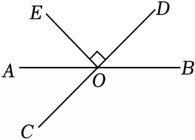

- A. 140°
- B. 130°
- C. 50°
- D. 40°

【答案】A

【解析】解：∵OE⊥CD，
∴∠EOC＝90°，
∴∠EOA+∠AOC＝90°，
∵∠AOE＝50°，
∴∠AOC＝90°﹣50°＝40°，
∴∠BOC＝180°﹣40°＝140°，
故选：A．

## 56. 单选题（难度：简单）

如图，直线AB，CD相交于点O，OE⊥OF，若∠1＝80°，∠2＝30°，则∠3的度数为（　　）

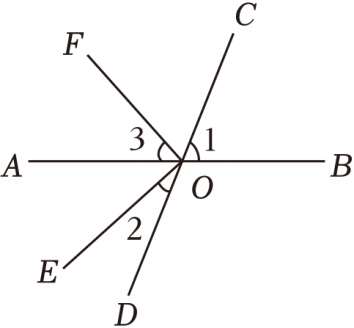

- A. 30°
- B. 40°
- C. 50°
- D. 60°

【答案】B

【解析】解：∵∠1＝80°，
∴∠1＝∠AOD＝80°，
∵∠2＝30°，
∴∠AOE＝∠AOD﹣∠2＝50°，
∵OE⊥OF，
∴∠EOF＝90°，
∴∠3＝∠EOF＝∠AOE＝40°，
故选：B．

## 57. 单选题（难度：非常简单）

如图．已知O是直线AB上一点，∠AOE＝35°，OF⊥OE，则∠BOF的度数是（　　）

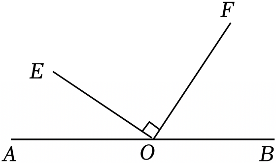

- A. 45°
- B. 55°
- C. 60°
- D. 65°

【答案】B

【解析】解：∵OF⊥OE，
∴∠EOF＝90°，
∵∠AOE＝35°，
∴∠BOF＝180°﹣∠AOE﹣∠EOF＝180°﹣35°﹣90°＝55°．
故选：B．

## 58. 判断题（难度：简单）

两条直线互相垂直，则所有的邻补角都相等． （    ）

- YES. √
- NO. ×

【答案】YES

【解析】解：两条直线互相垂直，则所有的邻补角都等于90°，
故答案为：√．

## 59. 判断题（难度：简单）

在平面内，过一点且垂直于已知直线的垂线只有一条．（    ）

- YES. √
- NO. ×

【答案】YES

【解析】解：在同一平面内，过一点且垂直于已知直线的垂线只有一条是正确的．
故答案为：√．
