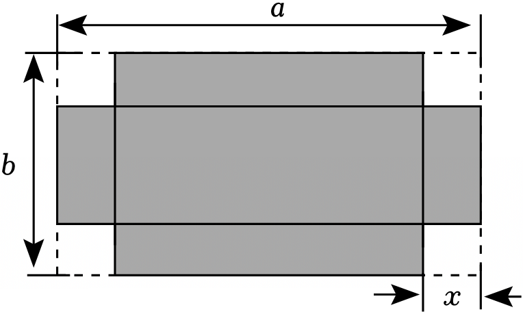
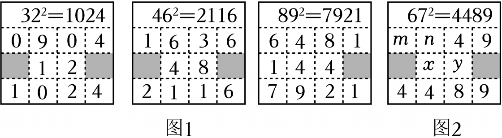
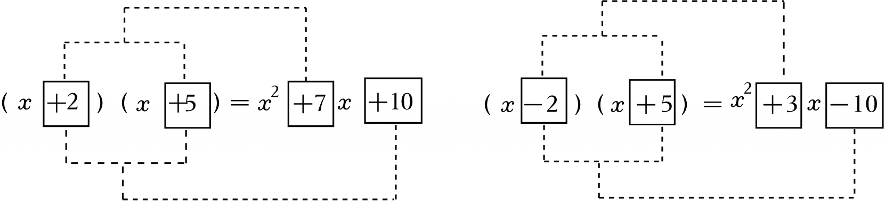
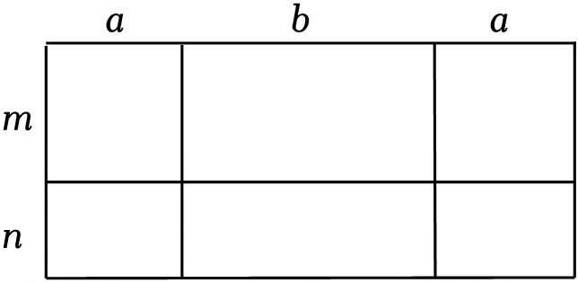
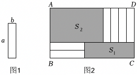
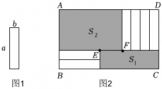
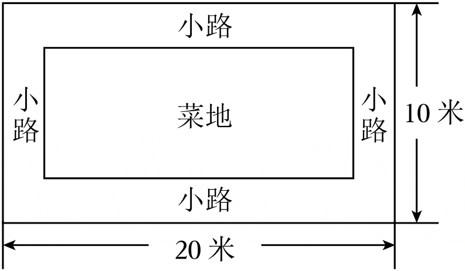

# 知识点·多项式乘以多项式（同步练习）

> 教材：数学·七年级下册·沪科技版2024新教材 ｜ 来源：国家中小学智慧教育平台·在线练习 ｜ 共 100 题

## 1. 单选题（难度：简单）

（2024秋•天门期末）若（2x+m）（x﹣3）的展开式中不含x项，则实数m的值为（　　）

【答案】A

## 2. 单选题（难度：简单）

（2024秋•朝阳区校级期末）若（x+m）（x﹣8）的展开式中不含x的一次项，则m的值（　　）

【答案】A

## 3. 单选题（难度：简单）

（2025•金寨县模拟）已知ab＝1，a+b＝﹣3，则代数式（a﹣1）（b﹣1）的值为（　　）

- A. 3
- B. 5
- C. ﹣3
- D. ﹣1

【答案】B

【解析】解：∵ab＝1，a+b＝﹣3，
∴（a﹣1）（b﹣1）
＝ab﹣（a+b）+1
＝1﹣（﹣3）+1
＝5，
故选：B．

## 4. 单选题（难度：简单）

（2025春•西安校级月考）若（x﹣m）（x+3）＝x²﹣nx﹣3，则n的值为（　　）

- A. ﹣2
- B. 2
- C. ﹣3
- D. 3

【答案】A

【解析】解：∵（x﹣m）（x+3）＝x²﹣nx﹣3，
∴x²+3x﹣mx﹣3m＝x²﹣nx﹣3，
∴x²+（3﹣m）x﹣3m＝x²﹣nx﹣3，
∴3﹣m＝﹣n，3m＝3，
∴m＝1，n＝﹣2，
故选：A．

## 5. 单选题（难度：简单）

（2024秋•济宁期末）如果（x+b）（ax﹣1）展开后不含x的一次项，且常数项为﹣2，那么ab的值为（　　）

【答案】A

## 6. 单选题（难度：简单）

（2024秋•如皋市期末）若x+y＝1且xy＝﹣2，则代数式（1﹣x）（1﹣y）的值等于（　　）

- A. ﹣2
- B. 0
- C. 1
- D. 2

【答案】A

【解析】解：∵x+y＝1，xy＝﹣2，
∴（1﹣x）（1﹣y）
＝1﹣y﹣x+xy
＝1﹣（x+y）+xy
＝1﹣1+（﹣2）
＝﹣2，
故选：A．

## 7. 单选题（难度：简单）

（2025春•灞桥区校级月考）已知（x﹣2）（x²+mx）的乘积中不含x²项，则m的值为（　　）

- A. 2
- B. 3
- C. ﹣2
- D. ﹣3

【答案】A

【解析】解：（x﹣2）（x²+mx）
＝x³+mx²﹣2x²﹣2mx
＝x³+（m﹣2）x²﹣2mx，
∵乘积中不含x²项，
∴m﹣2＝0，
∴m＝2．
故选：A．

## 8. 单选题（难度：简单）

（2024秋•德化县期末）一块长为a米，宽为b米（a＞b＞100）的长方形花园，若把这个花园的长增加10米，宽减少10米．则改变后的花园的面积（　　）

- A. 一定变小
- B. 一定变大
- C. 没有变化
- D. 可能没变化

【答案】A

【解析】解：（a+10）（b﹣10）﹣ab
＝ab﹣10a+10b﹣100﹣ab
＝10（b﹣a）﹣100，
∵a＞b＞100，
∴b﹣a＜0，
∴10（b﹣a）﹣100＜0，
∴改变后的花园的面积变小．
故选：A．

## 9. 单选题（难度：简单）

（2024秋•莒县期末）已知多项式x﹣a与2x²﹣2x+1的乘积中不含x²项，则常数a的值是（　　）

- A. ﹣1
- B. 0
- C. 1
- D. 2

【答案】A

【解析】解：（x﹣a）（2x²﹣2x+1）＝2x³+（﹣2﹣2a）x²+（2a+1）x﹣a，
∵不含x²项，
∴﹣2﹣2a＝0，
解得a＝﹣1．
故选：A．

## 10. 单选题（难度：简单）

（2024秋•仁怀市期末）如果计算（na+3a3）（1﹣2a2）的结果不含a3项，那么n的值为（　　）

【答案】A

## 11. 单选题（难度：简单）

（2024秋•八公山区期末）若将（2x+a）（2x﹣b）展开的结果中不含有x项，则a，b满足的关系式是（　　）

- A. ab＝1
- B. ab＝0
- C. a﹣b＝0
- D. a+b＝0

【答案】C

【解析】解：原式＝4x²﹣2bx+2ax﹣ab
＝4x²+2（a﹣b）x﹣ab，
∵（2x+a）（2x﹣b）展开的结果中不含有x项，
∴a﹣b＝0．
故选：C．

## 12. 单选题（难度：简单）

（2024秋•科左后旗期末）计算（x﹣1）（x+5）的结果为（　　）

- A. ﹣x²+4x﹣5
- B. ﹣x²+4x+5
- C. x²﹣4x+5
- D. x²+4x﹣5

【答案】D

【解析】解：（x﹣1）（x+5）＝x²+5x﹣x﹣5＝x²+4x﹣5，
故选：D．

## 13. 单选题（难度：简单）

（2024秋•南阳期末）在展开多项式（x²+x﹣3）（x²﹣2x+2a）中，常数项为﹣30，则a等于（　　）

- A. 3
- B. 4
- C. 5
- D. 6

【答案】C

【解析】解：观察式子（x²+x﹣3）（x²﹣2x+2a）中常数项为﹣3×2a＝﹣6a，
∵常数项为﹣30，
∴﹣6a＝﹣30，
∴a＝5；
故选：C．

## 14. 单选题（难度：简单）

（2024秋•江津区期末）已知等式（x+m）（x﹣n）＝x²+kx﹣36（m，n为正整数），则k的值不可能是（　　）

- A. ﹣9
- B. ﹣5
- C. 15
- D. 16

【答案】C

【解析】解：（x+m）（x﹣n）
＝x²﹣nx+mx﹣mn
＝x²+（m﹣n）x﹣mn，
∵（x+m）（x﹣n）＝x²+kx﹣36（m，n为正整数），
∴mn＝36，k＝m﹣n，
∴当m＝1，n＝36，k＝1﹣36＝﹣35；
m＝2，n＝18，k＝2﹣18＝﹣16；
m＝3，n＝12，k＝3﹣12＝﹣9；
m＝4，n＝9，k＝4﹣9＝﹣5；
m＝6，n＝6，k＝6﹣6＝0；
m＝9，n＝4，k＝9﹣4＝5；
m＝12，n＝3，k＝12﹣3＝9；
m＝18，n＝2，k＝18﹣2＝16；
m＝36，n＝1，k＝36﹣1＝35；
∴k的值为0或±5或±9或±16或±35，
∴k的值不可能是15，
∴A、B、D选项不符合题意，C选项符合题意，
故选：C．

## 15. 单选题（难度：简单）

（2024春•广饶县期末）下列各式中，结果错误的是（　　）

- A. （x+2）（x﹣3）＝x²﹣x﹣6
- B. （x﹣4）（x+4）＝x²﹣16
- C. （2x+3）（2x﹣6）＝2x²﹣3x﹣18
- D. （2x﹣1）（2x+2）＝4x²+2x﹣2

【答案】C

【解析】解：A、原式＝x²﹣3x+2x﹣6＝x²﹣x﹣6，正确，不符合题意；
B、原式＝x²﹣16，正确，不符合题意；
C、原式＝4x²﹣12x+6x﹣18＝4x²﹣6x﹣18，错误，符合题意；
D、原式＝4x²+4x﹣2x﹣2＝4x²+2x﹣2，正确，不符合题意．
故选：C．

## 16. 单选题（难度：简单）

（2024秋•舞阳县期末）若（y+3）（y﹣2）＝y2+my+n，则m、n的值分别为（　　）

【答案】A

## 17. 单选题（难度：简单）

（2024秋•鲤城区校级期末）若x+m与x+3的乘积中不含x的一次项，则m的值为（　　）

【答案】A

## 18. 单选题（难度：简单）

（2024秋•鼓楼区校级期末）已知a、b是常数，若化简（x﹣a）（2x²+bx﹣4）的结果不含x的二次项，则12a﹣6b﹣1的值为（　　）

- A. 1
- B. ﹣1
- C. 5
- D. ﹣13

【答案】B

【解析】解：∵多项式（x﹣a）（2x²+bx﹣4）＝2x³+（﹣2a+b）x²+（﹣ab﹣4）x+4a不含x的二次项，
∴﹣2a+b＝0，
解得b＝2a，
∴12a﹣6b﹣1＝12a﹣6×2a﹣1＝﹣1．
故选：B．

## 19. 单选题（难度：简单）

（2025春•青岛月考）若（x+3）（x+n）＝x2+mx﹣15，则mn的值为（　　）

【答案】A

## 20. 单选题（难度：简单）

（2025春•金水区校级月考）若（x+3）（x+m）展开合并后不含x项，则m的值为（　　）

- A. ﹣4
- B. 4
- C. ﹣3
- D. 3

【答案】C

【解析】解：∵多项式（x+3）（x+m）＝x²+（m+3）x+3m不含x项，
∴m+3＝0，
解得m＝﹣3．
故选：C．

## 21. 单选题（难度：简单）

（2024秋•周村区期末）已知（x+a）（x+b）＝x²+mx﹣6，若a，b都是整数，则m的值不可能是（　　）

- A. 1
- B. ﹣1
- C. ﹣5
- D. ﹣7

【答案】D

【解析】解：∵（x+a）（x+b）＝x²+（a+b）x+ab＝x²+mx﹣6，
∴当a＝1，b＝﹣6时，m＝a+b＝﹣5；
当a＝﹣1，b＝6时，m＝a+b＝5；
当a＝2，b＝﹣3时，m＝﹣1；
当a＝﹣2，b＝3时，m＝1；
当a＝3，b＝﹣2时，m＝1；
当a＝﹣3，b＝2时，m＝﹣1；
故m的值不可能是﹣7；
故选：D．

## 22. 单选题（难度：简单）

（2025•慈利县一模）若整式（2x+m）（x﹣1）不含x的一次项，则m的值为（　　）

【答案】A

## 23. 单选题（难度：简单）

（2024秋•三门峡期末）已知式子（2x+3）（x﹣a）的计算结果中不含x的一次项，则a的值为（　　）

【答案】A

## 24. 单选题（难度：简单）

（2025春•姑苏区校级月考）在数学中，为了书写简便，18世纪数学家欧拉就首先使用了求和符号“∑”．如记\( \sum _{k=1}^{n} \)k＝1+2+3+⋯+（n﹣1）+n；\( \sum _{k=3}^{n} \)（x+k）＝（x+3）+（x+4）+⋯+（x+n）．已知\( \sum _{k=2}^{n} \)[（x+k）（x﹣k+1）]＝5x²+mx﹣70，则m的值是（　　）

- A. 4
- B. 5
- C. ﹣5
- D. ﹣4

【答案】B

【解析】解：∵x²系数为5，
∴n＝6，
∴\( \sum _{k=2}^{n} \left[\right(x+k\left)\right(x-k+1\left)\right]\)
＝（x+2）（x﹣1）+（x+3）（x﹣2）+（x+4）（x﹣3）+（x+5）（x﹣4）+（x+6）（x﹣5）
＝x²+x﹣2+（x²+x﹣6）+（x²+x﹣12）+（x²+x﹣20）+（x²+x﹣30）
＝5x²+5x﹣70，
∵\( \sum _{k=2}^{n} \left[\right(x+k\left)\right(x-k+1\left)\right]=5{x}^{2}+mx-70\)，
∴m＝5，
故选：B．

## 25. 单选题（难度：适中）

（2025春•吴江区月考）若（x+2）（x﹣3）＝x²+ax﹣6，则a的值为（　　）

- A. ﹣1
- B. 1
- C. 3
- D. 5

【答案】A

【解析】解：（x+2）（x﹣3）
＝x²﹣3x+2x﹣6
＝x²﹣x﹣6，
∵（x+2）（x﹣3）＝x²+ax﹣6，
∴a＝﹣1，
故选：A．

## 26. 单选题（难度：简单）

（2024秋•滑县期末）若（y+3）（y﹣2）＝y2+my+n，则m，n的值分别为（　　）

【答案】A

## 27. 单选题（难度：适中）

（2024秋•辉县市期末）已知（x+a）（x+b）＝x2+mx+12，m、a、b都是整数，那么m的可能值的个数为（　　）

【答案】A

## 28. 单选题（难度：适中）

（2024秋•宁乡市期末）若（y+2）（y﹣3）＝y2+my+n，则m，n的值分别为（　　）

【答案】A

## 29. 单选题（难度：适中）

（2024秋•玉林期末）如果（x+m）与（x﹣4）的乘积中不含x的一次项，则m的值为（　　）

【答案】A

## 30. 单选题（难度：适中）

（2025•哈尔滨校级开学）若（x+m）与（x+5）的乘积中不含x的一次项，则m的值为（　　）

【答案】A

## 31. 单选题（难度：适中）

（2024秋•临高县期末）已知a﹣b＝5，ab＝3，则（a+1）（b﹣1）＝（　　）

- A. ﹣3
- B. ﹣2
- C. 3
- D. 2

【答案】A

【解析】解：∵a﹣b＝5，ab＝3，
∴（a+1）（b﹣1）
＝ab﹣a+b﹣1
＝ab﹣（a﹣b）﹣1
＝3﹣5﹣1
＝﹣3．
故选：A．

## 32. 单选题（难度：适中）

（2024秋•枣阳市期末）如果（x+m）与（x+3）的乘积中不含x的一次项，则m的值为（　　）

【答案】A

## 33. 单选题（难度：适中）

（2024秋•晋江市期末）对于多项式x﹣a，x﹣b，x﹣c，x﹣d（a，b，c，d是常数），若x﹣a与x﹣b的积减去x﹣c与x﹣d的积，其差为常数，则a，b，c，d应满足的关系是（　　）

【答案】A

## 34. 单选题（难度：适中）

（2024秋•长清区期末）已知a2+a+5＝0，代数式（a2+5）（a+1）的值是（　　）

【答案】A

## 35. 单选题（难度：适中）

（2024秋•嵩县期末）若（x﹣3）（2x+1）＝2x²+ax﹣3，则a的值为（　　）

- A. ﹣7
- B. ﹣5
- C. 5
- D. 7

【答案】B

【解析】解：（x﹣3）（2x+1）
＝2x²+x﹣6x﹣3
＝2x²﹣5x﹣3，
∵（x﹣3）（2x+1）＝2x²+ax﹣3，
∴a＝﹣5．
故选：B．

## 36. 单选题（难度：适中）

（2024秋•荔湾区期末）如果（x+m）（x+3）＝x2﹣x﹣12，则m的值为（　　）

【答案】A

## 37. 单选题（难度：适中）

（2024秋•河北区校级期末）如（x+m）与（x+3）的乘积中不含x的一次项，则m的值为（　　）

- A. ﹣3
- B. 3
- C. ﹣1
- D. 1

【答案】A

【解析】解：（x+m）（x+3）
＝x²+3x+mx+3m
＝x²+（3+m）x+3m，
∵（x+m）与（x+3）的乘积中不含x的一次项，
∴3+m＝0，
解得：m＝﹣3，
故选：A．

## 38. 单选题（难度：适中）

（2024秋•嘉陵区期末）若x﹣m与3x﹣2的乘积中不含x的一次项，则m的值为（　　）

【答案】A

## 39. 单选题（难度：适中）

（2024秋•河池期末）已知m+n＝2，mn＝﹣2，则（1﹣m）（1﹣n）的值为（　　）

- A. ﹣1
- B. 1
- C. ﹣3
- D. 5

【答案】C

【解析】解：∵m+n＝2，mn＝﹣2，
∴（1﹣m）（1﹣n）＝1﹣n﹣m+mn＝1﹣（n+m）+mn＝1﹣2﹣2＝﹣3；
故选：C．

## 40. 单选题（难度：适中）

（2024秋•雨花区期末）若x+m与x﹣5的乘积中不含x的一次项，则m的值是（　　）

- A. ﹣5
- B. 0
- C. 1
- D. 5

【答案】D

【解析】解：（x+m）（x﹣5）＝x²+（m﹣5）x﹣5m，
∵x+m与x﹣5的乘积中不含x的一次项，
∴m﹣5＝0，
解得：m＝5，
故选：D．

## 41. 单选题（难度：适中）

（2024秋•长沙期末）设M＝（x﹣3）（x﹣4），N＝（x﹣2）（x﹣5），则M与N的关系为（　　）

【答案】A

## 42. 单选题（难度：适中）

（2025春•秦淮区校级月考）已知多项式x﹣a与x²+x+1的乘积中不含x²项，则常数a的值是（　　）

- A. ﹣2
- B. ﹣1
- C. 1
- D. 2

【答案】C

【解析】解：原式＝x³+x²+x﹣ax²﹣ax﹣a
＝x³+（1﹣a）x²+（1﹣a）x﹣a，
由条件可知1﹣a＝0，
解得：a＝1，
故选：C．

## 43. 单选题（难度：适中）

（2024秋•思明区校级期末）如图，将长为a，宽为b的长方形纸板，在它的四角都切去一个边长为x的正方形，然后将四周突起部分折起；制成一个长方体形状的无盖纸盒．下列说法错误的有（　　）

- A. 纸盒的容积等于x（a﹣2x）（b﹣2x）
- B. 纸盒的表面积为ab﹣4x²
- C. 纸盒的底面积为ab﹣2（a+b）x﹣4x²
- D. 若制成的纸盒是正方体，则必须满足a＝b＝3x

【答案】C

【解析】解：A．观察图形可知：纸盒的底面长为a﹣2x，宽为b﹣2x，高为x，∴纸盒的容积等于x（a﹣2x）（b﹣2x），∴此选项的说法正确，故不符合题意；
B．观察图形可知：纸盒的表面积为ab﹣4x²，∴此选项的说法正确，故此选项不符合题意；
C．观察图形可知：纸盒的底面长为a﹣2x，宽为b﹣2x，∴纸盒的底面积为（a﹣2x）（b﹣2x）＝ab﹣2ax﹣2bx+4x²，∴此选项的说法错误，故此选项符合题意；
D．∵若制成的纸盒是正方体，则a﹣2x＝b﹣2x＝x，∴a＝b＝3x，∴此选项的说法正确，故此选项不符合题意；
故选：C．

## 44. 单选题（难度：适中）

（2024秋•邓州市期末）若n为整数，则代数式（3n+3）（n+3）﹣6的值一定可以（　　）

- A. 被9整除
- B. 被6整除
- C. 被3整除
- D. 被2整除

【答案】C

【解析】解：原式＝3n²+12n+9﹣6
＝3n²+12n+3
＝3（n²+4n+1），
∴该代数式的值一定可以被3整除．
故选：C．

## 45. 单选题

（2024秋•济源期末）有一块长为（m+6）米（m为正数），宽为（m+3）米的长方形土地，若把这块地的长增加1米，宽减少1米，则与原来相比，这块土地的面积（　　）

- A. 没有变化
- B. 变大了
- C. 变小了
- D. 无法确定

【答案】C

【解析】解：由题意得，新长方形的面积为（m+7）（m+2）＝m²+2m+7m+14＝（m²+9m+14）平方米，
原长方形的面积为（m+6）（m+3）＝m²+3m+6m+18＝m²+9m+18，
∵m²+9m+18﹣（m²+9m+14）＝4＞0，
∴与原来相比，这块土地的面积变小了，
故选：C．

## 46. 单选题

（2024秋•凉州区期末）若多项式x²+mx+n能因式分解为（x﹣2）（x+3），则mn的值是（　　）

- A. ﹣1
- B. 1
- C. ﹣6
- D. 6

【答案】C

【解析】解：∵x²+mx+n＝x²+x﹣6，
∴m＝1，n＝﹣6，
∴mn＝﹣6；
故选：C．

## 47. 单选题

（2024秋•红河县期末）若（a+3）（a+2b）＝a²﹣2a﹣15，则b等于（　　）

- A. 5
- B. \( -\frac{5}{2}\)
- C. 2
- D. ﹣2

【答案】B

【解析】解：（a+3）（a+2b）＝a²+3a+2ab+6b＝a²+（3+2b）a+6b，
∵（a+3）（a+2b）＝a²﹣2a﹣15，
∴3+2b＝﹣2或6b＝﹣15，
解得：\( b=-\frac{5}{2}\)，
故选：B．
声明：试题解析著作权属菁优网所有，未经书面同意，不得复制发布日期：2025/4/11 18:07:16；用户：周星；邮箱：ssxxyy37@xyh.com；学号：22078707

## 48. 单选题（难度：适中）

（2024秋•朝天区期末）下面四个整式中，不能表示图中阴影部分面积的是（　　）

【答案】A

## 49. 单选题（难度：适中）

（2024秋•东西湖区期末）在求两位数的平方时，可以用“列竖式”的方法进行速算，求解过程如图1所示．在图2中67²的“竖式”，可计算出（m+n）（x﹣y）是（　　）

- A. 36
- B. 37
- C. 38
- D. 39

【答案】A

【解析】解：由图1的可知：这个两位数的十位数字的平方等于第一行左边的两位数，个位数字的平方等于第一行右边的两位数，指数×十位数字×个位数字的积等于中间一行的数，
∴10m+n＝6²＝36，10x+y＝10x+y＝2×7×6＝84，
∴m＝3，n＝6，x＝8，y＝4，
∴（m+n）（x﹣y）
＝（3+6）×（8﹣4）
＝9×4
＝36，
故选：A．

## 50. 单选题（难度：适中）

（2024秋•榆树市期中）如图，甲、乙、丙、丁四位同学给出了四种表示该长方形面积的多项式：①（2a+b）（m+n）；②2a（m+n）+b（m+n）；③m（2a+b）+n（2a+b）；④2am+2an+2bm+bn．你认为其中正确的有（　　）个．

【答案】A

## 51. 单选题（难度：适中）

（2023秋•新乡期末）观察如图两个多项式相乘的运算过程，根据你发现的规律，若（x+a）（x+b）＝x²﹣9x+14，则a，b的值可能分别是（　　）

- A. ﹣2，﹣7
- B. ﹣2，7
- C. 2，﹣7
- D. 2，7

【答案】A

【解析】解：根据题意，知：a+b＝﹣9，ab＝14，
∴a，b的值可能分别是﹣2，﹣7，
故选：A．

## 52. 单选题（难度：适中）

（2025春•南昌县月考）如图，用A类、B类正方形卡片和C类长方形卡片各若干张，拼一个长为（a+4b）、宽为（a+3b）的大长方形，则需要C类卡片的张数为（　　）

【答案】A

## 53. 单选题（难度：适中）

（2025春•盐城月考）如图，甲、乙、丙、丁四位同学给出了四种表示该长方形面积的多项式：①（2a+b）（m+n）；②a（m+n）+b（m+n）；③m（2a+b）+n（2a+b）；④2am+2an+bm+bn，你认为其中正确的有（　　）

- A. ①②
- B. ②③
- C. ①③④
- D. ①②③④

【答案】C

【解析】解：①（2a+b）（m+n），正确；
②a（m+n）+b（m+n），错误；
③m（2a+b）+n（2a+b），正确；
 ④2am+2an+bm+bn，正确
故正确的有①③④
故答案为：C．

## 54. 单选题

（2024秋•呼兰区期末）图1是长为a，宽为b（a＞b）的小长方形纸片将6张如图1的纸片按图2的方式不重叠地放在长方形ABCD内，已知CD的长度固定不变，BC的长度可以变化，图中阴影部分（即两个长方形）的面积分别表示为S₁，S₂，若a＝4，b＝2，S₁﹣S₂的值是（　　）

- A. 8
- B. 16
- C. 12
- D. 32

【答案】B

【解析】解：设EF＝x，

S₁＝（4b+x）•2b＝（8+x）×4＝32+4x，
S₂＝（a+x）•a＝（4+x）×4＝16+4x，
∴S₁﹣S₂＝（32+4x）﹣（16+4x）＝32+4x﹣16﹣4x＝16．
故选：B．

## 55. 单选题

（2024秋•田阳区期末）学校操场旁边有一块长为20米，宽为10米的长方形空地，计划在这块空地上规划出一个长方形的菜地，作为劳动实践教育基地，如图所示空地四面需留出宽都是x米的小路，中间余下的长方形部分为菜地，则菜地的面积为（　　）

- A. （20﹣x）（10﹣2x）平方米
- B. （20﹣2x）（10﹣x）平方米
- C. （20﹣2x）（10﹣2x）平方米
- D. （20﹣x）（10﹣x）平方米

【答案】C

【解析】解：菜地的长为（20﹣2x）米，菜地的宽为（10﹣2x）米，
则菜地的面积为（20﹣2x）（10﹣2x）平方米．
故选：C．

## 56. 单选题（难度：简单）

若\( \left(x+4\right)\left(x-2\right)={x}^{2}+ax+b\)，则a、b的值为 （    ）

- A. \( a=2,b=-8\)
- B. \( a=-2,b=8\)
- C. \( a=6,b=-8\)
- D. \( a=-6,b=8\)

【答案】A

【解析】解：\( \left(x+4\right)\left(x-2\right)={x}^{2}+2x-8\)，\( \left(x+4\right)\left(x-2\right)={x}^{2}+ax+b\)，
\( \therefore a=2\)，\( b=-8\)．
故选：A．

## 57. 单选题（难度：简单）

若\( \left(x-5\right)\left(x+3\right)={x}^{2}-mx-15\)，则m的值为（    ）

- A. 8
- B. \( -2\)
- C. 2
- D. 5

【答案】C

【解析】解：∵\( \left(x-5\right)\left(x+3\right)={x}^{2}-5x+3x-15={x}^{2}-2x-15\)，且\( \left(x-5\right)\left(x+3\right)={x}^{2}-mx-15\)，
∴\( -m=-2\)，
解得\( m=2\)．
故选：C．

## 58. 单选题（难度：简单）

已知\( -2{x}^{2}+6x+3=-1\)，则\( \left(x+1\right)\left(x-4\right)\)的值为（   ）

- A. 2
- B. 6
- C. \( -2\)
- D. \( -4\)

【答案】C

【解析】解：∵\( -2{x}^{2}+6x+3=-1\)，
∴\( 2{x}^{2}-6x=4\)，
∴\( {x}^{2}-3x=2\)，
∴\( \left(x+1\right)\left(x-4\right)\)
\( ={x}^{2}-4x+x-4\) 
\( ={x}^{2}-3x-4\) 
\( =2-4\) 
\( =-2\)．
故选：C．

## 59. 单选题（难度：简单）

若\( \left(x-5\right)\left(x+3\right)={x}^{2}+mx-15\)，则\( m\)的值为（    ）

- A. 8
- B. 5
- C. 2
- D. \( -2\)

【答案】D

【解析】解：∵\( \left(x-5\right)\left(x+3\right)\)
\( ={x}^{2}+3x-5x-5\times 3\) 
\( ={x}^{2}-2x-15\)，
又∵\( \left(x-5\right)\left(x+3\right)={x}^{2}+mx-15\)，
∴\( {x}^{2}-2x-15={x}^{2}+mx-15\)，
比较系数，得：\( -2=m\)，
∴\( m=-2\)．

## 60. 单选题（难度：简单）

计算$ \left(a+3\right)\left(-a+1\right)$的结果是（    ）

【答案】A

## 61. 单选题（难度：简单）

若等式$ \left(x-3\right)\left(3x+5\right)=m{x}^{2}+nx-p$对任意$ x$恒成立，$ m，n，p$为常数，则$ \left(x+3\right)\left(x+n\right)={x}^{2}+mx-15$，则m的值为（ ）

【答案】A

## 63. 单选题（难度：简单）

若$ \left(1+x\right)\left(2{x}^{2}+ax+1\right)$的结果中$ {x}^{2}$项的系数为$ -2$，则a的值为（   ）

【答案】A

## 64. 单选题（难度：简单）

下列计算中，正确的是（    ）

【答案】A

## 65. 单选题（难度：非常简单）

若多项式$ \left(-x+1\right)\left(x-3\right)=-{x}^{2}+ax+b$，则$ a$，$ b$的值分别是（    ）

【答案】A

## 66. 单选题（难度：简单）

如果$ {x}^{2}+px+q=\left(x-1\right)\left(x+4\right)$，那么$ p$、$ q$的值是（　　）

【答案】A

## 67. 单选题（难度：简单）

已知$ a+b=5$，$ ab=2$，化简$ (a-2)(b-2)$的结果是（    ）

【答案】A

## 68. 单选题（难度：简单）

下列计算正确的是（    ）

【答案】A

## 69. 单选题（难度：简单）

若\( \left(x+2\right)\left(x-1\right)={x}^{2}+px+q\)，则\( p+q\)的值为()

- A. \( -2\)
- B. \( -1\)
- C. 1
- D. 2

【答案】B

【解析】解：∵\( \left(x+2\right)\left(x-1\right)={x}^{2}-x+2x-2={x}^{2}+x-2\)，
又∵\( \left(x+2\right)\left(x-1\right)={x}^{2}+px+q\)，
∴\( p=1\)，\( q=-2\)，
∴\( p+q=1+\left(-2\right)=-1\)．
故选：B．

## 70. 单选题（难度：简单）

下列多项式相乘结果为\( {a}^{2}-3a-18\)的是（   ）

- A. \( \left(a-2\right)\left(a+9\right)\)
- B. \( \left(a+2\right)\left(a-9\right)\)
- C. \( \left(a+3\right)\left(a-6\right)\)
- D. \( \left(a-3\right)\left(a+6\right)\)

【答案】C

【解析】解：A、\( \left(a-2\right)\left(a+9\right)={a}^{2}+9a-2a-18={a}^{2}+7a-18\)，结果不为\( {a}^{2}-3a-18\)，不符合题意；
B、\( \left(a+2\right)\left(a-9\right)={a}^{2}-9a+2a-18={a}^{2}-7a-18\)，结果不为\( {a}^{2}-3a-18\)，不符合题意；
C、\( \left(a+3\right)\left(a-6\right)={a}^{2}-6a+3a-18={a}^{2}-3a-18\)，符合题意；
D、\( \left(a-3\right)\left(a+6\right)={a}^{2}+6a-3a-18={a}^{2}+3a-18\)，结果不为\( {a}^{2}-3a-18\)，不符合题意；
故选：C．

## 71. 单选题（难度：简单）

下列多项式相乘结果为$ {a}^{2}-3a-18$的是（    ）

【答案】A

## 72. 单选题（难度：简单）

若$ (y+3)(y-4)={y}^{2}+my+n$，则m，n的值分别为（　　）

【答案】A

## 73. 单选题（难度：简单）

\( \left(x-2\right)\left({x}^{2}+x+3\right)\)的计算结果是（    ）

- A. \( {x}^{3}+{x}^{2}-6\)
- B. \( {x}^{3}-{6}^{3}\)
- C. \( {x}^{3}+2x-6\)
- D. \( {x}^{3}-{x}^{2}+x-6\)

【答案】D

【解析】解：\( \left(x-2\right)\left({x}^{2}+x+3\right)\)
\( ={x}^{3}+{x}^{2}+3x-2{x}^{2}-2x-6\) 
\( ={x}^{3}-{x}^{2}+x-6\)，
故选D

## 74. 单选题（难度：简单）

甲、乙、丙、丁四名同学各自表示了如图所示的大长方形的面积，其中正确的有（    ）   甲：$ \left(a+b\right)\left(2c+d\right)$．乙：$ a\left(2c+d\right)+b\left(2c+d\right)$．丙：<lat

【答案】A

## 75. 单选题（难度：简单）

若$ \left(x-4\right)\left(2x+1\right)=2{x}^{2}+ax-4$，则a的值为（    ）

【答案】A

## 76. 单选题（难度：简单）

如图，某市有一块长为$ 18$米，宽为$ 10$米的长方形广场，现因施工改造，将广场的长和宽各增加$ x$米，则广场面积增加了（   ）

【答案】A

## 77. 单选题（难度：简单）

如等式\( (x-2)(2x+5)=2{x}^{2}+\)

 ，被污染的部分正确的是（   ）

- A. \( 5x-4x-10\)
- B. \( 5x+4x+10\)
- C. \( 5x+2x-10\)
- D. \( 5x-2x+10\)

【答案】A

【解析】解：\( (x-2)(2x+5)=2{x}^{2}+5x-4x-10\)，
则被污染的部分为\( 5x-4x-10\)，
故选：A．

## 78. 单选题（难度：简单）

下列计算结果为\( {x}^{2}-5x-6\)是（   ）

- A. \( \left(x+6\right)\left(x-1\right)\)
- B. \( \left(x-6\right)\left(x+1\right)\)
- C. \( \left(x+3\right)\left(x-2\right)\)
- D. \( \left(x-3\right)\left(x+2\right)\)

【答案】B

【解析】解：A、\( \left(x+6\right)\left(x-1\right)={x}^{2}+5x-6\)，不符合题意；
B、\( \left(x-6\right)\left(x+1\right)={x}^{2}-5x-6\)，符合题意；
C、\( \left(x+3\right)\left(x-2\right)={x}^{2}+x-6\)，不符合题意；
D、\( \left(x-3\right)\left(x+2\right)={x}^{2}-x-6\)，不符合题意；
故选：B．

## 79. 单选题（难度：简单）

如图，将两张边长分别为$ a$和$ b\left(a>b\right)$的正方形纸片按图$ 1$，图$ 2$两种方式放置长方形内

【答案】A

## 80. 单选题（难度：简单）

计算$ \left(2x+3\right)\left(x-2\right)$的结果是（   ）

【答案】A

## 81. 单选题（难度：简单）

已知 $ x-y=-2$，$ xy=3$，则$ \left(x+1\right)\left(y-1\right)$的值为（   ）

【答案】A

## 82. 单选题（难度：简单）

若$ P=(x-2)(x-3),Q=(x-1)(x-4)$，则$ P$与$ Q$的大小关系是（   ）

【答案】A

## 83. 单选题（难度：简单）

下列各式中正确的是（    ）

- A. \( {a}^{4}\cdot {a}^{2}={a}^{8}\)
- B. \( {\left(-2{a}^{2}\right)}^{3}=-6{a}^{6}\)
- C. \( \left(x-3\right)\left(x-4\right)={x}^{2}-7x-12\)
- D. \( a\left(a-3\right)={a}^{2}-3a\)

【答案】D

【解析】解：A、\( {a}^{4}\cdot {a}^{2}={a}^{6}\)，原计算错误，不符合题意；
B、\( {\left(-2{a}^{2}\right)}^{3}=-8{a}^{6}\)，原计算错误，不符合题意；
C、\( \left(x-3\right)\left(x-4\right)={x}^{2}-7x+12\)，原计算错误，不符合题意；
D、\( a\left(a-3\right)={a}^{2}-3a\)，原计算正确，符合题意；
故选：D．

## 84. 单选题（难度：简单）

若$ \left(x+3\right)\left(x+n\right)={x}^{2}+mx+15$，则m的值为（   ）

【答案】A

## 85. 单选题（难度：简单）

设$ P=\left(x-1\right)\left(x-4\right)，Q=\left(x-2\right)\left(x-3\right)$，则$ P$与$ Q$的关系为（    ）

【答案】A

## 86. 单选题（难度：适中）

下列运算错误的是（   ）

【答案】A

## 87. 单选题（难度：简单）

已知\( (x+2)(x-3)={x}^{2}+mx-6\)，则\( m\)的值为（   ）

- A. \( 5\)
- B. \( -1\)
- C. \( -5\)
- D. \( 1\)

【答案】B

【解析】解：\( \left(x+2\right)\left(x-3\right)\)
\( ={x}^{2}-3x+2x-6\) 
\( ={x}^{2}-x-6\)，
又∵\( \left(x+2\right)\left(x-3\right)={x}^{2}+mx-6\)，
∴\( {x}^{2}-x-6={x}^{2}+mx-6\)，
比较一次项系数，得\( -1=m\)，
即\( m=-1\)，
故选：\( \text{B}\)．

## 88. 单选题（难度：适中）

已知$ {x}^{2}-x+3=0$，则$ (x-3)(x+2)$的值等于（   ）

【答案】A

## 89. 单选题（难度：适中）

如果多项式\( {x}^{2}-2x+3\)与\( mx-2\)的乘积化简后\( {x}^{2}\)项的系数是6，则m的值为（   ）

- A. 4
- B. \( -4\)
- C. 2
- D. \( -2\)

【答案】B

【解析】解：\( (mx-2)({x}^{2}-2x+3)\)
\( =m{x}^{3}-2m{x}^{2}+3mx-2{x}^{2}+4x-6\) 
\( =m{x}^{3}-(2m+2){x}^{2}+(3m+4)x-6\)，
\( \because {x}^{2}\)项的系数是6，
\( \therefore -(2m+2)=6\)，
解得：\( m=-4\)，
故选：B．

## 90. 单选题（难度：适中）

如果P、Q都是关于x的整式，且$ P\cdot Q$是一个九次式，$ P+Q$是一个五次式，那么（   ）

【答案】A

## 91. 单选题（难度：适中）

已知\( {x}^{2}-x-3=0\)，则\( 2\left(x-3\right)\left(x+2\right)\)的值等于（    ）

- A. \( -2\)
- B. \( -4\)
- C. \( -6\)
- D. \( -\frac{3}{4}\)

【答案】C

【解析】解：∵ \( {x}^{2}-x-3=0\)，
∴ \( {x}^{2}-x=3\)，
∴ \( {x}^{2}-x-6=3-6=-3\)，
∴ \( 2\left(x-3\right)\left(x+2\right)=2\left({x}^{2}-x-6\right)=2\times \left(-3\right)=-6\)．
故选：C．

## 92. 单选题

对于多项式：$ x-1,x+\mathrm{2,2}x-\mathrm{2,2}x+4$用任意两个多项式的积，再与剩余两个多项式的积作差，称之为“积差操作”，例如：$ \left(x-1\right)\left(x+2\right)-\left(2x-2\right)\left(2

【答案】A

## 93. 单选题

若<latex class="math-tex">\( {x}^{2}+mx-14=\left(x+a\right)\left(x+b\right)$（a、b是整数），则m的值可能是（　　）．

【答案】A

## 94. 单选题

定义\( {M}_{n}\left(x\right)={a}_{n}{x}^{n}+\cdots +{a}_{3}{x}^{3}+{a}_{2}{x}^{2}+{a}_{1}x+{a}_{0}\)，其中\( {a}_{0}\)为自然数，\( n,{a}_{1},{a}_{2},{a}_{3},{a}_{4}\)…，\( {a}_{n}\)为正整数，下列说法正确的有(   )个．
①存在\( {M}_{n}\left(x\right)\)为三次三项式；
②若\( {M}_{3}\left(x\right)·{M}_{2}\left(-x\right)\)不含\( {x}^{2}\)项，则\( 2{a}_{0}{a}_{2}={a}_{1}^{2}\)；
③若\( n=4\)，\( {M}_{4}\left(1\right)=20\)，\( {M}_{4}\left(-1\right)=4\)，则\( {a}_{1}+{a}_{3}=12\)；
④若\( n=3\)，\( {a}_{0}<{a}_{1}<{a}_{2}<{a}_{3}\)，且\( {a}_{0}+{a}_{3}=7\)，则满足条件的整式\( {M}_{n}\left(x\right)\)共有21个．

- A. 1
- B. 2
- C. 3
- D. 4

【答案】B

【解析】①\( \because \) \( n=3\)时，\( {M}_{3}\left(x\right)={a}_{3}{x}^{3}+{a}_{2}{x}^{2}+{a}_{1}x+{a}_{0}\)，其中\( {a}_{0}\)为自然数\( (\)可\( 0)\)，\( {a}_{1},{a}_{2},{a}_{3}\)为正整数，
\( \therefore \)当\( {a}_{0}=0\)时，\( {M}_{3}\left(x\right)\)为三次三项式，故正确．
②设\( {M}_{3}\left(x\right)={a}_{3}{x}^{3}+{a}_{2}{x}^{2}+{a}_{1}x+{a}_{0}\)，\( {M}_{2}\left(x\right)={a}_{2}{x}^{2}+{a}_{1}x+{a}_{0}\)，则\( {M}_{2}\left(-x\right)={a}_{2}{x}^{2}-{a}_{1}x+{a}_{0}\)．
乘积中\( {x}^{2}\)项系数为：\( {a}_{0}\cdot {a}_{2}+{a}_{1}\cdot \left(-{a}_{1}\right)+{a}_{0}\cdot {a}_{2}=2{a}_{0}{a}_{2}-{a}_{1}^{2}\)．
\( \because \)不含\( {x}^{2}\) 项，
\( \therefore 2{a}_{0}{a}_{2}-{a}_{1}^{2}=0\)，即\( 2{a}_{0}{a}_{2}={a}_{1}^{2}\)，故正确．
③\( {M}_{4}\left(1\right)={a}_{4}+{a}_{3}+{a}_{2}+{a}_{1}+{a}_{0}=20\)，\( {M}_{4}\left(-1\right)={a}_{4}-{a}_{3}+{a}_{2}-{a}_{1}+{a}_{0}=4\)．
两式相减得：\( 2{a}_{3}+2{a}_{1}=16\)
\( {a}_{3}+{a}_{1}=8\)，故错误．
④\( n=3\)时，\( {a}_{0}<{a}_{1}<{a}_{2}<{a}_{3}\)，\( {a}_{0}+{a}_{3}=7\)．
\( {a}_{0}\)可取\( \mathrm{0,1},\mathrm{2,3}\) \( \left(\because {a}_{0}<{a}_{3}\text{,}2{a}_{0}<7\right)\)．
\( {a}_{0}=0\)时，\( {a}_{3}=7\)，\( {a}_{1},{a}_{2}\)满足\( 0<{a}_{1}<{a}_{2}<7\)，有\( 15\)组．
\( {a}_{0}=1\)时，\( {a}_{3}=6\)，\( 1<{a}_{1}<{a}_{2}<6\)，有\( 6\)组．
\( {a}_{0}=2\)时，\( {a}_{3}=5\)，\( 2<{a}_{1}<{a}_{2}<5\)，有\( 1\)组．
\( {a}_{0}=3\)时，无解．
总计\( 15+6+1=22\)组，故错误．
综上，正确说法有2个．
故选：B．

## 95. 单选题

已知整式$ M={a}_{6}{x}^{6}+{a}_{5}{x}^{5}+\cdots +{a}_{1}x+{a}_{0}$，其中$ {a}_{6}$为正整数，$ {a}_{0}$，$ a$、$ b$的恒等式为（   ）

【答案】A

## 99. 单选题（难度：适中）

如图，在长方形$ ABCD$中放入一个边长为8的大正方形$ ALMN$和两个边长为6的小正方形（正方形$ DEFG$和正方形$ HIJK\)</l

【答案】A

## 100. 单选题（难度：简单）

下列各式，①<latex class="math-tex">\( ac+\left(b-c\right)c$；②$ ac+bc-{c}^{2}$；③$ ab-\left(a-c\right)\left(b-c\right)$；④<latex cl

【答案】A
