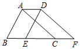
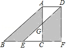
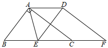
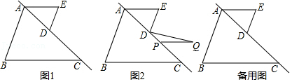
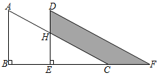

# 知识点·平移性质（同步练习）

> 教材：数学·七年级下册·沪科技版2024新教材 ｜ 来源：国家中小学智慧教育平台·在线练习 ｜ 共 5 题

## 1. 单选题（难度：适中）

如图，将周长为7的\(\triangle ABC\)​沿\(BC\)​方向平移2个单位得到\(△DEF\)​，则四边形\(ABFD\)​的周长为（　　）

- A. 16
- B. 9
- C. 11
- D. 12

【答案】C

【解析】​

## 2. 单选题（难度：简单）

如图，两个形状、大小完全相同的三角形\(ABC\)​和三角形\(DEF\)​重叠在一起，固定三角形\(ABC\)​不动，将三角形\(DEF\)​向右平移，当点\(E\)​和点\(C\)​重合时，停止移动，设\(DE\)​交\(AC\)​于\(G\)​．给出下列结论：

①四边形\(ABEG\)​的面积与\(CGDF\)​的面积相等；②\(AD//EC\)​，且\(AD=EC\)​，

则（　　）

- A. ①，②都正确
- B. ①正确，②错误
- C. ①，②都错误
- D. ①错误，②正确

【答案】B

【解析】​

## 3. 单选题（难度：简单）

如图，在三角形\(ABC\)​中，\(∠BAC=90°，AB=3cm，AC=4cm\)​，把三角形\(ABC\)​沿着直线\(BC\)​向右平移2.5cm后得到三角形\(DEF\)​，连接\(AE，AD\)​，有以下结论：

①\(AC//DF\)​； ②\(AD//CF\)​； ③\(CF=2.5\text{cm}\)​；④\(DE⊥AC\)​．其中正确的结论有（     ）

- A. 1个
- B. 2个
- C. 3个
- D. 4个

【答案】D

【解析】​

## 4. 

如图1，\(AB，BC\)​被直线\(AC\)​所截，点\(D\)​是线段\(AC\)​上的点，过点\(D\)​作\(DE//AB\)​，连接\(AE\)​，\(∠B=∠E=70°\)​．
​

请说明\(AE//BC\)​的理由．

将线段\(AE\)​沿着直线\(AC\)​平移得到线段\(PQ\)​，连接\(DQ\)​，如图2，当\(DE⊥DQ\)​时，求\(∠Q\)​的度数；

​​

【答案】

<latex class="math-tex">\(∵DE//AB，∴∠BAE+∠E=180°\)</latex>​，

<latex class="math-tex">\(∵∠B=∠E，∴∠BAE+∠B=180°\)</latex>​，

​​​<latex class="math-tex">\(∴AB//DE\)</latex>​

，

如图2，过<latex class="math-tex">\(D\)</latex>​作<latex class="math-tex">\(DF//AE\)</latex>​交<latex class="math-tex">\(AB\)</latex>​于<latex class="math-tex">\(F\)</latex>​，

<latex class="math-tex">\(∵PQ//AE，∴DF//PQ\)</latex>​，

<latex class="math-tex">\(∵∠E=70°，∴∠EDF=110°\)</latex>​，

<latex class="math-tex">\(∵DE⊥DQ，∴∠EDQ=90°\)</latex>​，

​​​<latex class="math-tex">\(∴∠FDQ=360°-110°-90°=160°\)</latex>​，

​​​<latex class="math-tex">\(∴∠DPQ+∠QDP=160°\)</latex>​，

<latex class="math-tex">\(∴∠Q=180°-160°=20°\)</latex>​

【解析】解析视频请查看最后一题。

​

## 5. 填空题（难度：适中）

如图，两个大小一样的直角三角形重叠在一起，将其中一个三角形沿着点\(B\)​到点\(C\)​的方向平移到三角形\(DEF\)​的位置，\(AB=10\)​，\(DH=4\)​，平移距离为8，则阴影部分的面积是．

【答案】64

【解析】​
