# 知识点·平行线基本事实（同步练习）

> 教材：数学·七年级下册·沪科技版2024新教材 ｜ 来源：国家中小学智慧教育平台·在线练习 ｜ 共 88 题

## 1. 单选题

图1是某品牌自行车放在水平地面的实物图，图2是其示意图，其中\( AB\)，\( CD\)都与地面l平行，\( \angle BAC=66°\)，\( \angle D=52°\)，要使\( AD\parallel BC\)，则\( \angle ACB\)的度数为（    ）

- A. \( 53°\)
- B. \( 62°\)
- C. \( 64°\)
- D. \( 38°\)

【答案】B

【解析】解：∵\( AB\)，\( CD\)都与地面l平行，
∴\( AB\parallel CD\)，
∴\( \angle ACD=\angle BAC=66°\)，
要使\( AD\parallel BC\)，则\( \angle D+\angle BCD=180°\)，
∴\( \angle BCD=180°-52°=128°\)，
∴\( \angle ACB=128°-66°=62°\)，
∴要使\( AD\parallel BC\)，\( \angle ACB\)的度数为\( 62°\)，
故选：B．

## 2. 单选题（难度：适中）

如图，已知OM∥a，ON∥a，所以点O、M、N三点共线的理由（　　）
 

- A. 三点确定一条直线
- B. 如果两条直线都与第三条直线平行，那么这两条直线重合
- C. 经过直线外一点，有且只有一条直线与这条直线平行
- D. 过三点可做一条直线与已知直线平行

【答案】C

【解析】解：∵OM∥a，ON∥a，且OM和ON都过点O，
∴理由是：经过直线外一点，有且只有一条直线与这条直线平行，
故选C．

## 3. 单选题（难度：适中）

（如图，在同一平面内，经过直线m外一点O的四条直线中，与直线m相交的直线最少有（    ）

- A. 1条
- B. 2条
- C. 3条
- D. 4条

【答案】C

【解析】解：根据经过直线外一点有且只有一条直线和已知直线平行，得出如果有和直线m平行的，只能是一条，
图中共计4条直线，则与直线m相交的直线至少有3条．
故选：C．

## 4. 单选题（难度：简单）

如图，在平面内作到直线m距离为5的平行线，可作平行线的条数有（    ）
 

- A. 0条
- B. 1条
- C. 2条
- D. 无数条

【答案】C

【解析】如图可知，作出的平行线分别在直线m的上方和下方各1条．

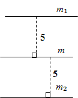
 
故选：C．

## 5. 单选题

如图将两张长方形纸片如图所示摆放，使小长方形纸片的一个顶点正好落在大长方形纸片的边上，测得\( \angle 1=35°\)，则\( \angle 2\)的度数为（    ）

- A. \( 45°\)
- B. \( 60°\)
- C. \( 35°\)
- D. \( 55°\)

【答案】D

【解析】解：如图，过点E作\( EF\text{∥}AB\)，

   
∵\( AB\text{∥}CD\)， 
∴\( AB\text{∥}CD\text{∥}EF\)． 
∵\( \angle 1=35°\)， 
∴\( \angle 4=\angle 1=35°\)， 
∴\( \angle 3=90°-35°=55°\)． 
∵\( AB\text{∥}EF\)， 
∴\( \angle 2=\angle 3=55°\)． 
故选：D．

## 6. 单选题

已知\( a\text{∥}b\)，将一个等腰直角三角板按图所示方式摆放．若\( \angle 2=30°\)，则\( \angle 1\)的度数为（    ）

- A. \( 10°\)
- B. \( 15°\)
- C. \( 20°\)
- D. \( 25°\)

【答案】B

【解析】过点\( C\)作\( CN\parallel a\)，
∴\( \angle 2=\angle 3\)，
∵\( a\text{∥}b\)，
∴\( b\parallel CN\)，
∴\( \angle 4=\angle 1\)，
∵\( △ABC\)是等腰直角三角形，
∴\( \angle ACB=45°\)，
∴\( \angle 3+4=45°\)，
∴\( \angle 1+\angle 2=45°\)，
∵\( \angle 2=30°\)，
∴\( \angle 1=15°\)．
故选：B．

## 7. 单选题

一副三角板如图所示摆放，若直线\( a\parallel b\)，则\( \angle 1\)的度数为（   ）

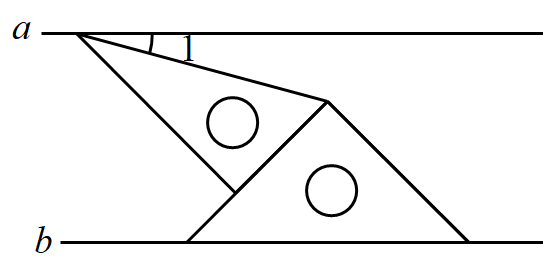

- A. \( 10°\)
- B. \( 15°\)
- C. \( 20°\)
- D. \( 25°\)

【答案】B

【解析】过点\( B\)作\( MN\parallel a\)，
∵\( a\parallel b\)，
∴\( MN\parallel a\parallel b\)，
∴\( \angle 1=\angle NBA\)，\( \angle NBE=\angle CEB\)，
∵\( △BEC\)是等腰直角三角形，
∴\( \angle BEC=45°\)，
∴\( \angle NBE=45°\)，
∵\( △ABF\)直角三角形，\( \angle ABF=60°\)，
∴\( \angle ABF=\angle ABN+\angle NBE=\angle 1+45°=60°\)，
∴\( \angle 1=15°\)，
故选：B．

## 8. 单选题

如图，直线\( {l}_{1}\text{∥}{l}_{2}\)，\( AB\perp {l}_{1}\)，垂足为\( C\)，\( BD\)与\( {l}_{2}\)相交于点\( E\)，若\( \angle \alpha =20°\)，则\( \angle B=\)（   ）.

- A. \( 100°\)
- B. \( 110°\)
- C. \( 70°\)
- D. \( 120°\)

【答案】B

【解析】解：过\( B\)点作\( BF\text{∥}{l}_{1}\)，

   
∵\( {l}_{1}\text{∥}{l}_{2}\)，
∴\( BF\text{∥}{l}_{1}\text{∥}{l}_{2}\)，
\( \therefore \angle DBF=\angle \alpha =20°\)，
\( \because AB\perp {l}_{1}\)，
\( \therefore AB\perp BF\)，
\( \therefore \angle CBF=90°\)，
\( \therefore \angle ABE=90°+20°=110°\)．
故选：B．

## 9. 单选题

如图，\( MN\text{∥}PQ\)，\( AB\)平分\( \angle MAC\)，\( CD\)平分\( \angle PDB\)，若\( 2\angle C-\angle B=60°\)，则\( \angle MAC\)的度数为（    ）

- A. \( 30°\)
- B. \( 40°\)
- C. \( 50°\)
- D. \( 60°\)

【答案】B

【解析】解：过点B作\( BE\text{∥}MN\)，过点C作\( CF\text{∥}PQ\)，
∵\( MN\text{∥}PQ\)，
∴\( MN\text{∥}BE\text{∥}CF\text{∥}PQ\)，
∴\( \angle MAB=\angle ABE\)，\( \angle MAC=\angle ACF\)，\( \angle EBD=\angle BDP\)，
∵\( AB\)平分\( \angle MAC\)，\( CD\)平分\( \angle PDB\)，
∴\( \angle MAB=\angle BAC=\frac{1}{2}\angle MAC\)，\( \angle PDC=\angle CDB=\frac{1}{2}\angle PDB\)，
∴\( \angle MAB=\angle BAC=\angle ABE\)，\( \angle PDC=\angle CDF=\angle DCF\)，
∵\( 2\angle ACD-\angle ABD=60°\)，
∴\( 2\left(\angle ACF+\angle DCF\right)-\left(\angle ABE+\angle DBE\right)=60°\)，
∴\( 2\angle MAC+2\angle PDC-\frac{1}{2}\angle MAC-\angle PDB=60°\)，
∴\( \frac{3}{2}\angle MAC+2\angle PDC-2\angle PDC=60°\)，
∴\( \frac{3}{2}\angle MAC=60°\)，
∴\( \angle MAC=40°\)，故B正确．
故选：B．

## 10. 单选题

如图，已知直线\( AB\text{∥}EF\)，\( AB\text{∥}CD\)，\( \angle ABE=50°\)，\( EC\) 平分\( \angle BEF\)，则\( \angle DCE\)的度数为（   ）

- A. \( 155°\)
- B. \( 145°\)
- C. \( 125°\)
- D. \( 105°\)

【答案】A

【解析】解：∵\( AB\parallel EF，\angle ABE=50°\)，
∴\( \angle ABE=\angle BEF=50°\)，
∵\( EC\)平分\( \angle BEF\)
∴\( \angle CEF=\frac{1}{2}\angle BEF=25°\)
∵\( AB\parallel EF，AB\parallel CD，\)
∴\( CD\parallel EF，\angle CEF+\angle DCE=180°，\)
∴\( \angle DCE=180°-25°=155°\)．
故选：A．

## 11. 单选题

如图，已知\( \angle 3=35°\)，\( \angle 2=140°\)，直线b平移后得到直线a，则\( \angle 1\)的度数为（    ）

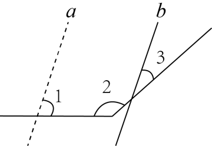

- A. 75°
- B. 70°
- C. 65°
- D. 60°

【答案】A

【解析】解：过点B作BC∥a，

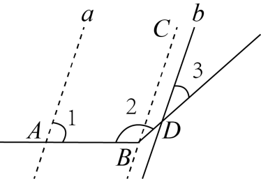
 
由平移的性质可知，a\( \text{∥}\)b，
∴BC\( \text{∥}\)b，
∴∠3=∠CBD=35°，
∵∠2=140°，
∴∠ABC=140°-35°=105°，
∵BC\( \text{∥}\)a，
∴∠ABC+∠1=180°，
∵∠1=180°-105°=75°，
故选：A．

## 12. 单选题（难度：适中）

如图，已知OM∥a，ON∥a，所以点O、M、N三点共线的理由（　　）
 

- A. 三点确定一条直线
- B. 如果两条直线都与第三条直线平行，那么这两条直线重合
- C. 经过直线外一点，有且只有一条直线与这条直线平行
- D. 过三点可做一条直线与已知直线平行

【答案】C

【解析】解：∵OM∥a，ON∥a，且OM和ON都过点O，
∴理由是：经过直线外一点，有且只有一条直线与这条直线平行，
故选C．

## 13. 单选题（难度：适中）

如图，是一个可折叠衣架，\( AB\)是地平线，当\( PM\parallel AB\)，\( PN\text{∥}AB\)时，就可以确定点\( N\)，\( P\)，\( M\)在同一直线上，这样判定的依据是（   ）

- A. 两点确定一条直线
- B. 同角的补角相等
- C. 平行于同一直线的两直线平行
- D. 过直线外一点有且只有一条直线与这条直线平行

【答案】D

【解析】解：∵\( PM\parallel AB\)，\( PN\text{∥}AB\)，
∴\( PM\text{∥}PN\)，
∵经过直线外一点，有且只有一条直线与已知直线平行，
∴点\( N\)，\( P\)，\( M\)在同一直线上，
故选：\( \text{D}\)．

## 14. 单选题

图1是某品牌自行车放在水平地面的实物图，图2是其示意图，其中\( AB\)，\( CD\)都与地面l平行，\( \angle BAC=66°\)，\( \angle D=52°\)，要使\( AD\parallel BC\)，则\( \angle ACB\)的度数为（    ）

- A. \( 53°\)
- B. \( 62°\)
- C. \( 64°\)
- D. \( 38°\)

【答案】B

【解析】解：∵\( AB\)，\( CD\)都与地面l平行，
∴\( AB\parallel CD\)，
∴\( \angle ACD=\angle BAC=66°\)，
要使\( AD\parallel BC\)，则\( \angle D+\angle BCD=180°\)，
∴\( \angle BCD=180°-52°=128°\)，
∴\( \angle ACB=128°-66°=62°\)，
∴要使\( AD\parallel BC\)，\( \angle ACB\)的度数为\( 62°\)，
故选：B．

## 15. 单选题（难度：简单）

如图，在平面内过点O作已知直线a的平行线和垂线，可作的条数分别是m条和n条，则\( m+n\)的值为（    ）

- A. 0条
- B. 1条
- C. 2条
- D. 无数条

【答案】C

【解析】解：\( \because \)在同一平面内，过直线外一点有且只有一条直线与已知直线平行，以及在同一平面内，过直线外一点有且只有一条直线与已知直线垂直，可知\( m=1\)，\( n=1\)，
\( \therefore m+n=2\)，
故选：C．

## 16. 单选题（难度：适中）

（如图，在同一平面内，经过直线m外一点O的四条直线中，与直线m相交的直线最少有（    ）

- A. 1条
- B. 2条
- C. 3条
- D. 4条

【答案】C

【解析】解：根据经过直线外一点有且只有一条直线和已知直线平行，得出如果有和直线m平行的，只能是一条，
图中共计4条直线，则与直线m相交的直线至少有3条．
故选：C．

## 17. 单选题（难度：简单）

如图，在平面内作到直线m距离为5的平行线，可作平行线的条数有（    ）
 
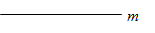

- A. 0条
- B. 1条
- C. 2条
- D. 无数条

【答案】C

【解析】如图可知，作出的平行线分别在直线m的上方和下方各1条．

 
故选：C．

## 18. 单选题

如图，已知直线\( AB\text{∥}EF\)，\( AB\text{∥}CD\)，\( \angle ABE=50°\)，\( EC\) 平分\( \angle BEF\)，则\( \angle DCE\)的度数为（   ）

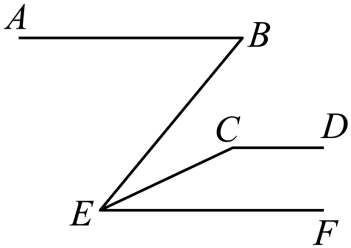

- A. \( 155°\)
- B. \( 145°\)
- C. \( 125°\)
- D. \( 105°\)

【答案】A

【解析】解：∵\( AB\parallel EF，\angle ABE=50°\)，
∴\( \angle ABE=\angle BEF=50°\)，
∵\( EC\)平分\( \angle BEF\)
∴\( \angle CEF=\frac{1}{2}\angle BEF=25°\)
∵\( AB\parallel EF，AB\parallel CD，\)
∴\( CD\parallel EF，\angle CEF+\angle DCE=180°，\)
∴\( \angle DCE=180°-25°=155°\)．
故选：A．

## 19. 单选题（难度：非常简单）

如图，在平面内作已知直线a的平行线，可作平行线的条数是(   )
   
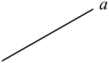

- A. 1条
- B. 2条
- C. 无数条
- D. 无法确定

【答案】C

【解析】解：在同一平面内与已知直线平行的直线有无数条，
∴在平面内作已知直线a的平行线，可作平行线的条数是无数条，
故选C．

## 20. 单选题

一副三角板如图所示摆放，若直线\( a\parallel b\)，则\( \angle 1\)的度数为（   ）

- A. \( 10°\)
- B. \( 15°\)
- C. \( 20°\)
- D. \( 25°\)

【答案】B

【解析】过点\( B\)作\( MN\parallel a\)，
∵\( a\parallel b\)，
∴\( MN\parallel a\parallel b\)，
∴\( \angle 1=\angle NBA\)，\( \angle NBE=\angle CEB\)，
∵\( △BEC\)是等腰直角三角形，
∴\( \angle BEC=45°\)，
∴\( \angle NBE=45°\)，
∵\( △ABF\)直角三角形，\( \angle ABF=60°\)，
∴\( \angle ABF=\angle ABN+\angle NBE=\angle 1+45°=60°\)，
∴\( \angle 1=15°\)，
故选：B．

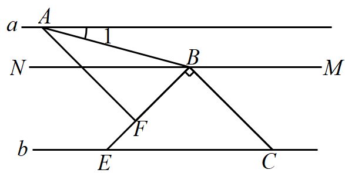

## 21. 单选题

已知\( a\text{∥}b\)，将一个等腰直角三角板按图所示方式摆放．若\( \angle 2=30°\)，则\( \angle 1\)的度数为（    ）

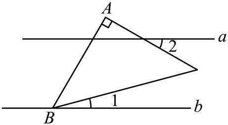

- A. \( 10°\)
- B. \( 15°\)
- C. \( 20°\)
- D. \( 25°\)

【答案】B

【解析】过点\( C\)作\( CN\parallel a\)，
∴\( \angle 2=\angle 3\)，
∵\( a\text{∥}b\)，
∴\( b\parallel CN\)，
∴\( \angle 4=\angle 1\)，
∵\( △ABC\)是等腰直角三角形，
∴\( \angle ACB=45°\)，
∴\( \angle 3+4=45°\)，
∴\( \angle 1+\angle 2=45°\)，
∵\( \angle 2=30°\)，
∴\( \angle 1=15°\)．
故选：B．

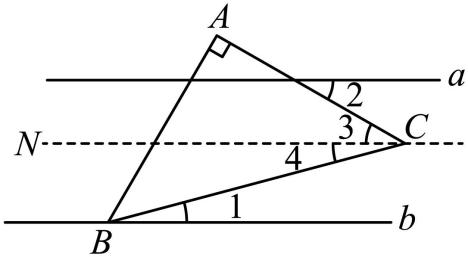

## 22. 单选题

如图，直线\( {l}_{1}\text{∥}{l}_{2}\)，\( AB\perp {l}_{1}\)，垂足为\( C\)，\( BD\)与\( {l}_{2}\)相交于点\( E\)，若\( \angle \alpha =20°\)，则\( \angle B=\)（   ）.

- A. \( 100°\)
- B. \( 110°\)
- C. \( 70°\)
- D. \( 120°\)

【答案】B

【解析】解：过\( B\)点作\( BF\text{∥}{l}_{1}\)，

   
∵\( {l}_{1}\text{∥}{l}_{2}\)，
∴\( BF\text{∥}{l}_{1}\text{∥}{l}_{2}\)，
\( \therefore \angle DBF=\angle \alpha =20°\)，
\( \because AB\perp {l}_{1}\)，
\( \therefore AB\perp BF\)，
\( \therefore \angle CBF=90°\)，
\( \therefore \angle ABE=90°+20°=110°\)．
故选：B．

## 23. 单选题

如图，\( MN\text{∥}PQ\)，\( AB\)平分\( \angle MAC\)，\( CD\)平分\( \angle PDB\)，若\( 2\angle C-\angle B=60°\)，则\( \angle MAC\)的度数为（    ）

- A. \( 30°\)
- B. \( 40°\)
- C. \( 50°\)
- D. \( 60°\)

【答案】B

【解析】解：过点B作\( BE\text{∥}MN\)，过点C作\( CF\text{∥}PQ\)，
∵\( MN\text{∥}PQ\)，
∴\( MN\text{∥}BE\text{∥}CF\text{∥}PQ\)，
∴\( \angle MAB=\angle ABE\)，\( \angle MAC=\angle ACF\)，\( \angle EBD=\angle BDP\)，
∵\( AB\)平分\( \angle MAC\)，\( CD\)平分\( \angle PDB\)，
∴\( \angle MAB=\angle BAC=\frac{1}{2}\angle MAC\)，\( \angle PDC=\angle CDB=\frac{1}{2}\angle PDB\)，
∴\( \angle MAB=\angle BAC=\angle ABE\)，\( \angle PDC=\angle CDF=\angle DCF\)，
∵\( 2\angle ACD-\angle ABD=60°\)，
∴\( 2\left(\angle ACF+\angle DCF\right)-\left(\angle ABE+\angle DBE\right)=60°\)，
∴\( 2\angle MAC+2\angle PDC-\frac{1}{2}\angle MAC-\angle PDB=60°\)，
∴\( \frac{3}{2}\angle MAC+2\angle PDC-2\angle PDC=60°\)，
∴\( \frac{3}{2}\angle MAC=60°\)，
∴\( \angle MAC=40°\)，故B正确．
故选：B．

## 24. 单选题

如图将两张长方形纸片如图所示摆放，使小长方形纸片的一个顶点正好落在大长方形纸片的边上，测得\( \angle 1=35°\)，则\( \angle 2\)的度数为（    ）

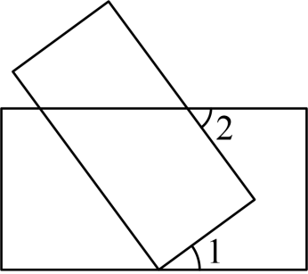

- A. \( 45°\)
- B. \( 60°\)
- C. \( 35°\)
- D. \( 55°\)

【答案】D

【解析】解：如图，过点E作\( EF\text{∥}AB\)，

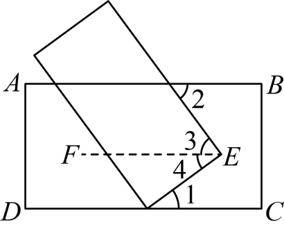
   
∵\( AB\text{∥}CD\)， 
∴\( AB\text{∥}CD\text{∥}EF\)． 
∵\( \angle 1=35°\)， 
∴\( \angle 4=\angle 1=35°\)， 
∴\( \angle 3=90°-35°=55°\)． 
∵\( AB\text{∥}EF\)， 
∴\( \angle 2=\angle 3=55°\)． 
故选：D．

## 25. 单选题

如图，已知\( \angle 3=35°\)，\( \angle 2=140°\)，直线b平移后得到直线a，则\( \angle 1\)的度数为（    ）

- A. 75°
- B. 70°
- C. 65°
- D. 60°

【答案】A

【解析】解：过点B作BC∥a，

 
由平移的性质可知，a\( \text{∥}\)b，
∴BC\( \text{∥}\)b，
∴∠3=∠CBD=35°，
∵∠2=140°，
∴∠ABC=140°-35°=105°，
∵BC\( \text{∥}\)a，
∴∠ABC+∠1=180°，
∵∠1=180°-105°=75°，
故选：A．

## 26. 单选题（难度：简单）

下列说法中正确的是（　　）

- A. 连接两点的线段叫两点的距离
- B. 绝对值等于它本身的有理数是0和1
- C. 过一点有且只有一条直线与已知直线平行
- D. 所有的有理数都能用数轴上的点表示

【答案】D

【解析】解：A、连接两点的线段的长度叫两点间的距离，故不符合题意；
B、绝对值等于它本身的有理数是0和正有理数，故不符合题意；
C、过直线外一点有且只有一条直线与已知直线平行，故不符合题意；
D、所有的有理数都能用数轴上的点表示，故符合题意．
故选：D．

## 27. 单选题（难度：简单）

下列说法中正确的是（　　）

- A. 过点P画线段AB的垂线
- B. P是直线外一点，Q是直线上一点，连接PQ，PQ⊥AB
- C. 过一点有且只有一条直线平行于已知直线
- D. 线段AB就是表示A，B两点间的距离

【答案】A

【解析】解：A、正确；
B、这种作法不一定垂直，错误；
C、必须强调过直线外一点，错误；
D、必须强调线段AB的长度，错误．
故选：A．

## 28. 单选题（难度：简单）

下列说法中可能错误的是（　　）

- A. 过直线外一点有且只有一条直线与已知直线平行
- B. 过一点有且只有一条直线与已知直线垂直
- C. 两条直线相交，有且只有一个交点
- D. 若两条直线相交成直角，则这两条直线互相垂直

【答案】B

【解析】解：A、过直线外一点有且只有一条直线与已知直线平行，故本选项正确；
B、应该是同一平面内，过一点有且只有一条直线与已知直线垂直，故本选项错误；
C、两条直线相交，有且只有一个交点，故本选项正确；
D、若两条直线相交成直角，则这两条直线互相垂直，直线垂直的定义，故本选项正确．
故选：B．

## 29. 单选题（难度：适中）

在同一平面内，下列说法：①过两点有且只有一条直线；②两条不相同的直线有且只有一个公共点；③经过直线外一点有且只有一条直线与已知直线垂直；④经过直线外一点有且只有一条直线与已知直线平行，其中正确的个数为（　　）

- A. 1个
- B. 2个
- C. 3个
- D. 4个

【答案】B

【解析】解：①过两点有且只有一条直线，正确；
②两条不相同的直线相交有且只有一个公共点，平行没有公共点，故本小题错误；
③在同一平面内，经过直线外一点有且只有一条直线与已知直线垂直，该说法错误；
④经过直线外一点有且只有一条直线与已知直线平行，正确，
综上所述，正确的有①④共2个．
故选：B．

## 30. 单选题（难度：简单）

下列说法正确的是（　　）

【答案】A

## 31. 单选题（难度：简单）

下列说法中，错误的是（　　）

【答案】A

## 32. 单选题（难度：简单）

下列说法正确的是（　　）

【答案】A

## 33. 单选题（难度：简单）

a、b、c是直线，下列说法正确的是（　　）

【答案】A

## 34. 单选题（难度：简单）

下列说法中正确的是（　　）

【答案】A

## 35. 单选题（难度：适中）

在同一平面内，下列说法正确的有（　　）
①若a与b相交，b与c相交，则a与c相交
②若a∥b，b与c相交（不重合），则a与c相交
③若a⊥b，b⊥c，则a⊥c
④若a∥b，b∥c，则a∥c．

- A. 1个
- B. 2个
- C. 3个
- D. 都不正确

【答案】B

【解析】解：①若a与b相交，b与c相交，则a与c相交或平行，故本小题错误；
②若a∥b，b与c相交（不重合），则a与c相交，正确；
③若a⊥b，b⊥c，则a∥c，故本小题错误；
④若a∥b，b∥c，则a∥c，正确；
综上所述，正确的有②④共2个．
故选：B．

## 36. 单选题（难度：适中）

以下说法：①过两点有且只有一条直线；②连接两点的线段叫做两点间的距离；③两点之间，线段最短；④若AB＝BC，则点B是线段AC的中点；⑤过直线外一点可作无数条直线与已知直线平行；⑥在同一平面内过一点有且只有一条直线与已知直线垂直．其中正确的有（　　）

【答案】A

## 37. 单选题（难度：非常简单）

a，b，c是三条直线，如果a∥b，b∥c，那么（　　）

【答案】A

## 38. 单选题（难度：适中）

下面语句中，正确的是（　　）
①不相交的两条直线叫做平行线；
②在同一平面内，两条直线的位置关系只有相交和平行两种；
③如果线段AB和线段CD不相交，那么直线AB和直线CD平行；
④如果a∥b，b∥c，那么a∥c．

- A. ②和④
- B. ①和②
- C. ②和③
- D. ①和④

【答案】A

【解析】解：①在同一平面内，不相交的两条直线叫平行线，故本选项错误；
②在同一平面内，两条直线的位置关系有两种：平行和相交，故本选项正确；
③在同一平面内，如果线段AB和线段CD不相交，那么直线AB和直线CD平行，故本选项错误；
④如果两条直线都与第三条直线平行，那么这两条直线也互相平行，故本选项正确．
故选：A．

## 39. 单选题（难度：简单）

下列说法中错误的是（　　）

- A. 如果a⊥b，b⊥c，那么a⊥c
- B. 如果a∥b，b∥c，那么a∥c
- C. 如果a＝b，b＝c，那么a＝c
- D. 如果a＞b，b＞c，那么a＞c

【答案】A

【解析】解：A、∵a⊥b，b⊥c，∴a∥c，故本选项错误，符合题意；
B、符合平行公理，故本选项正确，不符合题意；
C、属等量代换，故本选项正确，不符合题意；
D、符合不等式的性质，故本选项正确，不符合题意．
故选：A．

## 40. 单选题（难度：简单）

下列说法错误的是（　　）

【答案】A

## 41. 单选题（难度：非常简单）

在同一平面内，已知直线AB∥CD，直线CD∥EF，则直线AB于直线EF的位置关系是（　　）

【答案】A

## 42. 单选题（难度：简单）

下列说法不正确的是（　　）

【答案】A

## 43. 单选题（难度：适中）

下列四种说法中：①过一点有且只有一条直线与已知直线垂直；②相等的两个角一定是对顶角；③过一点有且只有一条直线与已知直线平行；④平行于同一直线的两条直线平行，其中正确的说法有（　　）

【答案】A

## 44. 单选题（难度：简单）

下列说法错误的是（　　）

【答案】A

## 45. 单选题（难度：适中）

下列说法中正确的是（　　）

- A. 平面内，过一点有且只有一条直线与已知直线平行
- B. 平面内，过一点有且只有一条直线与已知直线垂直
- C. 直线外一点到已知直线引垂线，点和垂足之间的垂线段叫做这个点到这条直线的距离
- D. 平面内，如果直线a与b相交，b与c相交，那么a与c相交

【答案】B

【解析】解：A、平面内，过直线外一点有且只有一条直线与已知直线平行，故不符合题意；
B、平面内，过一点有且只有一条直线与已知直线垂直，故符合题意；
C、直线外一点到已知直线引垂线，点和垂足之间的垂线段的长叫做这个点到这条直线的距离，故不符合题意；
D、平面内，如果直线a与b相交，b与c相交，那么a与c不一定相交，故不符合题意；
故选：B．

## 46. 单选题（难度：非常简单）

如果a∥b，a∥c，那么b∥c，推理依据是（　　）

【答案】A

## 47. 单选题（难度：适中）

下列说法正确的是（　　）

【答案】A

## 48. 单选题（难度：适中）

下列说法错误的个数是（　　）
①经过一点有且只有一条直线与已知直线平行；
②垂直于同一条直线的两条直线互相平行；
③直线外一点到这条直线的垂线段，叫做这个点到直线的距离；
④同一平面内不相交的两条直线叫做平行线．

- A. 1个
- B. 2个
- C. 3个
- D. 4个

【答案】C

【解析】解：①经过直线外一点有且只有一条直线与已知直线平行，故①错误；
②在同一平面内，垂直于同一条直线的两条直线互相平行，故②错误；
③直线外一点到这条直线的垂线段的长度，叫做这个点到直线的距离，故③错误；
④同一平面内不相交的两条直线叫做平行线，故④正确；
故选：C．

## 49. 单选题（难度：适中）

下列说法：①过两点有且只有一条直线；②两条直线不平行必相交；③过一点有且只有一条直线与已知直线垂直；④过一点有且只有一条直线与已知直线平行．⑤点到直线的距离是指这点到这条直线的垂线段．其中正确的有（　　）

【答案】A

## 50. 单选题（难度：非常简单）

如图，过C点作线段AB的平行线，说法正确的是（　　）

【答案】A

## 51. 单选题（难度：简单）

下列说法错误的是（　　）

- A. 在同一平面内，没有公共点的两条直线是平行线
- B. 如果两条直线都与第三条直线平行，那么这两条直线也互相平行
- C. 经过直线外一点有且只有一条直线与该直线平行
- D. 在同一平面内，不相交的两条线段是平行线

【答案】D

【解析】解；A、在同一平面内，没有公共点的两条直线是平行线．正确，本选项不符合题意；
B、如果两条直线都与第三条直线平行，那么这两条直线也互相平行．平行线具有“传递性”， 正确，本选项不符合题意；
C、经过直线外一点有且只有一条直线与该直线平行．正确，本选项不符合题意；
D、在同一平面内，不相交的两条直线是平行线．原说法错误，本选项符合题意．
故选：D．

## 52. 单选题（难度：简单）

下列说法正确的是（    ）

【答案】A

## 53. 单选题（难度：简单）

经过直线外一点，能画几条直线与这条直线平行（       ）

【答案】A

## 54. 单选题（难度：简单）

下列说法正确的是（　　）

【答案】A

## 55. 单选题（难度：简单）

下列说法错误的是（   ）

【答案】A

## 56. 单选题（难度：简单）

下列说法正确的有（   ）
①同位角相等：②对顶角相等；③过一点有且只有一条直线与已知直线平行；④在同一平面内，两条直线的位置关系有相交和平行两种．

- A. 1个
- B. 2个
- C. 3个
- D. 4个

【答案】B

【解析】解：同位角不一定相等，故①错误；
对顶角相等，故②正确；
在同一平面内，过直线外一点有且只有一条直线与已知直线平行，故③错误；
在同一平面内，两条直线的位置关系有相交和平行两种；故④正确；
故选B．

## 57. 单选题（难度：简单）

下列四个说法：①两点之间，线段最短；②连接两点之间的线段叫做这两点间的距离；③经过直线外一点，有且只有一条直线与这条直线平行；④角的边越长，角越大．其中正确的个数有（　　）

- A. ①②
- B. ①③
- C. ②③
- D. ②④

【答案】B

【解析】解：①两点之间，线段最短，正确；
②连接两点之间的线段叫做这两点间的距离，错误，应该是连接两点之间的线段的距离叫做这两点间的距离；
③经过直线外一点，有且只有一条直线与这条直线平行，正确；
④角的边越长，角越大．错误．角的大小和边的长度没有关系，应该是角的开口越大，角越大；
∴正确的有①③，
故选：B．

## 58. 单选题（难度：简单）

过直线外一点画与已知直线平行的直线（    ）

【答案】A

## 59. 单选题（难度：简单）

（1）用两根钉子固定一根木条，体现数学事实是两点之间线段最短；（2）射线$ \mathrm{A}\mathrm{B}$与射线$ \mathrm{B}\mathrm{A}$表示同一条射线；（3）若$ \mathrm{

【答案】A

## 60. 单选题（难度：简单）

经过一点<latex class="math-tex">\( \mathrm{A}$画已知直线$ \mathrm{a}$的平行线，能画（   ）

【答案】A

## 61. 单选题（难度：简单）

下列结论中，正确的是（   ）

【答案】A

## 62. 单选题（难度：简单）

下列说法不正确的是（　　）

【答案】A

## 63. 单选题（难度：简单）

下列说法正确的是（   ）

【答案】A

## 64. 单选题（难度：简单）

如图，在同一平面内，过点\( \mathrm{A}\)作直线\( \mathrm{m}\)的平行线，能画（    ）
 
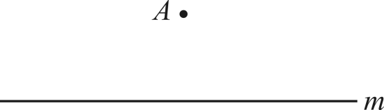

- A. 0条
- B. 1条
- C. 2条
- D. 无数条

【答案】B

【解析】解：根据“过直线外一点有且只有一条直线与已知直线平行”得：在同一平面内，过点\( \mathrm{A}\)作直线\( \mathrm{m}\)的平行线，只能画一条．
故选：B．

## 65. 单选题（难度：简单）

下列说法正确的是（　　）

- A. 如果两个角的和是\( 180°\)，那么这两个角互为余角
- B. 相等的角是对顶角
- C. 过一点有且只有一条直线与已知直线平行
- D. 同角或等角的余角相等

【答案】D

【解析】解：A、如果两个角的和是\( 180°\)，那么这两个角互为补角，此选项说法错误，不合题意；
B、相等的角不一定是对顶角，此选项说法错误，不合题意；
C、过直线外一点有且只有一条直线与已知直线平行，此选项说法错误，不合题意；
D、同角或等角的余角相等，此选项说法正确，符合题意；
故选：D

## 66. 单选题（难度：简单）

如图，点P为线段AB外一点，过点P作线段AB的平行线能作（    ）

【答案】A

## 67. 单选题（难度：简单）

如图，$ \mathrm{O}\mathrm{M}\parallel \mathrm{a}$，$ \mathrm{O}\mathrm{N}\parallel \mathrm{a}$，则$ \mathrm{O}\)<

【答案】A

## 68. 单选题（难度：简单）

如图，在同一平面内过点<latex class="math-tex">\( \mathrm{M}$且平行于直线$ \mathrm{a}$的直线有（    ）

【答案】A

## 69. 单选题（难度：简单）

如图，在平面内过点$ \mathrm{O}$作已知直线$ \mathrm{a}$的平行线，可作的条数为（    ）

【答案】A

## 70. 单选题（难度：简单）

如图，过点P作直线$ \mathrm{l}$的平行线，可作的平行线有（   ）

【答案】A

## 71. 单选题（难度：简单）

如图，在平面内过点A作直线$ \mathrm{m}\parallel \mathrm{l}$，可作平行线的条数（   ）

【答案】A

## 72. 单选题（难度：简单）

如图，在同一平面内过直线l外一点A作直线l的平行线，可作平行线的条数有（    ）

【答案】A

## 73. 单选题（难度：简单）

如图，已知OM∥a，ON∥a，所以点O、M、N三点共线的理由（　　）

【答案】A

## 74. 单选题（难度：简单）

下列结论中，正确的是（    ）

- A. 单项式m的次数是1，系数是0
- B. 单项式\( \mathrm{a}{\mathrm{b}}^{2}\)与单项式\( 3{\mathrm{a}}^{2}\mathrm{b}\)是同类项
- C. 过一点有且只有一条直线与已知直线平行
- D. 把弯曲的公路改直，就能缩短路程的根据是“两点之间，线段最短”

【答案】D

【解析】解：A、单项式m的次数是1，系数是1，本选项不符合题意；
B、单项式\( \mathrm{a}{\mathrm{b}}^{2}\)与单项式\( 3{\mathrm{a}}^{2}\mathrm{b}\)，相同字母的指数不同，不是同类项，本选项不符合题意；
C、在同一平面内，过直线外一点有且只有一条直线与已知直线平行，本选项不符合题意；
D、把弯曲的公路改直，就能缩短路程的根据是“两点之间，线段最短”，本选项符合题意；
故选：D．

## 75. 单选题（难度：简单）

如图，已知P是直线l外一点，若\( PA\parallel l\)，\( PB\parallel l\)，则\( P\)，\( A\)，\( B\)三点在同一条直线上．其依据是（   ）
  
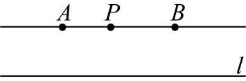

- A. 两点确定一条直线
- B. 两点之间，线段最短
- C. 在同一平面内，过一点有且只有一条直线与已知直线垂直
- D. 过直线外一点有且只有一条直线与这条直线平行

【答案】D

【解析】解：P是直线l外一点，若\( \mathrm{P}\mathrm{A}\parallel \mathrm{l}\)，\( \mathrm{P}\mathrm{B}\parallel \mathrm{l}\)，则\( P\)，\( A\)，\( B\)三点在同一条直线上．其依据是过直线外一点有且只有一条直线与这条直线平行，
故选：D

## 76. 单选题（难度：简单）

下列说法正确的是（    ）
①在同一平面内，两条不重合的直线只有平行或相交这两种位置关系；
②过直线外一点有且只有一条直线与已知直线平行；
③平行于同一直线的两条直线互相平行；
④直线外一点到这条直线的垂线段叫做点到直线的距离．

- A. ①②③
- B. ①②③④
- C. ②④
- D. ②③

【答案】A

【解析】解：①在同一平面内，两条不重合的直线只有平行或相交这两种位置关系，说法正确；
②过直线外一点有且只有一条直线与已知直线平行，说法正确；
③平行于同一直线的两条直线互相平行，说法正确；
④直线外一点到这条直线的垂线段的长度叫做点到直线的距离，说法错误；
综上分析可知，①②③正确．
故选：A．

## 77. 单选题（难度：简单）

如图，在同一平面内，经过直线m外一点O的四条直线中，与直线m相交的直线最少有（    ）
 
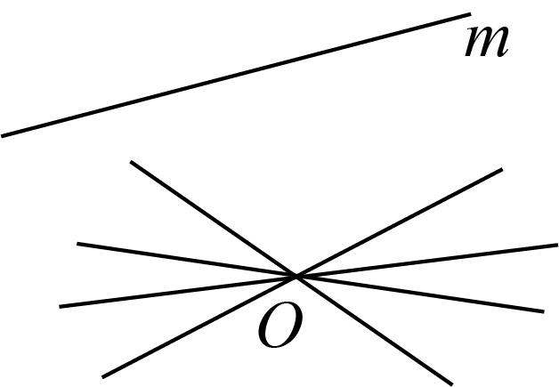

- A. 1条
- B. 2条
- C. 3条
- D. 4条

【答案】C

【解析】解：根据经过直线外一点有且只有一条直线和已知直线平行，得出如果有和直线m平行的，只能是一条，
图中共计4条直线，则与直线m相交的直线至少有3条．
故选：C．

## 78. 单选题（难度：简单）

已知，P是任意一点，过点P画一条直线与$ \mathrm{B}\mathrm{C}$平行，则这样的直线（　　）

【答案】A

## 79. 单选题（难度：简单）

如图，\( \mathrm{M}\mathrm{C}\text{∥}\mathrm{A}\mathrm{B}\)，\( \mathrm{N}\mathrm{C}\text{∥}\mathrm{A}\mathrm{B}\)，则点M，C，N在同一条直线上，理由是：（    ）
  
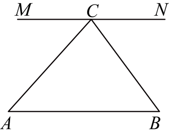

- A. 两点确定一条直线
- B. 在同一平面内，过直线外一点有且只有一条直线与已知直线垂直
- C. 平行于同一条直线的两条直线平行
- D. 过直线外一点有且只有一条直线与已知直线平行

【答案】D

【解析】解∶ \( \mathrm{M}\mathrm{C}\text{∥}\mathrm{A}\mathrm{B}\)，\( \mathrm{N}\mathrm{C}\text{∥}\mathrm{A}\mathrm{B}\)，则点M，C，N在同一条直线上，理由是：过直线外一点有且只有一条直线与已知直线平行．
故选∶D．

## 80. 单选题（难度：简单）

如图，在平面内作已知直线a的平行线，可作平行线的条数是(   )

【答案】A

## 81. 单选题（难度：简单）

如图，是一个可折叠衣架，AB是地平线，当$ \mathrm{P}\mathrm{M}\parallel \mathrm{A}\mathrm{B}$，$ \mathrm{P}\mathrm{N}\parallel \mathrm{A}\mathrm{B}$时，就可以

【答案】A

## 82. 单选题（难度：简单）

如图是一个可折叠衣架，$ \mathrm{A}\mathrm{B}$是地平线，当$ \mathrm{P}\mathrm{M}\parallel \mathrm{A}\mathrm{B}$，$ \mathrm{P}\

【答案】A

## 83. 单选题（难度：简单）

下列说法：①两点之间的所有连线中，线段最短． ②在数轴上与表示－1的点距离是3的点表示的数是2 ；③ 相等的角是对顶角；④过一点有且仅有一条直线与已知直线平行；⑤若AC=BC，则点C是线段AB的中点，其中错误的有（  ）

【答案】A

## 84. 单选题（难度：简单）

经过直线<latex class="math-tex">\( \mathrm{a}$外一点$ \mathrm{P}$的5条不同的直线中，与直线$ \mathrm{a}$相交的直线至少有（　　）

【答案】A

## 85. 单选题（难度：简单）

如图，在直线\( \mathrm{l}\)外任取一点\( \mathrm{Q}\)，过点\( \mathrm{Q}\)画直线\( \mathrm{l}\)的平行线，可画出的平行线有（    ）

- A. 0条
- B. 1条
- C. 2条
- D. 无数条

【答案】B

【解析】解：过直线\( \mathrm{l}\)外一点\( \mathrm{Q}\)画直线\( \mathrm{l}\)的平行线，只能画一条，
故选：B．

## 86. 单选题（难度：简单）

如图，在平面内作到直线m距离为5的平行线，可作平行线的条数有（    ）

【答案】A

## 87. 单选题（难度：简单）

如图，点P是直线AB外一点，过点P分别作$ \mathrm{C}\mathrm{P}\text{∥}\mathrm{A}\mathrm{B}$，$ \mathrm{P}\mathrm{D}\text{∥}\mathrm{A}\mathrm{B}$，则点C、P、D三

【答案】A

## 88. 单选题（难度：简单）

如图，$ \mathrm{P}\mathrm{C}\parallel \mathrm{A}\mathrm{B}$，$ \mathrm{Q}\mathrm{C}\parallel \mathrm{A}\mathrm{B}$，则点P，C，Q在一条直线上，理由是（

【答案】A
