# 知识点·平行线的性质（同步练习）

> 教材：数学·七年级下册·沪科技版2024新教材 ｜ 来源：国家中小学智慧教育平台·在线练习 ｜ 共 24 题

## 1. 单选题（难度：适中）

如图，把一块含有45°的直角三角形的两个顶点放在直尺的对边上．如果\(∠1=20°\)​，那么\(∠2\)​的度数是（　　）。

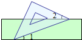

- A. 15°
- B. 20°
- C. 25°
- D. 30°

【答案】C

【解析】​

## 2. 填空题（难度：简单）

如图，已知\(AB//CD\)​，\(∠B=60°\)​，则∠1的度数是。

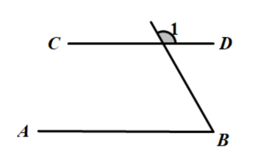

【答案】120&deg;

【解析】​

## 3. 填空题（难度：适中）

如图，把一张长方形纸片\(ABCD\)​沿\(EF\)​折叠，若\(∠EFG=52°\)​，则\(∠AEG\)​的度数是．

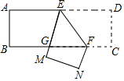

【答案】76&deg;

【解析】​

## 4. 单选题（难度：适中）

如图，\(ABCD\)​为一长条形纸带，\(AB//CD\)​，将\(ABCD\)​沿EF折叠，\(A、D\)​两点分别与\(A'、D'\)​对应，若\(∠1=2∠2\)​，则\(∠AEF\)​的度数为（　　）。

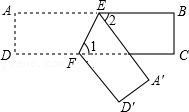

- A. 60°
- B. 65°
- C. 72°
- D. 75°

【答案】C

【解析】​

## 5. 填空题（难度：适中）

如图，直线\(l//m\)​，将含有45°角的三角板\(ABC\)​的直角顶点\(C\)​放在直线\(m\)​上，则\(∠1+∠2\)​的度数为．

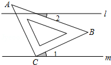

【答案】45&deg;

【解析】​

## 6. （难度：适中）

如图，\(AB//CD\)​，\(∠BEC\)​的平分线交\(CD\)​于点\(F\)​，若\(∠MEB=52°\)​，求\(∠EFC\)​的度数。

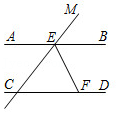

【答案】

​​​<latex class="math-tex">\(∵∠MEB=52°\)</latex>​，<latex class="math-tex">\(∴∠BEC=180°-52°=128°\)</latex>​；

​​​<latex class="math-tex">\(∵EF\)</latex>​平分<latex class="math-tex">\(∠BEC\)</latex>​，​$∴∠BEF=\frac {1} {2}∠BEC=64°$​；

又<latex class="math-tex">\(∵AB//CD\)</latex>​，

<latex class="math-tex">\(∴∠EFC=∠BEF=64°\)</latex>​

【解析】​

## 7. （难度：适中）

已知：如图，\(EF\)​平分\(∠DEB\)​，\(AC//DE，CD//EF\)​，请证明：\(CD\)​平分\(∠ACB\)​。

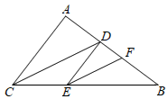

【答案】

<latex class="math-tex">\(∵AC//DE，∴∠ACD=∠CDE\)</latex>​，

​<latex class="math-tex">\(∵CD//EF，∴∠DCB=∠FEB，∠CDE=∠DEF\)</latex>​，

​<latex class="math-tex">\(∴∠ACD=∠DEF\)</latex>​，

又<latex class="math-tex">\(∵EF\)</latex>​平分<latex class="math-tex">\(∠DEB\)</latex>​，​

​​​​<latex class="math-tex">\(∴∠DEF=∠FEB\)</latex>​，​

​​​​<latex class="math-tex">\(∴∠ACD=∠DCB\)</latex>​，

​​​<latex class="math-tex">\(∴CD\)</latex>​平分<latex class="math-tex">\(∠ACB\)</latex>​。

【解析】​

## 8. 

如图1，\(AB//CD\)​，在\(AB、CD\)​内有一条折线\(EPF\)​。
​
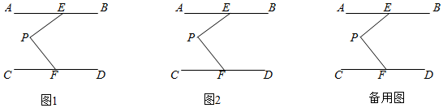

求证：\(∠AEP+∠CFP=∠EPF\)​；

在图2中，画\(∠BEP\)​的平分线与\(∠DFP\)​的平分线，两条角平分线交于点\(Q\)​，请你补全图形，试探索\(∠EPF\)​与\(∠EQF\)​之间的关系，并证明你的结论。​

【答案】

如图1，过点<latex class="math-tex">\(P\)</latex>​作<latex class="math-tex">\(PG//AB\)</latex>​，

，

​​​<latex class="math-tex">\(∵AB//CD\)</latex>​，

​​​<latex class="math-tex">\(∴PG//CD\)</latex>​，

​​​<latex class="math-tex">\(∴∠AEP=∠1，∠CFP=∠2\)</latex>​，

又<latex class="math-tex">\(∵∠1+∠2=∠EPF\)</latex>​，

​​​<latex class="math-tex">\(∴∠AEP+∠CFP=∠EPF\)</latex>​；

，

如图2，

，

由（1）可得：<latex class="math-tex">\(∠EPF=∠AEP+CFP\)</latex>​，<latex class="math-tex">\(∠EQF=∠BEQ+∠DFQ\)</latex>​，

​​​<latex class="math-tex">\(∵∠BEP\)</latex>​的平分线与<latex class="math-tex">\(∠DFP\)</latex>​的平分线相交于点<latex class="math-tex">\(Q\)</latex>​，​​​​​

​<latex class="math-tex">\(∴∠EQF=∠BEQ+∠DFQ=\frac {1} {2}\left ( {∠BEP+∠DFP} \right )=\frac {1} {2}[360°-\left ( {∠AEP+∠CFP} \right )]=\frac {1} {2}\left ( {360°-∠EPF} \right )\)</latex>，

​​​<latex class="math-tex">\(∴∠EPF+2∠EQF=360°\)</latex>​。

【解析】解析视频请查看最后一题。

​

## 9. 单选题（难度：简单）

两条直线被第三条直线所截，若∠1与∠2是同旁内角，且∠1＝70°，则（　　）。

- A. ∠2＝70°
- B. ∠2＝110°
- C. ∠2＝70°或∠2＝110°
- D. ∠2的度数不能确定

【答案】D

【解析】​

## 10. 单选题（难度：简单）

如图，若\(AB//CD\)​，\(BC//DE\)​，\(∠B=70°\)​，则\(∠D\)​的大小为（　　）。

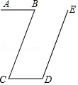

- A. 35°
- B. 70°
- C. 110°
- D. 140°

【答案】C

【解析】​

## 11. 单选题（难度：适中）

如图，直线\(AB//CD//EF\)​，点\(O\)​在直线\(EF\)​上，下列结论正确的是（　　）。

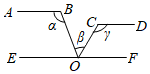

- A. \(∠α+∠β-∠γ=90°\)​
- B. \(∠α+∠γ-∠β=180°\)​
- C. \(∠γ+∠β-∠α=180°\)​
- D. \(∠α+∠β+∠γ=180°\)​

【答案】B

【解析】​

## 12. 单选题（难度：适中）

一条公路修到湖边时，需拐弯绕道而过，第一次拐弯\(∠A\)​的度数为\(α\)​，第二次拐弯\(∠B\)​的度数为\(β\)​，到了点\(C\)​后需要继续拐弯，拐弯后与第一次拐弯之前的道路平行，则\(∠C\)​的度数为（　　）。

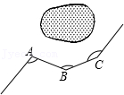

- A. \(α-β\)​
- B. \(180°-β+α\)​
- C. \(360°-β-α\)​
- D. \(β-α\)​

【答案】B

【解析】​

## 13. 填空题（难度：简单）

如图，一只因损坏而倾斜的椅子，从背后看到的形状如图，其中两组对边的平行关系没有发生变化，若∠1＝75°，则∠2的大小是。

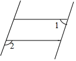

【答案】105&deg;

【解析】​

## 14. （难度：适中）

解答下列问题：

如图，已知\(∠ABC\)​，画一个角\(∠DEF\)​，使\(DE//AB，EF//BC\)​，且\(DE\)​交\(BC\)​于点\(P\)​。探究：\(∠ABC\)​与\(∠DEF\)​分别有怎样的数量关系？并选择一种情况说明理由。

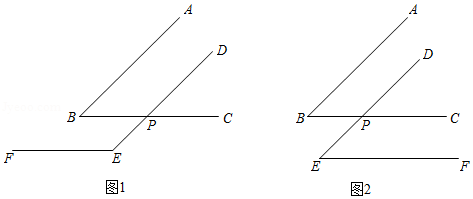
    
图1中\(∠ABC\)​与\(∠DEF\)​数量关系为；
图2中\(∠ABC\)​与\(∠DEF\)​数量关系为。
选择一种情况说明理由：

由（1）你得出的结论是。

若两个角的两边互相平行，且一个角比另一个角的2倍少30°，直接写出这两个角的度数。

【答案】<latex class="math-tex">\(∠ABC+∠DEF=180°\)</latex>/<latex class="math-tex">\(∠ABC=∠DEF\)</latex>，如果两个角的两边互相平行，那么这两个角相等或互补。，

30&deg;，30&deg;或70&deg;，110&deg;。

【解析】解析视频请查看最后一题。

解析视频请查看最后一题。

​

## 15. 填空题（难度：适中）

如图，一副三角板\(GEF\)​和\(HEF\)​按如图所示放置，过\(E\)​的直线\(AB\)​与过\(F\)​的直线\(CD\)​相互平行，若\(∠CFG=72°\)​，则​​​\(∠BEH=\)​°．

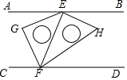

【答案】27

【解析】​

## 16. 单选题（难度：适中）

小林乘车进入车库时仔细观察了车库门口的“曲臂直杆道闸”，并抽象出如图所示的模型，已知\(AB\)​垂直于水平地面\(AE\)​．当车牌被自动识别后，曲臂直杆道闸的\(BC\)​段绕点\(B\)​缓慢向上旋转，\(CD\)​段则一直保持水平状态上升（即\(CD\)​与\(AE\)​始终平行），在该过程中\(\angle ABC+\angle BCD\)​始终等于（    ）。

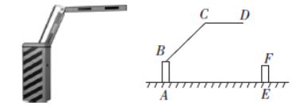

- A. \(360°\)​
- B. \(180°\)​
- C. \(250°\)​
- D. \(270°\)​

【答案】D

【解析】​

## 17. 填空题

欢欢观察“抖空竹”时发现，可以将某一时刻的情形抽象成数学问题：如图，已知\(AB//CD\)​，\(∠BAE=92°，∠DCE=115°\)​，则\(∠E\)​的度数是°。

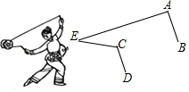

【答案】23

【解析】​

## 18. 单选题（难度：适中）

如图，将三角板与直尺贴在一起，使三角板的直角顶点​​​\(C(∠ACB=90°)\)​在直尺的一边上，若∠2＝65°，则∠1的度数是（　　）。

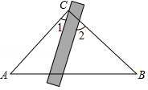

- A. 15°
- B. 25°
- C. 35°
- D. 65°

【答案】B

【解析】​

## 19. 单选题（难度：适中）

如图，将一张矩形纸片折叠，若∠1＝70°，则∠2的度数是（　　）。

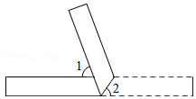

- A. 65°
- B. 55°
- C. 70°
- D. 40°

【答案】B

【解析】​

## 20. （难度：适中）

如图，将一张上、下两边平行（即\(AB//CD\)​）的纸带沿直线\(MN\)​折叠，\(EF\)​为折痕。
​
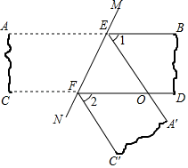

试说明∠1＝∠2；

已知∠2＝40°，求\(∠BEF\)​的度数。​

【答案】

​​​<latex class="math-tex">\(∵AB//CD，∴∠MEB=∠MFD\)</latex>​，

​​​<latex class="math-tex">\(∵A'E//C'F\)</latex>​，

​​​<latex class="math-tex">\(∴∠MEA'=∠MFC'\)</latex>​，

​​​<latex class="math-tex">\(∴∠MEA'-∠MEB=∠MFC'-∠MFD\)</latex>​，

即∠1＝∠2；

，

由折叠知，<latex class="math-tex">\(∠C'FN\)</latex>​​${\rm{ = }}\frac{{{{180}^ \circ }{\rm{ - }}\angle 2}}{2}{\rm{ = }}{70^ \circ }$，

<latex class="math-tex">\(∵A'E//C'F，∴∠A'EN=∠C'FN=70°\)</latex>​，

​​​<latex class="math-tex">\(∵∠1=∠2\)</latex>​，

​​​<latex class="math-tex">\(∴∠BEF=70°+40°=110°\)</latex>​。

【解析】解析视频请查看最后一题。

​

## 21. 填空题（难度：适中）

将一副直角三角板如图摆放，点\(D\)​落在\(AB\)​边上，\(BC//DE\)​，则∠1＝°。

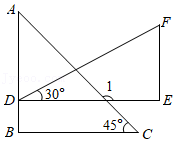

【答案】135

【解析】​

## 22. 

已知：如图，点\(C\)​在\(∠AOB\)​的一边\(OA\)​上，过点\(C\)​的直线\(DE//OB\)​，\(CF\)​平分\(∠ACD\)​，\(CG⊥CF\)​于\(C\)​。
​
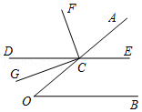

若\(∠O=40°\)​，求\(∠ECF\)​的度数；

求证：\(CG\)​平分\(∠OCD\)​​；

当\(∠O\)​为多少度时，\(CD\)​平分\(∠OCF\)​，并说明理由。​

【答案】

<latex class="math-tex">\(∵DE//OB，∴∠O=∠ACE\)</latex>​，（两直线平行，同位角相等）​

​<latex class="math-tex">\(∵∠O=40°，∴∠ACE=40°\)</latex>​，

​​​​​<latex class="math-tex">\(∵∠ACD+∠ACE=180°\)</latex>​，（平角定义）​​​​​

​<latex class="math-tex">\(∴∠ACD=140°\)</latex>​，

又<latex class="math-tex">\(∵CF\)</latex>​平分<latex class="math-tex">\(∠ACD\)</latex>​，

​<latex class="math-tex">\(∴∠ACF=70°\)</latex>​，（角平分线定义）​​

<latex class="math-tex">\(∴∠ECF=70°+40°=110°\)</latex>​

，

证明：<latex class="math-tex">\(∵CG⊥CF，∴∠FCG=90°\)</latex>​，

​​​<latex class="math-tex">\(∴∠DCG+∠DCF=90°\)</latex>​，

又<latex class="math-tex">\(∵∠AOC=180°\)</latex>​，（平角定义）

​​​<latex class="math-tex">\(∴∠GCO+∠FCA=90°\)</latex>​，

<latex class="math-tex">\(∵∠ACF=∠DCF，∴∠GCO=∠GCD\)</latex>​，（等角的余角相等）

即<latex class="math-tex">\(CG\)</latex>​平分<latex class="math-tex">\(∠OCD\)</latex>​。 

，

结论：当<latex class="math-tex">\(∠O=60°\)</latex>​时，<latex class="math-tex">\(CD\)</latex>​平分<latex class="math-tex">\(∠OCF\)</latex>​。

当<latex class="math-tex">\(∠O=60°\)</latex>​时，

​​​<latex class="math-tex">\(∵DE//OB\)</latex>​，

​​​<latex class="math-tex">\(∴∠DCO=∠O=60°\)</latex>​。

​​​<latex class="math-tex">\(∴∠ACD=120°\)</latex>​。

又<latex class="math-tex">\(∵CF\)</latex>​平分<latex class="math-tex">\(∠ACD\)</latex>​，

​​​<latex class="math-tex">\(∴∠DCF=60°\)</latex>​，

​​​<latex class="math-tex">\(∴∠DCO=∠DCF\)</latex>​，

即<latex class="math-tex">\(CD\)</latex>​平分<latex class="math-tex">\(∠OCF\)</latex>​。

【解析】解析视频请查看最后一题。

解析视频请查看最后一题。

​

## 23. 单选题（难度：简单）

如图，直线l与直线\(a、b\)​分别相交，且\(a//b，∠1=110°\)​，则∠2的度数是（　　）。

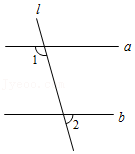

- A. 20°
- B. 70°
- C. 90°
- D. 110°

【答案】B

【解析】​

## 24. （难度：适中）

如图，已知射线​​​\(AB\)​与直线​​​\(CD\)​交于点​​​\(O\)​，​​​\(OF\)​平分​​​\(∠BOC\)​，​​​\(AE//DC\)​，且​​​\(∠A=65°\)​，求​​​\(∠DOF\)​。

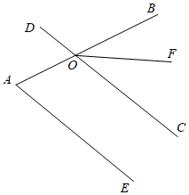

【答案】

147.5°

【解析】​​​

​​ ​
