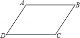
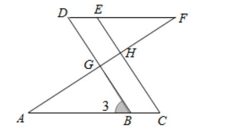
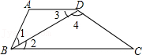
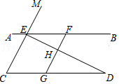
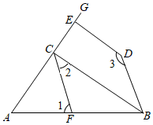
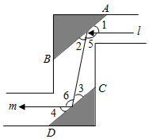

# 知识点·平行线的性质与判定（同步练习）

> 教材：数学·七年级下册·沪科技版2024新教材 ｜ 来源：国家中小学智慧教育平台·在线练习 ｜ 共 6 题

## 1. 填空题（难度：简单）

已知：如图，\(AB//CD，∠A=∠C，∠B=50°\)​，则​​​\(∠C=\)​，​​​\(∠D=\)​．

【答案】130&deg;，50&deg;

【解析】​

## 2. 填空题（难度：适中）

已知：如图，\(DB⊥AF\)​于点\(G\)​，\(EC⊥AF\)​于点\(H\)​，\(∠C=∠D\)​．求证：\(∠A=∠F\)​．
证明：\(∵DB⊥AF\)​于点\(G\)​，\(EC⊥AF\)​于点\(H\)​（已知），
​​​\(∴∠DGH=∠EHF=90°\)​（）．
​​​\(∴DB//EC\)​（）．
​​​\(∴∠C=\)​（）．
​​​\(∵∠C=∠D\)​（已知），
​​​\(∴∠D=\)​（）．
​​​\(∴DF//AC\)​（）．
​​​\(∴∠A=∠F\)​（）．

【答案】垂直的定义；，同位角相等，两直线平行；，<latex class="math-tex">\(∠3\)</latex>，两直线平行，同位角相等；，<latex class="math-tex">\(∠3\)</latex>，等量代换；，内错角相等，两直线平行；，两直线平行，内错角相等．

【解析】​

## 3. 单选题（难度：适中）

如图，有下列判定，其中正确的有（　　）。

①若∠1＝∠3，则\(AD//BC\)​；

②若\(AD//BC\)，则∠1＝∠2＝∠3；

③若∠1＝∠3，\(AD//BC\)，则∠1＝∠2；

④若∠C+∠3+∠4＝180°，则\(AD//BC\)．

- A. 1个
- B. 2个
- C. 3个
- D. 4个

【答案】B

【解析】​

## 4. 

如图，已知点\(E、F\)​在直线\(AB\)​上，点\(G\)​在线段\(CD\)​上，\(ED\)​与\(FG\)​交于点\(H\)​，\(∠C=∠EFG，∠CED=∠GHD\)​．
​

求证：\(CE//GF\)​；

试判断\(∠AED\)​与\(∠D\)​之间的数量关系，并说明理由；

若\(∠EHF=80°，∠D=30°\)​，求\(∠AEM\)​的度数．​

【答案】

​​​<latex class="math-tex">\(∵∠CED=∠GHD\)</latex>​，

​​​<latex class="math-tex">\(∴CE//GF\)</latex>​；

，

​​​<latex class="math-tex">\(∠AED+∠D=180°\)</latex>​；

理由：<latex class="math-tex">\(∵CE//GF，∴∠C=∠FGD\)</latex>​，

又<latex class="math-tex">\(∵∠C=∠EFG，∴∠FGD=∠EFG\)</latex>​，

​​​<latex class="math-tex">\(∴AB//CD\)</latex>​，

​​​<latex class="math-tex">\(∴∠AED+∠D=180°\)</latex>​

，

​​​<latex class="math-tex">\(∵∠GHD=∠EHF=80°，∠D=30°\)</latex>​，

​​​<latex class="math-tex">\(∴∠CGF=80°+30°=110°\)</latex>​，

又<latex class="math-tex">\(∵CE//GF\)</latex>​，

​​​<latex class="math-tex">\(∴∠C=180°-110°=70°\)</latex>​，

又<latex class="math-tex">\(∵AB//CD\)</latex>​，

​​​<latex class="math-tex">\(∴∠AEC=∠C=70°\)</latex>​，

​​​​​<latex class="math-tex">\(∴∠AEM=180°-70°=110°\)</latex>​．

【解析】解析视频请查看最后一题。

解析视频请查看最后一题。

​

## 5. 

如图，已知\(BC⊥AE，DE⊥AE，∠2+∠3=180°\)​．
​

请你判断∠1与\(∠ABD\)​的数量关系，并说明理由；

若\(∠1=70°\)​，\(BC\)​平分\(∠ABD\)​，试求\(∠ACF\)​的度数．​

【答案】

​​​<latex class="math-tex">\(∠1=∠ABD\)</latex>​，

理由：<latex class="math-tex">\(∵BC⊥AE，DE⊥AE\)</latex>​，

​​​<latex class="math-tex">\(∴BC//DE\)</latex>​，

​​​<latex class="math-tex">\(∴∠3+∠CBD=180°\)</latex>​，

又<latex class="math-tex">\(∵∠2+∠3=180°\)</latex>​，

​​​<latex class="math-tex">\(∴∠2=∠CBD\)</latex>​，

​​​<latex class="math-tex">\(∴CF//DB\)</latex>​，

​​​<latex class="math-tex">\(∴∠1=∠ABD\)</latex>​．

，

​​​<latex class="math-tex">\(∵∠1=70°，CF//DB\)</latex>​，

​​​<latex class="math-tex">\(∴∠ABD=70°\)</latex>​，

又<latex class="math-tex">\(∵BC\)</latex>​平分<latex class="math-tex">\(∠ABD\)</latex>​，

​​​​<latex class="math-tex">\(∴∠DBC=\frac {1} {2}∠ABD=35°\)</latex>​​ ​​，

​​​<latex class="math-tex">\(∴∠2=∠DBC=35°\)</latex>​，

又<latex class="math-tex">\(∵BC⊥AG\)</latex>​，

​​​<latex class="math-tex">\(∴∠ACF=90°-∠2=90°-35°=55°\)</latex>​．

【解析】解析视频请查看最后一题。

​

## 6. （难度：适中）

如图是潜望镜工作原理示意图，阴影部分是平行放置在潜望镜里的两面镜子．已知光线经过镜子反射时，有\(∠1=∠2，∠3=∠4\)​，请解释进入潜望镜的光线l为什么和离开潜望镜的光线\(m\)​是平行的？

【答案】

<latex class="math-tex">\(∵AB//CD，∴∠2=∠3\)</latex>​，

<latex class="math-tex">\(∵∠1=∠2，∠3=∠4，∴∠1=∠2=∠3=∠4\)</latex>​，

​​​<latex class="math-tex">\(∴180°-∠1-∠2=180°-∠3-∠4\)</latex>​，

即<latex class="math-tex">\(∠5=∠6\)</latex>​，

​​​<latex class="math-tex">\(\therefore l//m\)</latex>​，

所以，进入潜望镜的光线l和离开潜望镜的光线<latex class="math-tex">\(m\)</latex>​是平行的．

【解析】​
