# 知识点·平行线的概念（同步练习）

> 教材：数学·七年级下册·沪科技版2024新教材 ｜ 来源：国家中小学智慧教育平台·在线练习 ｜ 共 52 题

## 1. 单选题（难度：简单）

同一平面内不重合的两条直线的位置关系有（　　）

- A. 相交、垂直
- B. 相交、平行
- C. 垂直、平行
- D. 相交、垂直、平行

【答案】B

【解析】解：同一平面内的两直线只有相交与平行两种位置关系．
故选：B．

## 2. 单选题（难度：适中）

下列说法中正确的是（　　）

- A. 不相交的两条直线叫做平行线
- B. 把弯曲的河道改直，能够缩短航程，这是由于两点之间，线段最短
- C. 射线AB与射线BA是同一条射线
- D. 线段AB叫做A、B两点间的距离

【答案】B

【解析】解：对于选项A，根据平行线的定义得：在同一平面内，不相交的两条直线叫做平行线，
因此选项A不正确，故不符合题意；
对于选项B，把弯曲的河道改直，能够缩短航程，这是由于两点之间，线段最短，
因此选项B正确，故符合题意；
对于选项C，射线AB的端点是点A，射线BA的端点是B，因此射线AB与射线BA不是同一条射线，
因此选项C不正确，故不符合题意；
对于选项D，线段AB的长度叫做A、B两点间的距离，
因此选项D不正确，故不符合题意．
故选：B．

## 3. 单选题

下列说法正确的是（　　）

- A. 30°角的补角度数是60°
- B. 两条直线被第三条直线所截，所得的同位角相等
- C. 相等的两个角是对顶角
- D. 在同一平面内两条直线的位置关系有相交和平行两种

【答案】D

【解析】解：A、30°角的补角度数是150°，原说法错误，故此选项不符合题意；
B、两条直线被第三条直线所截，所得的同位角不一定相等，原说法错误，故此选项不符合题意；
C、相等的两个角不一定是对顶角，原说法错误，故此选项不符合题意；
D、在同一平面内两条直线的位置关系有相交和平行两种，原说法正确，故此选项符合题意．
故选：D．

## 4. 单选题（难度：适中）

下列说法中，正确的是（　　）

- A. 两条不相交的直线叫做平行线
- B. 一条直线的平行线有且只有一条
- C. 在同一平面内，若直线a∥b，a∥c，则b∥c
- D. 若两条线段不相交，则它们互相平行

【答案】C

【解析】解：A、平行线的定义：在同一平面内，两条不相交的直线叫做平行线．故错误；
B、过直线外一点，有且只有一条直线与已知直线平行．一条直线的平行线有无数条，故错误；
C、在同一平面内，平行于同一直线的两条直线平行．故正确；
D、根据平行线的定义知是错误的．
故选：C．

## 5. 单选题（难度：适中）

下列说法正确的是（　　）

- A. 同一个平面内，不相交的两条线段是平行线
- B. 同一个平面内，两条直线不相交就重合
- C. 同一个平面内，没有公共点的两条直线是平行线
- D. 不相交的两条直线是平行线

【答案】C

【解析】解：A、应该是不相交的两条直线，故错误；
B、还有平行的情况，故错误；
C、正确；
D、应该是在同一平面内，故错误．
故选：C．

## 6. 单选题（难度：简单）

下列说法正确的是（　　）

- A. 具有公共顶点的两个角是对顶角
- B. A、B两点之间的距离就是线段AB
- C. 两点之间，线段最短
- D. 不相交的两条直线叫做平行线

【答案】C

【解析】解：A．具有公共顶点的两个角不一定是对顶角，故本选项错误；
B．A、B两点之间的距离就是线段AB的长，故本选项错误；
C．两点之间，线段最短，故本选项正确；
D．在同一平面内，不相交的两条直线叫做平行线，故本选项错误；
故选：C．

## 7. 单选题（难度：适中）

在长方体中，对任意一条棱，与它平行的棱共有（　　）

- A. 1条
- B. 2条
- C. 3条
- D. 4条

【答案】C

【解析】解：由题意知，在长方体中，对任意一条棱，与它平行的棱共有3条，
故选：C．

## 8. 单选题（难度：适中）

下列说法中正确的是（　　）

- A. 直线外一点到这条直线的垂线段，叫点到直线的距离
- B. 不相交的两条直线叫平行线
- C. 平面内，过一点有且只有一条直线与已知直线垂直
- D. 相等的两个角是对顶角

【答案】C

【解析】解：A、直线外一点到这条直线的垂线段的长度，叫点到直线的距离，故本选项错误；
B、在同一平面内，不相交的两条直线叫平行线，故本选项错误；
C、过一点有且只有一条直线与已知直线垂直，正确；
D、相等的两个角两边不一定互为反向延长线，所以不一定是对顶角，故本选项错误．
故选：C．

## 9. 单选题（难度：适中）

下列说法不正确的是（　　）

- A. 过任意一点可作已知直线的一条平行线
- B. 同一平面内两条不相交的直线是平行线
- C. 在同一平面内，过直线外一点只能画一条直线与已知直线垂直
- D. 平行于同一直线的两直线平行

【答案】A

【解析】解：A中，若点在直线上，则不可以作出已知直线的平行线，而是与已知直线重合，错误．
B、C、D正确．
故选：A．

## 10. 单选题（难度：适中）

下列说法正确的是（　　）

- A. 不相交的两条直线叫做平行线
- B. 同一平面内，过一点有且仅有一条直线与已知直线垂直
- C. 平角是一条直线
- D. 过同一平面内三点中任意两点，只能画出3条直线

【答案】B

【解析】解：A．应强调在同一平面内，错误；
B．同一平面内，过一点有且仅有一条直线与已知直线垂直，正确；
C．直线与角是不同的两个概念，错误；
D．过同一平面内三点中任意两点，能画出3条直线或1条直线，故错误．
故选：B．

## 11. 单选题

下列语句正确的有（　　）个
①任意两条直线的位置关系不是相交就是平行
②过一点有且只有一条直线和已知直线平行
③过两条直线a，b外一点P，画直线c，使c∥a，且c∥b
④若直线a∥b，b∥c，则c∥a．

- A. 4
- B. 3
- C. 2
- D. 1

【答案】D

【解析】解：①任意两条直线的位置关系不是相交就是平行，说法错误，应为根据同一平面内，任意两条直线的位置关系不是相交就是平行；
②过一点有且只有一条直线和已知直线平行，说法错误，应为过直线外一点有且只有一条直线和已知直线平行；
③过两条直线a，b外一点P，画直线c，使c∥a，且c∥b，只有a∥b时才能画出，故说法错误；
④若直线a∥b，b∥c，则c∥a，说法正确；
故选：D．

## 12. 单选题（难度：适中）

下列说法正确的是（　　）

- A. 两点之间，直线最短
- B. 不相交的两条直线叫做平行线
- C. 在同一平面内，过一点有且只有一条直线与已知直线垂直
- D. 直线外一点到这条直线的垂线段叫做点到直线的距离

【答案】C

【解析】解：A．两点之间，线段最短，故A不符合题意．
B．在同一平面内，不相交的两条直线叫做平行线，故B不符合题意．
C．在同一平面内，过一点有且只有一条直线与已知直线垂直，故C符合题意．
D．直线外一点到这条直线的垂线段的长度，叫做点到直线的距离，故D不符合题意．
故选：C．

## 13. 单选题（难度：简单）

在同一平面内，不重合的两条直线的位置关系是（　　）

- A. 平行
- B. 相交
- C. 平行或相交
- D. 平行、相交或垂直

【答案】C

【解析】解：在同一平面内，不重合的两条直线只有两种位置关系，是平行或相交，
所以在同一平面内，不重合的两条直线的位置关系是：平行或相交．
故选：C．

## 14. 单选题（难度：适中）

下列说法中正确的个数为（　　）
①不相交的两条直线叫做平行线；
②在同一平面内，过一点有且只有一条直线与已知直线垂直；
③从直线外一点到这条直线的垂线段，叫做这点到直线的距离；
④两条直线被第三条直线所截，同位角相等．

- A. 0个
- B. 1个
- C. 2个
- D. 3个

【答案】B

【解析】解：由题意知，在同一平面内，不相交的两条直线叫做平行线，①错误，故不符合要求；
在同一平面内，过一点有且只有一条直线与已知直线垂直，②正确，故符合要求；
从直线外一点到这条直线的垂线段的长度，叫做这点到直线的距离，③错误，故不符合要求；
两条平行直线被第三条直线所截，同位角相等，④错误，故不符合要求；
故选：B．

## 15. 单选题（难度：非常简单）

在长方体ABCD﹣ABCD中，下列棱中，既与棱CC₁异面又与棱BC平行的是（　　）

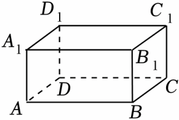

- A. 棱AD
- B. 棱AB
- C. 棱AA₁
- D. 棱A₁B₁

【答案】A

【解析】解：观察图象可知，既与棱CC₁异面又与棱BC平行的是A₁D₁，AD．
故选：A．

## 16. 单选题（难度：非常简单）

如图，在正方体ABCD﹣EFGH中，下列各棱与棱AB平行的是（　　）

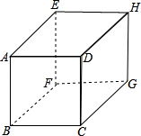

- A. BC
- B. CG
- C. EH
- D. HG

【答案】D

【解析】解：结合图形可知，与棱AB平行的棱有CD，EF，GH．
故选：D．

## 17. 单选题（难度：适中）

下列说法正确的有（　　）
①同位角相等；
②若∠A+∠B+∠C＝180°，则∠A、∠B、∠C互补；
③同一平面内的三条直线a、b、c，若a∥b，c与a相交，则c与b相交；
④同一平面内两条直线的位置关系可能是平行或垂直；
⑤有公共顶点并且相等的角是对顶角．

- A. 1个
- B. 2个
- C. 3个
- D. 4个

【答案】A

【解析】解：∵同位角不一定相等，∴①错误；
∵互补或互余是两个角之间的关系，∴说∠A+∠B+∠C＝180°，则∠A、∠B、∠C互补错误，∴②错误；
∵同一平面内的三条直线a、b、c，若a∥b，c与a相交，则c与b相交，∴③正确；
∵同一平面内两条直线的位置关系可能是平行或相交，∴④错误；
∵如图，

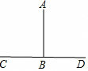
  
∠ABC＝∠ABD，∠ABC和∠ABD有公共顶点并且相等的角，但不是对顶角，∴⑤错误；
即正确的个数是1个，
故选：A．

## 18. 单选题（难度：简单）

如图，将一张长方形纸对折两次，产生的折痕与折痕之间的位置关系是（　　）

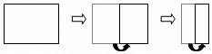

- A. 平行
- B. 垂直
- C. 平行或垂直
- D. 无法确定

【答案】A

【解析】解：观察图形可知，将一张长方形纸对折两次，产生的折痕与折痕之间的位置关系是平行．
故选：A．

## 19. 单选题（难度：非常简单）

如图，经过直线l外一点A画l的平行线，能画出（　　）

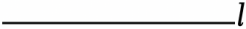

- A. 0条
- B. 1条
- C. 2条
- D. 无数条

【答案】B

【解析】解：经过直线l外一点A画l的平行线，能画出1条平行线，
故选：B．

## 20. 单选题（难度：适中）

下列说法中正确的是（　　）

- A. 若a⊥b，b⊥c，则a⊥c
- B. 在同一平面内，不相交的两条线段必平行
- C. 两条直线被第三条直线所截，所得的同位角相等
- D. 两条平行线被第三条直线所截，一对内错角的角平分线互相平行

【答案】D

【解析】解：（1）∵a⊥b，b⊥c，∴a∥c，故A选项错误；
（2）两条不相交的直线必平行，但是线段的长是有限的，故不相交的两条线段不一定平行，故B选项错误；
（3）只有两条平行的直线被第三条直线所截，所得的同位角才相等，故C选项错误；
（4）如图：

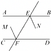
   
∵AB∥CD，∴∠BEF＝∠CFE．
∵EN平分∠BEF，FM平分∠CFE，
∴∠NEF\( =\frac{1}{2}\)∠BEF，∠MFE\( =\frac{1}{2}\)∠CFE，
∴∠NEF＝∠MFE，∴EN∥FM．故D选项正确；
故选：D．

## 21. 单选题（难度：简单）

下列说法正确的是（　　）

- A. 不相交的两条线段是平行线
- B. 不相交的两条直线是平行线
- C. 不相交的两条射线是平行线
- D. 在同一平面内，不相交的两条直线是平行线

【答案】D

【解析】解：根据平行线的定义：在同一平面内，不相交的两条直线是平行线．
A，B，C错误；D正确；
故选：D．

## 22. 单选题

下列说法正确的是（　　）

- A. 在同一平面内，a，b，c是直线，且a∥b，b∥c，则a∥c
- B. 在同一平面内，a，b，c是直线，且a⊥b，b⊥c，则a⊥c
- C. 在同一平面内，a，b，c是直线，且a∥b，b⊥c，则a∥c
- D. 在同一平面内，a，b，c是直线，且a∥b，b∥c，则a⊥c

【答案】A

【解析】解：先根据要求画出图形，图形如图所示：

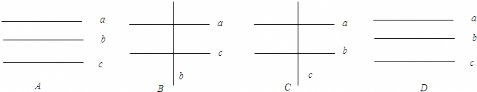
  
根据所画图形可知：A正确．
故选：A．

## 23. 单选题

下列说法中正确的个数为（　　）
①不相交的两条直线叫做平行线
②平面内，过一点有且只有一条直线与已知直线垂直
③平行于同一条直线的两条直线互相平行
④在同一平面内，两条直线不是平行就是相交．

- A. 1个
- B. 2个
- C. 3个
- D. 4个

【答案】C

【解析】解：①不相交的两条直线叫做平行线必须是在同一个平面内才能成立，故错误．
②平面内，过一点有且只有一条直线与已知直线垂直是正确的．
③平行于同一条直线的两条直线互相平行，正确．
④在同一平面内，两条直线不是平行就是相交是正确的．
故选：C．

## 24. 单选题（难度：适中）

下列说法正确的是（　　）

- A. 垂直于同一直线的两条直线平行
- B. 在同一平面内，不相交的两条线段是平行线
- C. 两条射线或线段平行是指它们所在的直线平行
- D. 一条直线有可能同时与两条相交直线平行

【答案】C

【解析】解：A． 在同一平面内垂直于同一直线的两条直线平行，错误； 
B． 在同一平面内，不相交的两条直线是平行线，错误；
C、两条射线或线段平行是指它们所在的直线平行，正确；
D、一条直线不能同时与两条相交直线平行，错误；
故选：C．

## 25. 单选题（难度：适中）

下列哪种情况下，直线a与b不一定是平行线（　　）

- A. 在同一平面内，a与b是不相交的两条直线
- B. a与b被直线c所截，且内错角互补
- C. a与b都平行于直线c
- D. a与b被直线c所截，且同位角相等

【答案】B

【解析】解：A、在同一平面内，不相交的两条直线叫平行线，故本选项错误；
B、因为内错角相等，两直线才平行，故本选项正确；
C、因为平行于同一直线的两直线平行，故本选项错误；
D、因为同位角相等，两直线平行，故本选项错误；
故选：B．

## 26. 单选题（难度：适中）

若a⊥b，c⊥d，则a与c的关系是（　　）

- A. 平行
- B. 垂直
- C. 相交
- D. 以上都不对

【答案】D

【解析】解：当b∥d时a∥c；
当b和d相交但不垂直时，a与c相交；
当b和d垂直时，a与c垂直；
a和c可能平行，也可能相交，还可能垂直，
故选：D．

## 27. 单选题

下列说法中，正确的个数有（　　）
（1）在同一平面内不相交的两条线段必平行
（2）在同一平面内不相交的两条直线必平行
（3）在同一平面内不平行的两条线段必相交
（4）在同一平面内不平行的两条直线必相交

- A. 1个
- B. 2个
- C. 3个
- D. 4个

【答案】B

【解析】解：（1）线段不相交，延长后不一定不相交，错误；
（2）同一平面内，直线只有平行或相交两种位置关系，正确；
（3）线段是有长度的，不平行也可以不相交，错误；
（4）同（2），正确；
所以（2）（4）正确．
故选：B．

## 28. 单选题（难度：简单）

在同一平面内有三条直线，若其中有两条且只有两条直线平行，则这三条直线交点的个数为（　　）

- A. 0个
- B. 1个
- C. 2个
- D. 3个

【答案】C

【解析】解：根据题意，第三条直线与这两条平行直线各有一个交点．
故选：C．

## 29. 单选题（难度：适中）

在同一平面内，一条直线与另两条平行线的关系是（　　）

- A. 一定与两条平行线都平行
- B. 可能与两条平行线中的一条平行、一条相交
- C. 一定与两条平行线相交
- D. 与两条平行线都平行或都相交

【答案】D

【解析】解：∵在同一平面内，两条直线的位置关系有两种：平行和相交，
∴如果一条直线与另两条平行线中的一条相交，则它与另一条平行线也相交，否则与平行公理相矛盾；
如果一条直线与另两条平行线中的一条平行，根据平行于同一直线的两条直线平行，则它与另一条平行线也平行．
故选：D．

## 30. 单选题（难度：简单）

同一平面内有三条直线，如果只有两条平行，那么它们交点的个数为（　　）

- A. 0
- B. 1
- C. 2
- D. 3

【答案】C

【解析】解：根据题意，第三条直线与这两条平行直线各有一个交点．
故选：C．

## 31. 单选题（难度：简单）

下列说法中，错误的是（　　）

- A. 邻补角的角平分线互相垂直
- B. 平行于同一直线的两条直线互相平行
- C. 在同一平面内不相交的两条直线一定平行
- D. 经过一点有且只有一条直线与已知直线平行

【答案】D

【解析】解：A、邻补角的角平分线互相垂直，说法正确；
B、平行于同一直线的两条直线互相平行，说法正确；
C、在同一平面内不相交的两条直线一定平行，说法正确；
D、经过一点有且只有一条直线与已知直线平行，说法错误，应为经过直线外一点，经过一点有且只有一条直线与已知直线平行．
故选：D．

## 32. 单选题（难度：适中）

下列四个说法：①射线有一个端点，它能够度量长度；②连接两点之间的直线的长度叫做这两点间的距离；③经过直线外一点，有且只有一条直线与这条直线平行；④直线外一点与直线上各点连接的所有线段中，垂线段最短．其中正确的是（　　）

- A. ①②
- B. ②③
- C. ②④
- D. ③④

【答案】D

【解析】解：①线段的长度能够度量，而直线、射线的长度不可能度量；故①错误；
②连接两点之间的线段的长度叫做这两点间的距离；故②错误；
③在同一平面内，经过直线外一点，有且只有一条直线与这条直线平行；故③正确；
④根据垂线段的定理判断：直线外一点与直线上各点连接的所有线段中，垂线段最短．故④正确；
综上所述，正确的说法是③④；
故选：D．

## 33. 单选题

下列说法正确的有（　　）个．
①不相交的两条直线是平行线；②在同一平面内，两条不相交的线段是平行线；③过一点可以而且只可以画一条直线与已知直线平行；④如果一条直线与两条平行线中的一条平行，那么它与另一条直线也互相平行．

- A. 1
- B. 2
- C. 3
- D. 4

【答案】A

【解析】解：因为在同一平面内，两条不相交的直线是平行线，故①②错误；
③过直线外一点可以而且只可以画一条直线与已知直线平行；故此选项错误，
根据平行公理及推论，可得④正确．则正确的有1个．
故选：A．

## 34. 单选题（难度：适中）

下列说法中，正确的个数有（　　）
①同一平面内，不相交的两条直线是平行线；②在同一平面内，两条不相交的线段是平行线；
③过一点可以而且只可以画一条直线与已知直线平行；④一条直线有无数条平行线；
⑤过直线外一点可以作无数条直线与已知直线平行．

- A. 0个
- B. 1个
- C. 2个
- D. 3个

【答案】C

【解析】解：①同一平面内，不相交的两条直线是平行线，符合平行线的定义，正确；
②因为线段有端点，所以有长短，不相交也不一定平行，故在同一平面内，两条不相交的线段不一定是平行线，故本小题错误；
③应为过直线外一点可以而且只可以画一条直线与已知直线平行，故本小题错误；
④一条直线有无数条平行线，正确；
⑤过直线外一点有且只有一条直线与已知直线平行，故本小题错误．
所以正确的有①④两个．
故选：C．

## 35. 单选题（难度：简单）

下列生活实例中；①交通道口的斑马线；②天上的彩虹；③体操的纵队；④百米跑道线；⑤火车的平直铁轨线．其中属于平行线的有（　　）

- A. 1个
- B. 2个
- C. 3个
- D. 4个

【答案】D

【解析】解：属于平行线的有：①③④⑤．
故选：D．

## 36. 单选题（难度：简单）

下列生活实例中：①交通道路上的斑马线；②天上的彩虹；③百米跑道线；④一段平直的火车铁轨线．其中属于平行线的有（　　）

- A. 1个
- B. 2个
- C. 3个
- D. 4个

【答案】C

【解析】解：属于平行线的有：①③④，共3个，
故选：C．

## 37. 单选题（难度：适中）

如果线段AB与线段CD没有交点，则（　　）

- A. 线段AB与线段CD一定平行
- B. 线段AB与线段CD一定不平行
- C. 线段AB与线段CD可能平行
- D. 以上说法都不正确

【答案】C

【解析】解：A、线段AB与线段CD不一定平行，有可能相交，故本选项错误；
B、线段AB与线段CD不一定不平行，有可能平行，故本选项错误；
C、线段AB与线段CD可能平行，故本选项正确；
D、以上说法都不正确，也不对，故本选项错误；
故选：C．

## 38. 单选题

平行线是指（　　）

- A. 两条不相交的直线
- B. 两条延长后仍不相交的直线
- C. 同一平面内两条不相交的直线
- D. 以上都不对

【答案】C

【解析】解：在同一平面内，不相交的两条直线叫平行线，
故选：C．

## 39. 单选题（难度：适中）

下列语句：①一条直线有且只有一条垂线；②不相等的两个角一定不是对顶角；③在同一平面内，两条不相交的直线叫做平行线；④若两个角的一对边在同一直线上，另一对边互相平行，则这两个角相等；⑤不在同一直线上的四个点可画6条直线；⑥三条直线两两相交，一定有三个交点，其中错误的是（　　）

- A. 2个
- B. 3个
- C. 4个
- D. 5个

【答案】C

【解析】解：①一条直线有无数条垂线，故①错误；
②不相等的两个角一定不是对顶角，故②正确；
③在同一平面内，两条不相交的直线叫做平行线，故③正确；
④若两个角的一对边在同一直线上，另一对边互相平行，则这两个角相等或互补，故④错误；
⑤不在同一直线上的四个点可画4或6条直线，故⑤错误；
⑥三条直线两两相交，有一个或三个交点，故⑥错误．
所以错误的有4个．
故选：C．

## 40. 单选题（难度：简单）

下列说法不正确的是（　　）

- A. 平面内两条不相交的直线叫做平行线
- B. 一条直线的平行线有且只有一条
- C. 过直线外一点能画一条直线与已知直线平行
- D. 同一平面，过直线外一点能画一条直线与已知直线垂直

【答案】B

【解析】解：A、平面内两条不相交的直线叫做平行线，此选项正确；
B、一条直线的平行线无数条，此选项错误；
C、过直线外一点能画一条直线与已知直线平行，此选项正确；
D、过直线外一点能画一条直线与已知直线垂直，此选项正确；
故选：B．

## 41. 单选题（难度：非常简单）

下列表示方法正确的是（　　）

- A. a∥A
- B. AB∥cd
- C. A∥B
- D. a∥b

【答案】D

【解析】解：一条直线可以用两个大写字母或者一个小写字母表示，据此可排除A、B、C，故选：D．

## 42. 单选题（难度：简单）

在同一平面内，直线l₁，l₂相交于点O，又l₃∥l₂，则直线l₁和l₃的位置关系是（　　）

- A. 平行
- B. 相交
- C. 垂直
- D. 平行或垂直

【答案】B

【解析】解：因为l₃∥l₂，直线l₁与l₂相交，所以直线l₁和l₃也有交点；
故选：B．

## 43. 单选题（难度：适中）

长方形有（　　）组平行线．

- A. 1
- B. 2
- C. 3
- D. 4

【答案】B

【解析】解；两组对边分别相等的四边形是平行四边形，有一个角是直角的平行四边形是矩形，
故选：B．

## 44. 单选题（难度：适中）

在同一平面内，下列说法正确的是（　　）

- A. 不相交的两条直线平行
- B. 不相交的两条射线平行
- C. 不相交的两条线段平行
- D. 一条射线和一条直线不平行就相交

【答案】A

【解析】解：A、在同一平面内，不相交的两条直线一定平行．故本选项正确；
B、在同一平面内，不相交的两条射线不一定平行，如图：

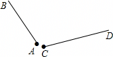
 
射线AB与射线CD既不相交，也不平行．故本选项错误；
C、在同一平面内，线段不相交，延长后不一定不相交．故本选项错误；
D、在同一平面内，一条射线和一条直线不平行时，也不一定相交，故本选项错误；
故选：A．

## 45. 单选题（难度：简单）

在如图的几何体中，上下底面都是平行四边形，各个侧面都是梯形，那么图形中与AB平行的线段有（　　）

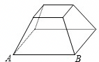

- A. 1条
- B. 2条
- C. 3条
- D. 4条

【答案】C

【解析】解：如图，与AB平行的线段有：CD、A′B′、C′D′共3条．
故选：C．

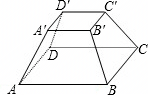

## 46. 单选题（难度：适中）

在同一平面内，不相邻的两个直角，如果它们只有一条边在同一直线上，那么它们的另一边互相（　　）

- A. 平行
- B. 垂直
- C. 平行或垂直
- D. 平行或相交

【答案】A

【解析】解：如图所示：

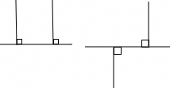
  
因为只有一条边在一条直线上，另一条边要么平行，要么共线，而共线的情况也是在一条直线上，与题意矛盾，所以只能是平行．
故选：A．

## 47. 单选题（难度：简单）

如图所示的两条平行直线用符号表示正确的是（　　）

【答案】A

## 48. 单选题（难度：非常简单）

下列四边形中，AB不平行于CD的是（　　）

- A. 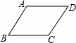
- B. 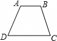
- C. 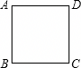
- D. 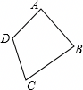

【答案】D

【解析】解：因为A、B、C都是特殊的四边形，正确；
故选：D．

## 49. 单选题（难度：简单）

下列说法正确的是（　　）

- A. 不相交的两条直线是平行线
- B. 在同一平面内，两条平行的直线有且只有一个交点
- C. 在同一平面内，两条直线的位置关系只有平行和相交两种
- D. 过一点有且只有一条直线与已知直线平行

【答案】C

【解析】解：A、不相交的两条直线是平行线，错误，应强调在同一平面内．
B、在同一平面内，两条平行的直线有且只有一个交点，错误，在同一平面内，两条平行的直线没有交点．
C、正确．
D、过一点有且只有一条直线与已知直线平行，错误，过直线外一点有且只有一条直线与已知直线平行．
故选：C．

## 50. 单选题（难度：简单）

下列说法错误的是（　　）

- A. 在同一平面内，两条不平行的直线是相交线
- B. 与同一条直线平行的直线必平行
- C. 与同一条直线相交的直线必相交
- D. 过直线外一点有且只有一条直线平行于已知直线

【答案】C

【解析】解：A、在同一平面内，两条不平行的直线是相交线，符合平行、相交定义故说法正确；
B、与同一条直线平行的直线必平行，符合平行公理，故说法正确；
C、与同一条直线相交的直线必相交，不一定，如两条平行线可与第三条直线相交，故说法错误；
D、过直线外一点有且只有一条直线平行于已知直线，符合平行线定理，故说法正确．
故选：C．

## 51. 单选题（难度：简单）

下列说法中，正确的是（　　）

- A. 两条直线的位置关系只有相交，平行两种
- B. 在同一平面内，不相交的两条线段互相平行
- C. 在同一平面内，不相交的两条直线互相平行
- D. 在同一平面内，不相交的两条射线互相平行

【答案】C

【解析】解：A、在同一平面内，两条直线的位置关系只有相交，平行两种，故A错误；
B、错误，线段延长后可能相交；
C、正确；
D、错误，两条射线反向延长后可能相交．
故选：C．

## 52. 单选题（难度：适中）

下列说法正确的是（　　）

- A. 两条不相交的线段叫平行线
- B. 过一点有且只有一条直线与已知直线平行
- C. 线段与直线不平行就相交
- D. 与同一条直线相交的两条直线有可能平行

【答案】D

【解析】解：A、在同一平面内，两条不相交的直线叫平行线，所以A选项错误；
B、过直线外一点有且只有一条直线与已知直线平行，所以B选项错误；
C、在同一平面内，直线与直线不平行就相交，所以C选项错误；
D、与同一条直线相交的两直线可能平行，所以D选项正确．
故选：D．
