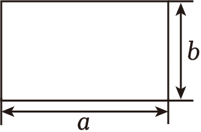

# 知识点·提公因式法分解因式（同步练习）

> 教材：数学·七年级下册·沪科技版2024新教材 ｜ 来源：国家中小学智慧教育平台·在线练习 ｜ 共 71 题

## 1. 单选题（难度：简单）

多项式12ab²﹣8a²bc的公因式是（　　）

- A. 4ab
- B. 4a²b²
- C. 2ab
- D. 2abc

【答案】A

【解析】解：∵12ab²﹣8a²bc＝4ab•3b﹣4ab•2c，
∴12ab²﹣8a²bc各项的公因式是4ab．
故选：A．

## 2. 单选题（难度：适中）

（﹣2）²⁰²²+（﹣2）²⁰²³等于（　　）

- A. ﹣2²⁰²²
- B. ﹣2²⁰²³
- C. （﹣2）²⁰²²
- D. ﹣2

【答案】A

【解析】解：（﹣2）²⁰²²+（﹣2）²⁰²³
＝（﹣2）²⁰²²×（1﹣2）
＝2²⁰²²×（﹣1）
＝﹣2²⁰²²．
故选：A．

## 3. 单选题（难度：适中）

计算（﹣2）2016+（﹣2）2017所得结果是（　　）

【答案】A

## 4. 单选题

把﹣9x³+6x²﹣3x因式分解时，提出公因式后，另一个因式是（　　）

- A. 3x²﹣2x
- B. 3x²﹣2x﹣1
- C. ﹣9x²+6x
- D. 3x²﹣2x+1

【答案】D

【解析】解：﹣9x³+6x²﹣3x＝﹣3x（3x²﹣2x+1），
故选：D．
声明：试题解析著作权属菁优网所有，未经书面同意，不得复制发布日期：2025/4/11 18:31:58；用户：周星；邮箱：ssxxyy37@xyh.com；学号：22078707

## 5. 单选题（难度：简单）

<latex class="math-tex">\({{2005}^{2}}-2005\)</latex>一定能被（    ）整除

【答案】A

## 6. 单选题（难度：简单）

单项式<latex class="math-tex">\(3{{x}^{2}}{{y}^{2}}\)</latex>，<latex class="math-tex">\(9{{x}^{2}}y\)</latex>，<latex class="math-tex">\(6x{{y}^{2}}\)</latex>的公因式是（   ）

【答案】A

## 7. （难度：简单）

因式分解：4x2+2x＝　   　 ．

## 8. （难度：简单）

因式分解：x2+xy＝ 　   　 ．

## 9. 单选题（难度：简单）

把多项式\(-6{{x}^{2}}-9x\)分解因式，结果正确的是（    ）

- A. \(-3\left( 2{{x}^{2}}+3x \right)\)
- B. \(-3\left( 2{{x}^{2}}-3x \right)\)
- C. \(-3x(2x-3)\)
- D. \(-3x(2x+3)\)

【答案】D

【解析】运用提公因式法分解因式即可．
解：\(-6{{x}^{2}}-9x=-3x\left( 2x+3 \right)\)，
故选：D．

## 10. （难度：简单）

分解因式：4a³﹣28ab＝　    　 ．

【答案】

4<i>a</i>（<i>a</i>2﹣7<i>b</i>）

【解析】先确定公因式4a，再提取公因式分解因式即可．
解：4a³﹣28ab＝4a（a²﹣7b），
故答案为：4a（a²﹣7b）．
【点睛】本题考查了因式分解﹣提公因式法，熟练掌握公因式的确定方法是解题的关键．

## 11. 单选题（难度：简单）

下列各组中的两个多项式，没有公因式的是（　　）

- A. a+b与a²﹣2ab+b²
- B. ax﹣bx与by﹣ay
- C. x（x﹣y）³与y（y﹣x）²
- D. x²﹣y²与x﹣y

【答案】A

【解析】分别分析各选项中的代数式，能因式分解的先进行因式分解，再确定没有公因式的选项即可．
解：a+b与a²﹣2ab+b²没有公因式，选项A符合题意；
ax﹣bx与by﹣ay的公因式为（a﹣b），选项B不符合题意；
x（x﹣y）³与y（y﹣x）²的公因式为（x﹣y）²，选项C不符合题意；
x²﹣y²与x﹣y的公因式为（x﹣y），选项D不符合题意．
故选：A．

## 12. 单选题（难度：简单）

将多项式<latex class="math-tex">\({{x}^{2}}y\left( a-b \right)-xy\left( b-a \right)+y\left( a-b \right)\)</latex>提公因式后，另一个因式为（　　）

【答案】A

## 13. （难度：简单）

多项式8a³b²+6ab³c的公因式是 　      　 ．

【答案】

2<i>ab</i>2

【解析】根据公因式的确定方法解答即可．
解：多项式8a³b²+6ab³c的公因式是2ab²，故答案为：2ab²．
【点睛】本题考查了公因式，熟练掌握公因式的确定方法是解题的关键．

## 14. （难度：简单）

18ab2（a﹣b）2与12b（a﹣b）的公因式是 　    　 ．

## 15. 单选题（难度：简单）

下列等式中正确的是（    ）

【答案】A

## 16. 单选题（难度：简单）

将多项式<latex class="math-tex">\(6{{x}^{3}}{{y}^{2}}+3{{x}^{3}}{{y}^{2}}-12{{x}^{2}}{{y}^{3}}\)</latex>分解因式时，应提取的公因式是（    ）

【答案】A

## 17. 单选题（难度：简单）

多项式﹣8x2y3z+12xy2z3﹣24x3yz2的公因式是（　　）

【答案】A

## 18. 单选题（难度：简单）

下列变形中错误的是（    ）

【答案】A

## 19. 单选题（难度：简单）

把<latex class="math-tex">\({{a}^{3}}-4{{a}^{2}}\)</latex>分解因式，正确的是（    ）

【答案】A

## 20. 单选题（难度：简单）

将多项式<latex class="math-tex">\(3{{x}^{3}}-2{{x}^{2}}+4x-5\)</latex>添括号后正确的是（）

【答案】A

## 21. 单选题（难度：简单）

用提公因式法分解因式正确的是（　　）

【答案】A

## 22. 单选题（难度：简单）

多项式xy²﹣y因式分解，正确的是（　　）

- A. x（y²﹣y）
- B. y（xy﹣1）
- C. y（xy+1）
- D. x（xy+y）

【答案】B

【解析】首先确定公因式，然后提取公因式即可．
解：xy²﹣y＝y（xy﹣1）．
故选：B．
【点睛】本题考查了提公因式法进行因式分解，确定公因式，正确提取公因式是解题的关键．

## 23. 单选题（难度：简单）

若<latex class="math-tex">\(a-(b-c+d)=a-d+(\quad )\)</latex>，则括号中应填入（    ）

【答案】A

## 24. 单选题（难度：简单）

把多项式a2+2a分解因式得（　　）

【答案】A

## 25. 单选题（难度：简单）

若<latex class="math-tex">\({{\left( x+y \right)}^{3}}-xy\left( x+y \right)=\left( x+y \right)\cdot A\)</latex>，则A为（　　）

【答案】A

## 26. 单选题（难度：简单）

把﹣9x³+6x²﹣3x因式分解时，提出公因式后，另一个因式是（　　）

- A. 3x²﹣2x
- B. 3x²﹣2x﹣1
- C. ﹣9x²+6x
- D. 3x²﹣2x+1

【答案】D

【解析】直接提取公因式﹣3x即可分解．
【解析】解：﹣9x³+6x²﹣3x＝﹣3x（3x²﹣2x+1），
故选：D．
【点睛】此题主要考查了提公因式法分解因式，解题的关键是正确找出公因式．

## 27. （难度：简单）

因式分解：a2b﹣5ab2＝ 　    　 ．

## 28. 单选题（难度：简单）

多项式3a2b2﹣15a3b3﹣12a2b2c的公因式是（　　）

【答案】A

## 29. （难度：适中）

化简：（﹣2）²⁰²⁵+（﹣2）²⁰²⁶＝　    　 ．

【答案】

22025

【解析】本题考查了因式分解﹣提公因式法，有理数的混合运算，正确计算是解题的关键．
先提公因式，再根据有理数的混合运算计算即可．
【解析】解：（﹣2）²⁰²⁵+（﹣2）²⁰²⁶
＝（﹣2）²⁰²⁵×[1+（﹣2）]
＝（﹣2）²⁰²⁵×（﹣1）
＝2²⁰²⁵，
故答案为：2²⁰²⁵．

## 30. 单选题（难度：适中）

多项式8x2n﹣4xn的公因式是（　　）

【答案】A

## 31. 单选题（难度：简单）

如图，长宽分别为a、b的长方形周长为16，面积为12，则a²b+ab²的值为（　　）

- A. 80
- B. 96
- C. 192
- D. 240

【答案】B

【解析】根据题意得出a+b＝8，ab＝12，然后将整式因式分解化简，整体代入求解即可
解：∵边长为a，b的长方形周长为16，面积为12，
∴a+b＝8，ab＝12，
∴a²b+ab²
＝ab（a+b）
＝12×8
＝96．
故选：B．
【点睛】本题主要考查利用整体代入法求代数式的值，因式分解，关键是得到a²b+ab²＝ab（a+b）．

## 32. （难度：适中）

分解因式：x（x﹣3）+（3﹣x）＝　        　 ．

## 33. 单选题（难度：简单）

多项式2xmyn﹣1﹣4xm﹣1yn（m，n均为大于1的整数）各项的公因式是（　　）

【答案】A

## 34. 单选题（难度：简单）

已知a﹣b＝5，b﹣c＝﹣6，则代数式a2﹣ac﹣b（a﹣c）的值为（　　）

【答案】A

## 35. （难度：简单）

分解因式：（a﹣3）²﹣（2a﹣6）

【答案】

（<i>a</i>﹣3）（<i>a</i>﹣5）

【解析】直接提取公因式（a﹣3），进而得出即可；
（a﹣3）²﹣（2a﹣6）
＝（a﹣3）²﹣2（a﹣3）
＝（a﹣3）（a﹣5）；

## 36. （难度：简单）

因式分解：（2a+1）a﹣4a﹣2＝　      　 ．

## 37. （难度：简单）

分解因式：（m+n）（p﹣q）﹣（m+n）（q+p）

## 38. （难度：简单）

分解因式：15×（a﹣b）2﹣3y（b﹣a）；

## 39. 单选题（难度：简单）

多项式8x²n﹣4xn的公因式是（　　）

- A. 4xn
- B. 2xn﹣1
- C. 4xn﹣1
- D. 2xn﹣¹

【答案】A

【解析】本题考查公因式的定义．找公因式的要点是：（1）公因式的系数是多项式各项系数的最大公约数；
（2）字母取各项都含有的相同字母；（3）相同字母的指数取次数最低的．
解：8x²n﹣4xn＝4xn（2xn﹣1），
∴4xn是公因式．
故选：A．

## 40. （难度：简单）

分解因式：﹣20a﹣15ax；

## 41. 单选题（难度：简单）

矩形长为 <latex class="math-tex">\( {2x}^{2}+4x\)</latex>，宽为 <latex class="math-tex">\( x\)</latex>，其面积可因式分解为（ ）

【答案】A

## 42. 单选题（难度：非常简单）

分解 <latex class="math-tex">\( {4x}^{2}-8x\)</latex> 的结果是（ ）

【答案】A

## 43. 单选题（难度：非常简单）

【题干】<latex class="math-tex">\( 6a-9b\)</latex> 的公因式是（ ）

【答案】A

## 44. 单选题（难度：非常简单）

\( (b-a)+2(a-b)\) 可提取的公因式是（ ）

- A. \( (a-b)\)
- B. \( (b-a)\)
- C. \( 1\)

【答案】B

【解析】解：由 \( a-b=-(b-a)\)，原式 \( =(b-a)-2(b-a)=(b-a)(1-2)\)，公因式为 \( (b-a)\)。

## 45. 单选题（难度：非常简单）

分解 \( -3y+6\) 的结果是（ ）

- A. \( -3(y-2)\)
- B. \( 3(-y+2)\)
- C. \( -3(y+2)\)

【答案】A

【解析】解：提取负公因式 \( -3\)，得 \( -3(y-2)\)。B未处理负号，C符号错误。

## 46. 单选题（难度：非常简单）

若 \( k(a+b)-3(a+b)=(a+b)\bullet M\)，则 \( M=\)（ ）

- A. \( k-3\)
- B. \( k+3\)
- C. \( k(a+b)-3\)

【答案】A

【解析】解：原式 \( =(a+b)(k-3)\)，故 \( M=k-3\)。

## 47. 单选题（难度：简单）

分解 \( {9a}^{2}-3a\) 的结果是（ ）

- A. \( 3a(3a-1)\)
- B. \( 3({3a}^{2}-a)\)
- C. \( a(9a-3)\)

【答案】A

【解析】解：公因式 \( 3a\)，提取后得 \( 3a(3a-1)\)。选项C未提系数3，D出现分数不符合整式要求。

## 48. 单选题（难度：非常简单）

实际应用 长方形的面积为 <latex class="math-tex">\( {3x}^{2}+6x\)</latex>，宽为 <latex class="math-tex">\( 3x\)</latex>，则长可表示为（ ）

【答案】A

## 49. 单选题（难度：非常简单）

嵌套结构 \( 2{(x-1)}^{2}+4(x-1)\) 的公因式是（ ）

- A. \( 2(x-1)\)
- B. \( (x-1)\)
- C. \( 2\)

【答案】A

【解析】解：整体公因式 \( 2(x-1)\)。B漏系数2，D未包含第一项。

## 50. 单选题（难度：简单）

分解因式：<latex class="math-tex">\( {8a}^{4}b{-12a}^{3}{b}^{2}=\)</latex>（ ）

【答案】A

## 51. 单选题（难度：非常简单）

多项式 <latex class="math-tex">\( 5mn-10m\)</latex> 分解因式正确的是（ ）

【答案】A

## 52. 单选题（难度：简单）

若 <latex class="math-tex">\( k(a+b)-4{(a+b)}^{2}=(a+b)\bullet M\)</latex>，则 <latex class="math-tex">\( M=\)</latex>（ ）

【答案】A

## 53. 单选题（难度：非常简单）

简单分组 <latex class="math-tex">\( 3m(p-q)-2n(p-q)\)</latex> 等于（ ）

【答案】A

## 54. 单选题（难度：简单）

多项式 <latex class="math-tex">\( 8x-12\)</latex> 的公因式是（ ）

【答案】A

## 55. 单选题（难度：非常简单）

分组基础 \( x(a+b)+y(a+b)\) 分解结果是（ ）

- A. \( (a+b)(x+y)\)
- B. \( (x+y)(a+b)\)
- C. \( a(x+y)+b(x+y)\)

【答案】A

【解析】解：直接提取公因式 \( (a+b)\)。C未合并，D未分解。

## 56. 单选题（难度：简单）

分解因式：<latex class="math-tex">\( a(b-c)+b(c-b)=\)</latex>（ ）

【答案】A

## 57. 单选题（难度：简单）

分解因式：<latex class="math-tex">\( 3a{(x-2)}^{2}{-6a}^{2}(x-2)=\)</latex>（ ）

【答案】A

## 58. 单选题（难度：简单）

多项式 <latex class="math-tex">\( {6x}^{3}y{-9x}^{2}{y}^{2}\)</latex> 的公因式是（ ）

【答案】A

## 59. 单选题（难度：简单）

多项式 <latex class="math-tex">\( {(y-x)}^{2}+3(x-y)\)</latex> 可变形为（ ）

【答案】A

## 60. 单选题（难度：简单）

已知 <latex class="math-tex">\( 9m+5n=12\)</latex>，分解 <latex class="math-tex">\( 3{(9m+5n)}^{2}-2(9m+5n)\)</latex> 的结果是（ ）

【答案】A

## 61. 单选题（难度：简单）

对多项式 \( 2m(x-y)+4n(y-x)\) 分解因式，结果为（ ）

- A. \( 2(x-y)(m-2n)\)
- B. \( 2(y-x)(m+2n)\)
- C. \( (x-y)(2m-4n)\)

【答案】A

【解析】解：\( y-x=-(x-y)\)，原式 \( =2m(x-y)-4n(x-y)=2(x-y)(m-2n)\)。

## 62. 单选题（难度：简单）

分解因式：\( {-12x}^{2}+18xy=\)（ ）

- A. \( -6x(2x-3y)\)
- B. \( 6x(-2x+3y)\)
- C. \( -6x(2x+3y)\)

【答案】A

【解析】解：提取负公因式 \( -6x\)，得 \( -6x(2x-3y)\)，括号内符号需调整。

## 63. 单选题（难度：简单）

下列因式分解结果正确的是（ ）

【答案】A

## 64. 单选题（难度：简单）

整体代换 设 <latex class="math-tex">\( t=2m+n\)</latex>，则 <latex class="math-tex">\( 5(2m+n)-2(2m+n)=\)</latex>（ ）

【答案】A

## 65. 单选题（难度：简单）

分解 <latex class="math-tex">\( 15xy+10y\)</latex> 的结果是（ ）

【答案】A

## 66. 单选题（难度：适中）

多项式 <latex class="math-tex">\( 4(x+1)-6x(x+1)\)</latex> 的公因式是（ ）

【答案】A

## 67. 单选题（难度：适中）

分解 <latex class="math-tex">\( 7b(a-2)+14(a-2)\)</latex> 的结果是（ ）

【答案】A

## 68. 单选题（难度：适中）

分解 \( x(3y-4)-5(3y-4)\) 的结果是（ ）

- A. \( (3y-4)(x-5)\)
- B. \( (3y-4)x-5\)
- C. \( 3y(x-5)-4\)

【答案】A

【解析】解：直接提取公因式 \( (3y-4)\) 即可，选项B、D未完成合并。

## 69. 单选题（难度：简单）

分解 <latex class="math-tex">\( -8m+12\)</latex> 的结果是（ ）

【答案】A

## 70. 单选题（难度：适中）

分解 <latex class="math-tex">\( 12-18p\)</latex> 的结果是（ ）

【答案】A

## 71. 单选题（难度：适中）

分解 <latex class="math-tex">\( {5x}^{2}{y-10xy}^{2}\)</latex> 的结果是（ ）

【答案】A
