# 知识点·最简分式（同步练习）

> 教材：数学·七年级下册·沪科技版2024新教材 ｜ 来源：国家中小学智慧教育平台·在线练习 ｜ 共 47 题

## 1. 单选题（难度：简单）

计算$ \frac{a+2}{a+1}+\frac{-1}{a+1}$的结果是（　　）

【答案】A

## 2. 单选题（难度：适中）

计算\( \frac{1}{x-1}-\frac{x}{x-1}\)的结果是（　　）

- A. ﹣1
- B. 2
- C. \( \frac{x}{x-1}\)
- D. \( \frac{1+x}{x-1}\)

【答案】A

【解析】解：\( \frac{1}{x-1}-\frac{x}{x-1}\)
\( =\frac{1-x}{x-1}\) 
\( =\frac{-(x-1)}{x-1}\) 
＝﹣1，
故选：A．

## 3. 单选题（难度：简单）

化简\( \frac{1-x}{x-3}-\frac{2}{3-x}\)的结果为（　　）

- A. \( \frac{x}{x-3}\)
- B. \( \frac{x}{3-x}\)
- C. 1
- D. ﹣1

【答案】D

【解析】解：\( \frac{1-x}{x-3}-\frac{2}{3-x}\)
\( =\frac{1-x}{x-3}+\frac{2}{x-3}\) 
\( =\frac{3-x}{x-3}\) 
＝﹣1，
故选：D．

## 4. 单选题（难度：适中）

化简\( \frac{2}{a-3}-\frac{12}{{a}^{2}-9}\)的结果为（　　）

- A. \( \frac{2}{a+3}\)
- B. \( \frac{2}{a-3}\)
- C. \( \frac{3-a}{a+3}\)
- D. \( \frac{a+3}{a-3}\)

【答案】A

【解析】解：原式\( =\frac{2(a+3)}{{a}^{2}-9}-\frac{12}{{a}^{2}-9}\)
\( =\frac{2a+6-12}{{a}^{2}-9}\) 
\( =\frac{2(a-3)}{(a-3)(a+3)}\) 
\( =\frac{2}{a+3}\)，
故选：A．

## 5. 单选题（难度：适中）

化简$ \frac{4{a}^{2}}{2a-b}+\frac{{b}^{2}}{b-2a}$的结果是（　　）

【答案】A

## 6. 单选题（难度：适中）

若\( \frac{1}{a}+\frac{2}{b}=1\)，则\( \frac{ab-b}{a}\)的值为（　　）

- A. \( \frac{1}{2}\)
- B. 1
- C. 2
- D. 3

【答案】C

【解析】解：∵\( \frac{1}{a}+\frac{2}{b}=1\)，
∴ab＝b+2a，
∴原式\( =\frac{b+2a-b}{a}=\frac{2a}{a}=\)2，
故选：C．

## 7. 单选题（难度：适中）

计算\( \frac{2a}{a+1}+\frac{2}{a+1}\)的结果正确的是（　　）

- A. 2
- B. \( \frac{1}{a+1}\)
- C. a+1
- D. \( \frac{a}{a+1}\)

【答案】A

【解析】解：根据同分母分式的加减运算法则得：
\( \frac{2a}{a+1}+\frac{2}{a+1}=\frac{2a+2}{a+1}=\frac{2(a+1)}{a+1}=2\)，
故选：A．

## 8. 单选题（难度：适中）

计算\( \frac{2m}{m-1}-\frac{2}{m-1}\)的结果等于（　　）

- A. \( \frac{2}{{m}^{2}-1}\)
- B. \( \frac{m}{m-1}\)
- C. m
- D. 2

【答案】D

【解析】解：原式\( =\frac{2m-2}{m-1}\)
\( =\frac{2(m-1)}{m-1}\) 
＝2，
故选：D．

## 9. 单选题（难度：适中）

化简：\( \frac{x}{x-1}-\frac{1}{x-1}=\)（　　）

- A. 1
- B. 0
- C. x
- D. x2

【答案】A

【解析】解：\( \frac{x}{x-1}-\frac{1}{x-1}\)
\( =\frac{x-1}{x-1}\) 
＝1，
故选：A．

## 10. 单选题（难度：适中）

化简\( \frac{m-3n}{m-n}+\frac{2n}{m-n}\)的结果是（　　）

- A. 1
- B. ﹣1
- C. 3
- D. \( \frac{m-5n}{m-n}\)

【答案】A

【解析】解：\( \frac{m-3n}{m-n}+\frac{2n}{m-n}=\frac{m-3n+2n}{m-n}=\frac{m-n}{m-n}=1\)．
故选：A．

## 11. 单选题（难度：简单）

$ \frac{a}{{a}^{2}-{b}^{2}}-\frac{1}{a+b}$的计算结果为（　　）

【答案】A

## 12. 单选题

计算\( \frac{x}{{x}^{2}-1}-\frac{1}{x+1}\)的结果等于（　　）

- A. \( \frac{1}{x}\)
- B. \( \frac{1}{x+1}\)
- C. \( \frac{1}{x-1}\)
- D. \( \frac{1}{{x}^{2}-1}\)

【答案】D

【解析】解：\( \frac{x}{{x}^{2}-1}-\frac{1}{x+1}\)
\( =\frac{x}{{x}^{2}-1}-\frac{x-1}{{x}^{2}-1}\) 
\( =\frac{1}{{x}^{2}-1}\)．
故选：D．

## 13. 单选题（难度：简单）

下列各分式中是最简分式的是（　　）

【答案】A

## 14. 单选题（难度：简单）

下列分式是最简分式的是（　　）

【答案】A

## 15. 单选题（难度：适中）

下列分式中，是最简分式的是（　　）

【答案】A

## 16. 单选题（难度：适中）

下列分式中，是最简分式的是（　　）

- A. \( \frac{1}{m}\)
- B. \( \frac{3xy}{{x}^{2}}\)
- C. \( \frac{y-2}{(y-2{)}^{2}}\)
- D. \( \frac{a+b}{{a}^{2}-{b}^{2}}\)

【答案】A

【解析】解：A、\( \frac{1}{m}\)是最简分式，符合题意；
B、\( \frac{3xy}{{x}^{2}}=\frac{3y}{x}\)不是最简分式，不符合题意；
C、\( \frac{y-2}{(y-2{)}^{2}}=\frac{1}{y-2}\)不是最简分式，不符合题意；
D、\( \frac{a+b}{{a}^{2}-{b}^{2}}=\frac{a+b}{(a-b)(a+b)}=\frac{1}{a-b}\)不是最简分式，不符合题意；
故选：A．

## 17. 单选题（难度：简单）

下列分式中，为最简分式的是（　　）

【答案】A

## 18. 单选题（难度：简单）

在下列分式中，是最简分式的是（　　）

【答案】A

## 19. 单选题（难度：非常简单）

下列分式中是最简分式的是（　　）

【答案】A

## 20. 单选题（难度：适中）

下列各分式中，是最简分式的是（　　）

【答案】A

## 21. 单选题（难度：非常简单）

下列各式中最简分式是（　　）

【答案】A

## 22. 单选题（难度：适中）

下列分式中，属于最简分式的是（　　）

【答案】A

## 23. 单选题（难度：非常简单）

下列各式中最简分式是（　　）

【答案】A

## 24. 单选题（难度：简单）

下列分式是最简分式的是（　　）

【答案】A

## 25. 单选题（难度：简单）

下列分式为最简分式的是（　　）

【答案】A

## 26. 单选题（难度：简单）

下列分式是最简分式的是（　　）

【答案】A

## 27. 单选题（难度：简单）

下列分式中是最简分式的是（　　）

【答案】A

## 28. 单选题（难度：简单）

下列分式中是最简分式的是（　　）

【答案】A

## 29. 单选题（难度：适中）

下列各式中，最简分式为（　　）

【答案】A

## 30. 单选题（难度：简单）

下列分式中是最简分式的是（　　）

【答案】A

## 31. 单选题（难度：非常简单）

下列代数式中，是最简分式的是（　　）

- A. \( \frac{x}{2}\)
- B. \( \frac{2{x}^{2}+x}{{x}^{2}}\)
- C. \( \frac{6}{4x}\)
- D. \( \frac{1}{3-x}\)

【答案】D

【解析】解：A、\( \frac{x}{2}\)不是分式，故选项不符合题意；
B、\( \frac{2{x}^{2}+x}{{x}^{2}}=\frac{x(2x+1)}{{x}^{2}}=\frac{2x+1}{x}\)，不是最简分式，故选项不符合题意；
C、\( \frac{6}{4x}=\frac{3}{2x}\)，不是最简分式，故选项不符合题意；
D、\( \frac{1}{3-x}\)是最简分式，故本选项符合题意；
故选：D．

## 32. 单选题（难度：非常简单）

下列分式是最简分式的是（　　）

【答案】A

## 33. 单选题（难度：适中）

下列各式中，是最简分式的是（　　）

【答案】A

## 34. 单选题（难度：适中）

下列分式是最简分式的是（　　）

- A. \( \frac{9y}{12x}\)
- B. \( \frac{x+y}{{x}^{2}+{y}^{2}}\)
- C. \( \frac{x-y}{2x-2y}\)
- D. \( \frac{x+y}{{x}^{2}-{y}^{2}}\)

【答案】B

【解析】解：A、该代数式的分子与分母存在公因式数3，不是最简分式，不符合题意；
B、该代数式的分子与分母没有公因式，是最简分式，符合题意；
C、该代数式的分子与分母存在公因式（x﹣y），不是最简分式，不符合题意；
D、该代数式的分子与分母存在公因式（x+y），不是最简分式，不符合题意；
故选：B．

## 35. 单选题（难度：适中）

下列分式中，属于最简分式的是（　　）

【答案】A

## 36. 单选题（难度：适中）

下列分式是最简分式的是（　　）

【答案】A

## 37. 单选题（难度：适中）

下列各分式中是最简分式的是（　　）

- A. \( \frac{x-1}{{x}^{2}-1}\)
- B. \( \frac{4}{2x}\)
- C. \( \frac{2x}{{x}^{2}-1}\)
- D. \( \frac{x-1}{1-x}\)

【答案】C

【解析】解：A、原式\( =\frac{x-1}{(x+1)(x-1)}=\frac{1}{x+1}\)，故A不符合题意．
B、原式\( =\frac{2}{x}\)，故B不符合题意．
C、\( \frac{2x}{{x}^{2}-1}\)是最简分式，故C符合题意．
D、原式＝﹣1，故D不符合题意．
故选：C．

## 38. 单选题（难度：适中）

下列各式，是最简分式的是（　　）

【答案】A

## 39. 单选题

下列各式是最简分式的是（　　）

- A. \( \frac{3}{12x}\)
- B. \( \frac{{x}^{2}-{y}^{2}}{x-y}\)
- C. \( \frac{x-y}{{x}^{2}+{y}^{2}}\)
- D. \( \frac{5{x}^{3}}{7{x}^{5}}\)

【答案】C

【解析】解：A、\( \frac{3}{12x}=\frac{1}{4x}\)，不是最简分式，不符合题意；
B、\( \frac{{x}^{2}-{y}^{2}}{x-y}=x+y\)，不是最简分式，不符合题意；
C、\( \frac{x-y}{{x}^{2}+{y}^{2}}\)是最简分式，符合题意；
D、\( \frac{5{x}^{3}}{7{x}^{5}}=\frac{5}{7{x}^{2}}\)，不是最简分式，不符合题意；
故选：C．

## 40. 单选题（难度：适中）

下列各分式中，是最简分式的是（　　）

- A. \( \frac{10xy}{5x}\)
- B. \( \frac{{x}^{2}-{y}^{2}}{x-y}\)
- C. \( \frac{x+y}{x}\)
- D. \( \frac{2}{4x}\)

【答案】C

【解析】解：因为：\( \frac{10xy}{5x}\)的分子、分母中含有公因式5x，故选项A不是最简分式；
\( \frac{{x}^{2}-{y}^{2}}{x-y}\)的分子、分母中含有公因式（x﹣y），故选项B不是最简分式；
\( \frac{2}{4X}\)的分子、分母中含有公因数2，故选项D不是最简分式．
由于\( \frac{x+y}{x}\)不能再约分，所以选项C是最简分式．
故选：C．

## 41. 单选题（难度：适中）

下列式子中是最简分式的是（　　）

【答案】A

## 42. 单选题（难度：非常简单）

下列分式中，最简分式是（　　）

- A. \( \frac{3a}{6bc}\)
- B. \( \frac{a+b}{{a}^{2}+ab}\)
- C. \( \frac{a+1}{{a}^{2}-1}\)
- D. \( \frac{a}{2-a}\)

【答案】D

【解析】最简分式就是分式的分子和分母没有公因式，据此逐一判断即可.
故选D.

## 43. 填空题（难度：非常简单）

在分式 \( \frac{b}{8a}\) ， \( \frac{a+b}{a-b}\) ， \( \frac{x-y}{{x}^{2}-{y}^{2}}\) ， \( \frac{x+y}{{x}^{2}+{y}^{2}}\) 中，最简分式有个；

【答案】3

【解析】最简分式就是分式的分子和分母没有公因式，据此逐一判断即可.
 \( \frac{b}{8a}\) ， \( \frac{a+b}{a-b}\) ， \( \frac{x+y}{{x}^{2}+{y}^{2}}\) 是最简分式，共有3个.
‎

## 44. 单选题（难度：非常简单）

下列分式中，最简分式是（　　）

【答案】A

## 45. 单选题（难度：简单）

（2024春•仪征市期中）下列分式中，属于最简分式的是（　　）

【答案】A

## 46. 单选题（难度：简单）

（2023秋•商丘期末）下列各分式中，是最简分式的是（　　）

【答案】A

## 47. 单选题（难度：简单）

（2023秋•潮州期末）下列分式中，是最简分式的是（　　）

- A. 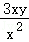
- B. 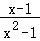
- C. 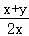
- D. 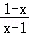

【答案】C

【解析】解：A、
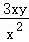
＝
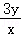
，不是最简分式，不符合题意；
B、
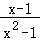
＝
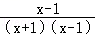
＝
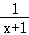
，不是最简分式，不符合题意；
C、
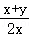
是最简分式，符合题意；
D、
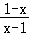
＝
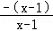
＝﹣1，不是最简分式，不符合题意；
故选：C．
