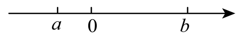
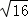
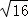

# 知识点·求一个数的平方根（同步练习）

> 教材：数学·七年级下册·沪科技版2024新教材 ｜ 来源：国家中小学智慧教育平台·在线练习 ｜ 共 56 题

## 1. 单选题（难度：非常简单）

（23-24七年级下·全国·课后作业）下列语句正确的是(　　)．

- A. 一个数的平方根一定有两个
- B. 一个非负数的非负平方根一定是它的算术平方根
- C. 一个正数的平方根一定是它的算术平方根
- D. 一个非零数的负的平方根是它的算术平方根

【答案】B

【解析】解：A.一个正数的平方根有两个，0的平方根只有0，故错误；B.非负数为0和正数，正数的正的平方根是它的算术平方根，0的算术平方根是0，故正确；C.一个正数的平方根有两个，其中正的平方根是它的算术平方根，例如5的平方根是±\( \sqrt{5}\)，5的算术平方根是\( \sqrt{5}\)，故错误；D.正数的正的平方根是它的算术平方根，负数没有算术平方根，故错误.
故选B.

## 2. 单选题（难度：非常简单）

（23-24七年级下·全国·课后作业）下列语句正确的是(　　)．

- A. 一个数的平方根一定有两个
- B. 一个非负数的非负平方根一定是它的算术平方根
- C. 一个正数的平方根一定是它的算术平方根
- D. 一个非零数的负的平方根是它的算术平方根

【答案】B

【解析】解：A.一个正数的平方根有两个，0的平方根只有0，故错误；B.非负数为0和正数，正数的正的平方根是它的算术平方根，0的算术平方根是0，故正确；C.一个正数的平方根有两个，其中正的平方根是它的算术平方根，例如5的平方根是±\( \sqrt{5}\)，5的算术平方根是\( \sqrt{5}\)，故错误；D.正数的正的平方根是它的算术平方根，负数没有算术平方根，故错误.
故选B.

## 3. 单选题（难度：非常简单）

（23-24七年级下·全国·课后作业）下列语句正确的是(　　)．

- A. 一个数的平方根一定有两个
- B. 一个非负数的非负平方根一定是它的算术平方根
- C. 一个正数的平方根一定是它的算术平方根
- D. 一个非零数的负的平方根是它的算术平方根

【答案】B

【解析】解：A.一个正数的平方根有两个，0的平方根只有0，故错误；B.非负数为0和正数，正数的正的平方根是它的算术平方根，0的算术平方根是0，故正确；C.一个正数的平方根有两个，其中正的平方根是它的算术平方根，例如5的平方根是±\( \sqrt{5}\)，5的算术平方根是\( \sqrt{5}\)，故错误；D.正数的正的平方根是它的算术平方根，负数没有算术平方根，故错误.
故选B.

## 4. 单选题（难度：非常简单）

（25-26八年级上·山西运城·期中）下列式子中表示“9的平方根是<latex class="math-tex">\( \pm 3\)</latex>”的是（）

【答案】A

## 5. 单选题

（25-26八年级上·河南鹤壁·期中）若<latex class="math-tex">\( {\left(3x+2y-18\right)}^{2}+\left|2x+y-11\right|=0\)</latex>，则<latex class="math-tex">\( x+y\)</latex>的平方根是（   ）

【答案】A

## 6. 单选题（难度：适中）

（25-26八年级上·四川内江·期末）\( \sqrt{\frac{81}{16}}\)的平方根为（       ）

- A. \( \pm \frac{9}{4}\)
- B. \( \frac{3}{4}\)
- C. \( \pm \frac{3}{2}\)
- D. \( \frac{3}{2}\)

【答案】C

【解析】解：∵\( \sqrt{\frac{81}{16}}=\frac{\sqrt{81}}{\sqrt{16}}=\frac{9}{4}\)，
∴\( \sqrt{\frac{81}{16}}\)的平方根为\( \pm \sqrt{\frac{9}{4}}=\pm \frac{3}{2}\)，故选：C．

## 7. 单选题（难度：适中）

（25-26七年级上·陕西西安·期中）若<latex class="math-tex">\( \left|a\right|=8，{b}^{2}=4\)</latex>，且<latex class="math-tex">\( ab<0\)</latex>，则<latex class="math-tex">\( a+b\)</latex>的值是（    ）

【答案】A

## 8. 单选题（难度：简单）

（24-25七年级下·全国·课后作业）下列各式中，正确的是（    ）

- A. \( \sqrt{{2}^{2}}=2\)
- B. \( \pm \sqrt{81}=9\)  C．
- C. \( \sqrt{16}=8\)
- D. \( -\sqrt{{(-3)}^{2}}=3\)

【答案】A

【解析】解：A、\( \sqrt{{2}^{2}}=\sqrt{4}=2\)，符合题意；B、\( \pm \sqrt{81}\)表示\( 81\)的平方根，结果为\( \pm 9\)，原式错误，不符合题意；C、\( \sqrt{16}=4\ne 8\)，不符合题意；D、\( {(-3)}^{2}=9\)，\( \sqrt{9}=3\)，\( -\sqrt{9}=-3\ne 3\)，不符合题意；故选： A．

## 9. 单选题（难度：非常简单）

（25-26八年级上·吉林长春·期末）<latex class="math-tex">\( \frac{1}{4}\)</latex>的平方根是<latex class="math-tex">\( \pm \frac{1}{2}\)</latex>，用数学表达式表示正确的是（   ）

【答案】A

## 10. 单选题（难度：简单）

（24-25七年级下·全国·课后作业）下列各式中，正确的是（    ）

【答案】A

## 11. 单选题（难度：适中）

（24-25七年级下·全国·课后作业）若\( {x}^{2}=16\)，则\( 5-x\)的平方根是（    ）

- A. \( \pm 1\)
- B. \( \pm 3\)
- C. \( \pm 1\)或\( \pm 3\)
- D. 1或3

【答案】C

【解析】解：∵ \( {x}^{2}=16\)，
∴ \( x=\pm 4\).
当\( x=4\)时，\( 5-x=1\)，\( 1\)的平方根为\( \pm 1\)；
当\( x=-4\)时，\( 5-x=9\)，\( 9\)的平方根为\( \pm 3\).
∴\( 5-x\)的平方根是\( \pm 1\)或\( \pm 3\).
故选：C．

## 12. 单选题

（2025九年级·全国·专题练习）若\( {\left(3x+2y-19\right)}^{2}+\left|2x+y-11\right|=0\)，则\( x+y\)的平方根是（   ）

- A. 8
- B. \( \pm 8\)
- C. \( \pm 2\sqrt{2}\)
- D. 2

【答案】C

【解析】解：\( \because {\left(3x+2y-19\right)}^{2}+\left|2x+y-11\right|=0\)，
\( \therefore \left\{\begin{array}{c}3x+2y-19=0,①\\ 2x+y-11=0.②\end{array}\right. \) 
①－②，得\( x+y=8\)，
\( \therefore x+y\)的平方根是\( \pm \sqrt{8}=\pm 2\sqrt{2}\)．
故选：C．

## 13. 单选题（难度：非常简单）

（25-26八年级上·吉林长春·期末）16的平方根是（    ）

【答案】A

## 14. 单选题（难度：适中）

（22-23八年级上·河南平顶山·期中）下列说法正确的是（）

【答案】A

## 15. 单选题（难度：适中）

（25-26八年级上·河南开封·期中）若\( \sqrt{x+3}+{\left(y-2\right)}^{2}=0\)，则\( {x}^{y}\)的平方根是（   ）

- A. \( -3\)
- B. 3
- C. \( \pm 3\)
- D. 2

【答案】C

【解析】解：∵\( \sqrt{x+3}\ge 0\)且\( {\left(y-2\right)}^{2}\ge 0\)，且\( \sqrt{x+3}+{\left(y-2\right)}^{2}=0\)，
∴\( \sqrt{x+3}=0\)且\( {\left(y-2\right)}^{2}=0\)，
∴\( x+3=0\)，\( y-2=0\)，
即\( x=-3\)，\( y=2\)，
∴\( {x}^{y}={\left(-3\right)}^{2}=9\)，
∵9的平方根为\( \pm 3\)，
∴\( {x}^{y}\)的平方根是\( \pm 3\)．
故选：C．

## 16. 单选题

（25-26八年级上·河北石家庄·期中）在数轴上有C，D两点分别表示实数c和d，且有<latex class="math-tex">\( \left|3c+d\right|\)</latex>与<latex class="math-tex">\( \sqrt{d+6}\)</latex>互为相反数，则<latex class="math-tex">\( 3c-2d\)</latex>的平方根为（

【答案】A

## 17. 单选题（难度：非常简单）

（24-25七年级下·云南临沧·期末）<latex class="math-tex">\( \frac{81}{25}\)</latex>的平方根是（   ）

【答案】A

## 18. 单选题（难度：简单）

（24-25七年级下·内蒙古乌兰察布·期末）<latex class="math-tex">\( \sqrt{\frac{81}{16}}\)</latex>的平方根为（    ）

【答案】A

## 19. 单选题（难度：非常简单）

（24-25七年级下·全国·课后作业）若x是<latex class="math-tex">\( {\left(-2\right)}^{2}\)</latex>的平方根，则<latex class="math-tex">\( x+3\)</latex>的正的平方根是（    ）

【答案】A

## 20. 单选题（难度：适中）

（23-24七年级下·北京西城·月考）下列说法：①36的平方根是6；②±9的平方根是±3；③<latex class="math-tex">\( \sqrt{16}=\pm 4\)</latex>；④0.01是0.1的算术平方根；⑤<latex class="math-tex">\( \sqrt{16}\)</latex>的算术平方根是4；⑥81的算术平方根是±9．其中正确的说法有（    ）

【答案】A

## 21. 单选题（难度：适中）

（2025七年级下·全国·专题练习）下列命题：①只有正数才有平方根；②<latex class="math-tex">\( -2\)</latex>是<latex class="math-tex">\( 4\)</latex>的一个平方根；③<latex class="math-tex">\( 5\)</latex>的平方根是<latex class="math-tex">\( \sqrt{5}\

【答案】A

## 22. 单选题（难度：适中）

（24-25七年级下·内蒙古乌兰察布·期中）下列说法：①\( -2\)是4的平方根；②16的平方根是4；③\( -125\)的平方根是\( \pm 15\)；④0.25的算术平方根是0.5；⑤\( \frac{27}{125}\)的立方根是\( \pm \frac{3}{5}\)；⑥\( \sqrt{81}\)的算术平方根是9．其中正确的说法有（   ）

- A. 1个
- B. 2个
- C. 3个
- D. 4个

【答案】B

【解析】解：①\( -2\)是4的平方根，故原说法正确；②16的平方根是\( \pm 4\)，故原说法错误；③\( -125\)没有平方根，故原说法错误；④0.25的算术平方根是0.5，故原说法正确；⑤\( \frac{27}{125}\)的立方根是\( \frac{3}{5}\)，故原说法错误；⑥\( \sqrt{81}\)的算术平方根是\( 3\)，故原说法错误．综上可知，正确的说法是①④，共2个，故选：B

## 23. 单选题（难度：简单）

（24-25七年级下·河北衡水·期中）下列五个命题：①只有正数才有平方根；②−2是4的平方根；③5的平方根是<latex class="math-tex">\( \sqrt{5}\)</latex>；④±<latex class="math-tex">\( \sqrt{3}\)</latex>都是3的平方根；⑤(−2)2的平方根是−2；其中正确的命题是(      )

【答案】A

## 24. 单选题（难度：适中）

（24-25七下年级下·广东佛山·月考）下列说法正确的是有（    ）①<latex class="math-tex">\( \text{-3}\)</latex>是<latex class="math-tex">\( \sqrt{\text{81}}\)</latex>的平方根；②25的平方根是5；③<latex class="math-tex">\( \text{-36}\)</latex>的

【答案】A

## 25. 单选题（难度：适中）

（24-25七年级下·山东青岛·开学考试）解析下列说法：①每一个无理数都可以用数轴上的一个点来表示；②\( -{a}^{2}\)没有平方根；③\( \sqrt{16}\)的算术平方根是4；④平方根与立方根相同的数是0和1；⑤0.01的算术平方根是0.1；⑥\( -\pi \)是\( {\left(-\text{π}\right)}^{2}\)的平方根．其中正确的有（   ）

- A. 4个
- B. 3个
- C. 2个
- D. 1个

【答案】B

【解析】解：①每一个无理数都可以用数轴上的一个点来表示，正确；②当\( a=0\)时，\( -{a}^{2}\)有平方根0，故原说法错误；③\( \sqrt{16}=4\)的算术平方根是2，故原说法错误；④平方根与立方根相同的数是0，故原说法错误；⑤0.01的算术平方根是0.1，正确；⑥\( -\pi \)是\( {\left(-\text{π}\right)}^{2}\)的平方根，正确．综上所述：正确的有①⑤⑥．故选：B．

## 26. 单选题（难度：简单）

（24-25七年级下·河南信阳·期末）下列说法正确的是（    ）

【答案】A

## 27. 单选题（难度：简单）

（24-25七年级下·上海奉贤·期中）下列说法正确的是（   ）

【答案】A

## 28. 单选题

（23-24七年级下·全国·单元测试）下列有关平方根的叙述，正确的个数是（    ）①如果a存在平方根，那么a>0；②如果a有两个不同的平方根，那么a>0；③如果a没有平方根，那么a<0；④如果a>0，那么a的平方根也大于0 ．

【答案】A

## 29. 单选题（难度：适中）

（25-26七年级下·全国·课后作业）关于平方根的说法：①<latex class="math-tex">\( 1\)</latex>是<latex class="math-tex">\( 1\)</latex>的平方根；②<latex class="math-tex">\( 1\)</latex>的平方根是<latex class="math-tex">\( 1\)</latex>；③<late

【答案】A

## 30. 单选题（难度：适中）

（23-24七年级下·湖南湘潭·期末）下列说法中正确的个数是（    ）①<latex class="math-tex">\( {(-3)}^{2}\)</latex>的平方根是<latex class="math-tex">\( +3\)</latex>；②<latex class="math-tex">\( -{m}^{2}\)</latex>没有平方根；③非负数a的平方根是非负数；④负数没有

【答案】A

## 31. 单选题（难度：适中）

（24-25七年级下·河南安阳·月考）有下列说法：①-3是\( \sqrt{81}\)的平方根；②-7是\( {(-7)}^{2}\)的算术平方根：③25的平方根是\( \pm 5\)；④-9的平方根是\( \pm 3\)；⑤0没有算术平方根；⑥\( \sqrt{9}\)的平方根为\( \pm \sqrt{3}\)；⑦平方根等于本身的数有0，1．其中，正确的有（    ）

- A. 1个
- B. 2个
- C. 3个
- D. 4个

【答案】C

【解析】解：①−3是\( \sqrt{81}\)的平方根；故①正确，②7是（−7）²的算术平方根；故②错误，
③25的平方根是±5；正确④−9的平方根是±3；负数没有平方根，故④错误，⑤0没有算术平方根；错误，⑥\( \sqrt{9}\)的平方根为±\( \sqrt{3}\)；正确，⑦平方根等于本身的数有0、1．只有0，故错误．正确的有①③⑥，故选：C．

## 32. 单选题（难度：简单）

（24-25七年级下·贵州黔西·月考）下列说法正确的是（    ）

【答案】A

## 33. 单选题（难度：适中）

（23-24七年级下·全国·单元测试）下列命题是假命题的是（    ）

【答案】A

## 34. 单选题（难度：简单）

（22-23七年级·江西南昌·期中）下列说法：①<latex class="math-tex">\( ﹣3\)</latex>是9的一个平方根；②16的平方根是4；③<latex class="math-tex">\( ﹣125\)</latex>的平方根是<latex class="math-tex">\( ﹣15\)</latex>；④0.25的算术平方根是0.5；⑤<latex class=

【答案】A

## 35. 单选题（难度：适中）

（24-25七年级下·甘肃酒泉·月考）下列说法中正确的有（   ）①<latex class="math-tex">\( 0\)</latex>的算术平方根是<latex class="math-tex">\( 0\)</latex>；②<latex class="math-tex">\( 8\)</latex>的算术平方根是<latex class="math-tex">\( 4\)</late

【答案】A

## 36. 单选题（难度：适中）

（23-24七年级下·全国·课后作业）下列说法：①\( {\left(-5\right)}^{2}\)的平方根是\( \pm 5\)；②\( -{a}^{2}\)一定没有平方根；③非负数a的平方根是非负数；④因为负数没有平方根，所以平方根不可能为负，其中错误说法的个数是（　　）

- A. 1
- B. 2
- C. 3
- D. 4

【答案】C

【解析】解：①\( {\left(-5\right)}^{2}=25\)的平方根是\( \pm 5\)，故①正确；②当\( -{a}^{2}=0\)时有平方根，故②错误；③非负数a的平方根互为相反数，故③错误；④负数没有平方根，一个正数的平方根有两个，一正一负，故④错误．综上所述，错误的有②③④，共\( 3\)个，故选C．

## 37. 单选题（难度：适中）

（2021七年级下·全国·专题练习）下列说法中正确的有（    ）①只有正数才有平方根．②-2是4的平方根．③<latex class="math-tex">\( \sqrt{16}\)</latex>的平方根是<latex class="math-tex">\( \pm 4\)</latex>．④<latex class="math-tex">\( {a}^{2}\)</latex>的算术平方根

【答案】A

## 38. 单选题（难度：适中）

（22-23七年级下·青海西宁·期中）下列说法正确的有(　 　)①0的算术平方根是0； ②8的算术平方根是4； ③±<latex class="math-tex">\( \sqrt{11}\)</latex>是11的平方根；④-5是25的一个平方根；  ⑤±2是8的立方根；   ⑥81的平方根是9.

【答案】A

## 39. 单选题（难度：适中）

（25-26七年级下·河南驻马店·期中）下列说法：①每一个无理数都可以用数轴上的一个点来表示；②<latex class="math-tex">\( -{a}^{\text{2}}\)</latex>没有平方根；③<latex class="math-tex">\( \sqrt{16}\)</latex>的算术平方根是4；④平方根与立方根相同的数是0和1；⑤<latex class="math-t

【答案】A

## 40. 单选题（难度：适中）

（21-22七年级下·陕西宝鸡·月考）下列说法中正确的有（　　）①0的算术平方根是0；②8的算术平方根是4；③±<latex class="math-tex">\( \sqrt{11}\)</latex>是11的平方根；④﹣5是25的平方根；⑤±2是8的平方根．

【答案】A

## 41. 单选题（难度：适中）

（23-24七年级下·河南许昌·期末）学完平方根后，当堂检测环节周老师布置了4道填空题，下面是嘉嘉的完成情况：
①0的平方根是0；②16的平方根是\( \pm 4\)；③9的算术平方根是3；④\( \sqrt{25}\)的平方根是\( \pm 5\)．若每做对一道题得25分，则该次检测嘉嘉应得分（    ）

- A. 25分
- B. 50分
- C. 75分
- D. 100分

【答案】C

【解析】解：①0的平方根是0，正确；②16的平方根是\( \pm 4\)，正确；③9的算术平方根是3，正确；④\( \sqrt{25}=5\)，其平方根是\( \pm \sqrt{5}\)，则④错误；那么该次检测嘉嘉应得分为\( 25\times 3=75\)（分\( )\)，故选：C

## 42. 单选题（难度：非常简单）

（22-23七年级下·天津南开·期末）下列说法正确的是（   ）

- A. 9的平方根是3
- B. \( -9\)的平方根是\( -3\)
- C. 9的算术平方根是3
- D. 9的算术平方根是\( \pm 3\)

【答案】C

【解析】解：非负数a的平方根是\( \pm \sqrt{a}\)，算术平方根是\( \sqrt{a}\)，因此9的平方根是\( \pm 3\)，算术平方根是3．A．9的平方根是\( \pm 3\)，故错误，不符合题意；B．\( -9\)没有平方根，故错误，不符合题意； C．9的算术平方根是3，故正确，符合题意；D．9的算术平方根是3，故错误，不符合题意；故选：C．

## 43. 单选题（难度：非常简单）

（23-24七年级下·山东济宁·期末）下列说法正确的是（   ）

【答案】A

## 44. 单选题（难度：非常简单）

（23-24七年级下·福建厦门·期末）<latex class="math-tex">\( \sqrt{4}\)</latex>表示的意义是（    ）

【答案】A

## 45. 单选题（难度：非常简单）

（22-23七年级下·福建莆田·期中）下列说法正确的是（   ）

- A. 1\( 6\)的平方根是\( 4\)
- B. \( -16\)的平方根是\( \pm 4\)
- C. \( 16\)的平方根是\( \pm 4\)
- D. \( 16\)的算术平方根是\( -4\)

【答案】C

【解析】解：A. 1\( 6\)的平方根是\( \pm 4\)，故该选项不正确，不符合题意；B. \( -16\)没有平方根，故该选项不正确，不符合题意；C. \( 16\)的平方根是\( \pm 4\)，故该选项正确，符合题意；    D. \( 16\)的算术平方根是\( 4\)，故该选项不正确，不符合题意；故选：C．

## 46. 单选题（难度：非常简单）

（25-26七年级下·河北唐山·期中）下列说法正确的是（　　）

【答案】A

## 47. 单选题（难度：简单）

（23-24七年级下·河北邯郸·期末）\( -\sqrt{0.2}\)可以表示（    ）

- A. 0.2的平方根
- B. \( -0.2\)的算术平方根
- C. 0.2的负的平方根
- D. \( -0.2\)的平方根

【答案】C

【解析】解：由平方根的定义可得0.2的平方根为：\( \pm \sqrt{0.2}\) ，\( \therefore -\sqrt{0.2}\) 为0.2的负的平方根故选：C．

## 48. 单选题（难度：非常简单）

（23-24七年级下·江苏盐城·月考）下列说法正确的是（   ）

【答案】A

## 49. 单选题（难度：适中）

（23-24七年级下·福建龙岩·月考）下列说法正确的是（    ）

【答案】A

## 50. 单选题（难度：简单）

（22-23七年级下·全国·课后作业）下列说法正确的是（    ）

【答案】A

## 51. 单选题（难度：适中）

（2023七年级下·全国·专题练习）试题下列说法中正确的是（　　）

【答案】A

## 52. （难度：简单）

（22-23七年级下·江苏南京·期末）下列说法正确的是（    ）A． <latex class="math-tex">\( 3\frac{1}{3}\)</latex>是<latex class="math-tex">\( 9\frac{1}{9}\)</latex>的平方根B．0.3是0.9的平方根C．<latex class="math-tex">\( -3\)</latex>是<latex

## 53. 单选题（难度：适中）

（24-25七年级下·全国·单元测试）\( a\)、\( b\)代表的数在数轴上的位置如图所示，下列说法中正确的是（    ）

- A. \( a-b\)有平方根
- B. \( -a-b\)有平方根
- C. \( b-a\)有平方根
- D. \( ab\)有平方根

【答案】C

【解析】解：由题意可得：\( a<0<b\)，且\( \left|a\right|<\left|b\right|\)，所以\( a-b<0,b-a>0,-a-b<0,ab<0\)，所以\( b-a\)有平方根，\( a-b\)、\( -a-b\)、\( ab\)都没有平方根，故选：C.

## 54. 单选题（难度：简单）

（22-23七年级下·新疆巴音郭楞·期中）下列说法中正确的是（   ）

- A. \( -4\)的平方根为\( \pm 2\)
- B. 4的平方根为2
- C. 0的平方根与算术平方根都是0
- D. (-4)²的平方根为\(-4\)

【答案】C

【解析】解：A、负数没有平方根，不符合题意，选项错误；B、4的平方根为\( \pm 2\)，不符合题意，选项错误；C、0的平方根与算术平方根都是0，符合题意，选项正确；D、\( {\left(-4\right)}^{2}=16\)，16的平方根为\( \pm 4\)，不符合题意，选项错误，故选：C．

## 55. 单选题（难度：简单）

（25-26七年级下·山东潍坊·月考）下列说法正确的是（ ）

- A. ﹣4是﹣16的平方根
- B. 4是（﹣4）²的平方根
- C. （﹣6）²的平方根是﹣6
- D. 
的平方根是±4

【答案】B

【解析】解：A、因为﹣16＜0，所以﹣16没有平方根，故A选项错误；B、因为（﹣4）²，=16，4²，=16，所以4是（﹣4）²的平方根，故B选项正确；C、因为（﹣6）²=36，所以（﹣6）²的平方根是±6，故C选项错误；D、因为

=4，所以

的平方根是±2，故D选项错误．故选B．

## 56. 单选题（难度：适中）

（23-24七年级下·河南新乡·月考）下列说法：①一个数的算术平方根一定是正数；②49的平方根是<latex class="math-tex">\( \pm 7\)</latex>；③<latex class="math-tex">\( {(3.14-\pi )}^{2}\)</latex>的算术平方根是<latex class="math-tex">\( 3.14-\mathrm{\pi }\)

【答案】A
