# 知识点·用计算器求平方根和立方根（同步练习）

> 教材：数学·七年级下册·沪科技版2024新教材 ｜ 来源：国家中小学智慧教育平台·在线练习 ｜ 共 50 题

## 1. 单选题（难度：简单）

利用计算器计算出的下表中各数的算术平方根如下：…<latex class="math-tex">\( \sqrt{0.0625}\)</latex> <latex class="math-tex">\( \sqrt{0.625}\)</latex> <latex class="math-tex">\( \sqrt{6.25}\)</latex> <latex class="math-tex">\(

【答案】A

## 2. 单选题（难度：非常简单）

下表是利用计算器算出的正数的算术平方根：
x
18.3
18.4
18.5
18.6
18.7
18.8
18.9
19

x2
334.89
338.56
342.25
345.96
349.69
353.44
357.21
361

根据上表，求\( \sqrt{338.56}+\sqrt{3.5721}\)的值，若结果保留整数，则值为（

- A. 17
- B. 18
- C. 19
- D. 20

【答案】D

【解析】解：结合表格可得\( \sqrt{338.56}+\sqrt{3.5721}=18.4+1.89=20.29\)，
结果保留整数为20，
故选：D．

## 3. 单选题（难度：简单）

有一个计算器，计算<latex class="math-tex">\( \sqrt{3}\)</latex>时屏幕显示的结果为1.7320508，从左往右数只有九位（包括小数点），现在想知道第十位的数字是什么，可以在这个计算器中计算下面哪一个式子的值（　　）

【答案】A

## 4. 单选题（难度：简单）

大多数计算器都有“<latex class="math-tex">\( \sqrt{}\)</latex>”键，用它可以求出一个正有理数的算术平方根（或其近似值）．用计算器依此按键“<latex class="math-tex">\( \sqrt{}\)</latex>”，“1”，“4”，“4”，“＝”，最终显示的结果是（

【答案】A

## 5. 单选题（难度：简单）

用计算器求<latex class="math-tex">\( \sqrt{3.489}\)</latex>结果为（保留四个有效数字）（　　）

【答案】A

## 6. 单选题（难度：简单）

若用我们数学课本上采用的科学计算器进行计算，依次按键
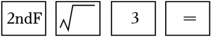
，对应的计算是（　　）

- A. 23
- B. 32
- C. \( \sqrt[3]{3}\)
- D. \( \sqrt{3}\)

【答案】C

【解析】解：根据按键顺序可知算式为\( \sqrt[3]{3}\)．
故选：C．

## 7. 单选题（难度：简单）

如图，若用我们数学课本上采用的科学计算器进行计算，其按键顺序如下：

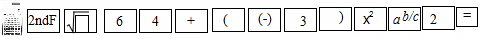

则输出结果应为（　　）

- A. \( \frac{1}{2}\)
- B. \( \frac{13}{2}\)
- C. \( \frac{17}{2}\)
- D. \( \frac{25}{2}\)

【答案】C

【解析】解：依题意得：\( \sqrt[3]{64}+\)（﹣3）2÷2\( =\frac{17}{2}\)．
故选：C．

## 8. 单选题（难度：简单）

利用教材中的计算器依次按键如下：则计算器显示的结果与下列各数中最接近的一个是（　　）

【答案】A

## 9. 单选题（难度：简单）

计算\( \sqrt{3}-\sqrt{2}\)的结果精确到0.01是（可用科学计算器计算或笔算）（

- A. 0.30
- B. 0.31
- C. 0.32
- D. 0.33

【答案】C

【解析】解：∵\( \sqrt{3}\approx \)1.732，\( \sqrt{2}\approx \)1.414，
∴\( \sqrt{3}-\sqrt{2}\approx \)1.732﹣1.414＝0.318≈0.32．
故选：C．

## 10. 单选题（难度：简单）

下列计算结果正确的是（　　）

【答案】A

## 11. 单选题（难度：简单）

式子2<latex class="math-tex">\( \sqrt{3}+\sqrt{2}\)</latex>的结果精确到0.01为（可用计算器计算或笔算）（

【答案】A

## 12. 单选题（难度：简单）

利用教材中的计算器依次按键如下：，则计算器面板显示的结果为（　　）

【答案】A

## 13. 单选题（难度：简单）

有一个计算器，计算\( \sqrt{2}\)时只能显示1.41421356237十三位（包括小数点），现在想知道7后面的数字是什么，可以在这个计算器中计算下面哪一个值（　　）

- A. \( 10\sqrt{2}\)
- B. \( 10(\sqrt{2}-1)\)
- C. \( 100\sqrt{2}\)
- D. \( \sqrt{2}-1\)

【答案】B

【解析】解：A.10\( \sqrt{2}=\)14.1421356237，总的位数还是13位，
所以不可能出现7后面的数字，故A错误；
B.10（\( \sqrt{2}-\)1）＝14.1421356237﹣10＝4.1421356237一共12位，
这样7后面的数字一定会出现，故B正确；
C.100\( \sqrt{2}=\)141.421356237，总的位数还是13位，
所以不可能出现7后面的数字，故C错误；
D.\( \sqrt{2}-\)1＝1.41421356237﹣1＝0.41421356237一共13位，
这样7后面的数字不可能出现，故D错误；
故选：B．

## 14. 单选题（难度：简单）

在计算器上按键
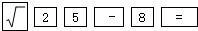
显示的结果是（　　）

- A. ﹣3
- B. 3
- C. 17
- D. 33

【答案】A

【解析】解：在计算器上按键
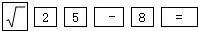

是在计算\( \sqrt{25}-\)8，结果为﹣3．
故选：A．

## 15. 单选题（难度：非常简单）

利用教材中的计算器计算\( \sqrt[3]{3}\)时，进行如下按键
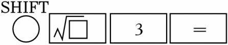
，显示1.44224957，则若按键：
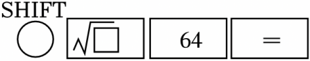
，显示（　　）

- A. 8
- B. ±8
- C. 4
- D. ±4

【答案】C

【解析】解：由题意得\( \sqrt[3]{64}=4\)，
故选：C．

## 16. 单选题（难度：简单）

在计算器上按键显示的结果是（　　）

【答案】A

## 17. 单选题（难度：适中）

用计算器求23值时，需相继按“2”，“∧”，“3”，“＝”键，若小红相继按“√”，“2”，“∧”，“4”，“＝”键，则输出结果是（　　）

【答案】A

## 18. 单选题（难度：简单）

用计算器求\( \sqrt{44.86}\)的值为（结果精确到0.01位）（　　）

- A. 6.69
- B. 6.7
- C. 6.70
- D. ±6.70

【答案】C

【解析】解：\( \sqrt{44.86}\approx \)6.69776≈6.70．
故选：C．

## 19. 单选题（难度：简单）

某同学在用计算器估算6的算术平方根时，需要用到以下哪个键（　　）

- A. 
- B. 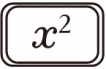
- C. 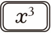
- D. 

【答案】A

【解析】解：根据计算器的相关知识，可知答案为A． 
故选：A．

## 20. 单选题（难度：适中）

用计算器计算<latex class="math-tex">\( 4÷2\sqrt{3}\)</latex>的近似值（精确到0.01），结果是（　　）

【答案】A

## 21. 单选题（难度：非常简单）

在用计算器求45的算术平方根时，需要用到的按键是（　　）

- A. 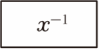
- B. 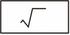
- C. 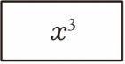
- D. 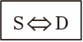

【答案】B

【解析】解：由题可知，
在用计算器求45的算术平方根时，需要用到的按键\( \sqrt{}\)．
故选：B．

## 22. 单选题（难度：简单）

若用湘教版初中数学教材上使用的某种计算器进行计算，则按键的结果为（　　）
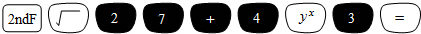

- A. 21
- B. 15
- C. 84
- D. 67

【答案】D

【解析】解：由题意得，算式为：
\( \sqrt[3]{27}+\)43
＝3+64
＝67．
故选：D．

## 23. 单选题（难度：简单）

小凯想用计算器来计算二次根式和乘法，当他以

的顺序按键后，显示的结果为（　　）

- A. 0.04
- B. 0.4
- C. 0.06
- D. 0.6

【答案】C

【解析】解：当他以

的顺序按键后，
显示的结果为0.173×0.346＝0.059≈0.06，
故选：C．

## 24. 单选题（难度：适中）

用计算器探索：已知按一定规则排列的一组数：1，\( \frac{1}{\sqrt{2}}\)，\( \frac{1}{\sqrt{3}}\)，…，\( \frac{1}{\sqrt{19}}\)，\( \frac{1}{\sqrt{20}}\)，如果从中选出若干个数，使它们的和大于3，那么至少要选几个数（

- A. 3个数
- B. 4个数
- C. 5个数
- D. 6个数

【答案】C

【解析】解：\( \frac{1}{\sqrt{2}}=\frac{1}{1.414}\approx \)0.7072，\( \frac{1}{\sqrt{3}}=\frac{1}{1.732}=\)0.5774，\( \frac{1}{\sqrt{4}}=\frac{1}{2}\)，\( \frac{1}{\sqrt{5}}=\frac{1}{2.236}=\)0.4472
1\( +\frac{1}{\sqrt{2}}+\frac{1}{\sqrt{3}}+\frac{1}{\sqrt{4}}=\)1+0.7072+0.5774\( +\frac{1}{2}=\)2.7846＜3，
1\( +\frac{1}{\sqrt{2}}+\frac{1}{\sqrt{3}}+\frac{1}{\sqrt{4}}+\frac{1}{\sqrt{5}}=\)1+0.7072+0.5774\( +\frac{1}{2}+\)0.4472＝3.2316＞3
故使它们的和大于3，那么至少要选5个数．
故选：C．

## 25. 单选题（难度：适中）

用计算器计算，若按键顺序为
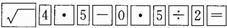
，相应算式是（　　）

- A. \( \sqrt{4}\times \)5﹣0×5÷2＝
- B. （\( \sqrt{4}\times \)5﹣0×5）÷2＝
- C. \( \sqrt{4.5}-\)0.5÷2＝
- D. （\( \sqrt{4.5}-\)0.5）÷2＝

【答案】C

【解析】解：∵按键顺序为
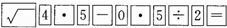
，
∴相应算式是\( \sqrt{4.5}-\)0.5÷2＝．
故选：C．

## 26. 单选题（难度：适中）

用科学计算器计算：（<latex class="math-tex">\( \sqrt{2005}-\)</latex>6.192）×100等于（　　）

【答案】A

## 27. 单选题（难度：适中）

如图，面积为30m2的正方形的四个角是面积为2m2的小正方形，用计算器求得a的长为（　　）（保留3个有效数字）

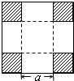

- A. 2.70m
- B. 2.66m
- C. 2.65m
- D. 2.60m

【答案】C

【解析】解：∵正方形的边长为\( \sqrt{30}\)，\( \sqrt{30}\)，
截取的小正方形的边长为\( \sqrt{2}\)，
∴a\( =\sqrt{30}-\)2\( \sqrt{2}\approx \)2.65m．
故选：C．

## 28. 单选题（难度：简单）

使用课本所示型号的计算机，按键顺序是
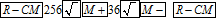
，最后显示的结果是（　　）

- A. 220
- B. 292
- C. 122
- D. 10

【答案】D

【解析】解：根据按键顺序可知要计算的式子为：\( \sqrt{256}-\sqrt{36}=\)16﹣6＝10．
故选：D．

## 29. 单选题（难度：简单）

利用计算器求\( \sqrt{0.059}\)的值，正确的按键顺序为（　　）

- A. 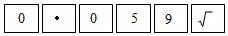
- B. 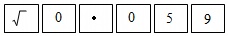
- C. 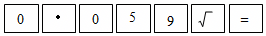
- D. 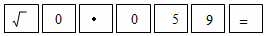

【答案】D

【解析】解：采用的科学计算器计算\( \sqrt{0.059}\)，按键顺序正确的是D选项中的顺序．
故选：D．

## 30. 单选题（难度：适中）

用计算器计算\( \sqrt[3]{28.36}\)约为（　　）

- A. 3.049
- B. 3.050
- C. 3.051
- D. 3.052

【答案】B

【解析】解：\( \sqrt[3]{28.36}\approx \)3.050，
所以用计算器计算\( \sqrt[3]{28.36}\)约为3.050．
故选：B．

## 31. 单选题（难度：非常简单）

用我们数学课本上选用的科学计算器计算下列算式的值，其按键顺序正确的是（　　）

【答案】A

## 32. 单选题（难度：简单）

运用湘教版初中数学教材上使用的某种电子计算器求\( \sqrt{8}+\sqrt[3]{6}\)的近似值，其按键顺序正确的是（　　）

- A. 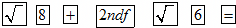
- B. 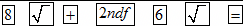
- C. 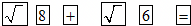
- D. 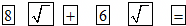

【答案】A

【解析】解：\( \sqrt{8}\)是先按\( \sqrt{\left(\right)}\)，再按8，
\( \sqrt[3]{6}\)是先按2nd键，再按\( \sqrt{\left(\right)}\)，最后按6，
则\( \sqrt{8}+\sqrt[3]{6}\)的顺序先按\( \sqrt{\left(\right)}\)，再按8，按+，按2nd键，按\( \sqrt{\left(\right)}\)，最后按6，
故选：A．

## 33. 单选题（难度：适中）

按键显示的结果约为（　　）

【答案】A

## 34. 单选题（难度：简单）

利用计算器求\( \sqrt{0.87}\)的值，正确的按键顺序为（　　）

- A. 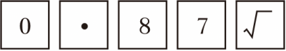
- B. 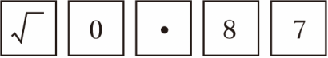
- C. 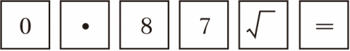
- D. 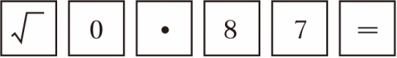

【答案】D

【解析】解：采用的科学计算器计算\( \sqrt{0.87}\)，按键顺序正确的是：\( \sqrt{}\to 0\to ．\to 8\to 7\to =\)．
故选：D．

## 35. 单选题（难度：适中）

用CZ1206型计算器计算某运算式子，若正确的按键顺序是，则此运算式子应是（　　）

【答案】A

## 36. 单选题（难度：简单）

如图，某计算器中三个按键，以下是这三个按键的功能：：将荧幕显示的数变成它的算术平方根；：将荧幕显示的数变成它的倒数；：将荧幕显示的数变成它的平方．小明输入一个数据后，按照如图步骤操作，依次按照从第一步到第三步循环按键．若一开始输入的数据为10，则第2019步后，显示的结果是（　　）

【答案】A

## 37. 单选题（难度：适中）

用计算器求<latex class="math-tex">\( \sqrt{3.489}\)</latex>，结果为（精确到0.01）（　　）

【答案】A

## 38. 单选题（难度：适中）

用计算器求2008的算术平方根时，下列四个键中，必须按的键是（　　）

- A. 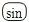
- B. 
- C. 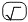
- D. 

【答案】C

【解析】解：根据计算器的知识可知答案：C
故选：C．

## 39. 单选题（难度：适中）

用计算器计算<latex class="math-tex">\( \sqrt{0.8}\)</latex>约等于（　　）

【答案】A

## 40. 单选题（难度：简单）

如图，某同学利用计算器中的，，三个按键设置计算程序，以下是这三个按键的功能．①：将荧幕显示的数变成它的算术平方根；②：将荧幕显示的数变成它的倒数；③：将荧幕显示的数变成它的平方．小明输入一个数据后，程序将按照以下步骤进行，依次按照从第一步到第三步循环计算．若一开始输入的数据为10，那么第2021步之后，显示的结果是（　　）

【答案】A

## 41. 单选题（难度：简单）

用计算器求2017的算术平方根时，下列四个键中，必须按的键是（　　）

【答案】A

## 42. 单选题（难度：简单）

如图，某计算器中有、、三个按键，以下是这三个按键的功能．①：将荧幕显示的数变成它的正平方根；②：将荧幕显示的数变成它的倒数；③：将荧幕显示的数变成它的平方．小明输入一个数据后，按照以下步骤操作，依次循环按键．若一开始输入的数据为10，那么第2018步之后，显示的结果是（　　）

【答案】A

## 43. 单选题（难度：简单）

如图，某计算器有，，三个按键，以下是三个按键的功能．①：将荧幕显示的数变成它的算术平方根；②：将荧幕显示的数变成它的倒数；③：将荧幕显示的数变成它的平方，小宇输入一个数据后，按照以下步骤操作，依次按照从第一步到第三步循环按键，，若一开始输入的数据为10，则第2022步之后，显示的结果是（　　）

【答案】A

## 44. 单选题（难度：简单）

如图，某计算器中有、、三个按键，以下是这三个按键的功能．①：将荧幕显示的数变成它的算术平方根；②：将荧幕显示的数变成它的倒数；③：将荧幕显示的数变成它的平方．小明输入一个数据后，按照以下步骤操作，依次按照从第一步到第三步循环按键．若一开始输入的数据为5，那么第2021步之后，显示的结果是（　　）

【答案】A

## 45. 单选题（难度：简单）

用计算器求2014的算术平方根时，下列四个键中，必须按的键是（　　）

【答案】A

## 46. 单选题（难度：简单）

用计算器求2012的平方根时，下列四个键中，必须按的键是（　　）

【答案】A

## 47. 单选题（难度：适中）

在使用科学计算器时，依次按下列键后，会得到下列哪个结果（说明：表示第二功能键）（　　）

【答案】A

## 48. 单选题（难度：简单）

利用如图所示的计算器进行计算，按键操作不正确的是（　　）

【答案】A

## 49. 单选题（难度：适中）

用我们数学课本上采用的科学计算器计算下列式子，其按键顺序正确的是（　　）

【答案】A

## 50. 单选题（难度：适中）

利用计算器求\( \sqrt{8}+\sqrt[3]{6}\)的值，其按键顺序正确的是（　　）

- A. 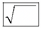

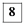

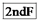

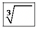

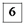

- B. 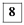

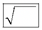

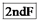

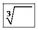

- C. 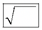

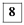

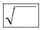

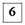

- D. 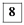

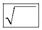

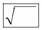

【答案】A

【解析】解：利用计算器求\( \sqrt{8}+\sqrt[3]{6}\)的值，其按键顺序正确的是：

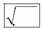

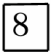

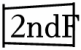

故选：A．
