# 知识点·画垂线（同步练习）

> 教材：数学·七年级下册·沪科技版2024新教材 ｜ 来源：国家中小学智慧教育平台·在线练习 ｜ 共 53 题

## 1. 单选题（难度：适中）

利用三角尺或量角器判断，图中的两点所成的直线能与直线l垂直的是（　　）

- A. 点M和点N
- B. 点P和点Q
- C. 点M和点Q
- D. 点N和点P

【答案】C

【解析】解：作直线MQ交l于A，NP交l于B，NQ交l于C，MP交l于D，如图所示：

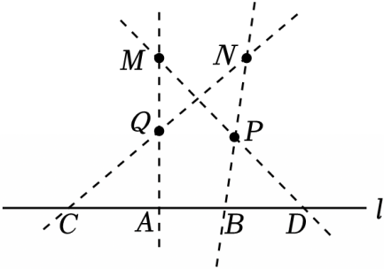

利用三角尺可得出MQ⊥直线l（或利用量角器量出∠QAC，∠QCA，∠PBD，∠PDB的度数即可得出MQ⊥直线l）．
故选：C．

## 2. 单选题（难度：非常简单）

过点M作AB的垂线CD，下列选项中，三角板的放法正确的是（　　）

- A. 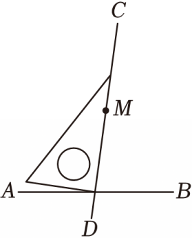
- B. 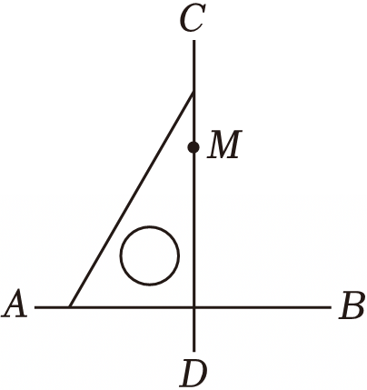
- C. 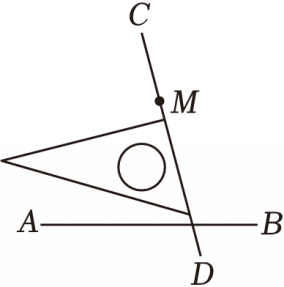

【答案】B

【解析】解：A、CD与AB不垂直，不符合题意；

B、CD是过点M的AB的垂线，符合题意；

C、CD与AB不垂直，不符合题意；​

故选：B．

## 3. 单选题（难度：简单）

下列选项中，过点P画直线l的垂线MN，用三角尺或量角器操作正确的是（　　）

- A. 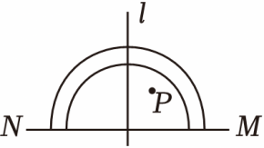
- B. 
- C. 

【答案】C

【解析】解：过点P画直线l的垂线MN，用三角尺或量角器操

作正确的是
故选：C．

## 4. 单选题（难度：简单）

下列四个图形中，过点B作AC的垂线，正确的是（　　）

- A. 
- B. 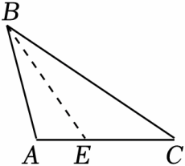
- C. 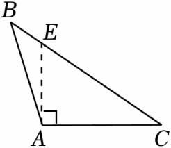

【答案】A

【解析】解：过点B作AC的垂线，则垂足在直线AC上，只有A选项符合题意，
故选：A．

## 5. 单选题（难度：非常简单）

过直线l外一点P画l的垂线CD，下列各图中，三角尺操作正确的是（　　）

- A. 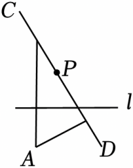
- B. 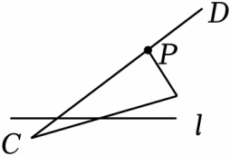
- C. 
- D. 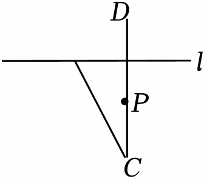

【答案】D

【解析】解：根据垂线的作法可得

，
故选：D．

## 6. 单选题（难度：适中）

下列说法正确的是（　　）

- A. 过线段外一点不一定能作出它的垂线
- B. 过直线m外一点A和直线m上一点B可画一条直线与m垂直
- C. 只能过直线外一点画一条直线和这条直线垂直
- D. 过任意一点均可作一条直线的垂线

【答案】D

【解析】解：A、过线段外一点一定能作出它的垂线，原说法错误，不符合题意；
B、过直线m外一点A和直线m上一点B不一定能画一条直线与m垂直，原说法错误，不符合题意；
C、过任意一点都可以画一条直线和已知直线垂直，原说法错误，不符合题意；
D、过任意一点均可作一条直线的垂线，原说法正确，符合题意；
故选：D．

## 7. 单选题（难度：简单）

下列方法中，不是用来检验直线与平面垂直的工具是（　　）

- A. 铅垂线
- B. 两块三角尺
- C. 长方形纸片
- D. 合页型折纸．

【答案】C

【解析】解：由分析可知：铅垂线，三角尺，合页型折纸可以用来检验平面与平面是否垂直，
而长方形纸片不能判断直线与平面垂直．
故选：C．

## 8. 单选题（难度：简单）

如图，点M，N是直线a外两点，点O是直线a上一点，已知ON⊥a，OM⊥a，所以OM与ON重合的理由是（　　）

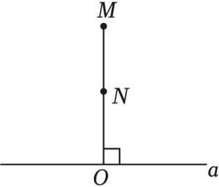

- A. 两点确定一条直线
- B. 垂线段最短
- C. 过一点只能作一条垂线
- D. 平面内，过一点有且只有一条直线与已知直线垂直

【答案】D

【解析】解：∵ON⊥a，OM⊥a，
∴根据在同一平面内，经过一点有且只有一条直线与已知直线垂直得到OM与ON重合，
故选：D．

## 9. 单选题（难度：非常简单）

在平面内，过一点画已知直线的垂线，可画垂线的条数是（　　）

- A. 0
- B. 1
- C. 2
- D. 无数

【答案】B

【解析】解：在平面内，过一点画已知直线的垂线，可画垂线的条数是1．
故选：B．

## 10. 单选题

如图，直线l代表一条河流，在河边O处修建一水闸，再过点O修建两条引水渠OA和OB，使得OA⊥l，OB⊥l，垂足为O，则OA与OB重合的理由是（　　）

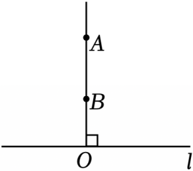

- A. 两点确定一条直线
- B. 垂线段最短
- C. 平面内，过一点有且只有一条直线与已知直线垂直
- D. 已知直线的垂线只有一条

【答案】C

【解析】解：由题意得：OA与OB重合的理由是：平面内，过一点有且只有一条直线与已知直线垂直，
故选：C．

## 11. 单选题（难度：简单）

如图，在平面内过A点作已知直线m的垂线，可作垂线的条数有（　　）

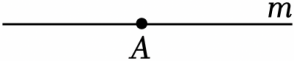

- A. 0条
- B. 1条
- C. 2条
- D. 无数条

【答案】B

【解析】解：在同一平面内，过一A点作已知直线m的垂线有一条．
故选：B．

## 12. 单选题（难度：适中）

下列说法中，
①过直线外一点作已知直线的垂线有且只有一条；
②连接两点的线段叫两点间的距离；
③等角的补角互余；
④两点之间，线段最短；
其中正确的有（　　）

- A. 1个
- B. 2个
- C. 3个
- D. 4个

【答案】B

【解析】解：∵过直线外一点作已知直线的垂线有且只有一条，
∴①正确；
∵连接两点的线段长度叫两点间的距离，
∴②不正确；
∵等角的补角相等，
∴③不正确；
∵两点之间，线段最短，
∴④正确．
综上所述：正确的说法是①④，共2个．
故选：B．

## 13. 单选题（难度：适中）

利用三角尺或量角器判断，图中的两点所成的直线能与直线l垂直的是（　　）

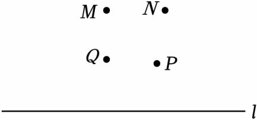

- A. 点M和点N
- B. 点P和点Q
- C. 点M和点Q
- D. 点N和点P

【答案】C

【解析】解：作直线MQ交l于A，NP交l于B，NQ交l于C，MP交l于D，如图所示：

 
利用三角尺可得出MQ⊥直线l（或利用量角器量出∠QAC，∠QCA，∠PBD，∠PDB的度数即可得出MQ⊥直线l）．
故选：C．

## 14. 单选题（难度：非常简单）

如图，在直线l外任取一点Q，过点Q画直线l的垂线，可画出的垂线有（　　）

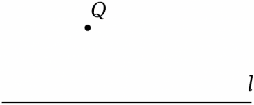

- A. 0条
- B. 1条
- C. 2条
- D. 无数条

【答案】B

【解析】解：在平面内，过一点有且只有一条直线与已知直线垂直．
故选：B．

## 15. 单选题（难度：非常简单）

如图，在同一平面内，经过直线l外一点A画l的垂线，能画出（　　）

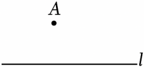

- A. 0条
- B. 1条
- C. 2条
- D. 无数条

【答案】B

【解析】解：在同一平面内，经过直线l外一点A画l的垂线，能画出1条．
故选：B．

## 16. 单选题（难度：简单）

如图，过点P作线段AB的垂线，垂足在（　　）

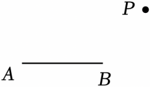

- A. 线段AB上
- B. 线段AB的延长线上
- C. 线段AB的反向延长线上
- D. 直线AB外

【答案】B

【解析】解：如图，

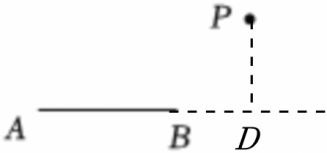
 
过点P作线段AB的垂线，垂足在线段AB的延长线上．
故选：B．

## 17. 单选题（难度：非常简单）

下列选项中，过点A画BC的垂线AD，三角板摆放正确的是（　　）

- A. 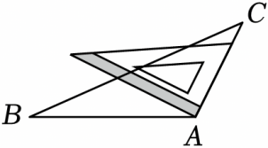
- B. 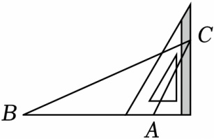
- C. 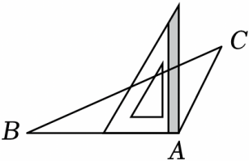
- D. 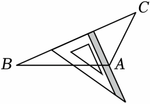

【答案】D

【解析】解：过点A画BC的垂线AD，三角板摆放正确的是选项D．
故选：D．

## 18. 单选题（难度：非常简单）

如图，在同一平面内过点A画直线m的垂线，能画（　　）

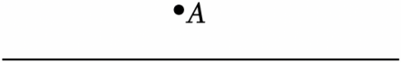

- A. 0条
- B. 1条
- C. 2条
- D. 无数条

【答案】B

【解析】解：根据“在同一平面内，过直线外一点有且只有一条直线与已知直线垂直”得：在同一平面内过点A画直线m的垂线，只能画一条．
故选：B．

## 19. 单选题（难度：适中）

如图，若过点P画直线l的垂线，则垂线经过的点是（　　）

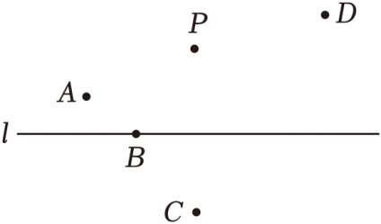

- A. 点A
- B. 点B
- C. 点C
- D. 点D

【答案】C

【解析】解：由垂线的定义可知，直线PC⊥l，

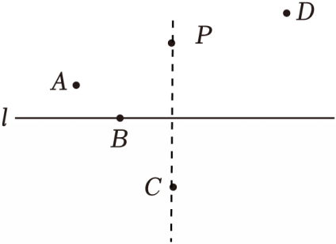
 
因此垂线经过的点是点C．
故选：C．

## 20. 单选题（难度：非常简单）

过点M作AB的垂线CD，下列选项中，三角板的放法正确的是（　　）

- A. 
- B. 
- C. 
- D. 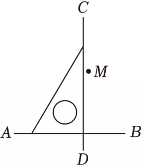

【答案】B

【解析】解：A、CD与AB不垂直，不符合题意；
B、CD是过点M的AB的垂线，符合题意；
C、CD与AB不垂直，不符合题意；
D、CD不经过点M，不符合题意；
故选：B．

## 21. 单选题（难度：简单）

下列选项中，过点M作直线l的垂线，三角板放置正确的是（　　）

- A. 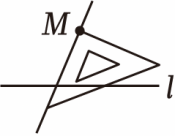
- B. 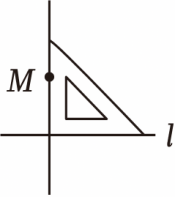
- C. 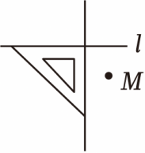
- D. 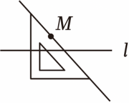

【答案】B

【解析】解：∵三角板有一个角是直角，
∴三角板的一条直角边与直线l重合，
∵过点M作直线l的垂线，
∴三角板的另一条直角边过点M，
∴符合上述条件的图形只有选项B．
故选：B．

## 22. 单选题（难度：非常简单）

在平面内作已知直线m的垂线，可作垂线的条数有（　　）

- A. 0条
- B. 1条
- C. 2条
- D. 无数条

【答案】D

【解析】解：在平面内作已知直线的垂线，
可作垂线的条数有无数条，
故选：D．

## 23. 单选题（难度：非常简单）

过点P作直线l的垂线CD，下面三角板的摆放正确的是（　　）

- A. 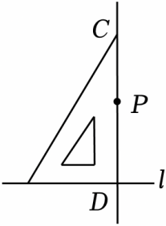
- B. 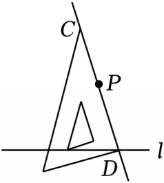
- C. 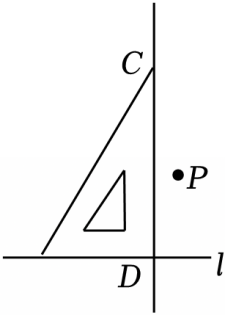
- D. 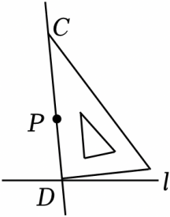

【答案】A

【解析】解：过点P作直线l的垂线CD，上面三角板的摆放正确的是，

  
故选：A．

## 24. 单选题（难度：简单）

过点A画线段BC所在直线的垂线段，其中正确的是（　　）

- A. 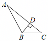
- B. 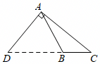
- C. 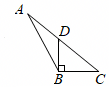
- D. 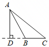

【答案】D

【解析】解：根据垂线段的定义，仅D选项符合要求．
故选：D．

## 25. 单选题（难度：适中）

已知直线AB、CB在同一平面内，若AB⊥l，垂足为B，CB⊥l，垂足也为B，则符合题意的图形可以是（　　）

- A. 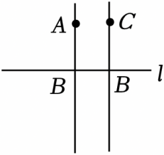
- B. 
- C. 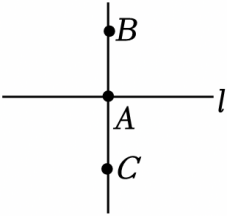
- D. 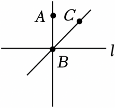

【答案】B

【解析】解：根据题意可得图形，

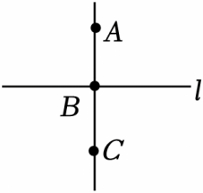
 
故选：B．

## 26. 单选题（难度：简单）

下列四个图形中，过点B作AC的垂线，正确的是（　　）

- A. 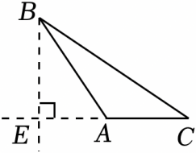
- B. 
- C. 
- D. 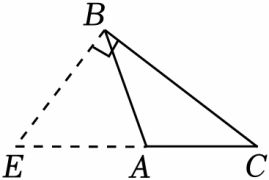

【答案】A

【解析】解：过点B作AC的垂线，则垂足在直线AC上，只有A选项符合题意，
故选：A．

## 27. 单选题（难度：适中）

在下列格点中，线段AB与CD垂直的是（　　）

- A. 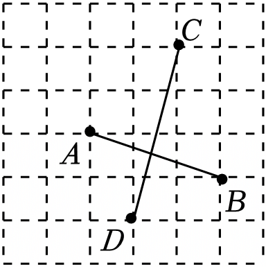
- B. 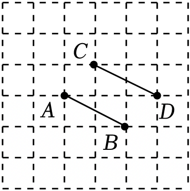
- C. 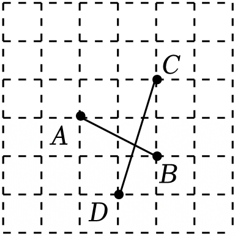
- D. 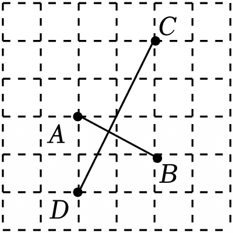

【答案】D

【解析】解：在上列格点中，线段AB与CD垂直的是，

 
故选：D．

## 28. 单选题（难度：非常简单）

过点P向线段AB所在直线引垂线，正确的画法是（　　）

- A. 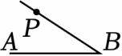
- B. 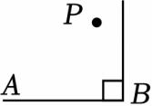
- C. 
- D. 

【答案】C

【解析】解：A选项，没有垂直，故该选项不符合题意；
B选项，没有过点P，故该选项不符合题意；
C选项，过点P作AB的垂线，垂线是直线，故该选项符合题意；
D选项，PO为垂线段，不是直线，故该选项不符合题意；
故选：C．

## 29. 单选题（难度：非常简单）

在一张透明的纸上画一条直线l，在l外任取一点Q，并折出过点Q且与l垂直的直线．这样的直线能折出（　　）

- A. 0条
- B. 1条
- C. 2条
- D. 3条

【答案】B

【解析】解：根据垂线的性质，这样的直线只能作一条，
故选：B．

## 30. 单选题（难度：非常简单）

下列选项中，过点P画AB的垂线CD，三角板放法正确的是（　　）

- A. 
- B. 
- C. 
- D. 

【答案】C

【解析】解：∵三角板有一个角是直角．
∴三角板的一条直角边与直线AB重合．
∵过点P作直线AB的垂线．
∴三角板的另一条直角边过点P．
∴符合上述条件的图形只有选项C．
故选：C．

## 31. 单选题（难度：非常简单）

过直线m外的一点Q作m的垂线，下列图中借助直角三角尺操作正确的是（　　）

- A. 
- B. 
- C. 
- D. 

【答案】D

【解析】解：过直线外一点向直线作垂线，则过点Q的垂线垂直于直线m，交点处所成角度为90°，
∴运用直角尺操作正确的是D选项．
故选：D．

## 32. 单选题（难度：适中）

下列方法中，不能用来检验平面与平面垂直的方法是（　　）

- A. 铅垂线
- B. 两把三角尺
- C. 合页型折纸
- D. 长方形纸片

【答案】D

【解析】解：由分析可知：铅垂线，两块三角尺，合页型折纸可以用来检验平面与平面是否垂直，
而长方形纸片只能判断长与宽互相垂直，不能判断与水平面垂直，也是无法保证水平面一定是水平的，
故选：D．

## 33. 单选题（难度：适中）

如果直线ON⊥直线a，直线OM⊥直线a，那么OM与ON重合（即O，M，N三点共线），其理由是（　　）

- A. 两点确定一条直线
- B. 在同一平面内，过两点有且只有一条直线与已知直线垂直
- C. 在同一平面内，过一点有且只有一条直线与已知直线垂直
- D. 两点之间，线段最短

【答案】C

【解析】解：如果直线ON⊥直线a，直线OM⊥直线a，那么OM与ON重合（即O，M，N三点共线），其理由是在同一平面内，过一点有且只有一条直线与已知直线垂直，
故选：C．

## 34. 单选题（难度：适中）

如图，经过点O的直线a，b，c，d中，有一条直线与直线l垂直，请借助三角板判断，与直线l垂直的直线是（　　）

- A. a
- B. b
- C. c
- D. d

【答案】D

【解析】解：把三角板的一条直角边与l重合，慢慢移动，在此过程中，
直线d经过三角板的另一条直角边，所以说与直线l垂直的直线是d，
故选：D．

## 35. 单选题（难度：适中）

下列说法正确的有（　　）
①在同一平面内，过直线上一点有且只有一条直线垂直于已知直线；
②在同一平面内，过直线外一点有且只有一条直线垂直于已知直线；
③在同一平面内，过一点可以任意画一条直线垂直于已知直线；
④在同一平面内，有且只有一条直线垂直于已知直线．

- A. 1个
- B. 2个
- C. 3个
- D. 4个

【答案】B

【解析】解：由垂线的性质可知①②正确．
故选：B．

## 36. 单选题（难度：简单）

下列选项中，过点P画直线l的垂线MN，用三角尺或量角器操作正确的是（　　）

- A. 
- B. 
- C. 
- D. 

【答案】C

【解析】解：过点P画直线l的垂线MN，用三角尺或量角器操作正确的是

 
故选：C．

## 37. 单选题（难度：简单）

P为直线l上的一点，Q为l外一点，下列说法不正确的是（　　）

- A. 过P可画直线垂直于l
- B. 过Q可画直线l的垂线
- C. 连接PQ使PQ⊥l
- D. 过Q可画直线与l垂直

【答案】C

【解析】解：A、∵P为直线l上的一点，Q为l外一点，∴过P可画直线垂直于l，正确，不合题意；
B、∵P为直线l上的一点，Q为l外一点，∴过Q可画直线l的垂线，正确，不合题意；
C、连接PQ不能保证PQ⊥l，故错误，符合题意；
D、∵Q为l外一点，∴过Q可画直线与l垂直，正确，不合题意；
故选：C．

## 38. 单选题（难度：非常简单）

从直线外一点到已知直线上的点的所有连线中，与已知直线垂直的线段有多少条？（　　）

- A. 0条
- B. 1条
- C. 2条
- D. 无数条

【答案】B

【解析】解：根据垂线的性质：过直线外一点，向已知直线作垂线，只能作一条，因此从直线外一点到已知直线的垂线段只有一条，
故选：B．

## 39. 单选题（难度：非常简单）

过直线l外一点P画l的垂线CD，下列各图中，三角尺操作正确的是（　　）

- A. 
- B. 
- C. 
- D. 

【答案】D

【解析】解：根据垂线的作法可得

， 
故选：D．

## 40. 单选题（难度：非常简单）

过点P作AB的垂线CD，下列选项中，三角板的放法正确的是（　　）

- A. 
- B. 
- C. 
- D. 

【答案】C

【解析】解：过点P作AB的垂线CD，下列选项中，三角板的放法正确的是，

 
故选：C．

## 41. 单选题（难度：非常简单）

下面不能用来检验直线与平面垂直的工具是（　　）

- A. 长方形纸片
- B. 合页型折纸
- C. 铅垂线
- D. 三角尺

【答案】A

【解析】解：由分析可知：铅垂线，三角尺，合页型折纸可以用来检验直线与平面是否垂直，
而长方形纸片只能判断两条直线互相垂直，不能判断直线与平面是否垂直，
故选：A．

## 42. 单选题（难度：非常简单）

如图，过点A作直线l的垂线，可作垂线的条数有（　　）

- A. 0条
- B. 1条
- C. 2条
- D. 无数条

【答案】B

【解析】解：根据垂线的性质，经过一个点，有且只有一条直线和已知直线垂直，
所以过点A作直线l的垂线，有且只有一条．
故选：B．

## 43. 单选题（难度：适中）

如图，取两根木条a，b，将它们钉在一起，固定木条a，转动木条b，当a⊥b时，∠α＝（　　）

- A. 45°
- B. 60°
- C. 90°
- D. 180°

【答案】C

【解析】解：当a⊥b时，∠α＝90°．
故选：C．

## 44. 单选题（难度：适中）

如图，在纸片上有线段AB和线段外一点M，将纸片沿过点M的直线折叠，使线段AB分成两部分并落在同一条直线上，下列说法正确的是（　　）

- A. 折痕平分线段AB
- B. 折痕与线段AB互相平行
- C. 折痕与线段AB互相垂直
- D. 折痕与线段AB不能相交

【答案】C

【解析】解：A、将纸片沿过点M
的直线折叠，当折痕平分线段AB时，如图所示：

 
∴由折叠性质可知，CB与CB′重合，不符合题意；
B、将纸片沿过点M的直线折叠，当折痕与线段AB互相平行时，如图所示：

 
∴由折叠性质可知，CB与A′B′重合，不符合题意；
C、将纸片沿过点M的直线折叠，当折痕与线段AB互相垂直时，如图所示：

 
∴由折叠性质可知，CB与CB′重合、CA与CA′重合，符合题意；
D、将纸片沿过点M的直线折叠，当折痕与线段AB不能相交时，不妨假设折痕与线段AB互相平行，如图所示：

 
∴由折叠性质可知，CB与A′B′重合，不符合题意；
综上所述，折痕与线段AB互相垂直时，满足题意，
故选：C．

## 45. 单选题（难度：适中）

如图，OM⊥NP，ON⊥NP，所以ON与OM重合，理由是（　　）

- A. 两点确定一条直线
- B. 同一平面内，经过一点有且只有一条直线与已知直线垂直
- C. 过一点只能作一直线
- D. 垂线段最短

【答案】B

【解析】解：利用OM⊥NP，ON⊥NP，所以直线ON与OM重合，
其理由是：同一平面内，经过一点有且只有一条直线与已知直线垂直．
故选：B．

## 46. 单选题（难度：适中）

在数学课上，同学们在练习过点B作线段AC所在直线的垂线段时，有一部分同学画出下列四种图形，请你数一数，错误的个数为（　　）

- A. 1个
- B. 2个
- C. 3个
- D. 4个

【答案】D

【解析】解：从左向右第一个图形中，垂线段是线段，图中画的是射线，故错误；
第二个图形中，BE不垂直AC，所以错误；
第三个图形中，是过点A作的AC的垂线，所以错误；
第四个图形中，过点B作的BC的垂线，也错误．
故选：D．

## 47. 单选题（难度：简单）

过点P向线段AB所在直线画垂线，画图正确的是（　　）

- A. 
- B. 
- C. 
- D. 

【答案】C

【解析】解：A、PB与AB不垂直，故不正确；
B、没有经过P点，故不正确；
C、经过P点且直线PO⊥AB，故正确；
D、PO是线段，不是直线故不正确．
故选：C．

## 48. 单选题（难度：非常简单）

过点P向线段AB所在的直线画垂线，正确的画法是（　　）

- A. 
- B. 
- C. 
- D. 

【答案】B

【解析】解：A选项，没有过点P，过该选项不符合题意；
B选项，过点P作AB的垂线，垂线是直线，故该选项符合题意；
C选项，PO为垂线段，不是直线，故该选项不符合题意；
D选项，PA没有垂直于AB，故该选项不符合题意；
故选：B．

## 49. 单选题（难度：简单）

下列各图中，过直线l外点P画l的垂线CD，三角板操作正确的是（　　）

- A. 
- B. 
- C. 
- D. 

【答案】D

【解析】解：根据分析可得，用直角三角板的一条直角边与l重合，另一条直角边过点P后沿直角边画直线，
∴D选项的画法正确，
故选：D．

## 50. 单选题（难度：非常简单）

下列各图中，过直线l外的点P画直线l的垂线，三角尺操作正确的是（　　）

- A. 
- B. 
- C. 
- D. 

【答案】C

【解析】解：用直角三角板的一条直角边与l重合，另一条直角边过点P后沿直角边画直线，
∴C选项的画法正确，
故选：C．

## 51. 单选题（难度：简单）

在数学课上，同学们在练习过点B作线段AC所在直线的垂线段时，有一部分同学画出下列四种图形，其中正确的是（　　）

- A. 
- B. 
- C. 
- D. 

【答案】A

【解析】解：根据垂线段的定义可知，A选项中线段BE，是点B作线段AC所在直线的垂线段，
故选：A．

## 52. 单选题（难度：简单）

过点P作AB的垂线，正确的是（　　）

- A. 
- B. 
- C. 
- D. 

【答案】C

【解析】解：过点P作AB的垂线即直线经过P点，且垂直AB，
故选：C．

## 53. 单选题（难度：简单）

过点B画线段AC所在直线的垂线段，其中正确的是（　　）

- A. 
- B. 
- C. 
- D. 

【答案】D

【解析】解：根据垂线段的定义可知，过点B画线段AC所在直线的垂线段，可得：

 
故选：D．
