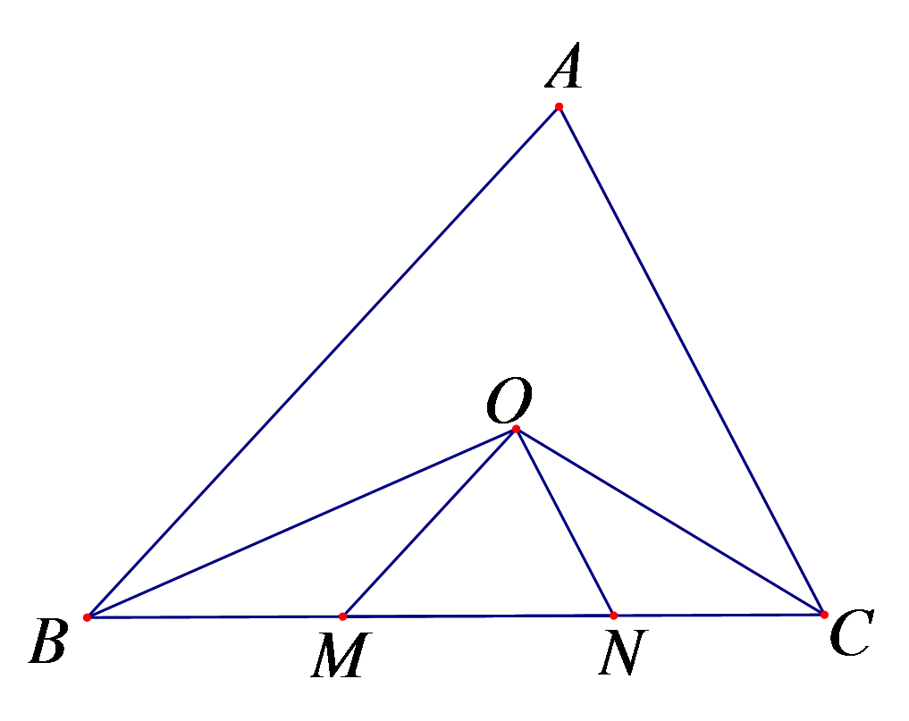
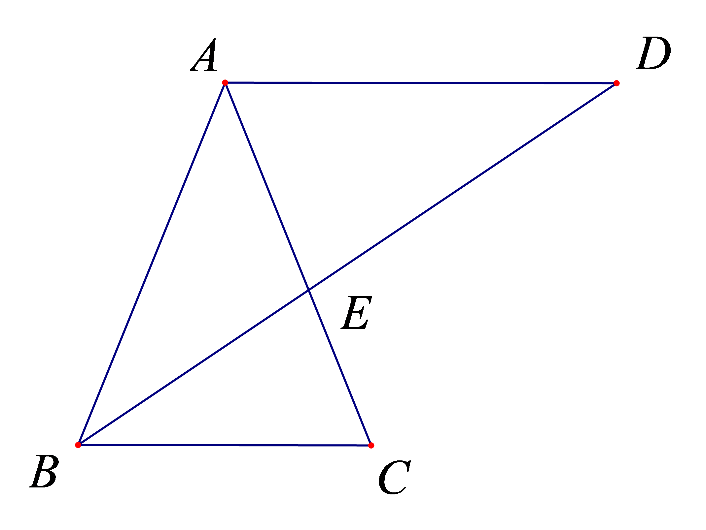

# 知识点·等腰三角形性质与判定（同步练习）

> 教材：数学·七年级下册·沪科技版2024新教材 ｜ 来源：国家中小学智慧教育平台·在线练习 ｜ 共 3 题

## 1. 填空题（难度：简单）

如图，△ABC中，BO、CO分别平分∠ABC、∠ACB，OM∥AB，ON∥AC，
BC＝10cm，则△OMN的周长＝。

【答案】10cm

【解析】​

## 2. （难度：适中）

如图，△ABC中，CE、CF分别是∠ACB和外角∠ACM的平分线，EF//BC交
AC于点D，求证：DE＝DF。

【答案】

利用角平分线和平行线得等角，再利用等角对等边即可得证。

【解析】​

## 3. （难度：适中）

如图，AB=AC=AD，且AD∥BC，探究∠C与∠D之间满足的等量关系。

【答案】

&ang;<i>C</i>=2&ang;<i>D</i>

【解析】​
