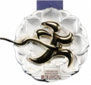
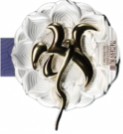
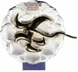
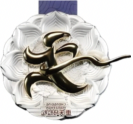
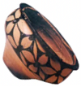
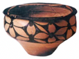

# 知识点·自然界和现实生活中的平移（同步练习）

> 教材：数学·七年级下册·沪科技版2024新教材 ｜ 来源：国家中小学智慧教育平台·在线练习 ｜ 共 27 题

## 1. 单选题（难度：简单）

下列不属于平移现象的是（　　）

【答案】A

## 2. 单选题（难度：简单）

下列物体的运动中，属于平移的是（　　）

- A. 电梯上下移动
- B. 翻开数学课本
- C. 电扇扇叶转动
- D. 落叶随风飘零

【答案】A

【解析】根据平移的定义，旋转的定义对各选项分析判断即可得解．

## 3. 单选题（难度：简单）

下列现象是数学中的平移的是（　　）

【答案】A

## 4. 单选题（难度：简单）

下列物体的运动属于平移的是（　　）

- A. 汽车方向盘的转动
- B. 小红荡秋千
- C. 电梯上顾客的升降运动
- D. 火车在弯曲的铁轨上行驶

【答案】C

【解析】根据平移的定义的定义对各选项判断即可．

## 5. 单选题（难度：简单）

下列生活现象中，属于平移的是（　　）

【答案】A

## 6. 单选题（难度：简单）

甲骨文是汉字的源头和中华优秀传统文化的根源，其字形简练，线条瘦劲，结构均衡对称，下列甲骨文中，能用其中一部分平移得到的是（　　）

【答案】A

## 7. 单选题（难度：简单）

如图是重庆马拉松比赛的奖牌，把该图形进行平移，能得到的图形是（　　）

- A. 
- B. 
- C. 

【答案】D

【解析】根据平移不改变图形的形状和大小，对应点的连线相等且互相平行即可判断．

## 8. 单选题（难度：简单）

“我是灵灵猴，也叫红中!”灵灵猴是一只来自黔灵山公园的猴子，也是贵阳地铁3号线的吉祥物，下列选项属于吉祥物灵灵猴平移得到的是（　　）

【答案】A

## 9. 单选题（难度：简单）

2024年巴黎奥运会是历史上第33届夏季奥运会，将于7月26日开幕．如图是本届奥运会的吉祥物“弗里热（ThePhryges）”，将图中的“弗里热”通过平移可得到下列选项中的（　　）

【答案】A

## 10. 单选题（难度：简单）

庙底沟博物馆作为一处展示彩陶文化和古代历史的旅游景点，以其春晚亮相的彩陶“花瓣纹”而成为热门打卡地，此图是小丽参观庙底沟博物馆后绘制的“花瓣纹彩陶盆”．在下面的四个图形中，能由该图经过平移得到的图形是（　　）

- A. 
- B. 
- C. 

【答案】C

【解析】根据平移的定义进行判断即可．

## 11. 单选题（难度：简单）

在下列生活现象中，属于平移现象的是（　　）

【答案】A

## 12. 单选题（难度：简单）

下列现象中，属于平移的是（　　）

【答案】A

## 13. 单选题（难度：简单）

下列物体的运动中，属于平移的是（　　）

- A. 电梯上下移动
- B. 翻开数学课本
- C. 电扇扇叶转动
- D. 落叶随风飘零

【答案】A

【解析】根据平移的定义，旋转的定义对各选项分析判断即可得解．

## 14. 单选题（难度：简单）

在下列现象中，属于平移的是（　　）

【答案】A

## 15. 单选题（难度：简单）

甲骨文是我国的一种古代文字，是汉字的早期形式，下列甲骨文中，能用其中一部分平移得到的是（　　）

【答案】A

## 16. 单选题（难度：简单）

庙底沟博物馆作为一处展示彩陶文化和古代历史的旅游景点，以其春晚亮相的彩陶“花瓣纹”而成为热门打卡地，此图是小丽参观庙底沟博物馆后绘制的“花瓣纹彩陶盆”．在下面的四个图形中，能由该图经过平移得到的图形是（　　）

【答案】A

## 17. 单选题（难度：简单）

下列物体的运动属于平移的是（　　）

- A. 汽车方向盘的转动
- B. 小红荡秋千
- C. 电梯上顾客的升降运动
- D. 火车在弯曲的铁轨上行驶

【答案】C

【解析】根据平移的定义的定义对各选项判断即可．

## 18. 单选题（难度：简单）

下列现象中，属于平移的是（　　）

- A. 钟摆的摆动
- B. 铝合金窗户左右移动
- C. 电风扇的转动
- D. 骑自行车时车轮的转动

【答案】B

【解析】根据平移的定义逐项进行判断即可．

## 19. 单选题（难度：简单）

在下列生活现象中，不是平移的是（　　）

【答案】A

## 20. 单选题（难度：简单）

国家要实施“体重管理年”计划，呼吁大家积极参与运动，下列各组运动图标中，能将其中一个图形只经过平移得到另一个图形的是（　　）

【答案】A

## 21. 单选题（难度：简单）

海豚天性善良、聪明、活泼欢快，是美好的象征．如图是吉祥物“越越”，通过平移可以得到的图形是（　　）

【答案】A

## 22. 单选题（难度：简单）

下列物体的运动中，属于平移的是（　　）

【答案】A

## 23. 单选题（难度：简单）

下列物体的运动属于平移的是（　　）

- A. 汽车方向盘的转动
- B. 小红荡秋千
- C. 电梯上顾客的升降运动
- D. 火车在弯曲的铁轨上行驶

【答案】C

【解析】根据平移的定义的定义对各选项判断即可．

## 24. 单选题（难度：简单）

在下列生活现象中，不是平移的是（　　）

【答案】A

## 25. 单选题（难度：简单）

甲骨文是我国的一种古代文字，是汉字的早期形式，下列甲骨文中，能用其中一部分平移得到的是（　　）

【答案】A

## 26. 单选题（难度：简单）

下列现象中属于平移的是（　　）①钟摆的摆动；②电梯的升降；③汽车沿直线行驶；④汽车雨刷的运动．

【答案】A

## 27. 单选题（难度：简单）

下列物体的运动属于平移的是（　　）

【答案】A
