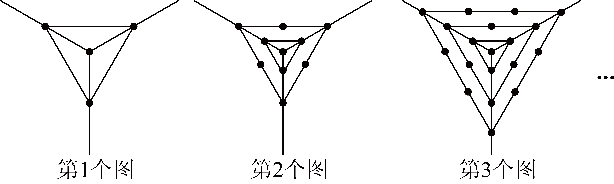
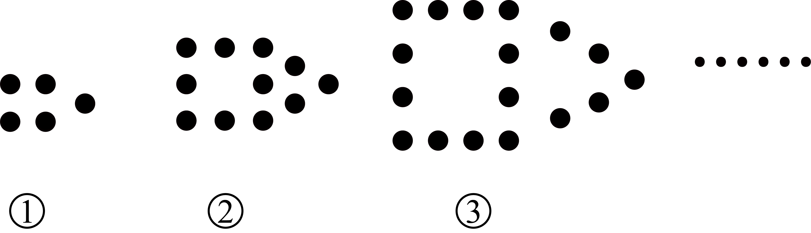
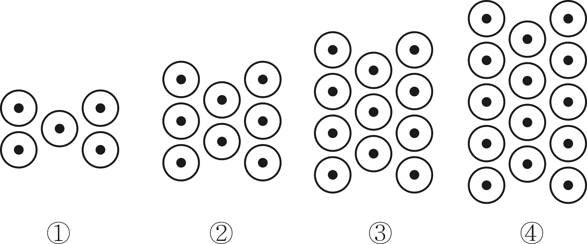
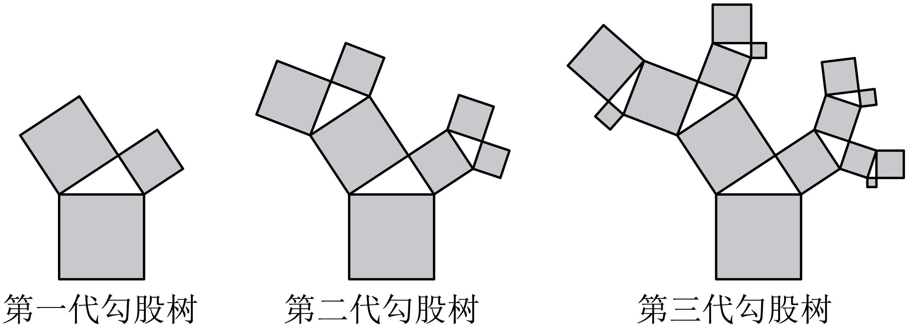
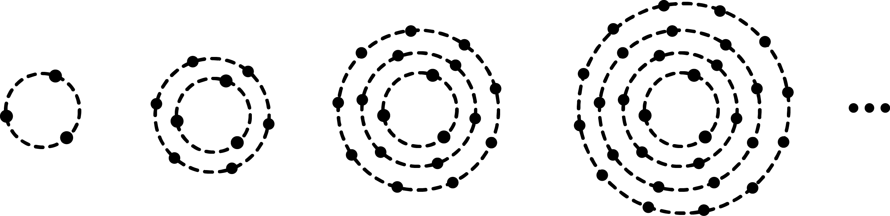
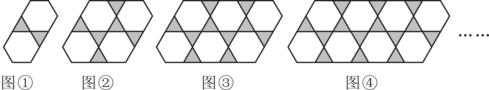

# 知识点·规律探究：图形问题（同步练习）

> 教材：数学·七年级下册·沪科技版2024新教材 ｜ 来源：国家中小学智慧教育平台·在线练习 ｜ 共 8 题

## 1. 单选题

观察下列一组图形中点的个数，其中第1个图中共有4个点，第2个图中共有10个点，第3个图中共有19个点，…按此规律第7个图中共有点的个数是（   ）

- A. 76
- B. 85
- C. 94
- D. 109

【答案】B

【解析】解：第1个图中共有\( 1+1\times 3=4\)个点，
第2个图中共有\( 1+1\times 3+2\times 3=10\)个点，
第3个图中共有\( 1+1\times 3+2\times 3+3\times 3=19\)个点，
…
第n个图有\( \left(1+1\times 3+2\times 3+3\times 3+\dots +3n\right)\)个点，
所以第7个图中共有点的个数是\( 1+1\times 3+2\times 3+3\times 3+4\times 3+5\times 3+6\times 3+7\times 3=85\)，
故选B．

## 2. 单选题（难度：适中）

下列图形是由相同的围棋子按一定规律组成的，其中第①个图形中一共有5枚围棋子，第②个图形中一共有11枚围棋子，第③个图形中一共有17枚围棋子，……，按此规律排列，则第⑧个图形中围棋子的枚数为（   ）

- A. 50
- B. 49
- C. 48
- D. 47

【答案】D

【解析】解：由所给图形可知，
第①个图形中围棋子的枚数为：\( 5=\left(1\times 6-1\right)\)(枚)；
第②个图形中围棋子的枚数为：\( 11=\left(2\times 6-1\right)\)(枚)；
第③个图形中围棋子的枚数为：\( 17=\left(3\times 6-1\right)\)(枚)；
……
所以第n个图形中围棋子的枚数为\( \left(6n-1\right)\)枚．
当\( n=8\)时，
\( 6n-1=47\)(枚)，
即第⑧个图形中围棋子的枚数为47枚．
故选：D．

## 3. 单选题（难度：适中）

下列图形都是由同样大小的基本图形按一定规律组成的，其中第①个图形中一共有5个基本图形，第②个图形中一共有8个基本图形，第③个图形中一共有11个基本图形，第④个图形中一共有14个基本图形，…，按此规律排列，则第n个图形中基本图形的个数为（   ）

- A. \( 1+4n\)
- B. \( 2+4n\)
- C. \( 2+3n\)
- D. \( 3+3n\)

【答案】C

【解析】解：第①个图形中共有5个基本图形，而\( 5=2+3=2+3\times 1\)；
第②个图形中共有8个基本图形，而\( 8=2+3+3=2+3\times 2\)；
第③个图形中共有11个基本图形，而\( 11=2+3+3+3=2+3\times 3\)；
第④个图形中共有14个基本图形，而\( 14=2+3+3+3+3=2+3\times 4\)；
…
第\( n\)个图形中共有\( \left(2+3n\right)\)个基本图形．
故选：C．

## 4. 单选题

“勾股树”是以正方形一边为斜边向外作直角三角形，再以该直角三角形的两直角边为边分别向外作正方形，重复这一过程所画出来的图形，因为重复数次后的形状好似一棵树而得名．假设如图分别是第一代勾股树、第二代勾股树、第三代勾股树，按照勾股树的作图原理作图，则第七代勾股树中正方形的个数为（   ）

 
第一代勾股树    第二代勾股树    第三代勾股树

- A. 127
- B. 129
- C. 255
- D. 257

【答案】C

【解析】解：∵第一代勾股树中正方形有\( 1+2=3\)（个），
第二代勾股树中正方形有\( 1+2+{2}^{2}=7\)（个），
第三代勾股树中正方形有\( 1+2+{2}^{2}+{2}^{3}=15\)（个），
．．．．．．
∴第七代勾股树中正方形有\( 1+2+{2}^{2}+{2}^{3}+{2}^{4}+{2}^{5}+{2}^{6}+{2}^{7}=255\)（个），
故选C．

## 5. 单选题（难度：适中）

如图是一组有规律的图案，它们是由边长相同的灰白两种颜色的小正方形组成的，按照这样的规律，第2024个图案中灰色小正方形的个数为（   ）

【答案】A

## 6. 单选题

在中国西部的某光伏基地，工作人员按照某一点将光伏板一层一层的布置成圆形．若把光伏板看成一个点，如图，第①层布置了3个光伏板，第②层布置了6个光伏板，第③层布置了9个光伏板，第④层布置了12个光伏板，．．．，按此规律排列下去，布置到第⑦层时，一共布置的光伏板个数是（   ）

- A. 63
- B. 84
- C. 94
- D. 108

【答案】B

【解析】解：第①层布置了3个光伏板，为\( 3\times 1\)个，
第②层布置了6个光伏板，为\( 3\times 2\)个，
第③层布置了9个光伏板，为\( 3\times 3\)个，
第④层布置了12个光伏板，为\( 3\times 4\)个，
\( \cdots \cdots \) 
则第n个层光伏板的个数为\( 3n\)个，
布置到第⑦层时，第⑦层光伏板的个数为\( 21\)个，
一共布置的光伏板个数是\( 3+6+9+\cdots +21=\frac{\left(3+21\right)\times 7}{2}=84\)个，
故选：B．

## 7. 单选题

“低多边形风格”是一种数字艺术设计风格，它将整个区域分割成若干个三角形，通过把相邻三角形涂上不同颜色，产生立体及光影的效果，随着三角形数量的增加，效果更为斑斓绚丽（如图1）．如图2，当正五边形内有1个点时，可分得5个三角形；当正五边形内有2个点时，可分得7个三角形（不计被分割的三角形）．那么，当正五边形内有37个点时，可分得三角形的个数为（   ）

【答案】A

## 8. 单选题（难度：简单）

如图是由大小相同的正六边形和正三角形镶嵌而成的地砖图案，其中第①个图案有2个三角形，第②个图案有6个三角形，第③个图案有10个三角形，……，按照这一规律，第11个图案中三角形的个数是（   ）个

- A. 30
- B. 34
- C. 38
- D. 42

【答案】D

【解析】解：由图可知，第①个图案中三角形的个数为\( 2=4\times 1-2\)（个），
第②个图案中三角形的个数为\( 6=4\times 2-2\)（个），
第③个图案中三角形的个数为\( 10=4\times 3-2\)（个），
归纳类推得：第\( n\)个图案中三角形的个数为\( \left(4n-2\right)\)个，其中\( n\)为正整数，
则第11个图案中三角形的个数是\( 4\times 11-2=42\)（个），
故选：D．
