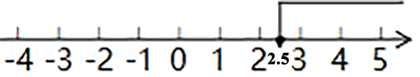
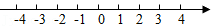
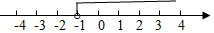

# 知识点·解一元一次不等式（同步练习）

> 教材：数学·七年级下册·沪科技版2024新教材 ｜ 来源：国家中小学智慧教育平台·在线练习 ｜ 共 5 题

## 1. （难度：适中）

解不等式\(\frac{{ - 2x + 5}}{3} + 1⩽3\)。

【答案】

$x⩾ - \frac{1}{2}$

【解析】​

## 2. （难度：适中）

解不等式\(3(x - 1)⩾x + 2\)，并将解集表示在数轴上。

【答案】

$x⩾2.5$，在数轴上表示为：

  

【解析】​

## 3. （难度：适中）

解不等式\(\frac{{x - 1}}{2} > \frac{{2x - 3}}{5}\)，并把解集在数轴上表示出来。

【答案】

$x &gt;  - 1$，在数轴上表示不等式的解集为：

    

【解析】​

## 4. 填空题

若关于\(x\)的方程\(3x + 3k = 2\)的解是正数，则\(k\)的取值范围为。

【答案】$k &lt; \frac{2}{3}$

【解析】​

## 5. （难度：适中）

解不等式\(\frac{{2(x - 1)}}{5}⩽\frac{{3(1 - x)}}{{10}}\)，并求出非负整数解。

【答案】

$x⩽1$

非负整数解为0，1

【解析】​
