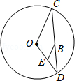
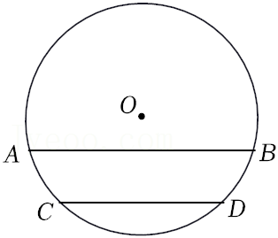
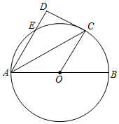
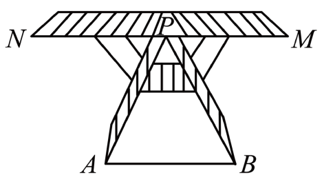

# 10.2 平行线的判定（同步练习）

> 教材：数学·七年级下册·沪科技版2024新教材 ｜ 来源：国家中小学智慧教育平台·在线练习 ｜ 共 6 题

## 1. 单选题（难度：简单）

若​​​\(P，Q\)​是直线​​​\(AB\)​外不重合的两点，则下列说法不正确的是（　　）。

- A. 直线​​​\(PQ\)​可能与直线​​​\(AB\)​垂直
- B. 直线​​​\(PQ\)​可能与直线​​​\(AB\)​平行
- C. 过点​​​\(P\)​的直线一定能与直线​​​\(AB\)​相交
- D. 过点​​​\(Q\)​只能画出一条直线与直线​​​\(AB\)​平行

【答案】C

【解析】​

## 2. 填空题（难度：适中）

如图，\( \odot O\)的周长为\(4\pi \)，\(B\)是弦\(CD\)上任意一点（与\(C\)，\(D\)不重合），过\(B\)作\(OC\)的平行线交\(OD\)于点\(E\)，则\(EO + EB = \)（用数字表示）。

【答案】2

【解析】​

## 3. （难度：简单）

如图，\( AB，CD\)是\( ⨀O\)的两条弦，\(\widehat{AC}=\)\( \widehat{BD}\) ．求证：\( AB//CD\)。

【答案】

略

【解析】​

## 4. 

如图，\(AB\)为\( \odot O\)的直径，点\(C\)为\(\widehat {BE}\)的中点，\(CD \bot AE\)交直线\(AE\)于\(D\)点。
​

求证：\(OC//AD\)；

若\(DE = 1\)，\(CD = 2\)，求\( \odot O\)的直径。​

【答案】

见解析

，

5

【解析】解析视频请查看最后一题。

​

## 5. 单选题（难度：简单）

如图，在平面内过点O作已知直线a的平行线和垂线，可作的条数分别是m条和n条，则\( m+n\)的值为（    ）

- A. 0条
- B. 1条
- C. 2条
- D. 无数条

【答案】C

【解析】解：\( \because \)在同一平面内，过直线外一点有且只有一条直线与已知直线平行，以及在同一平面内，过直线外一点有且只有一条直线与已知直线垂直，可知\( m=1\)，\( n=1\)，
\( \therefore m+n=2\)，
故选：C．

## 6. 单选题（难度：适中）

如图，是一个可折叠衣架，\( AB\)是地平线，当\( PM\parallel AB\)，\( PN\text{∥}AB\)时，就可以确定点\( N\)，\( P\)，\( M\)在同一直线上，这样判定的依据是（   ）

- A. 两点确定一条直线
- B. 同角的补角相等
- C. 平行于同一直线的两直线平行
- D. 过直线外一点有且只有一条直线与这条直线平行

【答案】D

【解析】解：∵\( PM\parallel AB\)，\( PN\text{∥}AB\)，
∴\( PM\text{∥}PN\)，
∵经过直线外一点，有且只有一条直线与已知直线平行，
∴点\( N\)，\( P\)，\( M\)在同一直线上，
故选：\( \text{D}\)．
