# 10.4 平移（同步练习）

> 教材：数学·七年级下册·沪科技版2024新教材 ｜ 来源：国家中小学智慧教育平台·在线练习 ｜ 共 81 题

## 1. 单选题（难度：简单）

以下运动属于平移运动的是（　　）

- A. 彩旗飘飘
- B. 荡秋千
- C. 电梯升降
- D. 折纸

【答案】C

【解析】解：A、不属于平移，故此选项错误；
B、属于旋转，故此选项错误；
C、属于平移，故此选项正确；
D、属于翻折变换，故此选项错误；
故选：C． 
【点睛】此题主要考查了平移定义，平移是指图形的平行移动，平移时图形中所有点移动的方向一致，并且移动的距离相等．

## 2. 单选题（难度：简单）

下列说法中，正确的是（　　）

- A. “同位角相等”是一个真命题
- B. 图形的平移是指把图形沿水平方向移动
- C. “凡直角都相等”是一个假命题
- D. 在平移的过程中，对应线段互相平行（或在同一条直线上）且相等

【答案】D

【解析】解：A. “两直线平行，同位角相等”是一个真命题，选项错误，不符合题意；
B. 图形的平移是指把图形沿一定方向移动，选项错误，不符合题意；
C. “凡直角都相等”是一个真命题，选项错误，不符合题意；
D. 在平移的过程中，对应线段互相平行（或在同一条直线上）且相等，选项正确，符合题意．
故选：D． 
【点睛】本题考查了平移的性质，对顶角的性质以及直角的性质的知识，解题的关键是熟记定理的应用．

## 3. 单选题（难度：简单）

如图，在一块长14m、宽6m的长方形场地上，有一条弯曲的道路，其余的部分为绿化区，道路的左边线向右平移3m就是它的右边线，则绿化区的面积是（　　）
  
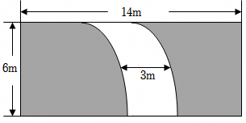

- A. 56m2
- B. 66m2
- C. 72m2
- D. 96m2

【答案】B

【解析】解：由题意得：（14﹣3）×6＝11×6＝66（平方米），∴绿化区的面积是66平方米，
故选：B．

## 4. 单选题（难度：简单）

如图所示，在5×5方格纸中将图①中的图形N平移后的位置如图②所示，那么下面平移中正确的是（　　）

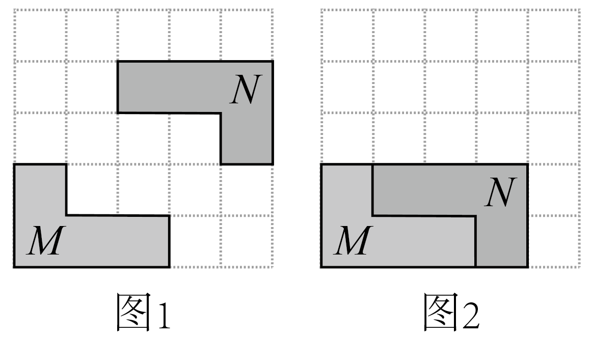

- A. 先向下移动1格，再向左移动1格
- B. 先向下移动1格，再向左移动2格
- C. 先向下移动2格，再向右移动1格
- D. 先向下移动2格，再向左移1个格

【答案】D

【解析】解：根据平移的概念，图形先向下移动2格，再向左移动1格或先向左移动1格，再向下移动2格． 
故选：D． 
【点睛】本题考查平移的基本概念及平移规律，是比较简单的几何图形变换．关键是要观察比较平移前后物体的位置．

## 5. 单选题（难度：非常简单）

在5×5的方格纸中，将图①中的三角形甲平移到图②中所示的位置，与三角形乙拼成一个长方形，下面平移的方法中正确的是（　　）

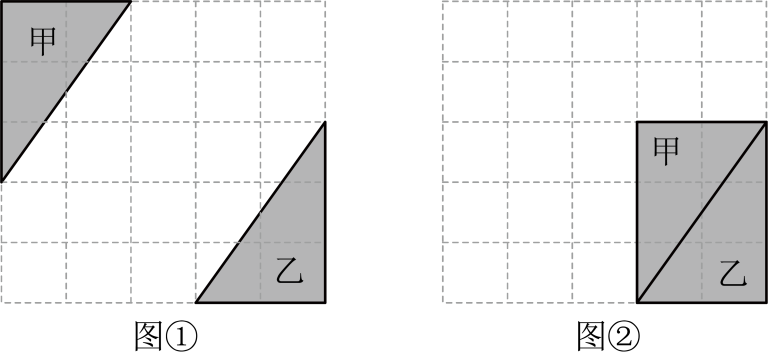

- A. 先向下平移2格，再向右平移1格
- B. 先向下平移2格，再向右平移2格
- C. 先向下平移2格，再向右平移3格
- D. 先向下平移3格，再向右平移2格

【答案】C

【解析】解：由图可知，图①中的三角形甲先向下平移2个单位，再向右平移3个单位到图②中所示的位置，与三角形乙拼成一个长方形；故选：C．

## 6. 单选题（难度：非常简单）

已知图形甲与图形乙，有如下三种说法：
①如果图形甲与图形乙成中心对称，那么它们不可能成轴对称；
②如果图形甲与图形乙成中心对称，那么图形甲不可能通过平移与图形乙重合；
③如果图形甲与图形乙成轴对称，那么图形甲不可能通过平移与图形乙重合；
上述说法中正确的是（　　）

- A. ①②
- B. ②③
- C. ①③
- D. 以上说法都不正确

【答案】D

【解析】解：设图形甲与图形乙是半径相等的圆，如图，

 
①如果图形甲与图形乙成中心对称，那么它们有可能成轴对称，原说法不正确；
②如果图形甲与图形乙成中心对称，那么图形甲有可能通过平移与图形乙重合，原说法不正确；
③如果图形甲与图形乙成轴对称，那么图形甲有可能通过平移与图形乙重合，原说法不正确；
故选：D．

## 7. 单选题（难度：简单）

在手工制作课上，张华和李丽用铁丝制作楼梯模型，如图所示，则她们用的铁丝周长（　　）

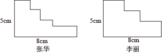

- A. 张华的长
- B. 李丽的长
- C. 一样长
- D. 不能确定

【答案】C

【解析】解：因为经过平移两个图形可变为两个边长相等的长方形，
所以两人用的一样多．
故选：C． 
【点睛】此题主要考查平移的应用，解题的关键是把两个图形可变为两个边长相等的长方形．

## 8. 单选题（难度：非常简单）

下列各组图形，可以通过平移得到的是（　　）

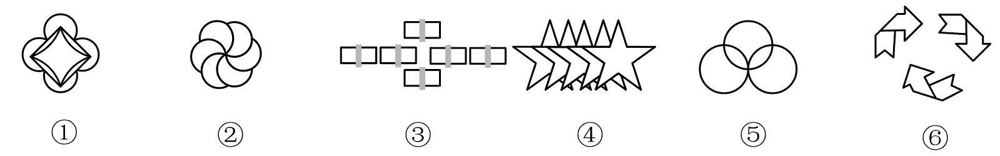

- A. ③④⑤
- B. ③⑤⑥
- C. ①③⑤
- D. ②③④

【答案】A

【解析】平移的定义：平移是图形沿某一方向移动，形状，大小，方向均不变．
分析各图形：
①图形各部分方向有变化，不是平移，可能通过旋转得到．
②图形结构类似旋转（如风车），非平移．
③小方块形状，方向一致，通过平移得到．
④星星方向一致，是平移结果．
⑤圆的组合可通过平移其中圆得到．
⑥图形各部分方向不同，属于旋转，非平移，
结论：③④⑤符合平移特征，对应选项A． 
故选：A．

## 9. 单选题（难度：非常简单）

窗棂是中国传统木构建筑的框架结构设计，在园林设计中常常可以看到．下列窗棂图案中可以看作由一个“基本图案”经过平移得到的是（　　）

- A. 
- B. 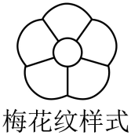
- C. 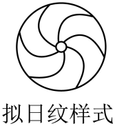
- D. 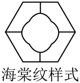

【答案】A

【解析】解：由平移只改变位置，不改变大小，形状和方向可知，四个选项中只有A选项中的图案可以有平移得到，
选项B，D中的图形可通过旋转或轴对称得到；C中的图形可通过旋转得到；故选：A．

## 10. 单选题（难度：简单）

如图，将三角形ABC沿OM方向平移一定的距离得到三角形A’B’C’  ，则下列结论中不正确的是（　　）

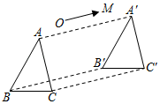

- A. AA’∥BB’
- B. AA’=BB’
- C. ∠ACB＝∠A’B’C’
- D. BC＝B’C’

【答案】C

【解析】解：∵三角形ABC沿OM方向平移一定的距离得到三角形A’B’C’，
∴AA’∥BB’，故A正确；
AA’=BB’，故B正确；
∠ACB＝∠A’C’B’，故C错误；
BC＝B’C’，故D正确，
故选：C． 
【点睛】本题主要考查了平移的性质，是基础题，熟记性质是解题的关键．

## 11. 单选题（难度：简单）

现实世界中，平移现象无处不在，中国的方块字中有些也具有平移性，下列汉字是由平移构成的是（　　）

- A. 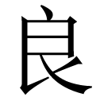
- B. 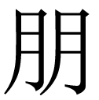
- C. 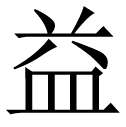
- D. 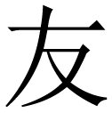

【答案】B

【解析】解：根据题意，由两或多个完全相同的部分组成的汉字即可满足条件，∵ “朋”由两个“月”组成， ∴“朋”可以通过“月”平移得到．∴B选项满足题意，故选：B． 
【点睛】本题考查了平移的基本性质，熟知图形平移不变性是解答此题的关键．

## 12. 单选题（难度：非常简单）

如图所示的图案是一些汽车的车标，可以看作由“基本图案”经过平移得到的是（　　）

- A. 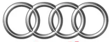
- B. 
- C. 
- D. 

【答案】A

【解析】解：观察图形可知，A选项图案可以看作由“基本图案”经过平移得到，
故选：A．

## 13. 单选题（难度：简单）

如图，如果将图中任意一条线段沿方格线的水平或竖直方向平移1格称为“1步”，那么通过平移要使图中的3条线段首尾相接组成一个三角形，最少需要（　　）

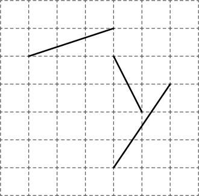

- A. 4步
- B. 5步
- C. 6步
- D. 7步

【答案】B

【解析】解：由图形知，中间的线段向左平移1个单位，上边的直线向右平移2个单位，最下边的直线向上平移2个单位，只有这样才能使构造的三角形平移的次数最少，其它平移方法都多于5步．
∴通过平移使图中的3条线段首尾相接组成一个三角形，最少需要5步．

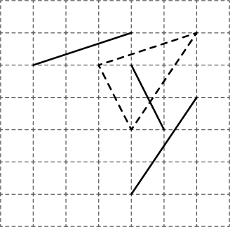
  
故选：B． 
【点睛】本题考查了图形的平移变换，注意平移不改变图形的形状和大小且平移前后图形对应点之间的连线应该互相平行，另外使平移后成为三角形．

## 14. 单选题（难度：简单）

下列四个图形中，不能通过其中一个四边形平移得到的是（　　）

- A. 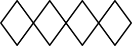
- B. 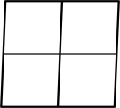
- C. 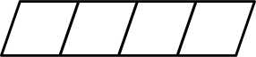
- D. 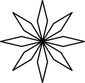

【答案】D

【解析】解：A． 能通过其中一个四边形平移得到，不合题意；
B． 能通过其中一个四边形平移得到，不合题意；
C． 能通过其中一个四边形平移得到，不合题意；
D． 不能通过其中一个四边形平移得到，符合题意，
故选：D．

## 15. 单选题（难度：非常简单）

甲骨文是我国古代的一种文字，是汉字的早期形式．下列甲骨文中，能用平移来分析其形成过程的是（　　）

- A. 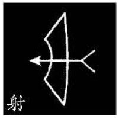
- B. 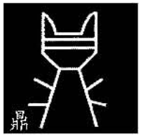
- C. 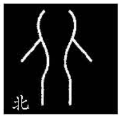
- D. 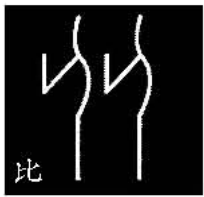

【答案】D

【解析】解：由图可知A，B，C不是平移得到，D是利用图形的平移得到．
 故选：D．

## 16. 单选题（难度：简单）

如图是由三个全等的菱形拼接成的图形，若平移其中一个菱形，与其他两个菱形重新拼接（无覆盖，有公共顶点），并使拼接成的图形为轴对称图形，则平移的方式共有（　　）

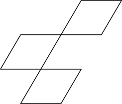

- A. 3种
- B. 6种
- C. 8种
- D. 10种

【答案】C

【解析】解：如图，把菱形A平移到①或②或⑤或⑥的位置可得轴对称图形．
把菱形B平移到③或④或⑤或⑦的位置可得轴对称图形．共有8种方法．

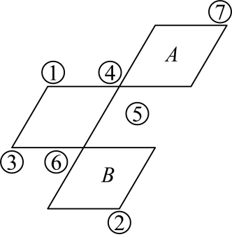
 
故选：C． 
【点睛】本题考查了轴对称的定义，如果一个图形沿一条直线对折，对折后的两部分能够完全重合，那么这个图形就叫做轴对称图形．理解轴对称的定义和菱形是轴对称图形是解题关键．

## 17. 单选题（难度：非常简单）

下列图案不能由基本图形平移得到的是（　　）

- A. 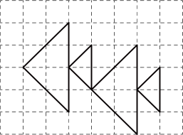
- B. 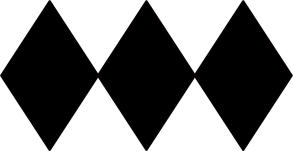
- C. 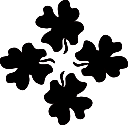
- D. 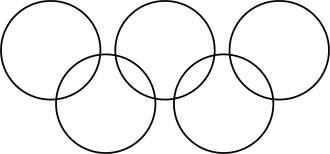

【答案】C

【解析】解：A，B，D选项中的图形都能由基本图形通过平移得到，
C选项中的图形不能由基本图形通过平移得到．
故选：C．

## 18. 单选题（难度：简单）

如图，正方形网格中，能由

平移得到的线段是（　　）

- A. 
- B. 
- C. 
- D. \(e\)

【答案】B

【解析】如图，线段c是由线段a平移得到的，
故选： B． 
【点睛】本题考查坐标与图形变化－平移，解题的关键是理解平移的定义，属于中考常考题型．

## 19. 单选题（难度：非常简单）

下面的左面图形平移后可以得到右面图形的是（　　）

- A. 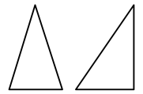
- B. 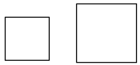
- C. 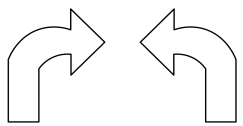
- D. 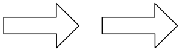

【答案】D

【解析】A、两个图形大小不一样，左面的图形不能通过平移得到右面图形，故本选项不符合题意；
B、两个图形大小不一样，左面的图形不能通过平移得到右面图形，故本选项不符合题意；
C、两个图形箭头方向不一样，左面的图形不能通过平移得到右面图形，故本选项不符合题意；
D、左面的图形平移后可以得到右面图形，故本选项符合题意．
故选D．

## 20. 单选题（难度：非常简单）

下列四个图案中，可用平移来分析整个图案的形成过程的图案是（　　）

- A. 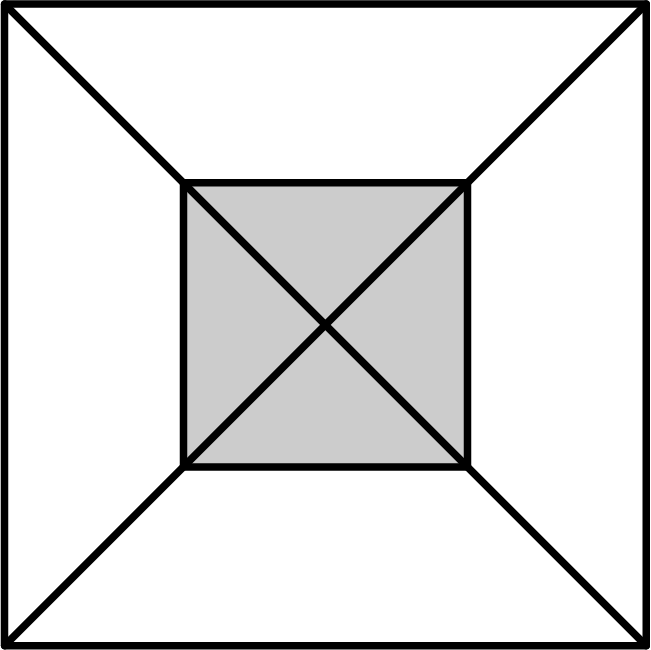
- B. 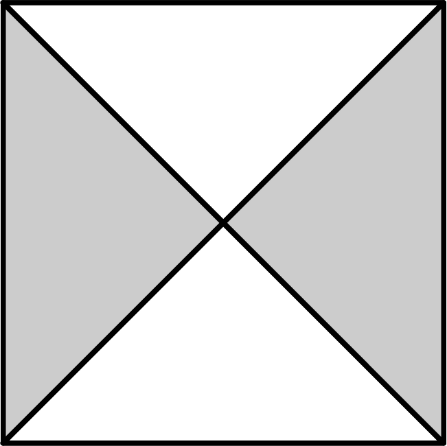
- C. 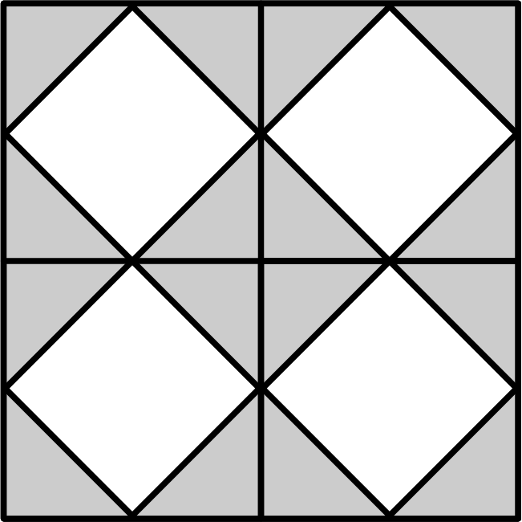
- D. 

【答案】C

【解析】解：A、B、D三个选项中的图形不是平移得到，只有C选项的图形，可看成是由基本图形 
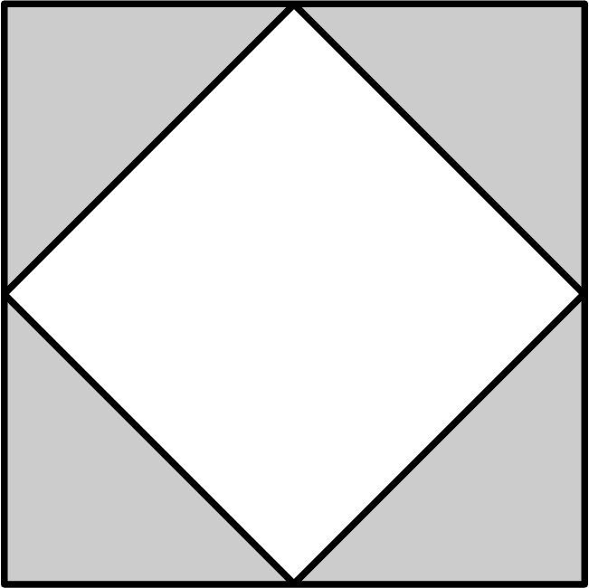
 通过平移得到的，故选：C．

## 21. 单选题（难度：非常简单）

如图，这是一个9级台阶的侧面示意图，在台阶上铺地毯至少需（　　）

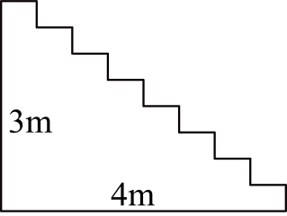

- A. 
- B. 
- C. 
- D. 

【答案】D

【解析】解：可以将台阶的横面、竖面平移，横向和为4米，竖向和为3米，故在台阶上铺地毯至少需4+3=7（m） ，故选：D．

## 22. 单选题（难度：简单）

如图所示的网格中各有不同的图案，不能直接通过平移得到的是（　　）

- A. 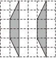
- B. 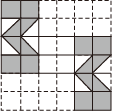
- C. 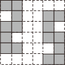
- D. 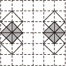

【答案】C

【解析】A、可以通过平移得到，不符合题意；
B、可以通过平移得到，不符合题意；
C、不可以通过平移得到，符合题意；
D、可以通过平移得到，不符合题意．
故选C． 
【点睛】本题考查平移的性质，属于基础题，要掌握图形的平移只改变图形的位置，而不改变图形的形状和大小，学生易混淆图形的平移与旋转或翻转．

## 23. 单选题（难度：非常简单）

下列图形中，可以由其中一个图形通过平移得到的是（　　）

- A. 
- B. 
- C. 
- D. 

【答案】B

【解析】解：只有

的基本图案的角度，形状和大小没有变化，符合平移的性质，属于平移得到，故选：

．

## 24. 单选题（难度：简单）

如图所示，甲、乙是两张画有图形的透明胶片，把其中一张向右平移到另一张上，形成的图形是（　　）
   
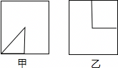

- A. 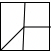
- B. 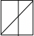
- C. 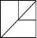
- D. 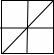

【答案】A

【解析】解：根据平移的性质可得：把其中一张向右平移到另一张上，形成的图形是A．故选：A．

## 25. 单选题（难度：非常简单）

本届亚冬会的吉祥物是一对可爱的东北虎“滨滨”和“妮妮”．“滨滨”和“妮妮”的原型是2023年9月出生于黑龙江东北虎林园的两只可爱的小东北虎，“滨滨”名字取自“哈尔滨”，“妮妮”取自“您”的读音，两个名字寓意“哈尔滨欢迎您”．如图，通过平移吉祥物，可以得到的图形是（　　）

- A. 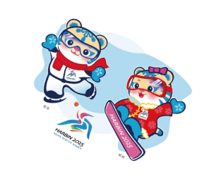
- B. 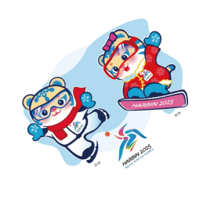
- C. 
- D. 

【答案】D

【解析】解：根据平移的定义，平移前后的图形形状、大小完全一样，仅位置不一样，那么D符合题意．
故选：D．

## 26. 单选题（难度：适中）

如图，从图1的正三角形到图2的正三角形，下列变化中不能得到的是（　　）

- A. 绕某点旋转
- B. 平移
- C. 轴对称
- D. 先平移再轴对称

【答案】A

【解析】因为图中为等边三角形，所以通过平移和轴对称可以得到，旋转不能由图1得到图2故选：A
【点睛】本题考查平移、轴对称、旋转的概念，熟练掌握平移是沿着某条直线方向移动、轴对称是沿着某条直线翻折、旋转是绕着某点转动，三大变换均不改变图形的形状和大小是关键

## 27. 单选题（难度：简单）

在中国园林建筑中，洞窗是最生动的眼睛，主要以镂空图案填心为主，故也称镂空花窗．花窗图案丰富多样，以各种植物，动物，字体，几何图案和其他图案为基础，相互交错形成多种吉祥图案．以下花窗的图样中，是通过平移设计的是（　　）

- A. 
- B. 
- C. 
- D. 

【答案】A

【解析】解∶A． 该图案可以看作是由一个基本图形沿着某个方向进行平移，重复排列而形成的．平移过程中，基本图形的形状、大小和方向都没有发生变化，只是位置发生了改变，符合平移的定义，故该选项符合题意；
B． 该图案明显是围绕着一个中心点进行旋转，旋转角度相同，从而形成了该图案，并非平移， 故该选项符合题意；
C． 该图案是围绕着一个中心点进行旋转，旋转角度相同，从而形成了该图案，不满足平移的特征，故该选项符合题意；
D． 该图案是基本图形围绕一个中心点进行旋转，其旋转一定角度后得到整个图案，不是平移得到的，故该选项符合题意；
故选：A．

## 28. 单选题（难度：适中）

下面的四个图形中，能够通过基本图形平移得到的图形有（　　）

- A. 1个
- B. 2个
- C. 3个
- D. 4个

【答案】B

【解析】解：第一个、第二个图不能由基本图形平移得到，
第三个、第四个图可以由基本图形平移得到，
故选：B． 
【点睛】本题主要考查了图形的平移，图形的平移只改变图形的位置，不改变图形的形状，大小，方向．学生比较难区分平移、旋转或翻转．

## 29. 单选题（难度：非常简单）

如下四个图形中，能由已知图形经过平移得到的是（　　）

- A. 
- B. 
- C. 
- D. 

【答案】C

【解析】解：能由已知图形经过平移得到的是

  
故选：C

## 30. 单选题（难度：适中）

在平面内，由图1经过两次图形变换得到图3，下列说法正确的是（　　）

- A. 只经过平移
- B. 只经过中心对称
- C. 只经过旋转
- D. 只经过轴对称

【答案】D

【解析】解：由图1变换到图2，可以是平移，也可以是轴消费提取；由图2变换到图3，可以经过中心对称，旋转和轴消费提取；但是，由图1经过两次图形变换得到图3只经过轴对称，
故选D
【点睛】本题考查了利用旋转、平移、轴对称、中心对称设计图案，解决本题的关键是掌握旋转、平移、轴对称、中心对称的性质．

## 31. 单选题（难度：非常简单）

下列甲骨文中，能用其中一部分平移得到的是（　　）

- A. 
- B. 
- C. 
- D. 

【答案】C

【解析】解：由图可知，选项

，

，

都不能通过平移得到，只有选项

利用图形的平移得到，
故选：C．

## 32. 单选题（难度：简单）

2024年3月2日神十七航天员乘组第二次出舱活动取得圆满成功．在下列四个航天员简笔画中，可以由如图平移得到的是（　　）

- A. 
- B. 
- C. 
- D. 

【答案】D

【解析】解：根据“平移”的定义可知，由题图经过平移得到的图形是

  故选：D．

## 33. 单选题（难度：简单）

下面的每组图形中，左面的平移后可以得到右面的是（　　）

- A. 
- B. 
- C. 
- D. 

【答案】D

【解析】解：A、两图形不全等，不合题意；
B、两图形不全等，不合题意；
C、通过平移得不到右边的图形，不合题意；
D、左面的图形平移后可以得到右面图形，符合题意．
故选D．

## 34. 单选题（难度：非常简单）

观察下列四幅图案，通过平移可以得到左图的是（　　）

- A. 
- B. 
- C. 
- D. 

【答案】B

【解析】解：观察各选项中的图案可以发现，通过平移可以得到 

 的是B，
故选：B．

## 35. 单选题（难度：简单）

下列各组图形可以通过平移互相得到的是（　　）

- A. 
- B. 
- C. 
- D. 

【答案】C

【解析】解：观察图形可知图案C通过平移后可以得到．
故选：C． 
【点睛】本题考查了图形的平移，正确掌握平移的性质是解题关键．

## 36. 单选题（难度：简单）

2024年夏季奥运会在法国巴黎举行，此次奥运会的会标如图所示，平移会标可以得到的图形是（　　）

- A. 
- B. 
- C. 
- D. 

【答案】C

【解析】解：由图形可知，选项C与原图形完全相同．
故选：C．

## 37. 单选题（难度：简单）

下列各图案中，是由一个基本图形通过平移得到的是（　　）

- A. 
- B. 
- C. 
- D. 

【答案】D

【解析】解：A、不是由一个基本图形通过平移得到的，不符合题意；
B、不是由一个基本图形通过平移得到的，不符合题意；
C、不是由一个基本图形通过平移得到的，不符合题意；
D、由一个基本图形通过平移得到的，符合题意；
故选D．

## 38. 单选题（难度：简单）

如图，不是平移设计的是（　　）

- A. 
- B. 
- C. 
- D. 

【答案】D

【解析】解：A． 可以利用平移变换得到，故此选项不符合题意；
B． 可以利用平移变换得到，故此选项不符合题意；
C． 可以利用平移变换得到，故此选项不符合题意；
D． 无法利用平移得到，故此选项符合题意．
故选：D． 
【点睛】此题主要考查了利用平移设计图案，正确把握平移的定义是解题关键．

## 39. 单选题（难度：简单）

“潮涌”是2022年杭州亚运会会徽，钱塘江和钱江潮头是会徽的形象核心，如图是会徽的一部分，在以下四个选项中，能由该图经过平移得到的是（　　）

- A. 
- B. 
- C. 
- D. 

【答案】C

【解析】解：根据平移的性质可知：能由该图经过平移得到的是C，
故选：C． 
【点睛】本题考查了利用平移设计图案，解决本题的关键是掌握平移的性质．

## 40. 单选题（难度：适中）

甲、乙两人用同种材料制作的楼梯模型如图所示，则他们所用的材料的长度相比，（    ）

- A. 甲用的长
- B. 乙用的长
- C. 一样长
- D. 无法判断

【答案】C

【解析】解：∵两个图形的左右两侧相等，上下两侧相等，
∴两个图形都可以运用平移的方法变为长为

，宽为

的长方形，
∴两个图形的周长都为

即一样长．
故选：C

## 41. 单选题（难度：简单）

杭州亚运会是亚洲最高规格的国际综合性体育赛事，如图是亚运会的会徽，通过平移可以得到的图形是（　　）

- A. 
- B. 
- C. 
- D. 

【答案】C

【解析】解：由题意，只有选项C的图形与原图形的形状，大小，方向都相同，可以通过平移得到；
故选C．

## 42. 单选题（难度：适中）

下列各组图形中，能将其中一个图形经过平移变换得到另一图形的是（　　）

- A. 
- B. 
- C. 
- D. 

【答案】C

【解析】解：各组图形中，选项C中的图形是一个图形经过平移能得到另一个图形，
故选：C． 
【点睛】本题考查平移的性质：①平移不改变图形的形状和大小；②经过平移，对应点所连的线段平行且相等，对应线段平行且相等，对应角相等．

## 43. 单选题（难度：适中）

下列四幅图案中，能通过平移下图得到的是（　　）

- A. 
- B. 
- C. 
- D. 

【答案】A

【解析】解：由平移的性质可知，不改变图形的形状、大小和方向，只有A选项符合要求，
故选：A． 
【点睛】本题考查了生活中的平移现象，图形的平移只改变图形的位置，而不改变图形的形状、大小和方向，学生易混淆图形的平移与图形旋转或翻转．

## 44. 单选题（难度：适中）

下列图案中可以看成是由图案自身的一部分经平移变换得到的是（　　）

- A. 
- B. 
- C. 
- D. 

【答案】C

【解析】解：A、是一个对称图形，不能由平移得到；
B、图形的方向发生了变化，不是平移；
C、是平移；
D、图形的大小发生了变化，不是平移．
故选：C． 
【点睛】本题考查了图形的平移，判断图形是否由平移得到，要把握两个“不变”，图形的形状和大小不变；一个“变”，位置改变．

## 45. 单选题（难度：适中）

北京2022年冬奥会的开幕式上，各个国家和地区代表团入场所持的引导牌是中国结和雪花融合的造型，如图1是中国体育代表团的引导牌．下面四个图案中，可以通过平移图1得到的是（　　）

- A. 
- B. 
- C. 
- D. 

【答案】A

【解析】根据平移的性质，平移后不改变图形的形状和大小，也不改变图形的方向（角度），符合条件的只有A，
故选A． 
【点睛】本题考查了平移的性质，掌握平移的性质是解题的关键．

## 46. 单选题（难度：适中）

下列选项中的图案能通过如图所示的图案平移得到的是（　　）

- A. 
- B. 
- C. 
- D. 

【答案】B

【解析】因为平移后的图形与原图形形状应完全相同，
所以平移后得到的图形应为B，
故选 B． 
【点睛】本题考查平移，理解平移的定义和性质是解题的关键．

## 47. 单选题（难度：适中）

（跨语文学科）四根火柴棒摆成如图所示的“口”字，平移“口”字的火柴棒后，可变成的文字是（　　）

- A. 
- B. 
- C. 
- D. 

【答案】C

【解析】解：原图形平移后，水平的两根火柴的火柴头应在左边，竖直的两根火柴的火柴头应一上一下，只有

符合，
故选：

．

## 48. 单选题（难度：适中）

北京2022年冬奥会会徽是以汉字“冬”为灵感来源设计的（如图）．下面四个图案中，可以通过平移图案得到的是（　　）

【答案】A

## 49. 单选题（难度：适中）

把左边如图所示的海豚吉祥物进行平移，能得到的图形是（　　）

- A. 
- B. 
- C. 
- D. 

【答案】C

【解析】解：A、选项不是由海豚吉祥物进行平移得到，故本选项不符合题意；
B、选项不是由海豚吉祥物进行平移得到，故本选项不符合题意；
C、选项是由海豚吉祥物进行平移得到，故本选项符合题意；
D、选项不是由海豚吉祥物进行平移得到，故本选项不符合题意．
故选C． 
【点睛】此题考查的是图形的平移，掌握平移的特征是解决此题的关键．

## 50. 单选题（难度：适中）

如图，将

沿

方向平移得到\(\vartriangle A'B'C'\)．连接

，若\(AA' = 3{\rm{cm}}\)，\(B'C = 4{\rm{cm}}\)，则

的长为（　　）

- A. 
- B. 
- C. 
- D. 

【答案】B

【解析】解：由平移的性质可得

，
∴

，
故选：B．

## 51. 单选题（难度：适中）

如图，将

沿直线

的方向向右平移

后到达\(\vartriangle A'B'C'\)的位置，此时点

与点

重合，若\(\vartriangle A'B'C'\)的周长为

，则四边形\(AB'C'C\)的周长为（    ）
  

- A. 
- B. 
- C. 
- D. \(17{\rm{cm}}\)

【答案】C

【解析】解：由平移的性质可知，

，

\(\because \vartriangle ABC\)的周长为

，即

，

四边形\(AB'C'C\)的周长为

，
故选：C．

## 52. 单选题（难度：简单）

如图，将射线AB沿着直线l平移得到射线CD，若\(\angle 1 = 115^\circ \)，则

的度数是（　　）
 

- A. 115°
- B. 75°
- C. 65°
- D. 60°

【答案】C

【解析】根据题意，得\(AB{\parallel }CD\)．
∴\(\angle ACD = \angle 1 = 115^\circ \)．
∴

．
故选：C． 
【点睛】本题考查了平移的性质，平行线的性质，邻补角的定义，掌握以上性质是解题的关键．

## 53. 单选题（难度：适中）

如图所示，一块长为18m，宽为12m的草地上有一条宽为2m的曲折的小路，则这块草地的绿地面积是（　　）
 

- A. 180m2
- B. 160m2
- C. 164m2
- D. 112m2

【答案】B

【解析】解：通过平移，两块绿地可以合成一个新长方形，新长方形的长为（18﹣2）m，宽为（12﹣2）m，
故绿地的面积为：（18﹣2）×（12﹣2）＝160（m2），
故选：B．

## 54. 单选题（难度：简单）

2022年，中国成功举办了第二十四届冬季奥林匹克运动会，吉祥物“冰墩墩”好可爱．如图，通过平移最左边的吉祥物“冰墩墩”可以得到的图形是（　　）

- A. 
- B. 
- C. 
- D. 

【答案】B

【解析】解：由平移的定义与性质可得：
A选项中的图形发生了形状的改变，C，D选项中的图形不单单是做了平行的移动，还有其它的变换，只有B选项中的图形做的平行移动，
故A，C，D不符合题意，B符合题意；
故选B
【点睛】本题考查生活中的平移，理解平移的性质是正确判断的前提．

## 55. 单选题（难度：简单）

如图，三角形

沿

方向平移2个单位长度后得到三角形

，连接

，若四边形

的周长是13，则三角形

的周长是（　　）
 

- A. 6
- B. 7
- C. 8
- D. 9

【答案】D

【解析】解：∵三角形

沿

方向平移2个单位长度后得到三角形

，
∴\(AA' = CC' = 2\)，

，
∵四边形

的周长是13，
∴

，
则

，
∴\(AB + BC + AC = 9\)，
即三角形

的周长是9，
故选：D．

## 56. 单选题（难度：非常简单）

如图，在

中，\(\angle BAC = 90^\circ \)，\(AB = 3{\rm{cm}}\)，\(AC = 4{\rm{cm}}\)，把

沿着直线

的方向平移

后得到

，连接

，

，有以下结论①

；②\(AD\parallel BE\)；③\(CF = 2.5{\rm{cm}}\)；④\(DE \bot AC\)，其中正确的结论有（　　）
 

- A. 1个
- B. 2个
- C. 3个
- D. 4个

【答案】D

【解析】解：\(\because \vartriangle ABC\)沿着直线

的方向平移

后得到

，

，故①正确；
\(AD\parallel BE\)，故②正确；
\(CF = AD = 2.5{\rm{cm}}\)

故③正确；

，
又\(\because \angle BAC = 90^\circ \)，
\(\therefore BA \bot AC\)，
\(\therefore DE \bot AC\)，故④正确；
故选：D．

## 57. 单选题（难度：简单）

如图，下列三角形中，可以由\( △\mathrm{A}\mathrm{B}\mathrm{C}\)平移得到的是（     ）
 

- A. \( △\mathrm{A}\mathrm{E}\mathrm{F}\)
- B. \( △\mathrm{A}\mathrm{D}\mathrm{C}\)
- C. \( △\mathrm{A}\mathrm{D}\mathrm{E}\)
- D. \( △\mathrm{A}\mathrm{B}\mathrm{G}\)

【答案】C

【解析】A、\( △\mathrm{A}\mathrm{E}\mathrm{F}\)的形状，与\( △\mathrm{A}\mathrm{B}\mathrm{C}\)相比，方向发生了改变，不是通过平移得到的；
B、\( △\mathrm{A}\mathrm{D}\mathrm{C}\)与\( △\mathrm{A}\mathrm{B}\mathrm{C}\)相比，方向发生了改变，不是通过平移得到的；
C、\( △\mathrm{A}\mathrm{D}\mathrm{E}\)大小和方向与\( △\mathrm{A}\mathrm{B}\mathrm{C}\)完全相同，是由\( △\mathrm{A}\mathrm{B}\mathrm{C}\)平移得到的；
D、\( △\mathrm{A}\mathrm{B}\mathrm{G}\)与\( △\mathrm{A}\mathrm{B}\mathrm{C}\)相比，方向发生了改变，不是通过平移得到的；
故选：A．

## 58. 单选题（难度：简单）

（24-25七年级下·全国·期中）在下列图案中，可以由如图平移得到的是（      ）
 

- A. 
- B. 
- C. 
- D. 

【答案】D

【解析】解：∵图形的平移只改变图形的位置，而不改变图形的形状和大小，
∴四幅图中，只有D选项中的图形是由原图平移得到的，
故选：D．

## 59. 单选题（难度：非常简单）

将线段\(AB\)平移\(1\text{cm}\)，得到线段\({A}'{B}'\)，则点B到点\({B}'\)的距离是（　　）

- A. \(\text{2cm}\)
- B. \(\text{1}\text{.5cm}\)
- C. \(\text{1cm}\)
- D. \(\text{0}\text{.5cm}\)

【答案】C

【解析】解∵线段\(AB\)平移\(1\text{cm}\)，得到线段\({A}'{B}'\)，
∴点\(B\)到点\({B}'\)的距离是\(1\text{cm}\)，
故选：C；

## 60. 单选题（难度：简单）

如图，三角形\(ABC\)沿\(BC\)方向平移2个单位长度后得到三角形\({A}'{B}'{C}'\)，连接\(A{A}'\)，若四边形\(AB{C}'{A}'\)的周长是13，则三角形\(ABC\)的周长是（　　）
 

- A. 6
- B. 7
- C. 8
- D. 9

【答案】D

【解析】解：∵三角形\(ABC\)沿\(BC\)方向平移2个单位长度后得到三角形\({A}'{B}'{C}'\)，
∴\(A{A}'=C{C}'=2\)，\(AC={{A}^{\prime }}{{C}^{\prime }}\)，
∵四边形\(AB{C}'{A}'\)的周长是13，
∴\(AB+A{A}'+BC+{C}'C+{A}'{C}'=13\)，
则\(AB+2+BC+2+AC=13\)，
∴\(AB+BC+AC=9\)，
即三角形\(ABC\)的周长是9，
故选：D．

## 61. 单选题（难度：简单）

如图，把一个平行四边形纸板<latex class="math-tex">\(ABCD\)</latex>的一边紧靠着数轴平移到平行四边形<latex class="math-tex">\({A}'{B}'{C}'{D}'\)</latex>的位置．点<latex class="math-tex">\(C\)</latex>、<latex class="math-tex">\({C}'\)</la

【答案】A

## 62. 单选题（难度：适中）

如图，将<latex class="math-tex">\(\vartriangle ABC\)</latex>沿<latex class="math-tex">\(BC\)</latex>方向平移得到<latex class="math-tex">\(\vartriangle {A}'{B}'{C}'\)</latex>．连接<latex class="math-tex">\(A{A}'\)</

【答案】A

## 63. 单选题（难度：简单）

如图，两个直角三角形重叠在一起，将其中一个三角形沿着点B到点C的方向平移到<latex class="math-tex">\(\vartriangle DEF\)</latex>的位置．若<latex class="math-tex">\(\angle B=90{}^\circ ,AB=8,DH=3\)</latex>，阴影部分的面积为26，则<latex class="math-tex">\(B

【答案】A

## 64. 单选题（难度：简单）

如图，将三角形<latex class="math-tex">\(ABC\)</latex>沿<latex class="math-tex">\(BC\)</latex>方向平移<latex class="math-tex">\(2\text{cm}\)</latex>得到对应的三角形<latex class="math-tex">\({A}'{B}'{C}'\)</latex>．若<latex

【答案】A

## 65. 单选题（难度：适中）

如图，将<latex class="math-tex">\(\vartriangle ABC\)</latex>沿直线<latex class="math-tex">\(AB\)</latex>的方向向右平移<latex class="math-tex">\(2\text{cm}\)</latex>后到达<latex class="math-tex">\(\vartriangle {A}'{B}'

【答案】A

## 66. 单选题（难度：简单）

如图，将<latex class="math-tex">\(\vartriangle ABC\)</latex>沿<latex class="math-tex">\(CB\)</latex>方向平移1个单位长度得到<latex class="math-tex">\(\vartriangle DEF\)</latex>，已知<latex class="math-tex">\(CB=3\)</late

【答案】A

## 67. 单选题（难度：适中）

如图，在三角形<latex class="math-tex">\(ABC\)</latex>中，<latex class="math-tex">\(\angle ABC=90{}^\circ \)</latex>，将三角形<latex class="math-tex">\(ABC\)</latex>沿BC方向平移得到三角形<latex class="math-tex">\(DEF\)</latex

【答案】A

## 68. 单选题（难度：简单）

如图，将<latex class="math-tex">\(\vartriangle ABE\)</latex>向右平移<latex class="math-tex">\(2\text{cm}\)</latex>得到<latex class="math-tex">\(\vartriangle DCF\)</latex>，如果四边形<latex class="math-tex">\(ABFD\)</

【答案】A

## 69. 单选题（难度：简单）

如图，将三角形<latex class="math-tex">\(ABC\)</latex>沿着<latex class="math-tex">\(EF\)</latex>的方向平移一定的距离得到三角形<latex class="math-tex">\(MNL\)</latex>．现有下列4个结论：①<latex class="math-tex">\(AM\parallel BN\)</latex

【答案】A

## 70. 单选题（难度：适中）

如图，长方形\(ABCD\)的长\(AD=a\)，宽\(AB=b\)，其中\(a>2,b>2\)，将这个长方形先向右平移2个单位长度，再向上平移2个单位长度，得到长方形\({A}'{B}'{C}'{D}'\)，则阴影部分的面积是（　　）
 

- A. \(2a+2b+4\)
- B. \(2a+2b-4\)
- C. \({{a}^{2}}+{{b}^{2}}+4\)
- D. \({{a}^{2}}+{{b}^{2}}-4\)

【答案】B

【解析】解：∵将长方形\(ABCD\)先向右平移2个单位长度，再向上平移2个单位长度，
∴长方形\(ABCD\)与长方形\({A}'{B}'{C}'{D}'\)的重叠部分的长为\(a-2\)，宽为\(b-2\)，
则阴影部分的面积是\(ab-\left( a-2 \right)\left( b-2 \right)\)
\(=ab-\left( ab-2a-2b+4 \right)\)
\(=ab-ab+2a+2b-4\)
\(=2a+2b-4\)，
故选：B．

## 71. 单选题（难度：适中）

如图，长方形\(ABCD\)的对角线\(AC=5\)，\(AB=3\)，\(BC=4\)，则图中五个小长方形的周长之和为（　　）
 

- A. 7
- B. 9
- C. 14
- D. 18

【答案】C

【解析】解：图中五个小长方形的周长之和\(=AB+BC+CD+AD=3+4+3+4=14\)．
故选：C．

## 72. 单选题（难度：适中）

如图，在高为<latex class="math-tex">\(3\text{m}\)</latex>，斜坡长为<latex class="math-tex">\(5\text{m}\)</latex>的楼梯台阶上铺地毯（　　）

【答案】A

## 73. 单选题（难度：适中）

如图，平移三角形ABC得到三角形DEF，其中点A，B，C的对应点分别是点D，E，F，则下列结论中不成立的是（　　）

【答案】A

## 74. 单选题（难度：适中）

如图，在一块长14m、宽6m的长方形场地上，有一条弯曲的道路，其余的部分为绿化区，道路的左边线向右平移3m就是它的右边线，则绿化区的面积是（　　）

【答案】A

## 75. 单选题（难度：适中）

日常生活情境：移动储物柜，小明沿墙挪动墙角的三角储物柜，示意图如图所示，则下列能表示平移距离的是（　　）
 

- A. 线段BC的长
- B. 线段BF的长
- C. 线段CE的长
- D. 线段AD的长

【答案】D

【解析】解：由平移的性质可得，能表示平移距离的是线段AD的长．
故选：D．

## 76. 单选题（难度：适中）

如图，\(\vartriangle \)ABC周长是20cm，将\(\vartriangle ABC\)向右平移4cm，得到\(\vartriangle \)DEF，求四边形ABFD的周长（　　）
 

- A. 20cm
- B. 24cm
- C. 27cm
- D. 28cm

【答案】D

【解析】根据题意可知，\(AB+BC+AC=20\) ,\(AD=CF=4,AC=DF\) ，
所以四边形ABFD的周长＝\(AB+BF+DF+AD=AB+BC+AC+AD+CF=20+4+4=28\) ．
故答案选D． 
【点睛】本题考查图形的平移性质，牢记并熟练运用即可．

## 77. 单选题（难度：适中）

如图，在一块长为11m，宽为5m的长方形草地上，有一条弯曲的小路，其余部分为绿地，小路的左边线向右平移1m就是它的右边线，这块草地的绿地面积为（　　）

【答案】A

## 78. 单选题（难度：适中）

如图，将射线AB沿着直线l平移得到射线CD，若<latex class="math-tex">\(\angle 1=115{}^\circ \)</latex>，则<latex class="math-tex">\(\angle 2\)</latex>的度数是（　　）

【答案】A

## 79. 单选题（难度：适中）

如图，有一块长方形区域，AD＝2AB，现在其中修建两条长方形小路，每条小路的宽度均为1米，若AB边的长为5米，则图中空白区域的面积为（　　）平方米．

【答案】A

## 80. 单选题（难度：适中）

如图，将\(\vartriangle ABC\)沿\(AC\)所在的直线平移到\(\vartriangle DEF\)的位置，若图中\(AC=12\)，\(DC=9\)，则\(CF\)的长度为（　　）
 

- A. 2
- B. 3
- C. 4
- D. 5

【答案】B

【解析】∵将\(\vartriangle ABC\)沿\(AC\)所在的直线平移到\(\vartriangle DEF\)的位置，
∴DF=AC=12，
∴CF=DF-DC=12-9=3,
故选：B． 
【点睛】本题考查了平移的性质，能够灵活运用平移的性质是解题关键．

## 81. 单选题（难度：适中）

下列各组图形，可由一个图形平移得到另一个图形的是（　　）

【答案】A
