# 数学活动 钥匙复制原理（同步练习）

> 教材：数学·七年级下册·沪科技版2024新教材 ｜ 来源：国家中小学智慧教育平台·在线练习 ｜ 共 72 题

## 1. 单选题（难度：简单）

下列生活中的现象，属于平移的是（　　）

- A. 摩天轮在运行
- B. 抽屉的拉开
- C. 坐在秋千上人的运动
- D. 树叶在风中飘落

【答案】B

【解析】A、摩天轮在运行，是转动，不符合题意；
B、抽屉的拉开，是抽屉沿着一个方向移动一定的距离，符合题意；
C、坐在秋千上的人，绕着顶端旋转，不符合题意；
D、树叶在风中飘落，方向变化，不符合平移的定义，不属于平移．
故选：B． 
【点睛】本题考查平移的概念，关键是把握平移两要素：沿着一个方向，移动一定的距离．

## 2. 单选题（难度：简单）

下列现象中，（　　）是平移

- A. “天问”探测器绕火星运动
- B. 篮球在空中飞行
- C. 电梯的上下移动
- D. 将一张纸对折

【答案】C

【解析】解：A. “天问”探测器绕火星运动不是平移，故此选项不符合题意；    
B. 篮球在空中飞行不是平移，故此选项不符合题意；
C. 电梯的上下移动是平移，故此选项符合题意；    
D. 将一张纸对折不是平移，故此选项不符合题意
故选：C． 
【点睛】本题考查平移的概念，与实际生活相联系，注意分清与旋转、翻转的区别．

## 3. 单选题（难度：非常简单）

下列现象中，属于平移过程的是（　　）

- A. 电风扇的转动
- B. 钟表的摆动
- C. 物体与平面镜中的像
- D. 拉开抽屉

【答案】D

【解析】解：A. 电风扇的转动，不是平移；
B. 钟表的摆动，不是平移；    
C. 物体与平面镜中的像，不是平移；    
D. 拉开抽屉，是平移．
故选：D

## 4. 单选题（难度：简单）

下列生活现象不属于平移的是（　　）

- A. 物体随升降电梯上下移动
- B. 拉抽屉
- C. 电风扇扇叶转动
- D. 汽车在平直的公路上直线走

【答案】C

【解析】解：A． 物体随升降电梯上下移动，属于平移，不合题意；
B． 拉抽屉，属于平移，不合题意；
C． 电风扇扇叶转动，属于旋转，不属于平移，符合题意；
D． 汽车在平直的公路上直线走，属于平移，不合题意；
故选C． 
【点睛】本题考查平移的识别，解题的关键是掌握平移的定义．在平面内，将一个图形上的所有点都按照某个直线方向做相同距离的移动，这样的图形运动叫做图形的平移运动，简称平移．

## 5. 单选题（难度：简单）

下列现象是数学中的平移的是（　　）

- A. 树叶从树上落下
- B. 卫星绕地球运动
- C. 骑自行车时轮胎的滚动
- D. 电梯从底楼升到顶楼

【答案】D

【解析】解：A． 树叶从树上落下，即有平移也有旋转，故A不符合题意；
B． 卫星绕地球运动，属于旋转，故B不符合题意；
C． 骑自行车时轮胎的滚动，属于旋转，故C不符合题意；
D． 电梯从底楼升到顶楼，属于平移，故D符合题意；
故选：D． 
【点睛】本题考查了生活中的平移现象，熟练掌握平移的定义是解题的关键．

## 6. 单选题（难度：非常简单）

下列几种运动现象中，属于平移的有（　　）
①水平运输带上砖的运动；②笔直的铁路上行驶的动车（忽略车轮的转动）；③升降机上下做机械运动；④钟表指针的运动．

- A. 1种
- B. 2种
- C. 3种
- D. 4种

【答案】C

【解析】解：平移是指物体在运动过程中，所有点的移动方向和平移距离都相同，
①水平运输带上砖的运动：砖块随传送带整体直线移动，无旋转，属于平移，
②笔直铁路上行驶的动车（忽略车轮转动）：动车整体沿轨道直线运动，题目忽略车轮转动，属于平移，
③升降机的上下运动：升降机沿直线上下移动，无旋转，属于平移，
④钟表指针的运动：指针绕轴心旋转，属于旋转而非平移；
综上所述，①、②、③属于平移，共3种，
故选：C；

## 7. 单选题（难度：简单）

在下列现象中，属于平移的是（　　）

- A. 小亮荡秋千运动
- B. 升降电梯由一楼升到八楼
- C. 时针的运行过程
- D. 卫星绕地球运动

【答案】B

【解析】解：A、小亮荡秋千运动不是平移，故此选项错误；
B、电梯由一楼升到八楼，是平移，故此选项正确；
C、时针的运行过程属于旋转，不是平移，故此选项错误；
D、卫星绕地球运动属于旋转，不是平移，故此选项错误；
故选：B． 
【点睛】此题主要考查了生活中的平移现象，关键是掌握平移的概念．

## 8. 单选题（难度：简单）

如图，在一块长方形草地上原有一条等宽的笔直小路，现在要把这条小路改为同样宽度的弯曲小路，则改造后草地部分的面积（　　）  

- A. 变大
- B. 不变
- C. 变小
- D. 无法确定

【答案】B

【解析】如图所示，将题干中第一个图形的两块草坪上下平移，得到一个长方形，同理，将第二个图形的两块草坪上下平移，也会得到一个面积大小相同的长方形．
 

 
故选：B． 
【点睛】本题考查了平移的性质，正确理解题意、灵活应用平移的性质是解题的关键．

## 9. 单选题（难度：简单）

如图，在宽为20米、长为30米的矩形地面上修筑宽均为2米的道路（图中阴影部分），余下部分种植草坪．则草坪的面积为（　　）平方米．
  
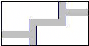

- A. 500
- B. 504
- C. 530
- D. 534

【答案】B

【解析】解：把路平移到边上，得
矩形的长是28米，宽是18米，
矩形的面积是28×18＝504（平方米），
故选：B．

## 10. 单选题（难度：简单）

如图1，从一个边长为4的正方形纸片上剪掉两个边长为a的小正方形，得到如图2所示的图形．若图2中图形的周长为22，则a的值是（　　）   
 

- A. 1.5
- B. 2
- C. 2.5
- D. 3

【答案】A

【解析】解：由题意得\(4 \times 4 + 4a = 22\)，
解得

，
故选A．

## 11. 单选题（难度：简单）

有一块长为am，宽为bm的长方形草地，计划在里面修一条小路，共有四种方案如图所示，图中每一条小路的右边线都是由左边线向右平移1m得到的．四条小路的面积从左至右依次用S1，S2，S3，S4表示．则关于四条小路面积大小的说法正确的是（　　）
 
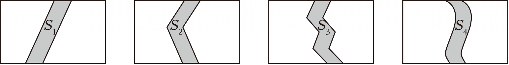

- A. S2最大
- B. S3最大
- C. S4最大
- D. 四个一样大

【答案】D

【解析】解：∵每一条小路的右边线都是由左边线向右平移1m得到的，
∴根据平移可知，草地的面积是长为（a﹣1）m，宽为b m的矩形面积，
∴S1＝S2＝S3＝S4＝ab﹣（a﹣1）b＝b（m2），
故选：D．

## 12. 单选题（难度：简单）

小红同学在某数学兴趣小组活动期间，用铁丝设计并制作了如图所示的三种不同的图形，请您观察甲、乙、丙三个图形，判断制作它们所用铁丝的长度关系是（　　）  
 
 

- A. 制作甲种图形所用铁丝最长
- B. 制作乙种图形所用铁丝最长
- C. 制作丙种图形所用铁丝最长
- D. 三种图形的制作所用铁丝一样长

【答案】D

【解析】解：由图形可得出：甲所用铁丝的长度为：2a+2b，
乙所用铁丝的长度为：2a+2b，
丙所用铁丝的长度为：2a+2b，
故三种方案所用铁丝一样长．
故选：D． 
【点睛】此题主要考查了生活中的平移现象，得出各图形中铁丝的长是解题关键．

## 13. 单选题（难度：简单）

如图，某居民小区有一长方形土地，长32米，宽20米．居民想在长方形地内修筑宽均为2米的小路，余下的部分做绿化，为了使草坪更美观，有人建议把道路修成如图所示的形状，求绿化的面积为（　　）平方米
 

- A. 640
- B. 600
- C. 540
- D. 504

【答案】D

【解析】解：利用平移可得，所有绿化面积之和为（32-4）（20-2）=504m2，
故选D． 
【点睛】此题主要考查了生活中的平移现象，这类题目体现了数形结合的思想，需利用平移把不规则的图形变为规则图形，进而即可列出算式，求出答案．

## 14. 单选题（难度：简单）

有下列现象：①高层公寓电梯的上升：②传送带的移动；③方向盘的转动；④风车的转动；⑤钟摆的运动；⑥荡秋千运动．其中属于旋转的有（　　）

【答案】A

## 15. 单选题（难度：简单）

下列现象中，不属于平移的是（　　）

- A. 滑雪运动员在平坦的雪地上沿直线滑行
- B. 时针的走动
- C. 商场自动扶梯上顾客的升降运动
- D. 火车在笔直的铁轨上行驶

【答案】B

【解析】解：A． 滑雪运动员在平坦的雪地上沿直线滑行，是平移，不符合题意；
B． 时针的走动，不是平移，符合题意；
C． 商场自动扶梯上顾客的升降运动，是平移，不符合题意；
D． 火车在笔直的铁轨上行驶，是平移，不符合题意；
故选B． 
【点睛】本题主要考查了平移的定义，熟知相关定义是解题的关键．

## 16. 单选题（难度：简单）

下列现象中，属于平移现象的是（　　）

- A. 钟表的指针运动
- B. 行驶的汽车的车轮
- C. 电风扇的转动
- D. 电梯的升降

【答案】D

【解析】解：A、钟表的指针运动，是旋转，故此选项不符合题意；
B、行驶的汽车的车轮，是旋转，故此选项不符合题意；
C、电风扇的转动，是旋转，故此选项不符合题意；
D、电梯的升降，是平移，故此选项符合题意；
故选：D． 
【点睛】本题考查了图形的平移，图形的平移只改变图形的位置，而不改变图形的形状和大小，学生易混淆图形的平移与旋转或翻转而误选．

## 17. 单选题（难度：简单）

下面情况中，可以看成平移的是（　　）

- A. 旗帜随风摇摆
- B. 碟片在光驱中运行
- C. 把打开的书本合上
- D. 急刹车时汽车在地面上的滑动

【答案】D

【解析】解：A． 旗帜随风摇摆，可以看作是旋转，选项说法错误，不符合题意；
B． 碟片在光驱中运行，可以看作是旋转，选项说法错误，不符合题意；
C． 把打开的书本合上，可以看作是旋转，选项说法错误，不符合题意；
D． 急刹车时汽车在地面上的滑动，可以看作是平移，选项说法正确，符合题意；
故选D． 
【点晴】本题考查生活中的平移现象，掌握平移的定义是正确判断的前提．

## 18. 单选题（难度：简单）

某酒店准备在一个楼梯铺设一种地毯，已知楼梯的宽为2米，楼梯的侧面如图所示，则买地毯的面积至少是（　　）m2．
  

- A. 9
- B. 11
- C. 18
- D. 27

【答案】C

【解析】解：由题意得，
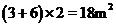
，
故选：C．

## 19. 单选题（难度：简单）

在以下现象中：①用打气筒打气时，气筒里活塞的运动；②传送带上，瓶装饮料的移动；③在笔直的公路上行驶的汽车；④温度计中，液柱的上升或下降；⑤钟摆的摆动．属于平移的是（　　）

【答案】A

## 20. 单选题（难度：简单）

下列现象中，属于平移的是（　　）

【答案】A

## 21. 单选题（难度：简单）

如图所示，某商场重新装修后，准备在门前台阶上铺设地毯，已知这种地毯的批发价为每平方米60元，其台阶的尺寸如图所示，则购买地毯至少需要（　　）
   
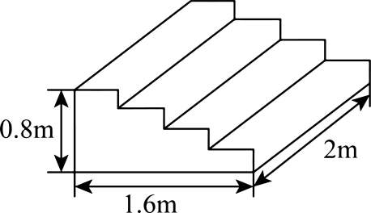

- A. 298元
- B. 288元
- C. 287元
- D. 297元

【答案】B

【解析】解：地毯的长度至少为：

（米）；
\(2.4 \times 2 \times 60 = 288\)（元）．
答：铺设梯子的红地毯至少需要花费至少

元．
故选B．

## 22. 单选题（难度：简单）

下列对象中不属于平移的是（　　）

- A. 在平坦雪地上滑行的滑雪运动员
- B. 上上下下地迎送来客的电梯
- C. 一棵倒映在湖中的树
- D. 在笔直的铁轨上飞驰而过的火车

【答案】C

【解析】解：A、滑雪运动员在平坦雪地上滑行，符合平移的性质，故属于平移；
B、电梯上上下下地迎送来客，符合平移的性质，故属于平移；
C、一棵树倒映在湖中，山与它在湖中的像成轴对称，故不属于平移；
D、火车在笔直的铁轨上飞弛而过，符合平移的性质，故属于平移；
故选：C． 
【点睛】本题考查了图形的平移，图形的平移只改变图形的位置，而不改变图形的形状和大小，学生易混淆图形的平移与旋转或轴对称．

## 23. 单选题（难度：非常简单）

在中国园林建筑中，洞窗是最生动的眼睛，主要以镂空图案填心为主，故也称镂空花窗．花窗图案丰富多样，以各种植物，动物，字体，几何图案和其他图案为基础，相互交错形成多种吉祥图案．以下花窗的图样中，是通过平移设计的是（　　）

【答案】A

## 24. 单选题（难度：简单）

如图所示的图案，可以看作由“基本图案”经过平移得到的是（　　）

【答案】A

## 25. 单选题（难度：简单）

小芳和小明在手工课上各自用铁丝制作楼梯模型（如下图），他们用的铁丝材料（　　）
 

- A. 一样多
- B. 小明多
- C. 小芳多
- D. 不能确定

【答案】A

【解析】解：两个图形右侧边与左侧相等，上侧与下侧相等，
即两个图形都可以利用平移的方法变为长为

，宽为

的长方形，
所以两个图形的周长都为
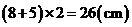
，
所以他们用的周长一样长．
故选：A．

## 26. 单选题（难度：简单）

下列现象中不属于平移的是（　　）

【答案】A

## 27. 单选题（难度：简单）

甲、乙两人用同种材料制作的楼梯模型如图所示，则他们所用的材料的长度相比，（　　）

【答案】A

## 28. 单选题（难度：适中）

如图，在长为xm，宽为ym的长方形草地ABCD中有两条小路，\({l_1}\)和\({l_2}\)、\({l_1}\)为W状，\({l_2}\)为平行四边形状，每条小路的右边线都是由小路左边线右移1m得到的，则三块草地面积之和为（　　）

- A. xy-2y
- B. xy-2x
- C. (x-1)(y-1)
- D. xy

【答案】A

【解析】解：根据题意可得：小路\({l_1}\)的面积为：xy-（x-1）y=xy-xy+y=y；
小路\({l_2}\)的面积为：xy-（x-1）y=xy-xy+y=y，
故三块草地面积之和为：xy-2y．
故选：A． 
【点睛】此题主要考查了平行四边形的性质，正确理解平移的性质是解题的关键．

## 29. 单选题（难度：适中）

将如图图案剪成若干小块，再分别平移后能够得到①，②，③中的（　　）

【答案】A

## 30. 单选题（难度：适中）

在6×6方格中，将图①中的图形N平移后位置如图②所示，则图形N的平移方法中，正确的是  图①                    图②

【答案】A

## 31. 单选题（难度：简单）

2022年北京成功举办第24届冬奥会和冬残奥会，成为世界上首个“双奥之城”，本届冬残奥会会徽主体图形展示了汉字“飞”的动感和力度，如图所示在下面的四个图形中，能由如图经过平移得到的图形是（　　）

【答案】A

## 32. 单选题（难度：适中）

如图，从A到B有①②③三条路可以走，每条路长分别为l，m，n，则l，m，n的大小关系是（　　）
 
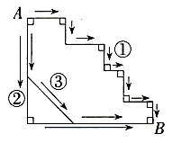

- A. \(l > m > n\)
- B. \(l = m > n\)
- C. \(m > n > l\)
- D. \(l = m < n\)

【答案】B

【解析】解：认真观察图形，可得①②两条路的长相等，根据两点之间线段最短，可知第③条路的长最短．所以l，m，n的大小关系是：\(l = m > n\)．
故选：B． 
【点睛】此题考查平移的性质，两点之间线段最短，正确理解图形的特点应用所学知识解决问题是解题的关键．

## 33. 单选题（难度：适中）

数学课上，老师提出了一个问题：如何作一条直线的平行线？如图是小明同学的作法，老师对小明的作法表示了肯定，那么小明作图的原理是（　　） 
 

- A. 两直线平行，同旁内角互补
- B. 同位角相等，两直线平行
- C. 同旁内角互补，两直线平行
- D. 两直线平行，同位角相等

【答案】B

【解析】解：利用平移的性质得到\(\angle 1 = \angle 2\)，
可知小明作图的原理是同位角相等两直线平行，
故选：B．

## 34. 单选题（难度：简单）

将如图冰墩墩图案进行平移，得到的图案可能是下列选项中的（　　）

- A. 
- B. 
- C. 
- D. 

【答案】D

【解析】解：如图冰墩墩，将图中冰墩墩进行平移，得到的冰墩墩可能是上列选项中的D． 
故选：D． 
【点睛】此题主要考查了生活中的平移现象，正确根据平移的性质得出是解题关键．

## 35. 单选题（难度：适中）

如图，在一块长为11m，宽为5m的长方形草地上，有一条弯曲的小路，其余部分为绿地，小路的左边线向右平移1m就是它的右边线，这块草地的绿地面积为（　　）
 
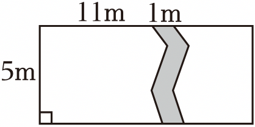

- A. 50m2
- B. 55m2
- C. 40m2
- D. 44m2

【答案】A

【解析】解：∵小路的左边线向右平移1m就是它的右边线，
∴将小路左半部分的草地向右平移1m，与小路的右半部分对接，
∴可以得到一个长为（11﹣1）m，宽为5m的长方形，
∴这块草地的绿地面积是（11﹣1）×5＝50（m2），
故选：A．

## 36. 单选题（难度：适中）

下面选项中哪幅图是由原图平移得到的（　　）

【答案】A

## 37. 单选题（难度：简单）

窗棂是中国传统木构建筑的框架结构设计，在园林设计中常常可以看到．下列窗棂图案中可以看作由一个“基本图案”经过平移得到的是（　　）

【答案】A

## 38. 单选题（难度：适中）

如框中的海豚形象，下列四个选项中由原图的海豚图案平移得到的是（　　）

- A. 
- B. 
- C. 
- D. 

【答案】D

【解析】解：由平移得到的图形是选项D，
故选：D．

## 39. 单选题（难度：非常简单）

下列图案中，可以看作由基本图案经过平移得到的是（　　）

【答案】A

## 40. 单选题（难度：适中）

如图，正方形网格中，能由平移得到的线段是（　　）

【答案】A

## 41. 单选题（难度：简单）

在下列现象中，属于平移的是（　　）

【答案】A

## 42. 单选题（难度：非常简单）

下列现象中，属于平移过程的是（　　）

【答案】A

## 43. 单选题（难度：简单）

下列生活现象不属于平移的是（　　）

- A. 物体随升降电梯上下移动
- B. 拉抽屉
- C. 电风扇扇叶转动
- D. 汽车在平直的公路上直线走

【答案】C

【解析】解：A． 物体随升降电梯上下移动，属于平移，不合题意；
B． 拉抽屉，属于平移，不合题意；
C． 电风扇扇叶转动，属于旋转，不属于平移，符合题意；
D． 汽车在平直的公路上直线走，属于平移，不合题意；
故选C． 
【点睛】本题考查平移的识别，解题的关键是掌握平移的定义．在平面内，将一个图形上的所有点都按照某个直线方向做相同距离的移动，这样的图形运动叫做图形的平移运动，简称平移．

## 44. 单选题（难度：简单）

下列生活中的现象，属于平移的是（　　）

【答案】A

## 45. 单选题（难度：简单）

下列现象是数学中的平移的是（　　）

【答案】A

## 46. 单选题（难度：简单）

下列现象中不属于平移的是（　　）

【答案】A

## 47. 单选题（难度：简单）

甲、乙两人用同种材料制作的楼梯模型如图所示，则他们所用的材料的长度相比，（　　）

【答案】A

## 48. 单选题（难度：简单）

如图，在宽为20米、长为30米的矩形地面上修筑宽均为2米的道路（图中阴影部分），余下部分种植草坪．则草坪的面积为（　　）平方米．

【答案】A

## 49. 单选题（难度：简单）

如图，某居民小区有一长方形土地，长32米，宽20米．居民想在长方形地内修筑宽均为2米的小路，余下的部分做绿化，为了使草坪更美观，有人建议把道路修成如图所示的形状，求绿化的面积为（　　）平方米
 
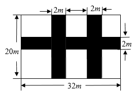

- A. 640
- B. 600
- C. 540
- D. 504

【答案】D

【解析】解：利用平移可得，所有绿化面积之和为（32-4）（20-2）=504m2，
故选D． 
【点睛】此题主要考查了生活中的平移现象，这类题目体现了数形结合的思想，需利用平移把不规则的图形变为规则图形，进而即可列出算式，求出答案．

## 50. 单选题（难度：简单）

下列现象中，属于平移现象的是（　　）

- A. 方向盘的转动
- B. 建筑落在水面的倒影
- C. 电梯的升降
- D. 钟摆的运动

【答案】C

【解析】解：A、方向盘的转动，不是平移，不符合题意；
B、建筑落在水面的倒影，是轴对称，不是平移，不符合题意；
C、电梯的升降，是平移，符合题意；
D、钟摆的运动，不是平移，不符合题意；
故选C．

## 51. 单选题（难度：简单）

有下列现象：①高层公寓电梯的上升：②传送带的移动；③方向盘的转动；④风车的转动；⑤钟摆的运动；⑥荡秋千运动．其中属于旋转的有（　　）

- A. 2个
- B. 3个
- C. 4个
- D. 5个

【答案】C

【解析】解：①高层公寓电梯的上升，是平移，故不符合要求：
②传送带的移动，是平移，故不符合要求； 
③方向盘的转动，是旋转，故符合要求；
④风车的转动，是旋转，故符合要求；
⑤钟摆的运动，是旋转，故符合要求；
⑥荡秋千运动，是旋转，故符合要求；
故选：C． 
【点睛】本题考查了旋转的定义．解题的关键在于对知识的熟练掌握．

## 52. 单选题（难度：简单）

如图，在一块长方形草地上原有一条等宽的笔直小路，现在要把这条小路改为同样宽度的弯曲小路，则改造后草地部分的面积（　　）  

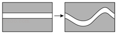

- A. 变大
- B. 不变
- C. 变小
- D. 无法确定

【答案】B

【解析】如图所示，将题干中第一个图形的两块草坪上下平移，得到一个长方形，同理，将第二个图形的两块草坪上下平移，也会得到一个面积大小相同的长方形．
 

 
故选：B． 
【点睛】本题考查了平移的性质，正确理解题意、灵活应用平移的性质是解题的关键．

## 53. 单选题（难度：简单）

下列现象中，属于平移现象的是（　　）

- A. 钟表的指针运动
- B. 行驶的汽车的车轮
- C. 电风扇的转动
- D. 电梯的升降

【答案】D

【解析】解：A、钟表的指针运动，是旋转，故此选项不符合题意；
B、行驶的汽车的车轮，是旋转，故此选项不符合题意；
C、电风扇的转动，是旋转，故此选项不符合题意；
D、电梯的升降，是平移，故此选项符合题意；
故选：D． 
【点睛】本题考查了图形的平移，图形的平移只改变图形的位置，而不改变图形的形状和大小，学生易混淆图形的平移与旋转或翻转而误选．

## 54. 单选题（难度：简单）

下列现象中，不属于平移的是（　　）

- A. 滑雪运动员在平坦的雪地上沿直线滑行
- B. 时针的走动
- C. 商场自动扶梯上顾客的升降运动
- D. 火车在笔直的铁轨上行驶

【答案】B

【解析】解：A． 滑雪运动员在平坦的雪地上沿直线滑行，是平移，不符合题意；
B． 时针的走动，不是平移，符合题意；
C． 商场自动扶梯上顾客的升降运动，是平移，不符合题意；
D． 火车在笔直的铁轨上行驶，是平移，不符合题意；
故选B． 
【点睛】本题主要考查了平移的定义，熟知相关定义是解题的关键．

## 55. 单选题（难度：简单）

下列现象中，属于平移的是（　　）

- A. 将一张纸沿它的中线折叠
- B. 飞碟的快速转动
- C. 翻开书中的每一页纸
- D. 电梯的上下移动

【答案】D

【解析】解：将一张纸沿它的中线折叠，属于轴对称，故A不符合题意；
飞碟的快速转动，属于旋转，故B不符合题意；
翻开书中的每一页纸，属于旋转，故C不符合题意；
电梯的上下移动，属于平移，故D符合题意；
故选D
【点睛】本题考查的是轴对称，平移，旋转，掌握“轴对称，平移，旋转的定义”是解本题的关键.

## 56. 单选题（难度：简单）

下面情况中，可以看成平移的是（　　）

- A. 旗帜随风摇摆
- B. 碟片在光驱中运行
- C. 把打开的书本合上
- D. 急刹车时汽车在地面上的滑动

【答案】D

【解析】解：A． 旗帜随风摇摆，可以看作是旋转，选项说法错误，不符合题意；
B． 碟片在光驱中运行，可以看作是旋转，选项说法错误，不符合题意；
C． 把打开的书本合上，可以看作是旋转，选项说法错误，不符合题意；
D． 急刹车时汽车在地面上的滑动，可以看作是平移，选项说法正确，符合题意；
故选D． 
【点晴】本题考查生活中的平移现象，掌握平移的定义是正确判断的前提．

## 57. 单选题（难度：简单）

下列对象中不属于平移的是（　　）

【答案】A

## 58. 单选题（难度：简单）

在以下现象中：①用打气筒打气时，气筒里活塞的运动；②传送带上，瓶装饮料的移动；③在笔直的公路上行驶的汽车；④温度计中，液柱的上升或下降；⑤钟摆的摆动．属于平移的是（　　）

- A. ①
- B. ①②
- C. ①②③
- D. ①②③④

【答案】C

【解析】解：①用打气筒打气时，气筒里活塞沿直线运动，符合平移的性质，故属平移；
②传送带上，瓶装饮料的移动沿直线运动，符合平移的性质，故属平移；
③在笔直的公路上行驶的汽车沿直线运动，符合平移的性质，故属平移；
④随温度计中，液柱的上升或下降时，体积要发生变化，不符合平移的性质；
⑤钟摆的摆动，在运动的过程中改变图形的方向，不符合平移的性质．
故选：C． 
【点睛】本题主要考查平移的性质，根据题意找到平移的特征是解决问题的关键．

## 59. 单选题（难度：适中）

如图，在长为xm，宽为ym的长方形草地ABCD中有两条小路，$l_1$和${{l}_{2}}$、$l_1$为W状，${{l}_{2}}\)</la

【答案】A

## 60. 单选题（难度：简单）

小红同学在某数学兴趣小组活动期间，用铁丝设计并制作了如图所示的三种不同的图形，请您观察甲、乙、丙三个图形，判断制作它们所用铁丝的长度关系是（　　）

【答案】A

## 61. 单选题（难度：适中）

在6×6方格中，将图①中的图形N平移后位置如图②所示，则图形N的平移方法中，正确的是
 
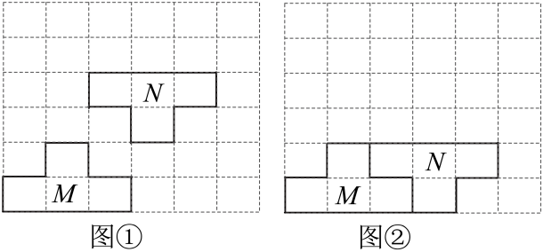
 
图①                    图②

- A. 向下移动1格
- B. 向上移动1格
- C. 向上移动2格
- D. 向下移动2格

【答案】D

【解析】由图可知，图①中的图形N向下移动2格后得到图②．故选D．

## 62. 单选题（难度：适中）

将如图图案剪成若干小块，再分别平移后能够得到①，②，③中的（　　）

【答案】A

## 63. 单选题（难度：适中）

如图，正方形网格中，能由\(a\)平移得到的线段是（　　）
 
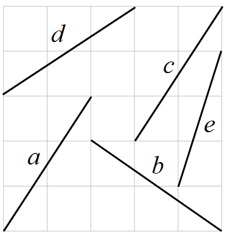

- A. \(b\)
- B. \(c\)
- C. \(d\)
- D. \({{e}}\)

【答案】B

【解析】如图，线段c是由线段a平移得到的，
故选： B． 
【点睛】本题考查坐标与图形变化－平移，解题的关键是理解平移的定义，属于中考常考题型．

## 64. 单选题（难度：适中）

如图所示，下列关于△ABC与△A′B′C′的说法不正确的是（　　）

【答案】A

## 65. 单选题（难度：简单）

如图所示的图案，可以看作由“基本图案”经过平移得到的是（　　）

- A. 
- B. 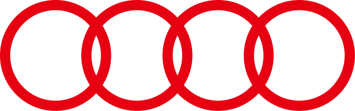
- C. 
- D. 

【答案】B

【解析】解：A、不是由“基本图案”经过平移得到，故此选项不符合题意；
B、是由“基本图案”经过平移得到，故此选项符合题意；
C、不是由“基本图案”经过平移得到，故此选项不符合题意；
D、不是由“基本图案”经过平移得到，故此选项不符合题意；
故选B． 
【点睛】本题考查生活中的平移现象，仔细观察各选项图形是解题的关键．

## 66. 单选题（难度：非常简单）

下列图案中，可以看作由基本图案经过平移得到的是（　　）

【答案】A

## 67. 单选题（难度：非常简单）

在中国园林建筑中，洞窗是最生动的眼睛，主要以镂空图案填心为主，故也称镂空花窗．花窗图案丰富多样，以各种植物，动物，字体，几何图案和其他图案为基础，相互交错形成多种吉祥图案．以下花窗的图样中，是通过平移设计的是（　　）

【答案】A

## 68. 单选题（难度：简单）

下列四幅图中，能通过平移原图得到的是（　　）

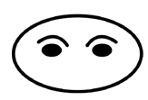

- A. 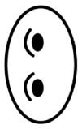
- B. 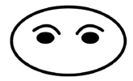
- C. 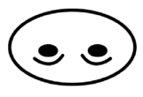
- D. 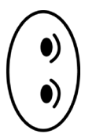

【答案】B

【解析】解：由平移的性质可知，不改变图形的形状、大小和方向，只有选项B符合要求，
故选：B．

## 69. 单选题（难度：适中）

如图，三角形<latex class="math-tex">\(ABC$的边$BC$在直线$MN$上，且$BC=8\text{cm}$．将三角形<latex class="mat

【答案】A

## 70. 单选题（难度：简单）

将如图冰墩墩图案进行平移，得到的图案可能是下列选项中的（　　）

- A. 
- B. 
- C. 
- D. 

【答案】D

【解析】解：如图冰墩墩，将图中冰墩墩进行平移，得到的冰墩墩可能是上列选项中的D． 
故选：D． 
【点睛】此题主要考查了生活中的平移现象，正确根据平移的性质得出是解题关键．

## 71. 单选题（难度：简单）

2022年北京成功举办第24届冬奥会和冬残奥会，成为世界上首个“双奥之城”，本届冬残奥会会徽主体图形展示了汉字“飞”的动感和力度，如图所示在下面的四个图形中，能由如图经过平移得到的图形是（　　）

【答案】A

## 72. 单选题（难度：简单）

窗棂是中国传统木构建筑的框架结构设计，在园林设计中常常可以看到．下列窗棂图案中可以看作由一个“基本图案”经过平移得到的是（　　）

【答案】A
