# 7.3 一元一次不等式组（同步练习）

> 教材：数学·七年级下册·沪科技版2024新教材 ｜ 来源：国家中小学智慧教育平台·在线练习 ｜ 共 49 题

## 1. 单选题（难度：简单）

不等式组\( \left\{\begin{array}{c}5x-3<9+x\\ x>\frac{x-2}{2}\end{array}\right. \)的整数解的个数为（   ）

- A. 3
- B. 4
- C. 5
- D. 6

【答案】B

【解析】解：解不等式\( 5x-3<9+x\)得，\( x<3\),
解不等式\( x>\frac{x-2}{2}\)得，\( x>-2\),
∴不等式组的解集为：\( -2<x<3\)，
∴不等式组的整数解为：\( -\mathrm{1,0},\mathrm{1,2}\),即不等式组有\( 4\)个整数解，
故选：\( \mathrm{B}\)．

## 2. 单选题（难度：非常简单）

不等式组\( \left\{\begin{array}{c}2x+3\ge 1\\ 4-3x\ge -5\end{array}\right. \)，的解集是（   ）

- A. \( -1\le x<2\)
- B. \( -1\le x\le 3\)
- C. \( x\ge \text{3}\)
- D. \( x\ge -1\)

【答案】B

【解析】解：\( \left\{\begin{array}{c}2x+3\ge 1①\\ 4-3x\ge -5②\end{array}\right. \)
解不等式①得，\( x\ge -1\)；
解不等式②得，\( x\le 3\)；
所以，不等式组的解集为：\( -1\le x\le 3\)，
故选：B．

## 3. 单选题（难度：非常简单）

不等式组\( \left\{\begin{array}{c}x-3<0\\ 2\left(x+2\right)>x\end{array}\right. \)的解集是（   ）

- A. \( -4<x<3\)
- B. \( 3<x<4\)
- C. \( -3<x<4\)
- D. \( -2<x<3\)

【答案】A

【解析】解：\( \left\{\begin{array}{c}x-3<0\\ 2\left(x+2\right)>x\end{array}\right. \begin{array}{c}①\\ ②\end{array}\)
解不等式①得，\( x<3\)，
解不等式②得，\( x>-4\)，
\( \therefore \)不等式组的解集是\( -4<x<3\)，
故答案为：A．

## 4. 单选题（难度：非常简单）

不等式组\( \left\{\begin{array}{c}x+2\ge 0\\ -2x+6\ge 0\end{array}\right. \)的解集是（   ）

- A. \( x\ge -2\)
- B. \( x\ge \text{3}\)
- C. \( -2\le x\le 3\)
- D. 无解

【答案】C

【解析】解：由不等式\( x+2\ge 0\)可得：\( x\ge -2\)，
由不等式\( -2x+6\ge 0\)可得：\( x\le 3\)，
∴原不等式组解集为：\( -2\le x\le 3\)，
故选：C.

## 5. 单选题（难度：简单）

不等式组\( \left\{\begin{array}{c}x-1<0\\ \frac{x+1}{2}\ge 2\end{array}\right. \)的解集是（   ）

- A. \( x<1\)
- B. \( x\ge \text{3}\)
- C. \( x\ge 1\)
- D. 无解

【答案】D

【解析】解：\( \left\{\begin{array}{c}x-1<0\text{①}\\ \frac{x+1}{2}\ge 2\text{②}\end{array}\right. \)
解不等式①得：\( x<1\)，
解不等式②得：\( x\ge 3\)，
故不等式组无解，
故选：D．

## 6. 单选题

在平面直角坐标系\( xOy\)中，对于点\( P\left(x,y\right)\)，若\( x，y\)均为整数，则称点\( P\)为“整点”，特别地，当\( \frac{y}{x}\)（其中\( xy\ne 0\)）的值为整数时，称“整点”\( P\)为“超整点”．已知点\( P\left(2a-4,a+3\right)\)在第二象限，下列说法正确的有（    ）
①\( a<-3\)；
②若点\( P\)为“整点”，则点\( P\)的个数为4个；
③若点\( P\)为“超整点”，则点\( P\)的个数为1个；
④若点\( P\)为“超整点”，则点\( P\)到两坐标轴的距离之和大于10．

- A. 1个
- B. 2个
- C. 3个
- D. 4个

【答案】B

【解析】解：∵点\( P\left(2a-4,a+3\right)\)在第二象限，
∴\( \left\{\begin{array}{c}2a-4<0\\ a+3>0\end{array}\right. \)，
∴\( -3<a<2\)，故①错误；
∵点\( P\left(2a-4,a+3\right)\)为“整点”， \( -3<a<2\)，
∴整数a为\( -2\)，\( -1\)，0，1，
∴点P的个数为4个，故②正确；
∴“整点”P为\( \left(-\mathrm{8,1}\right)\)，\( \left(-\mathrm{6,2}\right)\)，\( \left(-\mathrm{4,3}\right)\)，\( \left(-\mathrm{2,4}\right)\)，
∵\( \frac{1}{-8}=-\frac{1}{8}\)，\( \frac{2}{-6}=-\frac{1}{3}\)，\( \frac{3}{-4}=-\frac{3}{4}\)，\( \frac{4}{-2}=-2\)
∴“超整点”P为\( \left(-\mathrm{2,4}\right)\)，故③正确；
∵点\( P\left(2a-4,a+3\right)\)为“超整点”，
∴点P坐标为\( \left(-\mathrm{2,4}\right)\)，
∴点P到两坐标轴的距离之和\( 2+4=6\)，故④错误，
故选：B．

## 7. 单选题（难度：适中）

若点\( A(a+b,b-2)\)在第二象限，则点\( B(-a,1-b)\)在（   ）

- A. 第一象限
- B. 第二象限
- C. 第三象限
- D. 第四象限

【答案】D

【解析】因为点\( A(a+b,b-2)\)在第二象限，可得：
\( \left\{\begin{array}{c}a+b<0\\ b-2>0\end{array}\right. \)，
解得\( a<-2\)，\( b>2\)，
那么\( -a>2>0\)，
因为\( b>2\)，两边同时乘\( -1\)，不等号方向改变，得\( -b<-2\)，两边同时加1，得\( 1-b<-1<0\)，
根据第四象限内点的坐标特征：横坐标大于0，纵坐标小于0，
可知点\( B(-a,1-b)\)在第四象限．
故选：D．

## 8. 单选题（难度：简单）

实数m对应的点在数轴上的位置如图所示，则不等式组\( \left\{\begin{array}{c}x+2>0\\ x-m\le 0\end{array}\right. \)的解集为（    ）

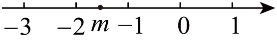

- A. \( x>-2\)
- B. \( x\le m\)
- C. \( -2<x\le m\)
- D. \( -2<x<m\)

【答案】C

【解析】解：由数轴可得\( -2<m<-1\)，
\( \left\{\begin{array}{c}x+2>0①\\ x-m\le 0②\end{array}\right. \)，
解不等式①得：\( x>-2\)，
解不等式②得：\( x\le m\)，
∴不等式组的解集为：\( -2<x\le m\)．
故选：C．

## 9. 单选题（难度：适中）

不等式组\( \left\{\begin{array}{c}x-2a\le 2\\ \frac{x}{3}-b>\frac{2}{3}\end{array}\right. \)的解集在数轴上表示如图，则式子\( \left(a+2\right)\left(b-1\right)\)的值为（   ）

- A. \( -4\)
- B. 0
- C. 4
- D. 6

【答案】A

【解析】解：\( \left\{\begin{array}{c}x-2a\le 2①\\ \frac{x}{3}-b>\frac{2}{3}②\end{array}\right. \)
解不等式①得\( x\le 2a+2\)，
解不等式②得：\( x>3b+2\)，
根据数轴表示的解集可知不等式组的解集为\( -1<x\le 2\)，
∴\( 2a+2=2，3b+2=-1\)，
∴\( a=0，b=-1\)，
∴\( \left(a+2\right)\left(b-1\right)=\left(0+2\right)\left(-1-1\right)=2\times \left(-2\right)=-4\)，
故选A．

## 10. 单选题（难度：简单）

已知平面直角坐标系上有一点\( P(m+\mathrm{2,5}+m)\)位于第二象限，则m的值可能为（   ）

- A. \( -3\)
- B. 1
- C. -5
- D. -6

【答案】A

【解析】解：∵点\( P\left(m+\mathrm{2,5}+m\right)\)在第二象限，
∴\( \left\{\begin{array}{c}m+2<0\\ 5+m>0\end{array}\right. \)，
解得：\( -5<m<-2\)，
则m的值可能为\( -3\)．
故选：A．

## 11. 单选题

关于x的不等式组\( \left\{\begin{array}{c}2a-x>3\\ 2x+8>4a\end{array}\right. \)的解集中每一个值均不在\( -1\le x\le 5\)的范围中，则a的取值范围是（   ）

- A. \( a<1\)或\( a>4.5\)
- B. \( a\le 1\)或\( a\ge 4.5\)
- C. \( a>4\)或 \( a<1.5\)
- D. \( a\ge 4\)或\( a\le 1.5\)

【答案】B

【解析】解：解不等式\( 2a-x>3\)，得\( x<2a-3\)，
解不等式\( 2x+8>4a\)，得\( x>2a-4\)，
∴不等式组的解集为\( 2a-4<x<2a-3\)，
∵不等式组\( \left\{\begin{array}{c}2a-x>3\\ 2x+8>4a\end{array}\right. \)的解集中每一个值均不在\( -1\le x\le 5\)的范围中，
∴\( 2a-3\le -1\)或\( 2a-4\ge 5\)，
解得\( a\le 1\)或\( a\ge 4.5\)，
故选：B．

## 12. 单选题（难度：适中）

如果\( \left|x+1\right|=1+x,\left|3x+2\right|=-3x-2\)，那么\( x\)的取值范围是（   ）

- A. \( -1\le x\le -\frac{2}{3}\)
- B. \( x\ge -1\)
- C. \( x\le -\frac{2}{3}\)  ​​​
- D. \( \frac{2}{3}\le x\le 1\)​​

【答案】A

【解析】解：由\( \left|x+1\right|=1+x,\left|3x+2\right|=-3x-2\)，
得\( 1+x\ge \mathrm{0,3}x+2\le 0\)，
解得\( -1\le x\le -\frac{2}{3}\)．
故选：A．

## 13. 单选题

当\( x>0\)，\( y>0\)，且满足\( x+y-xy=0\)时，\( x+y>{k}^{2}+2k+1\)恒成立．则k的取值范围为（   ）

- A. \( -3\le k\le 1\)
- B. \( -3<k<1\)
- C. \( -1\le k\le 3\)
- D. \( -1<k<3\)

【答案】B

【解析】解：∵\( x>0\)，\( y>0\)，且\( x+y-xy=0\)，
∴\( \frac{1}{x}+\frac{1}{y}=1\)，
∴\( x+y=\left(x+y\right)\left(\frac{1}{x}+\frac{1}{y}\right)=2+\frac{y}{x}+\frac{x}{y}\ge 2+2\sqrt{\frac{y}{x}\cdot \frac{x}{y}}=4\)，
∴\( x+y\)的最小值为4，
∵\( x+y>{k}^{2}+2k+1\)恒成立，
∴\( {k}^{2}+2k+1<4\)，
∴\( {\left(k+1\right)}^{2}<4\)，
∴\( -2<k+1<2\)，
∴\( -3<k<1\)．
故选：B．

## 14. 单选题（难度：简单）

不等式组\( \left\{\begin{array}{c}x>-2\\ 2x-1\le 5\end{array}\right. \)的解集在数轴上表示正确的是（   ）

- A. 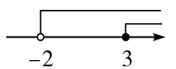
- B. 
​
- C. 
- D. 
​

【答案】C

【解析】解：不等式组整理得：\( \left\{\begin{array}{c}x>-2\\ x\le 3\end{array}\right. \)，
解得：\( -2<x\le 3\)，
数轴上表示，如图所示：

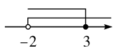

故选：C．

## 15. 单选题

已知关于x的不等式组\( \left\{\begin{array}{c}x-\frac{3x-5}{2}<2\\ 2x-a\le -1\end{array}\right. \)，下列四个结论：
①若它的解集是\( 1<x\le 3\)，则\( a=7\)；②当\( a=3\)，不等式组有解；
③若它的整数解仅有3个，则a的取值范围是\( 9\le x<11\)；④若不等式组有解，则\( a>3\)．
其中正确的结论个数（   ）

- A. 1个
- B. 2个
- C. 3个
- D. 4个

【答案】C

【解析】解：∵\( \left\{\begin{array}{c}x-\frac{3x-5}{2}<2①\\ 2x-a\le -1②\end{array}\right. \)，
解不等式①得：\( x>1\)，
解不等式②得：\( x\le \frac{a-1}{2}\)，
∵若它的解集是\( 1<x\le 3\)，即\( \frac{a-1}{2}=3\)，解得：\( a=7\)，
∴①正确，
∵当\( a=3\)，\( x\le 1\)，即不等式组的解为\( x=1\)，
∴②正确，
∵若它的整数解仅有3个，即\( 4\le \frac{a-1}{2}<5\)，
∴a的取值范围是\( 9\le x<11\)
∴③正确，
∵若不等式组有解，即\( 1\le \frac{a-1}{2}\)，则\( 3\le a\)，
∴④错误，
故选：C．

## 16. 单选题（难度：简单）

不等式组\( \left\{\begin{array}{c}-x-1\le 2\\ 0.5x<1.5\end{array}\right. \)的解集在数轴上表示正确的是（   ）

- A. 
- B. 
​
- C. 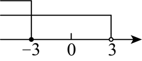
- D. 
​

【答案】A

【解析】解：\( \left\{\begin{array}{c}-x-1\le 2①\\ 0.5x<1.5②\end{array}\right. \)，
解不等式①得：\( x\ge -3\)，
解不等式②得：\( x<3\)，
∴不等式组的解集为\( -3\le x<3\)．
将不等式组的解集在数轴上表示为：
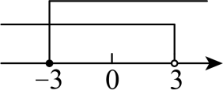

故选：A．

## 17. 单选题

关于x的不等式\( ax-b>0\)的解是\( x>1\)，则关于x的不等式\( (ax+b)(x-2)>0\)的解是（   ）

- A. \( x<-1\)或\( x>2\)
- B. \( -1<x<2\)
- C. \( 1<x<2\)
- D. \( x<1\)或\( x>2\)

【答案】A

【解析】解：∵关于x的不等式\( ax-b>0\)的解是\( x>1\)，
∴\( a>0\)，且\( \frac{b}{a}=1\)，
∴\( b=a>0\)，
∵关于x的不等式\( (ax+b)(x-2)>0\)，
∴\( \left\{\begin{array}{c}ax+a>0\\ x-2>0\end{array}\right. \)或\( \left\{\begin{array}{c}ax+a<0\\ x-2<0\end{array}\right. \)，
∴\( x<-1\)或\( x>2\)．
故选：A．

## 18. 单选题（难度：适中）

关于x的不等式组\( \left\{\begin{array}{l}2a-x＞3\\ 2x+8＞4a\end{array}\right.\)的解集中每一个值均不在﹣1≤x≤5的范围中，则a的取值范围是（　　）

- A. a＜1或a＞4.5
- B. a≤1或a≥4.5
- C. a＞4或a＜1.5
- D. a≥4或a≤1.5

【答案】B

【解析】解：由\( \left\{\begin{array}{l}2a-x＞3\\ 2x+8＞4a\end{array}\right.\) 解得2a﹣4＜x＜2a﹣3．
由关于x的不等式组 \( \left\{\begin{array}{l}2a-x＞3\\ 2x+8＞4a\end{array}\right.\)的解集中每一x值均不在﹣1≤x≤5的范围中，得
2a﹣4≥5或2a﹣3≤﹣1．
解得a≥4.5或a≤1，
故选：B．

## 19. 单选题（难度：适中）

不等式组\( \left\{\begin{array}{l}x＞1\\ x＞2\end{array}\right.\)的解是（　　）

- A. x＞1
- B. x＞2
- C. x＜1
- D. x＜2

【答案】B

【解析】解：不等式组\( \left\{\begin{array}{l}x＞1\\ x＞2\end{array}\right.\)的解是x＞2，
故选：B．

## 20. 单选题（难度：适中）

不等式组\( \left\{\begin{array}{l}5x-3＜3x+5\\ x＜a\end{array}\right.\)的解集为x＜4，则a满足的条件是（　　）

- A. a＜4
- B. a＝4
- C. a≤4
- D. a≥4

【答案】D

【解析】解：解不等式组得\( \left\{\begin{array}{l}x＜4\\ x＜a\end{array}\right.\)，
∵不等式组\( \left\{\begin{array}{l}5x-3＜3x+5\\ x＜a\end{array}\right.\)的解集为x＜4，
∴a≥4．
故选：D．

## 21. 单选题（难度：适中）

不等式组\( \left\{\begin{array}{l}2x-4＞0\\ 1-x＜5\end{array}\right.\)的解为（　　）

- A. x＞4
- B. x＞﹣4
- C. 2＜x＜4
- D. x＞2

【答案】D

【解析】解：由2x﹣4＞0得：x＞2，
由1﹣x＜5得：x＞﹣4，
则不等式组的解集为x＞2，
故选：D．

## 22. 单选题（难度：适中）

若不等式组\( \left\{\begin{array}{l}x-2\ge 0\\ 2x＜m\end{array}\right.\)无解，则m的值可能为（　　）

- A. 3
- B. 5
- C. 7
- D. 9

【答案】A

【解析】解：\( \left\{\begin{array}{l}x-2\ge 0①\\ 2x＜m②\end{array}\right.\)，
解不等式①，得x≥2，
解不等式②，得\( x＜\frac{m}{2}\)，
∵不等式组\( \left\{\begin{array}{l}x-2\ge 0\\ 2x＜m\end{array}\right.\)无解，
∴\( 2\ge \frac{m}{2}\)，
∴m≤4，
故选：A．

## 23. 单选题（难度：适中）

不等式组\( \left\{\begin{array}{l}x-3＜0\\ 2(x+2)＞x\end{array}\right.\)的解集是（　　）

- A. ﹣4＜x＜3
- B. 3＜x＜4
- C. ﹣3＜x＜4
- D. ﹣2＜x＜3

【答案】A

【解析】解：解不等式x﹣3＜0得x＜3，
解不等式2（x+2）＞x得x＞﹣4，
∴不等式组的解集为﹣4＜x＜3，
故选：A．

## 24. 单选题（难度：适中）

若关于x的不等式组\( \left\{\begin{array}{c}x-2＜3x-6\\ x＜a\end{array}\right.\)无解，则a的值可以是（　　）

- A. 1
- B. 3
- C. 5
- D. 7

【答案】A

【解析】解：\( \left\{\begin{array}{c}x-2＜3x-6①\\ x＜a②\end{array}\right.\)
解①得：x＞2，
解②得：x＜a，
由条件可知a≤2，
故选：A．

## 25. 单选题（难度：非常简单）

下列不等式组无解的是（　　）

【答案】A

## 26. 单选题（难度：非常简单）

不等式组<latex class="math-tex">\( \left\{\begin{array}{c}x\le 3①\\ x>-2②\end{array}\right. \)</latex>在数轴上表示为：      ，这个不等式组的解集为（    ）

【答案】A

## 27. 单选题（难度：非常简单）

不等式组\( \left\{\begin{array}{c}x\le 3\\ x>-2\end{array}\right. \)的解集是（　　）

- A. \( -2<\mathrm{x}\le 3\)
- B. \( \mathrm{x}>-2\)
- C. \( \mathrm{ }\mathrm{x}\ge \text{3}\)或\( \mathrm{x}<-2\)
- D. \( \mathrm{x}<-2\)

【答案】A

【解析】解：\( \because \) \( \left\{\begin{array}{c}x\le 3\\ x>-2\end{array}\right. \)，
利用大小小大取中间可得\( -2<\mathrm{x}\le 3\)，
故选：A．

## 28. 单选题（难度：非常简单）

不等式组<latex class="math-tex">\( \left\{\begin{array}{c}m\ge 3\\ m\le 4\end{array}\right. \)</latex>，则m的取值范围在数轴上可表示为（    ）

【答案】A

## 29. 单选题（难度：非常简单）

不等式组\( \left\{\begin{array}{c}x-1>0\\ 2-x\ge 0\end{array}\right. \)的解集在数轴上表示为（    ）

- A. 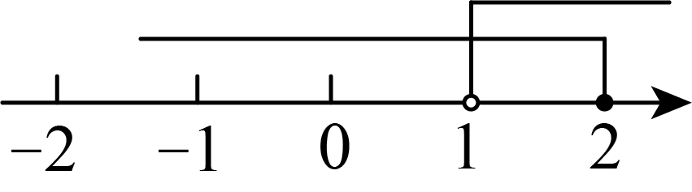
- B. 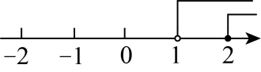
- C. 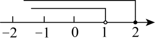
- D. 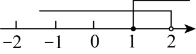

【答案】A

【解析】解：\( \left\{\begin{array}{c}x-1>0\text{\hspace{0.17em}}①\\ 2-x\ge 0\text{\hspace{0.17em}}②\end{array}\right. \) 
解不等式\( \mathrm{①}\)得：\( \mathrm{x}>1\)，
解不等式\( \mathrm{②}\)得：\( \mathrm{x}\le 2\)，
∴不等式组的解集为\( 1<\mathrm{x}\le 2\)，
在数轴上表示为：
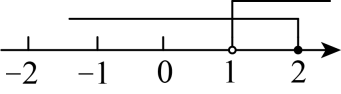
   ， 
故选：\( \text{A}\)．

## 30. 单选题（难度：非常简单）

不等式组<latex class="math-tex">\( \left\{\begin{array}{c}x\le -1\\ x>3\end{array}\right. \)</latex>的解集在数轴上表示为（   ）

【答案】A

## 31. 单选题（难度：非常简单）

不等式组\( \left\{\begin{array}{c}x>2\\ x\le -1\end{array}\right. \)的解集在数轴上表示正确的是（   ）

- A. 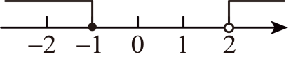
- B. 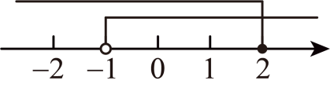
- C. 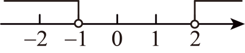
- D. 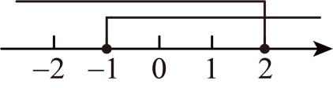

【答案】A

【解析】解： \( \left\{\begin{array}{c}x>2\\ x\le -1\end{array}\right. \)在数轴上表示为：
   
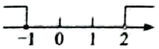
            
故选：A．

## 32. 单选题（难度：非常简单）

不等式组\( \left\{\begin{array}{c}x\le 3\\ x>-2\end{array}\right. \)的解集是（　　）

- A. \( -2<\mathrm{x}\le 3\)
- B. \( \mathrm{x}>-2\)
- C. \( \mathrm{ }\mathrm{x}\ge \text{3}\)或\( \mathrm{x}<-2\)
- D. \( \mathrm{x}<-2\)

【答案】A

【解析】解：\( \because \) \( \left\{\begin{array}{c}x\le 3\\ x>-2\end{array}\right. \)，
利用大小小大取中间可得\( -2<\mathrm{x}\le 3\)，
故选：A．

## 33. 单选题（难度：非常简单）

下列不等式组无解的是（　　）

【答案】A

## 34. 单选题（难度：非常简单）

不等式组<latex class="math-tex">\( \left\{\begin{array}{c}x\le 3①\\ x>-2②\end{array}\right. \)</latex>在数轴上表示为：      ，这个不等式组的解集为（    ）

【答案】A

## 35. 单选题（难度：非常简单）

将一个关于\( \mathrm{x}\)的一元一次不等式组的解集表示在数轴上如图所示，则该不等式组的解集是（    ）
   
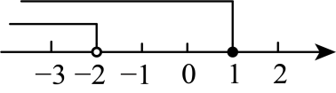

- A. \( \mathrm{x}<1\)
- B. \( \mathrm{x}\le 1\)
- C. \( \mathrm{x}\le -2\)
- D. \( \mathrm{x}<-2\)

【答案】D

【解析】解：由数轴知该不等式组的解集为\( \mathrm{x}<-2\)，
故选D．

## 36. 单选题（难度：非常简单）

不等式组<latex class="math-tex">\( \left\{\begin{array}{c}x>2\\ x\le -1\end{array}\right. \)</latex>的解集在数轴上表示正确的是（   ）

【答案】A

## 37. 单选题（难度：非常简单）

不等式组\( \left\{\begin{array}{c}m\ge 3\\ m\le 4\end{array}\right. \)，则m的取值范围在数轴上可表示为（    ）

- A. 
- B. 
- C. 
- D. 

【答案】D

【解析】解：不等式组\( \left\{\begin{array}{c}m\ge 3\\ m\le 4\end{array}\right. \)的解集为\( 3\le \mathrm{m}\le 4\)，
利用大小小大取中间，且包括3和4，取实心点，
  故选：D ．

## 38. 单选题（难度：非常简单）

不等式组<latex class="math-tex">\( \left\{\begin{array}{c}x\le -1\\ x>3\end{array}\right. \)</latex>的解集在数轴上表示为（   ）

【答案】A

## 39. 单选题（难度：非常简单）

不等式组<latex class="math-tex">\( \left\{\begin{array}{c}x-1>0\\ 2-x\ge 0\end{array}\right. \)</latex>的解集在数轴上表示为（    ）

【答案】A

## 40. 单选题（难度：简单）

不等式组<latex class="math-tex">\( \left\{\begin{array}{c}x-2<3\\ 3x+1\ge 2x\end{array}\right. \)</latex>的解集是（    ）

【答案】A

## 41. 单选题（难度：简单）

不等式组<latex class="math-tex">\( \left\{\begin{array}{c}2\left(\mathrm{x}-1\right)>x+1\\ \frac{5\mathrm{x}-1}{4}\le x+1\end{array}\right. \)</latex>的解集是（    ）

【答案】A

## 42. 单选题（难度：简单）

不等式组\( \mathrm{ }\left\{\begin{array}{c}x-3<0\\ 2\left(x+2\right)>x\end{array}\right. \)的解集是（   ）

- A. \( -4<x<3\)
- B. \( 3<x<4\)
- C. \( -3<\mathrm{x}<4\)
- D. \( -2<\mathrm{x}<3\)

【答案】A

【解析】解：\( \left\{\begin{array}{c}x-3<0\\ 2\left(\mathrm{x}+2\right)>x\end{array}\right. \begin{array}{c}①\\ ②\end{array}\)
解不等式①得，\( \mathrm{x}<3\)，
解不等式②得，\( \mathrm{x}>-4\)，
\( \therefore \)不等式组的解集是\( -4<\mathrm{x}<3\)，
故答案为：A．

## 43. 单选题（难度：简单）

不等式组\( \left\{\begin{array}{c}x+2>0\\ 2x\le 2\end{array}\right. \)的解为（    ）

- A. \( \mathrm{ }-2<\mathrm{x}\le 1\)
- B. \( -\text{2<}\mathrm{x}\text{<1}\)
- C. \( -\text{2}\le \mathrm{x}\le \text{1}\)
- D. \( -2\le \mathrm{x}<1\)

【答案】A

【解析】解：解不等式\( \mathrm{x}+2>0\)，得：\( \mathrm{x}>-2\)；
解不等式\( 2\mathrm{x}\le 2\)，得：\( \mathrm{x}\le 1\)；
则不等式组的解集为\( -2<\mathrm{x}\le 1\)．
故选：A．

## 44. 单选题（难度：简单）

不等式组<latex class="math-tex">\( \left\{\begin{array}{c}-x+3\ge 7\\ 4x-2<6\end{array}\right. \)</latex>的解集是（   ）

【答案】A

## 45. 单选题（难度：简单）

不等式组<latex class="math-tex">\( \left\{\begin{array}{c}3x-4\le 5\\ 6-3x<0\end{array}\right. \)</latex>的解集在数轴上表示为（    ）

【答案】A

## 46. 单选题（难度：简单）

一元一次不等式组\( \left\{\begin{array}{c}x-2\ge 1\\ x+1\le 5\end{array}\right. \)的解集为（    ）

- A. \( -1\le \mathrm{x}\le 4\)
- B. \( \mathrm{x}\le 4\)
- C. \( \mathrm{x}\le 3\)
- D. \( 3\le \mathrm{x}\le 4\)

【答案】D

【解析】解：\( \left\{\begin{array}{c}x-2\ge 1①\\ x+1\le 5②\end{array}\right. \)，
解不等式\( \mathrm{①}\)得：\( \mathrm{x}\ge 3\)，
解不等式\( \mathrm{②}\)得：\( \mathrm{x}\le 4\)，
\( \therefore \)原不等式组的解集为\( 3\le \mathrm{x}\le 4\)．
故选D．

## 47. 单选题（难度：简单）

不等式组\( \left\{\begin{array}{c}x-3\ge 2x-4\\ \\ x+1>-1\end{array}\right. \)的解集在数轴上表示正确的是（   ）

- A. 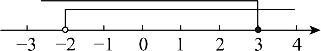
- B. 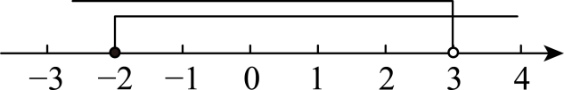
- C. 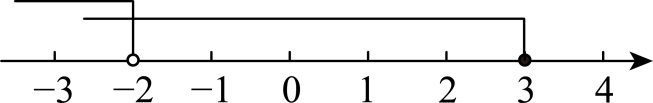
- D. 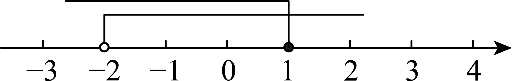

【答案】D

【解析】解：\( \left\{\begin{array}{c}x-3\ge 2x-4①\\ x+1>-1②\end{array}\right. \)，
解不等式①得，\( \mathrm{x}\le 1\)，
解不等式②得，\( \mathrm{x}>-2\)，
∴不等式的解集为：\( -2<\mathrm{x}\le 1\)，
将解集表示在数轴上，如图所示，
 

      
  故选：D ．

## 48. 单选题（难度：简单）

不等式组<latex class="math-tex">\( \left\{\begin{array}{c}2x+4\ge 3\\ \frac{1-\mathrm{x}}{5}>0\end{array}\right. \)</latex>的解集为（    ）

【答案】A

## 49. 单选题（难度：简单）

不等式组<latex class="math-tex">\( \left\{\begin{array}{c}\frac{\mathrm{x}+1}{2}>1\\ 7x-8<9x\end{array}\right. \)</latex>的解集在数轴上表示正确的是（    ）

【答案】A
