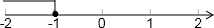
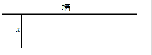
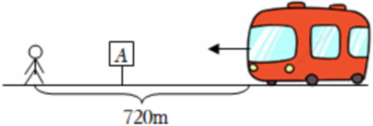
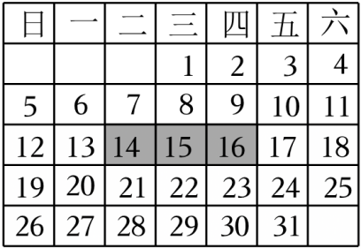
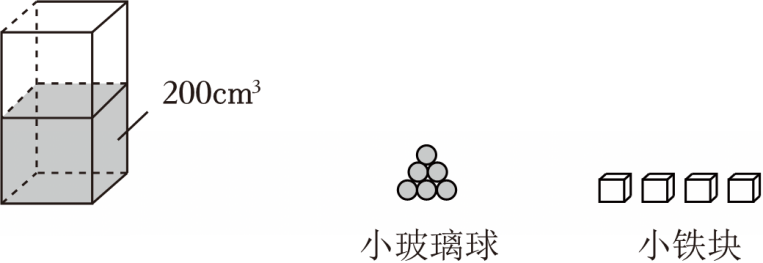

# 数学活动 饮品促销方案分析（同步练习）

> 教材：数学·七年级下册·沪科技版2024新教材 ｜ 来源：国家中小学智慧教育平台·在线练习 ｜ 共 60 题

## 1. 填空题（难度：适中）

关于\(x\)的不等式\(2x - a⩽ - 1\)的解集如图所示，则\(a\)的值是。

【答案】$ - 1$

【解析】​

## 2. 单选题（难度：简单）

小丽同学准备用自己节省的零花钱购买一台学生平板电脑，她已存有750元，并计划从本月起每月节省30元，直到她至少存有1080元，设\(x\)个月后小丽至少有1080元，则可列计算月数的不等式为\((\)　　\()\)

- A. \(30x + 750 > 1080\)
- B. \(30x - 750⩾1080\)
- C. \(30x - 750⩽1080\)
- D. \(30x + 750⩾1080\)

【答案】D

【解析】​

## 3. 单选题（难度：适中）

某品牌手机的成本为每部2000元，售价为每部2800元，该商店准备举行打折促销活动，要求利润率不低于\(12\% \)，如果将这种品牌的手机打\(x\)折销售，则下列不等式中能正确表示该商店的促销方式的是\((\)　　\()\)

- A. \(2800x⩾2000 \times 12\% \)
- B. \(2800 \times \frac{x}{{10}} - 2000⩾2000 \times 12\% \)
- C. \(2800 \times \frac{x}{{10}}⩾2000 \times 12\% \)
- D. \(2800x - 2000⩾2000 \times 12\% \)

【答案】B

【解析】​

## 4. 单选题

把一些书分给几名同学，若每人分11本，则有剩余，若\((\)　　\()\)，依题意，设有\(x\)名同学，可列不等式\(7(x + 4) > 11x\)。

- A. 每人分7本，则剩余4本
- B. 每人分7本，则剩余的书可多分给4个人
- C. 每人分4本，则剩余7本
- D. 其中一个人分7本，则其他同学每人可分4本

【答案】B

【解析】​

## 5. 单选题

某市居民用电的电价实行阶梯收费，收费标准如下表：
一户居民每月用电量（度\()\)
电费价格（元\(/\)度）

不超过200度的部分
0.48

大于200度且不超过400度的部分
0.53

大于400度的部分
0.78

七月份是用电高峰期，李叔计划七月份电费支出不超过200元，则李叔家七月份最多可用电的度数是\((\)　　\()\)

- A. 100
- B. 400
- C. 396
- D. 397

【答案】C

【解析】​

## 6. 填空题（难度：简单）

在一次绿色环保知识竞赛中，共有20道题，对于每一道题，答对了得10分，答错了或不答扣5分，则至少要答对道题，其得分才会不少于80分。

【答案】12

【解析】​

## 7. 

有\(A\)、\(B\)两个商场以同样价格出售同样商品，且各自推出了不同的优惠方案：
在\(A\)商场累计购物超过400元后，超出部分按\(80\% \)收费；
在\(B\)商场累计购物超过200元后，超出的部分按\(90\% \)收费．
顾客选择到哪家购物花费少？

【答案】

当$x \leqslant 200$或$x = 600$时，到两商场购物花费相同；当$200 &lt; x &lt; 600$时，到$B$商场购物花费少；当$x &gt; 600$时，到$A$商场购物花费少

【解析】​

## 8. （难度：简单）

通过测量一棵树的树围（树干的周长）可以计算出它的树龄，通常规定以树干离地面\(1.5\text{m}\)的地方作为测量部位，某树栽种时的树围约为\(8\text{cm}\)，以后树围每年增加约\(4\text{cm}\)，这棵树至少生长多少年（年数取整数），其树围才能超过\(2\text{m}\)？

【答案】

49年

【解析】​

## 9. （难度：适中）

有长为100米的篱笆，利用它和房屋的一面长为60米的墙围成形状如图的院子，院子的一边为\(x\)米．求\(x\)的取值的范围。

【答案】

$20 \leqslant x &lt; 50$

【解析】​

## 10. 填空题

商店为了对某种商品促销，将定价为10元的产品，以下列方式优惠销售：若购买不超过5件，按原价付款；若一次性购买5件以上，超过的部分打八折．现有290元钱，最多可以购买该商品的件数是。

【答案】35

【解析】​

## 11. 填空题（难度：适中）

若关于\(x\)的方程\(3k - 2x + 6 = 0\)的解是非负数，则\(k\)的取值范围为。

【答案】$k \geqslant  - 2$

【解析】​

## 12. 

某蔬菜加工厂承担出口蔬菜的加工任务，有一批蔬菜产品需要装入某一规格的纸箱．供应这种纸箱有两种方案可供选择：
方案一：从纸箱厂定制购买，每个纸箱价格为4元；
方案二：由蔬菜加工厂租赁机器自己加工制作这种纸箱，机器租赁费按生产纸箱数收取．工厂需要一次性投入机器安装等费用16000元，每加工一个纸箱还需成本费2.4元．
假设你是决策者，你认为应该如何选择方案。

【答案】

当纸箱大于10000个时，选择方案二费用较低；当纸箱等于10000个时，两种方案均可；当纸箱小于10000个时，选择方案一费用较低

【解析】​

## 13. 

某家电生产企业根据市场调查分析决定调整生产方案，准备每周（按120个工时计算）生产空调、彩电、冰箱共360台，且冰箱至少生产40台，已知生产这些家电产品每台所需工时和每台产值如下表：
家电名称
空调
彩电
冰箱

工时（个）
\(\frac {1} {2}\)​
\(\frac {1} {3}\)​
\(\frac {1} {4}\)​

产值（万元/台）
0.4
0.3
0.2

每周应生产空调、彩电、冰箱各多少台，才能使产值最高？

最高产值是多少万元？

【答案】

每周应生产空调器20台、彩电300台、冰箱40台，才能使产值最高

，

最高产值是106万元

【解析】解析视频请查看最后一题。

​

## 14. 单选题（难度：简单）

某工程队计划在10天内修路6km，施工前2天修完1.2km后，计划发生变化，准备提前2天完成修路任务，以后几天内平均每天至少要修路（　　）

- A. 0.6km
- B. 0.8km
- C. 0.9km
- D. 1km

【答案】B

【解析】解：设以后几天内平均每天修路x km，
根据题意得：1.2+（10﹣2﹣2）x≥6，
解得：x≥0.8，
∴x的最小值为0.8，
即以后几天内平均每天至少要修路0.8km．
故选：B．

## 15. 单选题（难度：简单）

小刚用100元钱去购买笔记本和圆珠笔共30件，已知每本笔记本2元，每支圆珠笔5元，则小刚最多能买圆珠笔（　　）

- A. 12支
- B. 13支
- C. 14支
- D. 15支

【答案】B

【解析】解：设小刚买圆珠笔x支，
根据题意得：5x+2（30﹣x）≤100，
解得x≤13\( \frac{1}{3}\)，
∵x为整数，
∴x的最大值为13，
∴小刚最多能买圆珠笔13支；
故选：B．

## 16. 单选题（难度：简单）

5月27日，怀宁县举办科技活动周暨“全国科技工作者日”系列活动启动仪式．活动期间，怀宁县将举办科学家精神进校园、科普研学、科普讲座等一系列活动，让科技创新的成果惠及千家万户，让科学精神在人民群众中生根发芽．某校开展了科技知识竞赛活动，共有20道选择题，每道题的四个选项中，有且只有一个答案正确，选对得5分，不选或错选倒扣2分，如果得分不低于80分才能得奖，那么要得奖至少应选对的题数是（　　）

- A. 16
- B. 17
- C. 18
- D. 19

【答案】C

【解析】解：设要得奖应选对x道题，
根据题意得5x﹣2（20﹣x）≥80，
解得\( x\ge \frac{120}{7}\)，
∵x为整数，
∴x≥18，
∴要得奖至少应选对18道题．
故选：C．

## 17. 单选题（难度：简单）

在一次科技知识竞赛中，共有20道选择题，每道题的四个选项中，有且只有一个答案正确，选对得10分，不选或错选倒扣5分，如果得分不低于90分才能得奖，那么要得奖至少应选对的题数是（　　）

- A. 13
- B. 14
- C. 15
- D. 16

【答案】A

【解析】解：设做对x道，则做错或不做的有（20﹣x）道，根据题意得：
10x﹣5×（20﹣x）≥90，
解得x≥12\( \frac{2}{3}\)，
∵x为整数，
∴至少应选对13道题．
故选：A．

## 18. 单选题（难度：适中）

某种商品的进价为200元，出售标价为300元，后来由于该商品积压，商店准备打折销售，但要保证利润率不低于20%，则最多可打（　　）

- A. 6折
- B. 7折
- C. 8折
- D. 9折

【答案】C

【解析】解：设可以打x折，根据题意得：
则300\( \times \frac{x}{10}-\)200≥200×20%，
解得x≥8，
则最多可打8折．
故选：C．

## 19. 单选题（难度：适中）

某品牌自行车进价为每辆800元，标价为每辆1200元．店庆期间，商场为了答谢顾客，进行打折促销活动，但是要保证利润率不低于5%，则最多可打（　　）折．

- A. 六
- B. 七
- C. 八
- D. 九

【答案】B

【解析】解：设该自行车能打x折，
由题意得\( 1200\times \frac{x}{10}-800\ge 800\times 5\%\)，
解得：x≥7，即最多可打7折．
故选：B．

## 20. 单选题（难度：适中）

某批电子产品的进价为200元/件，售价为350元/件．为提高销量，商店准备将这批电子产品降价销售，若要保证单件利润率不低于5%，则该批电子产品最多可降价（　　）

- A. 120元
- B. 132.5元
- C. 140元
- D. 142.5元

【答案】C

【解析】解：设这批电子产品降价x元．
根据题意得，
\( \frac{(350-x)-200}{200}\ge 5\%\)，
解得x≤140，
所以，若要保证单件利润率不低于5%，则该批电子产品最多可降价140元．
故选：C．

## 21. 单选题（难度：适中）

某商店为了促销一种定价为4元的商品，采取下列方式优惠销售：若一次性购买不超过5件，按原价付款；若一次性购买5件以上，超过部分按原价八折付款．如果小颖有44元钱，那么她最多可以购买该商品（　　）

- A. 10件
- B. 11件
- C. 12件
- D. 13件

【答案】C

【解析】解：设小颖可以购买x件该商品，
依题意得：4×5+4×0.8（x﹣5）≤44，
解得：x\( \le \frac{25}{2}\)，
又∵x为正整数，
∴x的最大值为12，
∴小颖最多可以购买该商品12件．
故选：C．

## 22. 单选题（难度：简单）

某企业产品换代升级，决定购买10台新设备，现有A，B两种型号，A型每台12万元，B型每台10万元，经预算，该企业购买设备的资金不高于105万元．则该企业的购买方案有（　　）

- A. 4种
- B. 3种
- C. 2种
- D. 1种

【答案】B

【解析】解：设购买A型设备x台，则B型设备（10﹣x）台，
由题意得：12x+10（10﹣x）≤105，
解得：x\( \le \frac{5}{2}\)，
∵x为非负整数，
∴x＝0或x＝1或x＝2，
∴购买方案有3种，
故选：B．

## 23. 单选题（难度：适中）

某品牌自行车进价为每辆800元，标价为每辆1200元．店庆期间，商场为了答谢顾客，进行打折促销活动，但是要保证利润率不低于20%，则最多可打（　　）折．

- A. 六
- B. 七
- C. 八
- D. 九

【答案】C

【解析】解：设可以打x折销售，
根据题意得：1200\( \times \frac{x}{10}-\)800≥800×20%，
解得：x≥8，
∴x的最小值为8，
∴最多可打八折．
故选：C．

## 24. 单选题（难度：简单）

一次智力测验，有20道选择题．评分标准是：对1题给5分，错1题扣2分，不答题不给分也不扣分．小明有两道题未答，要使总分不低于70分，那么小明至少答对的题数是（　　）

- A. 17道
- B. 16道
- C. 15道
- D. 14道

【答案】B

【解析】解：设小明答对的题数是x道，根据题意可得：
5x﹣2（20﹣2﹣x）≥70，
解得：x≥16，
故x应为16．
故选：B．

## 25. 单选题（难度：非常简单）

小明准备用26元买火腿肠和方便面，已知一根火腿肠2元，一盒方便面3元，他买了5盒方便面，他最多可以买几根火腿肠（　　）

- A. 4
- B. 5
- C. 6
- D. 7

【答案】B

【解析】解：设他买了x根火腿肠，
根据题意得2x+5×3≤26，
解得x≤5.5，
所以x的最大整数为5，
即他最多可以买5根火腿肠．
故选：B．

## 26. 单选题（难度：简单）

某广告强调“一罐饮料净重400克，蛋白质含量至少2克”，“蛋白质含量至少2克”这句你换一种广告语言可以是（　　）

- A. “蛋白质含量≥0.5%”
- B. “蛋白质含量＞0.5%”
- C. “蛋白质含量＜0.5%”
- D. “蛋白质含量≤0.5%”

【答案】A

【解析】解：设蛋白质含量为x，由题意得
x\( \ge \frac{2}{400}\times \)100%，
解得x≥0.5%，
故这句你换一种广告语言可以是“蛋白质含量≥0.5%”．
故选：A．

## 27. 单选题（难度：适中）

某种商品的进价为800元，出售时标价为1200元，后来由于该商品积压，商店准备打折销售，但要保证利润率不低于5%，则至少可打（　　）

- A. 6折
- B. 7折
- C. 8折
- D. 9折

【答案】B

【解析】解：设可打x折，则有1200x÷10﹣800≥800×5%，
解得：x≥7，
即至少可打7折．
故选：B．

## 28. 单选题（难度：非常简单）

小明准备用24元钱买笔和笔记本，已知每支笔3元，每本笔记本2元，他买了4本笔记本后，用剩余的钱来买笔，那么他最多可以买（　　）

- A. 3支笔
- B. 4支笔
- C. 5支笔
- D. 6支笔

【答案】C

【解析】解：设买了x支笔，
根据题意可得：2×4+3x≤24，
解得：\( x\le \frac{16}{3}\)，
故他最多可以买5支笔．
故选：C．

## 29. 单选题（难度：适中）

如图，小明想到A站乘公交车，发现他与公交车的距离为720m．假设公交车的速度是小明速度的5倍．若要保证小明不会错过这辆公交车，则小明到A站之间的距离最大为（　　）

- A. 100m
- B. 120m
- C. 180m
- D. 144m

【答案】B

【解析】解：设小明到A站之间的距离为x m，小明的速度为v m/s（v＞0），则公交车到A站之间的距离为（720﹣x）m，公交车的速度为5v m/s，
根据题意得：\( \frac{x}{v}\le \frac{720-x}{5v}\)，
即5x≤720﹣x，
解得：x≤120，
∴小明到A站之间的距离最大为120m．
故选：B．

## 30. 单选题（难度：简单）

某商品进价为900元，出售时标价为1100元，后由于商品积压，商店准备打折销售，但要保证利润率不低于10%，则至多可打（　　）

- A. 六折
- B. 七折
- C. 八折
- D. 九折

【答案】D

【解析】解：设可打x折，
依题意得，\( \frac{1100x-900}{900}\ge 10\%\)，
解得，x≥0.9，
∴至多可打九折，
故选：D．

## 31. 单选题

某商场在促销活动中，计划销售A型和B型两种饮水机共20台．若每台A型饮水机可盈利150元，每台B型饮水机可盈利200元，A型饮水机的销售量不小于B型饮水机的3倍．则该商场在本次促销活动中销售这两种饮水机能获得的最大利润是（　　）

- A. 3400元
- B. 3250元
- C. 4600元
- D. 4750元

【答案】B

【解析】解：设该商场在这一时期内销售获得的利润是W元，销售A型饮水机x台，则销售B型饮水机（20﹣x）台，
根据题意得：x≥3（20﹣x）．
解得：x≥15，
∵W＝150x+200（20﹣x）＝﹣50x+4000，﹣50＜0，
∴W随x的增大而减小，
∴当x＝15时，W取最大值，最大值为﹣50×15+4000＝3250（元），
答：该商场在这一时期内销售这两种饮水机能获得的最大利润是3250元．
故选：B．

## 32. 单选题（难度：简单）

某商品进价4元，标价5元出售，商家准备打折销售，但其利润不能少于10%，则最多可打（　　）

- A. 7折
- B. 8.5折
- C. 8.8折
- D. 9折

【答案】C

【解析】解：设该商品打x折出售，
根据题意得：5\( \times \frac{x}{10}-\)4≥4×10%，
解得：x≥8.8，
∴x的最小值为8.8，
即最多可打8.8折．
故选：C．

## 33. 单选题（难度：非常简单）

2024年台州市体育中考测试评分标准规定，男生1000米长跑用时不超过3分40秒为满分．张华在离终点200米时已用时3分钟，要想得到满分，则他的速度v应满足（　　）

- A. v＞5米/秒
- B. v＞4米/秒
- C. v≥5米/秒
- D. v≥4米/秒

【答案】C

【解析】解：根据题意，得40v≥200，
解得v≥5，
故选：C．

## 34. 单选题（难度：简单）

某业主贷款2.2万元购进一台机器，生产某种产品．已知产品的成本是每个5元，售价是每个8元，应付的税款和其他费用是售价的10%，若每个月能生产、销售2000个产品，问至少几个月后能赚回这台机器的贷款？（　　）

- A. 4
- B. 5
- C. 6
- D. 7

【答案】B

【解析】解：2000×8×10%＝1600（万元），可得每个月利润16000﹣2000×5﹣1600＝4400（万元），
设x个月后能赚回这台机器的贷款，
则4400x≥22000，
解得x≥5．
所以至少5个月后能赚回这台机器的贷款．
故选：B．

## 35. 单选题（难度：简单）

小红准备用50元钱买甲、乙两种饮料共10瓶，已知甲饮料每瓶7元，乙饮料每瓶4元，则小红最多能买甲种饮料的瓶数是（　　）

- A. 4
- B. 3
- C. 2
- D. 1

【答案】B

【解析】解：设小红能买甲种饮料的瓶数是x瓶，则可以买乙饮料（10﹣x）瓶，由题意得：
7x+4（10﹣x）≤50，
解得：x\( \le \frac{10}{3}\)，
∵x为自然数，
∴x＝0，1，2，3，
则小红最多能买甲种饮料的瓶数是3瓶．
故选：B．

## 36. 单选题（难度：适中）

某种商品的进价为600元，出售时标价为900元，后来由于该商品积压，商店准备打折销售，但要保证利润率不低于5%，则最低可打（　　）

- A. 9折
- B. 8折
- C. 7折
- D. 6折

【答案】C

【解析】解：设打了x折，
由题意得900×0.1x﹣600≥600×5%，
解得：x≥7．
答：最低可打7折．
故选：C．

## 37. 单选题（难度：简单）

某人计划在15天里加工408个零件，最初三天里每天加工24个，以后每天至少要加工（　　）零件才能在规定时间内超额完成任务．

- A. 29个
- B. 28个
- C. 27个
- D. 26个

【答案】A

【解析】解：设以后每天加工x个零件才能在规定时间内超额完成任务，
依题意得：24×3+（15﹣3）x＞408，
解得：x＞28，
∵x为整数，
∴x可以取的最小值为29．
故选：A．

## 38. 单选题（难度：适中）

某商店为了促销一种定价为3元的商品，采取下列方式优惠销售：若一次性购买不超过5件，按原价付款；若一次性购买5件以上，超过部分按原价八折付款．如果小明有30元钱，那么他最多可以购买该商品（　　）

- A. 9件
- B. 10件
- C. 11件
- D. 12件

【答案】C

【解析】解：设可以购买x（x为整数）件这样的商品．
3×5+（x﹣5）×3×0.8≤30，
解得x≤11.25，
则最多可以购买该商品的件数是11，
故选：C．

## 39. 单选题（难度：适中）

某市的出租车收费标准是：起步价为6元（即行驶距离不超过3千米应付车费6元），超过3千米后，每增加1千米加收1.4元（不足1千米按1千米收费）．某人从甲地到乙地经过的路程是x千米，出租车费为17.2元，则x为（　　）千米．

- A. 11
- B. 10＜x≤11
- C. 10
- D. 10≤x＜11

【答案】B

【解析】解：根据题意，得6+1.4（x﹣3）≤17.2，
∴x≤11，
∴10＜x≤11，
故选：B．

## 40. 单选题（难度：非常简单）

从A地向B地打长途电话，通话时间不超过3min收费2.4元，超过3min后每分加收1元．本题中通话时间取整数，不足1min的通话时间按1min计费．若小江有10元钱，则他打一次电话最多可以通话的时间是（　　）

- A. 9min
- B. 10min
- C. 11min
- D. 12min

【答案】B

【解析】解：设他打一次电话可以通话的时间是x min，
根据题意得：2.4+（x﹣3）≤10，
解得：x≤10.6，
又∵x为正整数，
∴x的最大值为10．
故选：B．

## 41. 单选题（难度：适中）

某产品进价为每件400元，商店标价为每件500元．现商店准备将这批服装打折出售，但要保证毛利润不低于12.5%，则商店最低可按（　　）折出售．

- A. 7.5
- B. 8
- C. 9
- D. 8.5

【答案】C

【解析】解：设该商品打x折销售，由题意得，
\( 500\times \frac{x}{10}-400\ge 400\times 12.5\%\)，
解得：x≥9，
∴商店最低可按9折出售．
故选：C．

## 42. 单选题（难度：适中）

某品牌儿童自行车的标价比成本高25%，根据市场需求，该自行车需降价x%，若保证不亏本，则x应满足（　　）

- A. x≤20
- B. x≤25
- C. x＜20
- D. x＜25

【答案】A

【解析】解：设成本为b元，由题意可得出：
b（1+25%）（1﹣x%）﹣b≥0，
则（1+25%）（1﹣x%）﹣1≥0，
去括号得：\( 1-x\%+25\%-\frac{25x}{10000}-1\ge 0\)，
整理得：﹣100x+2500﹣25x≥0，
解得：x≤20，
故选：A．

## 43. 单选题（难度：简单）

某种家用电器的进价为每件800元，以每件1200元的标价出售，由于电器积压，商店准备打折销售，但要保证利润率不低于5%，则最低可按标价的（　　）折出售．

- A. 6
- B. 7
- C. 8
- D. 9

【答案】B

【解析】解：设该商品按标价的x折出售，
依题意得：1200\( \times \frac{x}{10}-\)800≥800×5%，
解得：x≥7，
∴最低可按标价的7折出售．
故选：B．

## 44. 单选题（难度：简单）

某商店购进一种笔记本200本，进价为2元/本，标价为5元/本．现准备打折出售，若商店要保证售完这种笔记本的利润不少于300元，则至多可打（　　）

- A. 9折
- B. 8折
- C. 7折
- D. 6折

【答案】C

【解析】解：设该笔记本打x折销售，
根据题意得：（5\( \times \frac{x}{10}-\)2）×200≥300，
解得：x≥7，
∴x的最小值为7，
∴至多可打7折．
故选：C．

## 45. 单选题（难度：适中）

某校团员代表在3月份“学雷锋”活动中购买点心与水果去敬老院慰问15名孤寡老人，其中要求给每位老人50元的慰问金，此次活动经费不超过为990元，问最多可以给每位老人准备用于买点心与水果的费用为（　　）

- A. 15元
- B. 16元
- C. 17元
- D. 18元

【答案】B

【解析】解：设给每位老人准备用于买点心与水果的费用为x元，
根据题意得：50×15+15x≤990，
解得：x≤16，
∴x的最大值为16，
即最多可以给每位老人准备用于买点心与水果的费用为16元．
故选：B．

## 46. 单选题（难度：简单）

某商品进价是400元，标价是500元，商店要求利润不低于10%，需按标价打折出售，最多可以打（　　）

【答案】A

## 47. 单选题（难度：适中）

在“科学与艺术”知识竞赛中，有20道选择题，评分标准为：对1题得5分，错1题扣2分，不答不给分也不扣分，小明有2道题未答，问小明至少答对几道题，总分才不会低于60分（　　）

- A. 12
- B. 13
- C. 14
- D. 15

【答案】C

【解析】解：设小明至少答对x道题．
5x﹣2（20﹣2﹣x）≥60，
x≥13\( \frac{5}{7}\)．
所以小明至少答对14道题，总分才不会低于60分．
故选：C．

## 48. 单选题（难度：简单）

如图，∠CAB＝60°，AC＝6cm，动点P从点A出发，以2cm/s的速度沿射线AB运动，设运动的时间为t s．若∠ACP＞60°，则t的值可以是（　　）

【答案】A

## 49. 单选题（难度：简单）

下面是新华书店5种类型文学名著套装的价目表，小明在这里看好了类型②的名著套装，爸爸说：“今天有促销活动，九折优惠呢!你可以再选一套，但两套最终付款总额不能超过300元．”那么小明再买第二套名著选择价格最贵的类型是（　　）类型①②③④⑤价格/元26020013011080

【答案】A

## 50. 单选题（难度：简单）

某次知识竞赛共有20道题，答对一题得10分，答错或不答均扣5分，小玉得分超过95分，他至多可以答错的试题道数为（　　）

- A. 5
- B. 6
- C. 7
- D. 8

【答案】B

【解析】解：设小玉答对了x道题目，则答错或不答的题目一共为（20﹣x）道，
由题意可得，
10x﹣5（20﹣x）＞95，
解得x＞13，
∴小玉至少要答对14道题目，至多答错20﹣14＝6（道），
故选：B．

## 51. 单选题（难度：简单）

如图是2024年5月份的日历，像图中那样，用阴影圈住3个数，如果要被圈住的3个数的和不大于66，则被圈住的三个数中，最大的数（　　）

- A. 不大于21
- B. 不大于22
- C. 不大于23
- D. 不大于20

【答案】C

【解析】解：设最小的数为x，则其它两个数为x+1，x+2．
依题意得：x+x+1+x+2≤66，
解得：x≤21，
这三个数为21，22，23，
由日历知这三个数在一横行，故这三个数符合题意，即最大的数为23．
故选：C．

## 52. 单选题（难度：非常简单）

2024年4月23日是第29个“世界读书日”，新华书店特推出“倡导全民阅读，构建文明社会”的主题促销活动，某种标价a元/本的畅销书，每本进价是标价的五折，书店要想不亏本，必须保证每本书的利润率不低于30%，那么书店对该畅销书最多可打（　　）

【答案】A

## 53. 单选题（难度：简单）

“迎五一•赞劳模”活动准备中，商场推出定价为每瓶3元的清凉茶饮料，若购买超过15瓶，则超出的部分按每瓶2元售卖，若顾客现有50元钱，那么他最多能买清凉茶饮料的瓶数为（　　）

- A. 16
- B. 17
- C. 18
- D. 19

【答案】B

【解析】解：设该顾客可以购买x瓶清凉茶饮料，
根据题意得：3×15+2（x﹣15）≤50，
解得：x\( \le \frac{35}{2}\)，
又∵x为整数，
∴x的最大值为17，
∴该顾客最多能购买17瓶清凉茶饮料．
故选：B．

## 54. 单选题（难度：简单）

阳阳在易物儿童超市购买一款心爱的玩具，玩具成本为60元，定价为90元，当天是儿童节，超市打折优惠卖给小朋友，但利润率不能低于5%．则该玩具最多可以打（　　）

- A. 八五折
- B. 八折
- C. 七五折
- D. 七折

【答案】D

【解析】解：设该玩具打x折销售，
根据题意得：90\( \times \frac{x}{10}-\)60≥60×5%，
解得：x≥7，
∴x的最小值为7，即该玩具最多可以打七折．
故选：D．

## 55. 单选题（难度：简单）

从A地向B地打长途电话，通话时间不超过3min收费2.4元，超过3min后每分钟加收1元（通话时间均为整数，不足1min的通话时间均按1min计算）．若有10元钱时，打一次电话最多可以通话多长时间（　　）

- A. 10min
- B. 12min
- C. 13min
- D. 15min

【答案】A

【解析】解：设打一次电话的通话时长是x min，
根据题意得：2.4+1×（x﹣3）≤10，
解得：x≤10.6，
又∵通话时间均为整数，不足1min的通话时间均按1min计算，
∴x的最大值为10，
即打一次电话最多可以通话10min．
故选：A．

## 56. 单选题（难度：简单）

一次智力测验，有20道选择题．评分标准为：对1题给5分，错1题扣2分，不答题不给分也不扣分．李明有2道题未答，若他的总分不低于60分，则他至少要答对（　　）道题．

- A. 13
- B. 14
- C. 15
- D. 16

【答案】B

【解析】解：设李明答对了x道题目，则答错了（20﹣2﹣x）道题目，
由题意可得：5x﹣2（20﹣2﹣x）≥60，
解得x≥13\( \frac{5}{7}\)，
∵x为整数，
∴x的最小值为14，
答：他至少要答对14道题，
故选：B．

## 57. 单选题（难度：简单）

某品牌衬衫进价为120元，标价为240元，商家规定可以打折销售，但其利润率不能低于20%，则这种品牌衬衫最低可以打（　　）

- A. 8折
- B. 6折
- C. 7折
- D. 9折

【答案】B

【解析】解：设可以打x折出售此商品，
由题意得：240\( \times \frac{x}{10}-120\ge 120\times 20\%\)，
解得x≥6，
故选：B．

## 58. 单选题（难度：简单）

某人计划在10天里加工268个零件，最初三天里每天加工20个，以后每天至少要加工（　　）个零件才能在规定时间内完成任务．

- A. 30
- B. 29
- C. 28
- D. 27

【答案】A

【解析】解：设以后每天加工x个零件才能在规定时间内完成任务，
依题意得：20×3+（10﹣3）x≥268，
解得：\( x\ge 29\frac{5}{7}\)，
∵x为整数，
∴x可以取的最小值为30．
故选：A．

## 59. 单选题（难度：简单）

小凯参加学校举办的绿色环保知识竞赛，竞赛共有20道题，对于每一道题，答对了得10分，答错或者不答都要扣5分，如果小凯要在本次竞赛中得分不少于80分，至少要答对的题目数量是（　　）

- A. 8
- B. 10
- C. 12
- D. 14

【答案】C

【解析】解：设答对x道题目，则答错或者不答（20﹣x）道题目，
根据题意得：10x﹣5（20﹣x）≥80，
解得：x≥12，
∴x的最小值为12，
∴至少要答对12道题目．
故选：C．
声明：试题解析著作权属菁优网所有，未经书面同意，不得复制发布日期：2025/3/17 10:16:54；用户：陈晓君；邮箱：18826003166；学号：48220579

## 60. 单选题（难度：适中）

如图，一个容量为400cm³的杯子中装有200cm³的水，先将6颗相同的小玻璃球放入这个杯中后，总体积变为320cm³，接着依次放入4个相同的小铁块，直到放入第4个后，发现有水溢出．若每个小玻璃球的体积是a cm³，每个小铁块的体积是b cm³，则（　　）

- A. 320+4b＜400
- B. a+b＜40
- C. 杯子中仅放入6个小铁块，水一定会溢出
- D. 杯子中仅放入8个小玻璃球，水一定不会溢出

【答案】D

【解析】解：∵体积变为320cm³，接着依次放入4个相同的小铁块，直到放入第4个后，发现有水溢出，
∴320+4b＞400，故A项错误；
∴b＞20，
∵装有200cm³的水，先将6颗相同的小玻璃球放入这个杯中后，总体积变为320cm³，
∴200+6a＝320，
∴a＝20，
∴a+b＞40，故B项错误；
∵b＞20，
∴取b＝21时，200+6b＝326＜400，
∴杯子中仅放入6个小铁块，水不一定会溢出，故C项错误；
∵a＝20，
∴200+8a＝360＜400，
∴杯子中仅放入8个小玻璃球，水一定不会溢出，故 D项正确．
故选：D．
