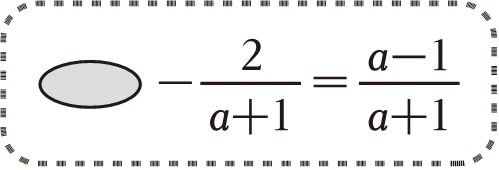

# 9.1 分式及其基本性质（同步练习）

> 教材：数学·七年级下册·沪科技版2024新教材 ｜ 来源：国家中小学智慧教育平台·在线练习 ｜ 共 23 题

## 1. 填空题（难度：简单）

填空题
(1)在\( \frac{3x}{x},\frac{x+y}{3},\frac{x}{\pi },\frac{4}{x-y}\)中是分式的有；
(2)当时，分式\( \frac{x-4}{2(x+2)}\)有意义，当x时，该分式的值为零；
​(3)​\( {x}^{2}{y}^{-3}{\left({x}^{-1}y\right)}^{3}\)=； \( {\left(2a{b}^{2}{c}^{-3}\right)}^{-2}÷{\left({a}^{-2}b\right)}^{3}\)=； (3×10⁻⁸)×(4×10³) =；\( {\left(2\times 1{0}^{-3}\right)}^{2}÷{\left(1{0}^{-3}\right)}^{3}\)= 。

【答案】$\frac {3x} {x},\frac {4} {x-y}$ ，$ x\ne -$ 2，$=$ 4，$ \frac{1}{x}$ ，$ \frac{{a}^{4}{c}^{6}}{4{b}^{7}}$ ，$ 1.2\times 1{0}^{-4}$ ，$ 4\times 1{0}^{3}$ 

【解析】​

## 2. 单选题

计算：\( {\left(\frac{2x}{{y}^{2}}\right)}^{3}\)•\( {\left(\frac{2y}{x}\right)}^{2}÷\)（\( -\frac{2y}{x}\)）的结果是（　　）

- A. \( -\frac{8{x}^{3}}{{y}^{6}}\)
- B. \( \frac{8{x}^{3}}{{y}^{6}}\)
- C. \( -\frac{16{x}^{2}}{{y}^{5}}\)
- D. \( \frac{16{x}^{2}}{{y}^{5}}\)

【答案】C

【解析】解：\( {\left(\frac{2x}{{y}^{2}}\right)}^{3}\)•\( {\left(\frac{2y}{x}\right)}^{2}÷\)（\( -\frac{2y}{x}\)）
\( =\frac{8{x}^{3}}{{y}^{6}}\cdot \frac{4{y}^{2}}{{x}^{2}}\cdot (-\frac{x}{2y})\) 
\( =-\frac{16{x}^{2}}{{y}^{5}}\)；
故选：C．

## 3. 单选题（难度：适中）

下列运算正确的是（　　）

【答案】A

## 4. 单选题（难度：适中）

下列计算正确的是（　　）

【答案】A

## 5. 单选题（难度：适中）

对于正数x，规定\( f\left(x\right)=\frac{x}{x+1}\)，例如\( f\left(5\right)=\frac{5}{5+1}=\frac{5}{6}\)，\( f\left(\frac{1}{5}\right)=\frac{\frac{1}{5}}{\frac{1}{5}+1}=\frac{1}{6}\)．则\( f\left(2022\right)+f\left(2021\right)+\cdots +f\left(3\right)+f\left(2\right)+f\left(1\right)+f\left(\frac{1}{2}\right)+f\left(\frac{1}{3}\right)+\cdots +f\left(\frac{1}{2022}\right)=\)（　　）

- A. 2022
- B. 2021
- C. 2021.5
- D. 2022.5

【答案】C

【解析】解：∵\( f\left(x\right)=\frac{x}{x+1}\)，
∴\( f\left(1\right)=\frac{1}{1+1}=\frac{1}{2}\)，\( f\left(2\right)=\frac{2}{2+1}=\frac{2}{3}，f\left(\frac{1}{2}\right)=\frac{\frac{1}{2}}{\frac{1}{2}+1}=\frac{1}{3}\)，
∴\( f\left(2\right)+f\left(\frac{1}{2}\right)=\frac{2}{3}+\frac{1}{3}=1\)，
同理可得：\( f\left(3\right)+f\left(\frac{1}{3}\right)=1，f\left(4\right)+f\left(\frac{1}{4}\right)=1\)，...，
∴\( f\left(n\right)+f\left(\frac{1}{n}\right)=1\)，
∴原式\( =f\left(2022\right)+f\left(\frac{1}{2022}\right)+f\left(2021\right)+f\left(\frac{1}{2021}\right)+...+f\left(2\right)+f\left(\frac{1}{2}\right)+f\left(1\right)\)
＝1+1+...+1\( +\frac{1}{2}\)
\( =2021+\frac{1}{2}\) 
\( =2021\frac{1}{2}\) 
＝2021.5
故选：C．

## 6. 单选题（难度：简单）

化简：\( \frac{2a}{a-1}-\frac{2}{a-1}\)的结果是（　　）

- A. 2
- B. a﹣1
- C. \( \frac{1}{a-1}\)
- D. \( \frac{2}{a-1}\)

【答案】A

【解析】解：\( \frac{2a}{a-1}-\frac{2}{a-1}=\frac{2a-2}{a-1}=\frac{2(a-1)}{a-1}=\)2．
故选：A．

## 7. 单选题（难度：简单）

已知$ \frac{1}{a}-\frac{1}{b}=2$，则$ \frac{4ab}{a-b}$的值为（　　）

【答案】A

## 8. 单选题（难度：适中）

下列式子从左到右运算正确的是（　　）

- A. \( \frac{m+1}{n+1}=\frac{m}{n}\)
- B. \( \frac{{n}^{2}}{{m}^{2}}=\frac{n}{m}\)
- C. \( \frac{-n}{m}=\frac{n}{-m}\)
- D. \( \frac{1}{m}+\frac{1}{n}=\frac{1}{mn}\)

【答案】C

【解析】解：A．∵\( \frac{m+1}{n+1}\ne \frac{m}{n}\)，∴此选项的计算错误，故此选项不符合题意；
B．∵\( \frac{{n}^{2}}{{m}^{2}}=\frac{{n}^{2}÷m}{{m}^{2}÷m}=\frac{\frac{{n}^{2}}{m}}{m}\)，∴此选项的计算错误，故此选项不符合题意；
C．∵\( \frac{-n}{m}=\frac{-n\times (-1)}{m\times (-1)}=\frac{n}{-m}\)，∴此选项的计算正确，故此选项符合题意；
D．∵\( \frac{1}{m}+\frac{1}{n}=\frac{n}{mn}+\frac{m}{mn}=\frac{m+n}{mn}\)，∴此选项的计算错误，故此选项不符合题意；
故选：C．

## 9. 单选题

化简\( \frac{1}{x-1}-\frac{x}{x-1}\)，结果正确的是（　　）

- A. 1
- B. ﹣1
- C. 0
- D. ±1

【答案】B

【解析】解：\( \frac{1}{x-1}-\frac{x}{x-1}\)
\( =\frac{1-x}{x-1}\) 
\( =\frac{-(x-1)}{x-1}\) 
＝﹣1，
故选：B．

## 10. 单选题（难度：适中）

下列运算正确的是（　　）

【答案】A

## 11. 单选题（难度：适中）

下列运算正确的是（　　）

【答案】A

## 12. 单选题

若2a﹣2b＝ab，则\( \frac{1}{a}-\frac{1}{b}\)的值是（　　）

- A. \( \frac{1}{2}\)
- B. 2
- C. \( -\frac{1}{2}\)
- D. ﹣2

【答案】C

【解析】解：∵2a﹣2b＝ab，
∴a﹣b\( =\frac{ab}{2}\)，
∴\( \frac{1}{a}-\frac{1}{b}\)
\( =\frac{b-a}{ab}\) 
\( =-\frac{a-b}{ab}\) 
\( =-\frac{\frac{ab}{2}}{ab}\) 
\( =-\frac{1}{2}\)，
故选：C．

## 13. 单选题（难度：适中）

如图，一个正确的运算过程被盖住了一部分，则被盖住的部分是（　　）

- A. \( \frac{a+2}{a+1}\)
- B. a
- C. \( \frac{a}{a+1}\)
- D. 1

【答案】D

【解析】解：由题意得，被盖住的部分是\( \frac{a-1}{a+1}+\frac{2}{a+1}=\frac{a-1+2}{a+1}=\frac{a+1}{a+1}=\)1．
故选：D．

## 14. 单选题（难度：简单）

在 $ \frac{a}{a+1}，-\frac{1}{m+1}$，$ \frac{1}{2}$，$ \frac{3{x}^{2}}{x}$，$

【答案】A

## 15. 单选题（难度：非常简单）

下列各式中，约分正确的是（　　）

- A. \( \frac{x+y}{x-y}=-1\)
- B. \( \frac{{a}^{5}}{{a}^{3}}=a\)
- C. \( \frac{x+y}{{x}^{2}+xy}=\frac{1}{x}\)
- D. \( \frac{2a{b}^{3}}{6{a}^{2}{b}^{3}}=\frac{a}{3}\)

【答案】C

【解析】解：A、\( \frac{x+y}{x-y}\)是最简分式，不能约分，故本选项结论不正确，不符合题意；
B、\( \frac{{a}^{5}}{{a}^{3}}=\)a²，故本选项结论不正确，不符合题意；
C、\( \frac{x+y}{{x}^{2}+xy}=\frac{x+y}{x(x+y)}=\frac{1}{x}\)，结论正确，符合题意；
D、\( \frac{2a{b}^{3}}{6{a}^{2}{b}^{3}}=\frac{1}{3a}\)，故本选项结论不正确，不符合题意；
故选：C．

## 16. 单选题（难度：适中）

下列式子的化简结果为\( \frac{m}{n}\)的是（　　）

- A. \( \frac{{m}^{2}}{{n}^{2}}\)
- B. \( \frac{m+2}{n+2}\)
- C. \( \frac{mn}{{n}^{2}}\)
- D. \( \frac{m-1}{n-1}\)

【答案】C

【解析】解：A，B，D选项无法化简，C选项\( \frac{mn}{{n}^{2}}=\frac{m}{n}\)．
故选：C．

## 17. 单选题（难度：简单）

下列分式约分，正确的是（　　）

【答案】A

## 18. 单选题（难度：适中）

如果一个分式的分子或分母可以因式分解，且不可约分，那么我们称这个分式为“和谐分式”．下列分式中，是“和谐分式”的是（　　）

【答案】A

## 19. 单选题（难度：简单）

下列约分结果正确的是（　　）

【答案】A

## 20. 单选题（难度：适中）

化简 \( \frac{4m-{m}^{2}}{{m}^{2}-8m+16}\)的结果是（　　）

- A. m
- B. 4﹣m
- C. \( \frac{m}{m-4}\)
- D. \( \frac{m}{4-m}\)

【答案】D

【解析】解：\( \frac{4m-{m}^{2}}{{m}^{2}-8m+16}\)
\( =\frac{-m(m-4)}{(m-4{)}^{2}}\) 
\( =-\frac{m}{m-4}\) 
\( =\frac{m}{4-m}\)．
故选：D．

## 21. 单选题（难度：适中）

化简分式 \( \frac{{x}^{2}}{x}\)，正确的结果是（　　）

- A. x
- B. x²
- C. x³
- D. \( \frac{1}{x}\)

【答案】A

【解析】解：原式＝x．
故选：A．

## 22. 单选题（难度：简单）

分式\(  \frac{{x}^{2}}{{x}^{2}+x}\)化简得\( \frac{x}{x+1}\)，则x应满足的条件是（　　）

- A. x＞0
- B. x＜0
- C. x≠0且x≠﹣1
- D. x≠﹣1

【答案】C

【解析】解：当x²+x≠0，即x≠0和﹣1时，\( \frac{{x}^{2}}{{x}^{2}+x}=\frac{x}{x+1}\)，
故选：C．

## 23. 单选题（难度：非常简单）

<latex class="math-tex">\( \frac{2{a}^{2}b}{8a{b}^{3}}$约分的结果是（　　）

【答案】A
