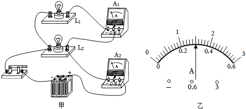
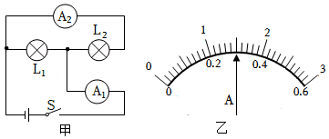
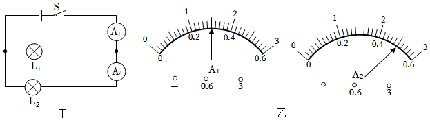

# 知识点·串、并联电路中电流的特点；串并联电路辨别（同步练习）

> 教材：物理·九年级全一册·沪科技版2024新教材 ｜ 来源：国家中小学智慧教育平台·在线练习 ｜ 共 3 题

## 1. 填空题（难度：简单）

如图甲所示的电路中，合上开关后，两灯正常发光，电流表\( {A}_{1}\)、\( {A}_{2}\)的示数都如图乙所示，两灯是（选填“串联”或“并联”），\( {L}_{2}\)的电流是 \( \text{A}\)．

【答案】并联，1.2

【解析】​

## 2. 填空题（难度：适中）

如图所示电路，当闭合开关后，电路无故障，两电表指针如图所示，则通过\( {L}_{1}\)的电流是，通过\( {L}_{2}\)的电流是．

【答案】1.2A，0.3A

【解析】​

## 3. 填空题

如图甲所示电路，闭合开关\( S\)，电流表\( {A}_{1}\)、\( {A}_{2}\)的示数如图乙、图丙所示，则电流表\( {A}_{1}\)的示数是；若只将小灯泡\( {L}_{1}\)、\( {L}_{2}\)的位置互换，闭合开关S，电流表\( {A}_{2}\)的示数是．

【答案】1.5A  ，1A

【解析】​
