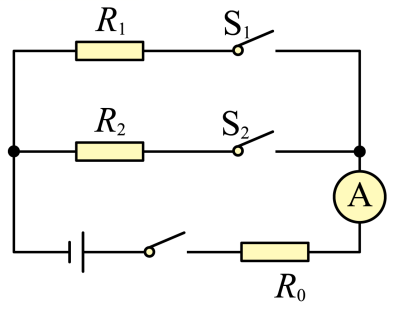
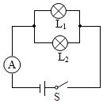
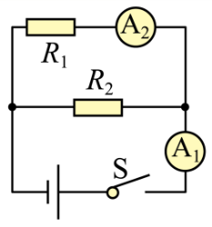

# 知识点·串联电路中电功率计算照顾弱者（同步练习）

> 教材：物理·九年级全一册·沪科技版2024新教材 ｜ 来源：国家中小学智慧教育平台·在线练习 ｜ 共 3 题

## 1. 填空题

如图所示，电源电压不变，R₁︰R₂=1︰2，当S、S₁闭合，S₂断开时，电流表示数为0.3A，R₁消耗的电功率为P₁；当S、S₂闭合，S₁断开时，R₀消耗的电功率为0.8W，R₂消耗的电功率为P₂；且P₁︰P₂=9︰8，则电阻R₀=Ω，电源电压U=V。

【答案】20，12

【解析】​

## 2. 填空题（难度：简单）

如图所示电路，电源电压恒为3V，闭合开关S，两只完全相同的小灯泡均正常发光，电流表示数为0.2A，则灯L₁正常发光时的阻值为Ω；灯L₂的额定功率为W。

【答案】30，0.3

【解析】​

## 3. 填空题（难度：适中）

如图所示，电源电压为3V，闭合开关S，电流表A₁示数为0.5A，A₂示数为0.3A，则电阻R₁为Ω。R₁电功率为W。通过电阻R₂的电流为A，5min整个电路消耗的电能为J。

【答案】10，0.9，0.2，450

【解析】​
