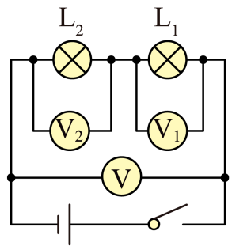
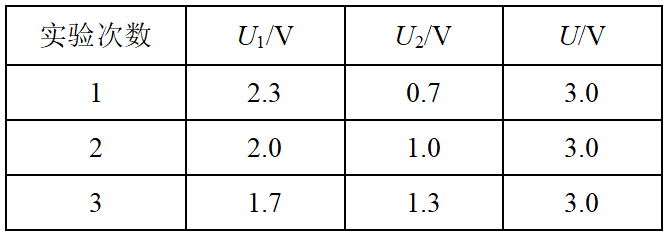
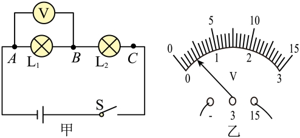
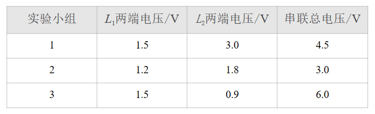
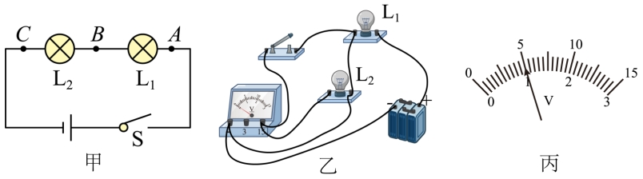
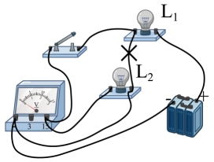

# 知识点·串联电路中电压关系的探究实验（同步练习）

> 教材：物理·九年级全一册·沪科技版2024新教材 ｜ 来源：国家中小学智慧教育平台·在线练习 ｜ 共 3 题

## 1. 填空题（难度：简单）

用如图所示的电路来探究串联电路的电压特点。

 
（1）连接实物电路时，开关应处于状态。
（2）实验中应选择规格（选填“相同”或“不同”）的灯泡。
（3）用电压表分别测出L₁和L₂两端电压及串联电路两端的总电压的值分别为U₁、U₂、U，经过多次实验，得到的数据记录在如下表中。分析实验数据，可得到串联电路的电压特点是（用公式写出）。
 

 
（4）进行多次实验的主要目的是（选填“寻找普遍规律”或“减小实验误差”）。

【答案】断开       ，不同     ，<em><em>U</em></em>$=$<em><em>U</em></em>1+<em><em>U</em></em>2     ，寻找普遍规律

【解析】​

## 2. 填空题（难度：适中）

同学们为了“探究串联电路的电压关系”，设计的实验电路如图甲所示。
  

 
（1）根据电路图甲，小明进行电路连接，当他连接好最后一根导线时两灯立即发光，小明实验过程中操作不当之处是，为了使探究得出的结论具有普遍意义，L₁、L₂应该选择（选填“相同”或“不同”）的小灯泡；
（2）小明根据图甲正确连接好电路，闭合开关，电压表示数如图乙所示，为了使实验结果更准确，接下来他应该；
（3）测出L₁两端的电压后，小明断开开关，准备拆下电压表，改接在B、C之间。小聪认为小明的操作太麻烦，只需将与A点相连的导线改接到C点即可。小聪的办法是否正确？答：。你的理由是；
（4）某小组测量完成后，记录了下表所示的数据，分析表格后同学们发现有一个数据记录错误，该数据是，经过讨论他们发现错误的数据是由于电压表的量程读错引起的，纠正错误后，他们根据表格得出的结论是。
 

【答案】连接电路时，开关没有断开，不同  ，断开开关，换用0~3V的量程重新实验  ，不正确；    ，电压表的正负接线柱接反了   ，0.9，串联电路中电路两端总电压等于各用电器两端的电压之和

【解析】​

## 3. 

小明同学在“探究串联电路电压特点”的实验中，使用3节新蓄电池作为电源，按如图甲所示的电路进行实验。

要用电压表测灯L₂两端的电压，连接的电路如图乙所示。图乙中只有一根导线连错了，请在连错的导线上画“×”，并画出正确的连线。

实验中L₁、L₂最好选择（选填“相同”或“不同”）规格的小灯泡；闭合开关后，小明发现灯L₂比L₁亮，则通过两灯的电流I₁I₂（选填“>”、“=”或“<”）；

图乙修改为正确电路后闭合开关，电压表的示数如图丙所示，此时灯L₂两端的电压为V，一段时间后，L₂突然熄灭，L₁仍然发光，电压表无示数，原因可能是（选填“L₁开路”、 “L₂开路”、“L₁短路”、 “L₂短路”）。

实验结束后整理实验器材时，应先断开开关，再拆除（选填“电压表”、“灯泡“或“电源”）两端导线，最后拆除其它元件并整理好器材。

【答案】

，不同    /$=$，5     /L2短路，电源    

【解析】​
