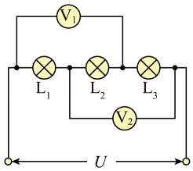
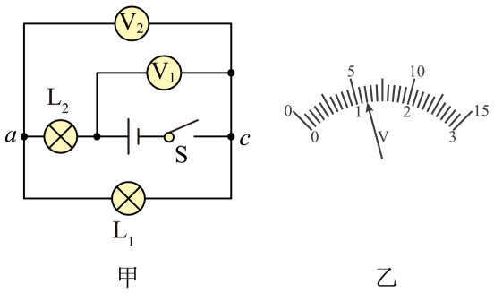
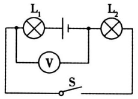
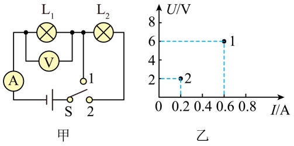
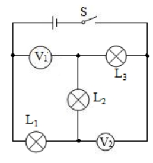

# 知识点·串联电路中电压的规律（同步练习）

> 教材：物理·九年级全一册·沪科技版2024新教材 ｜ 来源：国家中小学智慧教育平台·在线练习 ｜ 共 6 题

## 1. 单选题

在如图所示的电路中，电压表V₂的示数为5V，电压表V₁的示数为6V。若电源电压为8V，则L₂两端电压为（  ）。

- A. 1V
- B. 8V
- C. 3V
- D. 6V

【答案】C

【解析】​

## 2. 单选题（难度：适中）

如图甲所示的电路中，当闭合开关 S 后，两个电压表指针偏转均如图乙所示，则灯 L₁ 和 L₂ 两端的电压分别为（    ）。

- A. 1.2V 4.8V
- B. 4.8V 1.2V
- C. 1.2V 6V
- D. 6V 1.2V

【答案】A

【解析】​

## 3. 单选题（难度：简单）

如图所示，电源电压为6V且保持不变，当开关S闭合时，灯泡L₁、L₂均发光，电压表示数为2V，则灯泡L₁两端的电压是（    ）。

- A. 4V
- B. 2V
- C. 6V
- D. 9V

【答案】A

【解析】​

## 4. 填空题（难度：适中）

如图甲所示，当开关S由接点1转到接点2时，电压表、电流表示数变化如图乙所示，则灯泡L₂两端的电压是V，电源电压是V。

【答案】4，6

【解析】​

## 5. 填空题（难度：简单）

每个节日小彩灯正常工作时的电压为3V；要把它们串联在36V的电源上使之正常发光，则至少需要串联个这样的小彩灯；如果要使其中一个小彩灯正常发光，利用干电池供电，需要节干电池串联。

【答案】12，2

【解析】​

## 6. 填空题

如图所示的电路中，电源电压为10V，电压表V₁的示数为5V，电压表V₂的示数为8V，则L₁、L₂、L₃两端电压分别是、、。

【答案】2V，3V     ，5V

【解析】​
