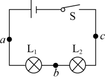
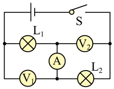
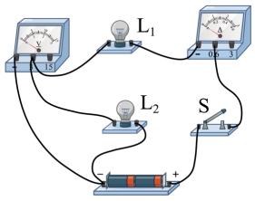
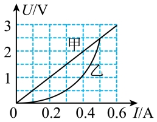
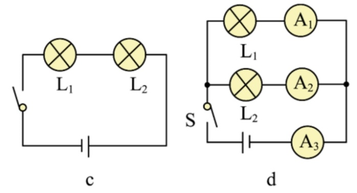
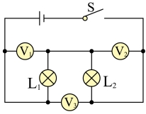

# 知识点·串联电路中电流、电压的规律（同步练习）

> 教材：物理·九年级全一册·沪科技版2024新教材 ｜ 来源：国家中小学智慧教育平台·在线练习 ｜ 共 6 题

## 1. 单选题（难度：适中）

利用如图所示电路探究串联电路的规律，下列做法中（  ）。

 
①分别把开关改接到a、b、c处，可以探究开关位置的改变对灯泡控制作用的影响
②分别将电流表串联在a、b、c处，可以探究电路中各处电流的关系
③将电压表正负接线柱分别接在ab、bc、ac点，可以探究电路中各灯泡两端电压与电源两端电压的关系
④为使探究结论更具普遍性，可更换不同的灯泡或改变电源电压进行多次实验

- A. ①②③④都正确
- B. 只有①③正确
- C. 只有②④正确
- D. 只有①②④正确

【答案】A

【解析】​

## 2. 单选题

如图，开关闭合时，电压表V₁的读数为4V，电压表V₂的读数为6V，电流表A的读数为0.2A．如果把电压表V₁换成电流表A₁，电压表换成V₂电流表A₂，电流表A换成电压表V，则电压表的读数为（    ）。

- A. 2V
- B. 4V
- C. 6V
- D. 10V

【答案】D

【解析】​

## 3. 单选题（难度：简单）

如图所示的电路中，将开关S闭合，灯​L₁和灯​L₂均发光。下列说法中正确的是（    ）。

- A. 灯L₁和灯L₂并联，电流表测量的是通过灯L₁的电流
- B. 灯L₁和灯L₂串联，电压表测量的是灯L₁两端的电压
- C. 灯L₁两端的电压与灯L₂两端的电压一定相等
- D. 通过灯L₁的电流与通过灯L₂的电流一定相等

【答案】D

【解析】​

## 4. 填空题

两个电路元件A和B中的电流与其两端电压的关系如图所示：若将甲和乙串联在电源电压为2V的电路中，电路中的电流为A；若将甲和乙并联接入电源电压为2.5V的电路中，则电路干路电流为A。

【答案】0.3，1

【解析】​

## 5. 填空题（难度：简单）

在图c电路图中，已知L₁比L₂亮，流过L₁的电流为I₁，流过L₂的电流为I₂，则I₁I₂；（选填“大于”“小于”或“等于”）；在图d电路图中，已知A₁示数为0.6A，A₂示数为0.3A，L₁两端电压为U₁，L₂两端电压为U₂，则U₁U₂；（选填“大于”“小于”或“等于”）。

【答案】等于，等于

【解析】​

## 6. 填空题（难度：适中）

如图所示，闭合开关后，电压表V₁测量两端的电压；电压表V₂测量两端的电压；通过灯L₁的电流I1与通过灯L₂的电流I2的关系是：I₁（选填“＞”、“＝”或“＜”）I₂。

【答案】L1     ，L2     ，<latex class="math-tex">\(=\)</latex>

【解析】​
