# 知识点·串联电路电功率（同步练习）

> 教材：物理·九年级全一册·沪科技版2024新教材 ｜ 来源：国家中小学智慧教育平台·在线练习 ｜ 共 23 题

## 1. 单选题

将“220V  60W”的灯泡L₁和“220V  40W”的灯泡L₂，串联在220V的电源上，组成闭合电路（设灯丝电阻不变），则下列说法正确的是（　　）。

- A. 灯泡L₁比灯泡L₂亮
- B. 灯泡L₂比灯泡L₁亮
- C. 两灯泡的总功率大于40W
- D. 两灯泡的实际功率都变为其额定功率的一半

【答案】B

【解析】​

## 2. 单选题（难度：适中）

额定电压相同的两只灯泡串联在电路中，L₁灯比L₂灯亮，下列说法正确的是（　　）（不计灯的电阻变化）。

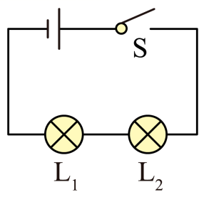

- A. 灯L₁额定功率较大
- B. 灯L₂两端实际电压较大
- C. 当灯丝材料、粗细相同时，灯L₂的灯丝较细
- D. 灯L₁两端实际电压较大

【答案】D

【解析】​

## 3. 单选题（难度：简单）

两个灯泡，其中L₁标有“6V  3W”，L₂没有标记，但测得它的电阻是4Ω，把它们串联后接在某一电路中时，两灯均能正常发光，这个电路两端的电压和L₂的电功率分别是（　　）。

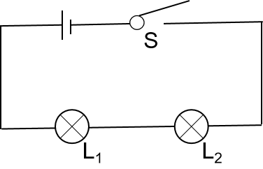

- A. 6V   3W
- B. 6V   1W
- C. 10V  4W
- D. 8V   1W

【答案】D

【解析】​

## 4. 多选题（难度：简单）

如图所示，L₁“3V 3W”、L₂“3V 1.5W”灯丝电阻不变，电源电压3V，开关S闭合后，下列说法正确的是（不考虑温度对灯丝电阻的影响）（　　）。

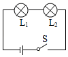

- A. L₁和L₂的电阻之比是2:1
- B. L₁和L₂的电流之比是1:1
- C. L₁两端电压是2V
- D. 两灯消耗的总功率是1W

【答案】B/D

【解析】​

## 5. 单选题（难度：适中）

如图所示的电路，电路接通后，移动滑动变阻器的滑片，电压表的最大值为6V，电流表的最大值为3A、最小值为1A，由此可以确定（　　）。

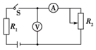

- A. 电源电压为9V
- B. 定值电阻的阻值为6Ω
- C. 滑动变阻器的最大阻值为2Ω
- D. 定值电阻最大功率为18W

【答案】A

【解析】​

## 6. 单选题

如图所示电路，电源电压不变，滑动变阻器的滑片移至最大阻值处，闭合开关，电流表示数为0.1A，小灯泡的功率为0.3W。移动滑片，使滑动变阻器最大阻值的1/3接入电路，电流表示数为0.2A，小灯泡恰好正常发光，且小灯泡消耗的功率为1W。下列计算结果错误的是（      ）。

- A. 电源电压为9V
- B. 小灯泡正常发光时电阻为25Ω
- C. 滑动变阻器的最大阻值为60Ω
- D. 小灯泡正常发光时，滑动变阻器消耗的功率为4W

【答案】D

【解析】​

## 7. 单选题（难度：简单）

如图所示，电源电压不变，灯泡的电阻不变，闭合开关，当滑动变阻器的滑片从右向左移动时，下列说法正确的是（　　）。

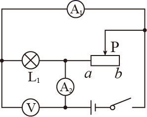

- A. 灯泡变亮
- B. 电流表A₂示数变小
- C. 电路消耗的总功率变大
- D. 电压表示数与电流表A₁示数之比变小

【答案】C

【解析】​

## 8. 单选题（难度：适中）

如图所示的电路，电源电压为3V且保持不变，定值电阻R1=1Ω，滑动变阻器R2阻值范围为0～4Ω。闭合开关S，在滑片从左向右移动的过程中，下列说法正确的是（　　）。

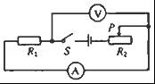

- A. 滑动变阻器的最大功率为1.44W
- B. 滑动变阻器的最大功率为2W
- C. 滑动变阻器的最大功率为2.25W
- D. 电压表示数从0V增大到2.4V

【答案】C

【解析】​

## 9. 单选题（难度：适中）

把标有“8V 16W”的灯泡L₁和“12V 36W”的灯泡L₂串联后接在电源两端，其中一只灯泡正常发光，另一只没有达到其额定功率，则（　　）。

- A. 电源电压为20V
- B. 电路中电流为3A
- C. 两灯泡的总功率为52W
- D. 灯L₂的实际功率等于灯L₁的实际功率

【答案】D

【解析】​

## 10. 单选题（难度：简单）

实验室有甲、乙两只灯泡甲标有“6V，6W”字样，乙标有“10V，0.5A”字样，现把它们串联起来。则该串联电路两端允许加的最高电压为（不考虑温度对灯泡电阻的影响）（　　）。

- A. 16V
- B. 15V
- C. 14V
- D. 13V

【答案】D

【解析】​

## 11. 多选题

如图所示，电源的电压为12V，且保持不变，R₀为“ 100Ω  0.5A ” 的滑动变阻器，R₂=10Ω。c、d和e、f为两对接线柱，另有一只定值电阻R₁和一根导线接在两对接线柱上。电路1：当闭合S、S1，断开S2，滑动变阻器的滑片P置于最左端a时，滑动变阻器消耗的功率为P₁=1W；电路2：当闭合S、S2，断开S1，滑片P置于中点时，滑动变阻器消耗的功率为P₂，下列说法正确的是（　　）。

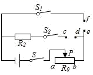

- A. R₁接在cd之间，导线接在ef之间
- B. R₁的阻值为20Ω
- C. 电路2中，当滑片P置于中点时，滑动变阻器消耗的功率P₂=4W
- D. 闭合S、S₂，断开S₁，使R₂消耗的功率不小于0.9W，且保持电路安全工作，则滑动变阻器接入电路的阻值范围为14Ω∼30Ω

【答案】B/D

【解析】​

## 12. 单选题（难度：适中）

如图中，灯泡L₁、L₂分别标有“6V 3W”“6V 6W”字样，电源电压不变，开关S闭合。①只闭合S₁，灯泡L₁、L发光；②只闭合S₂，灯泡L₂、L发光。灯泡L在②中比在①中（设灯丝电阻不变）（　　）。

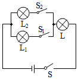

- A. 电功率较大，亮度较亮
- B. 电功率较小，亮度较暗
- C. 电功率相同，亮度相同
- D. 电功率较大，亮度较暗

【答案】A

【解析】​

## 13. 单选题（难度：简单）

灯泡L₁、L₂分别标有“6V 3W”“6V 6W”字样，电源电压U=6V不变，开关S1闭合，灯泡L₁、L₂都能发光，当开关S2闭合时，则下列判断正确的是（　　）（设灯丝电阻不变）。

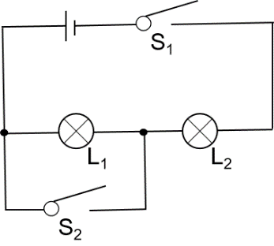

- A. L₁熄灭，L₂亮度不变
- B. L₂熄灭，电路总功率不变
- C. L₁熄灭，电路总功率变大
- D. L₁熄灭，电路总功率变小

【答案】C

【解析】​

## 14. 多选题

如图所示，电源电压4.5V保持不变，电压表选择“0-3V”量程，电流表选择“0-0.6A”量程，电阻R₁阻值为10Ω，滑动变阻器R₂规格为“20Ω  1A”，闭合开关S，在保证各元件安全的条件下，移动滑片P的过程中，下列说法正确的是（　　）。

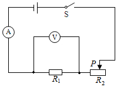

- A. 电流表的变化范围是0.3A-0.6A
- B. 电压表的变化范围是1.5V-3V
- C. 滑动变阻器的阻值变化范围是5Ω-20Ω
- D. 该电路的最大总功率是2.7W

【答案】B/C

【解析】​

## 15. 单选题

如图所示，电源电压恒定，电阻R₂为50Ω。只闭合开关S₁，电阻R₁的功率P₁为0.1W，电压表示数为 U₁；闭合开关S₁、S₂，电压表示数为6U₁。若用电阻R₃替换R₂，只闭合开关S₁，电压表示数比U₁加了0.5V，电路的总功率为P₂。则下列判断正确的是（　　）。 

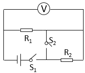

- A. R₁为25Ω
- B. R₃为110Ω
- C. P₂为0.9W
- D. U₁为5V

【答案】C

【解析】​

## 16. 多选题（难度：简单）

如图所示的电路，闭合开关S，当滑片P向右移动过程中，不正确的是（　　）。

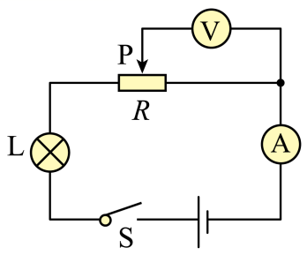

- A. 小灯泡变亮
- B. 电流表示数变大
- C. 电压表示数变小
- D. 电路的总功率变大

【答案】A/B/D

【解析】​

## 17. 多选题（难度：适中）

如图所示的电路，电源电压保持不变，闭合开关S，滑动变阻器的滑片P由a端向b端移动过程中，小灯泡L始终发光（忽略温度对小灯泡电阻的影响）。下列说法正确的是（　　）。

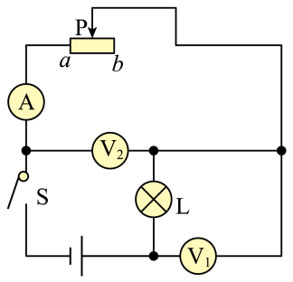

- A. 小灯泡亮度逐渐变暗
- B. 电流表示数变小
- C. 电压表V₁示数与电流表示数的比值变小
- D. 电压表V₂示数变化量与电流表示数变化量的比值不变

【答案】A/B/D

【解析】​

## 18. 单选题

如图1所示电路中，电源电压恒定不变，定值电阻R₁的阻值为20Ω。滑动变阻器R₂的最大阻值为100Ω，开关闭合后，当滑动变阻器的滑片P移到某一位置时，电压表V₁的示数如图2所示，R₂的功率为1.75W下列说法正确的是（　　）。

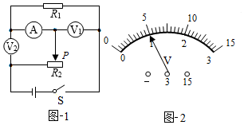

- A. 电阻R₁与滑动变阻器R₂并联
- B. 电压表V₁测量电源电压
- C. 电流表的示数为0.05A
- D. 电源电压为12V

【答案】D

【解析】​

## 19. 单选题（难度：简单）

如图所示，电源电压保持不变，滑动变阻器R₁的最大阻值为20Ω，小灯泡的电阻RL=8Ω，R₂<RL，闭合开关S，当滑片P置于b端时，小灯泡的实际功率为2W，忽略温度对小灯泡电阻的影响，则滑片P置于a端时小灯泡的实际功率可能是（　　）。

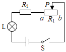

- A. 10W
- B. 15W
- C. 25W
- D. 30W

【答案】B

【解析】​

## 20. 单选题（难度：简单）

将阻值为5Ω的电阻R₁与阻值为10Ω的电阻R₂串联接入电路中，当开关S闭合后，下列说法中正确的是（　　）。

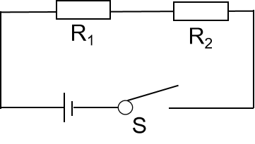

- A. R₁、R₂的电阻之比为2：1
- B. 通过R₁、R₂的电流之比为1：2
- C. R₁、R₂的两端的电压之比为1：2
- D. R₁、R₂的实际电功率之比为2：1

【答案】C

【解析】​

## 21. 单选题（难度：适中）

将规格为“6V 6W”的小灯泡L₁和规格为“12V 6W”的小灯泡L₂串联，两灯泡电阻不变，下列说法中正确的是（　　）。

- A. 两灯均能正常发光
- B. 小灯泡L₁比小灯泡L₂亮
- C. 电源的最大电压为18V
- D. 两灯的实际功率比为1∶4

【答案】D

【解析】​

## 22. 单选题（难度：适中）

如图电路中，电源压为12V。在a，b间接入灯L₁“4V 2W”，闭合开关，调节滑动变阻器的滑片P使灯L₁正常发光。断开开关取下灯L₁，保持滑片P的位置不变，在a、b间接入“4V 4W”灯L₂后闭合开关，不考虑温度对灯丝电阻的影响，则正确的（　　）。

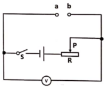

- A. 灯L₂正常发光
- B. 电压表的示数保持4V不变
- C. 灯L₂的实际功率为1.44W
- D. 滑动变阻器接入电路的电阻为8Ω

【答案】C

【解析】​

## 23. 单选题

在如图所示的电路中，电源的电压恒定，R₁为定值电阻，滑动变阻器R₂的最大阻值为8Ω。闭合开关，移动滑片P，当R₂等于2Ω或8Ω时，R₂消耗的电功率均为8W，则下列选项中正确的是（      ）。

​​

​

- A. 电流表示数最大为6A
- B. 电压表示数最大为6V
- C. R₁的阻值为8Ω
- D. R₂的最大功率为9W

【答案】D

【解析】​
