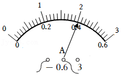
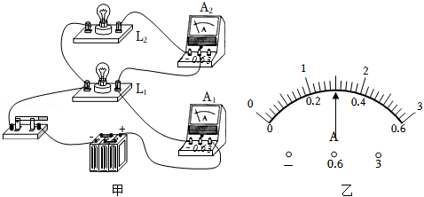
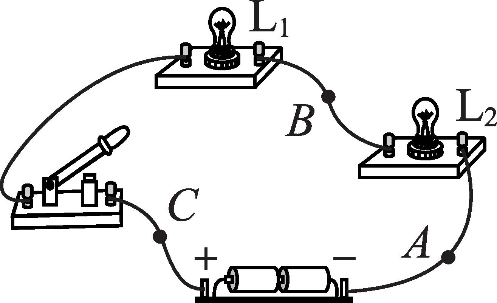

# 知识点·串联电路的电流规律．（同步练习）

> 教材：物理·九年级全一册·沪科技版2024新教材 ｜ 来源：国家中小学智慧教育平台·在线练习 ｜ 共 4 题

## 1. 单选题（难度：简单）

有一电路上串联着\( \text{20}\)只灯泡，如果电源插头处的电流为\( \text{200mA}\)，那么通过第\( \text{10}\)只小灯泡的电流是（    ）．

- A. \( \text{10mA}\)
- B. \( \text{20mA}\)
- C. \( \text{200mA}\)
- D. \( \text{100mA}\)

【答案】C

【解析】​

## 2. 单选题

两个小灯泡串联接入电路，通电后它们的亮度不一样，经测量较亮的灯泡的电流如图所示，则通过较暗的灯泡的电流是（    ）．

- A. 等于\( \text{0}\text{.}\text{4A}\)
- B. 等于\( \text{2A}\)
- C. 小于\( \text{0}\text{.}\text{4A}\)
- D. 小于\( \text{2A}\)

【答案】A

【解析】​

## 3. 单选题

如图甲所示电路，闭合开关后灯\( {L}_{1}\)、\( {L}_{2}\)均正常发光，电流表\( {A}_{1}\)、\( {A}_{2}\)的示数都如图乙所示，下列说法正确的是（    ）．

- A. 灯\( {L}_{1}\)、\( {L}_{2}\)是串联连接的
- B. 流过灯\( {L}_{2}\)的电流是\( \text{0}\text{.}\text{3A}\)
- C. 流过灯\( {L}_{1}\)的电流是\( \text{1}\text{.}\text{5A}\)
- D. 干路中电流为\( \text{1}\text{.}\text{8A}\)

【答案】B

【解析】​

## 4. 单选题（难度：适中）

如图所示的电路，闭合开关后，灯\( {L}_{1}\)比灯\( {L}_{2}\)亮，下列关于\( A\)、\( B\)、\( C\)三处电流的大小关系正确的是（    ）．

- A. \( {I}_{A}>{I}_{B}>{I}_{C}\)
- B. \( {I}_{A}<{I}_{B}<{I}_{C}\)
- C. \( {I}_{A}={I}_{B}={I}_{C}\)
- D. \( {I}_{A}={I}_{B}>{I}_{C}\)

【答案】C

【解析】​
