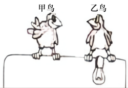

# 知识点·人体的电阻及触电的实质（同步练习）

> 教材：物理·九年级全一册·沪科技版2024新教材 ｜ 来源：国家中小学智慧教育平台·在线练习 ｜ 共 3 题

## 1. 单选题（难度：简单）

电对人体造成的伤害（    ）

- A. 只决定于电流大小
- B. 只决定于持续时间的长短
- C. 与通过人体电流的大小及持续时间无关
- D. 与通过人体电流的大小及持续时间有关

【答案】D

【解析】​

## 2. 单选题

十位小朋友在用干木板搭成的舞台上手拉手表演节目，由于不慎，第一位小朋友的手碰到了裸露的火线，而第十位小朋友的手恰巧也碰到了零线，则（    ）

- A. 第一位小朋友一定会触电
- B. 第十位小朋友一定会触电
- C. 十位小朋友一定同时触电
- D. 十位小朋友都不会触电

【答案】D

【解析】​

## 3. 单选题（难度：简单）

如图所示，甲鸟和乙鸟落在裸露输电线上，以下说法中正确的是（    ）
 

- A. 小鸟脚上的角质是绝缘的，故两鸟不会触电
- B. 小鸟对电流的承受能力较强，故两鸟不会触电
- C. 甲鸟被短路，几乎没有电流通过甲鸟，它不会触电，但乙鸟会触电
- D. 由于输电线上有绝缘皮，故两鸟不会触电

【答案】C

【解析】​
