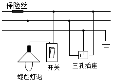
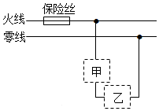
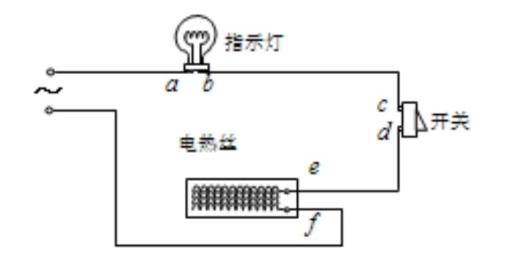
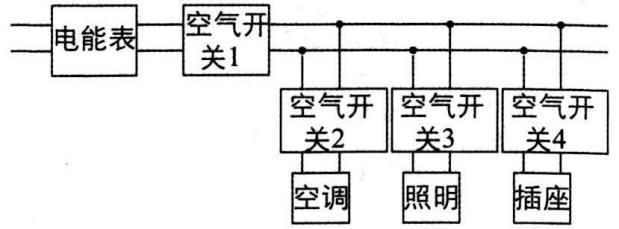
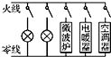
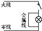
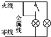
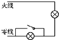
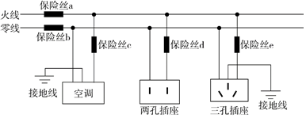

# 知识点·保险丝（空气开关）的作用（同步练习）

> 教材：物理·九年级全一册·沪科技版2024新教材 ｜ 来源：国家中小学智慧教育平台·在线练习 ｜ 共 6 题

## 1. 单选题（难度：适中）

如图所示是小军同学家庭电路的一部分. 他闭合开关时灯泡正常发光，再将电风扇的插头插入插座中时，灯泡突然熄灭，检查时发现保险丝熔断了. 其原因可能是（    ）. 

- A. 电风扇断路
- B. 灯泡的灯丝断路
- C. 电风扇的插头短路
- D. 电风扇的电功率很小

【答案】C

【解析】​

## 2. 单选题（难度：简单）

某家庭电路的部分电路如图所示，其中甲、乙两处分别装用电器或开关. 对此电路，下列说法正确的是（    ）. 

- A. 选用的保险丝应具有电阻小、熔点低的特点
- B. 当接入电路的用电器增多时，保险丝的发热功率增大
- C. 甲处应装用电器，乙处应装开关
- D. 电路中的总开关应该安装在保险丝的右侧

【答案】B

【解析】​

## 3. 单选题（难度：适中）

如图所示的是一个电热器电路. 电热丝、指示灯、开关构成串联电路，接在电源上，已知该电路中有一个元件断路，有一个元件短路，但不知道是哪两个有故障，今用一个校验电灯分别接在各处，得到下表所示的结果，根据表格内容可判断（    ）. 

 
 
 
 校验次数

 
 
 1

 
 
 2

 
 
 3

 
 
 4

 
 
 5

 
 
 6

 
 

 
 
 校验电灯接入点

 
 
 \( a\)、\( f\)

 
 
 \( a\)、\( b\)

 
 
 \( c\)、\( d\)

 
 
 e、 \( f\)

 
 
 \( a\) 、 \( d\)

 
 
 \( c\) 、 \( f\)

 
 

 
 
 发光情况

 
 
 正常发光

 
 
 不发光

 
 
 亮度较暗

 
 
 不发光

 
 
 亮度较暗

 
 
 正常发光

 
 

 

  

- A. 开关断路，指示灯短路
- B. 指示灯断路，电热丝短路
- C. 电热丝断路，开关短路
- D. 指示灯断路，开关短路

【答案】A

【解析】​

## 4. 单选题（难度：简单）

现代化的家庭电路不仅让我们生活更安全，更给我们带来了很大的舒适和便捷. 如图所示是小清家配电系统的简化电路图. 一天，小清在插座上插上了新买的制冷机，突然开关1“跳闸”了，而其他开关正常，拔掉制冷机后合上开关1，其他用电器仍正常工作，再次插上后又出现了之前的现象. 根据以上描述，下列说法正确的是（    ）. 

- A. 插座出现了短路现象
- B. 开关2或者开关3可能被短路
- C. 开关4可能断路
- D. 开关4允许通过的最大电流远大于开关1允许通过的最大电流

【答案】D

【解析】​

## 5. 多选题

某家庭电路中安装有“\( \text{220V}\) \( \text{10A}\)”的空气开关（未画出）. ，如图是电路中的四种情况，开关全部闭合后，不会引起空气开关“跳闸”的是（    ）.

- A. 
- B. 
- C. 
- D. 

【答案】C/D

【解析】​

## 6. 单选题

如图所示为某家庭部分电路示意图. 在三孔插座上刚插上电热烧水壶（开关未闭合）. 的插头时，保险丝\( e\)熔断，家中其他用电器都正常工作. 以下叙述正确的是（    ）. 

- A. 造成该故障的原因可能是电热烧水壶插头被短路了
- B. 保险丝熔断后，应立即更换新保险丝，恢复供电
- C. 保险丝\( e\)熔断后，用测电笔测试三孔插座的左右两孔，只有测右孔时氖管发光
- D. 在选择保险丝的规格时（以保险丝\( e\)为例）. ，保险丝\( e\)熔断所需的电流应小于空调的额定电流

【答案】A

【解析】​
