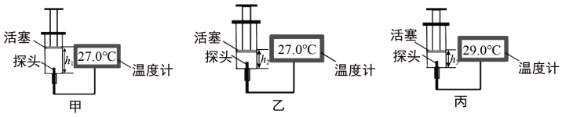
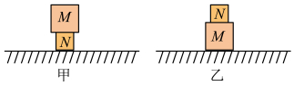

# 知识点·内能变化（同步练习）

> 教材：物理·九年级全一册·沪科技版2024新教材 ｜ 来源：国家中小学智慧教育平台·在线练习 ｜ 共 6 题

## 1. 单选题（难度：简单）

实验室有温度为0℃的水、-4℃的冰块，对于只有0℃的水和-4℃的冰组成的系统，下列说法正确的是（    ）．

- A. 0℃的水的内能一定大于-4℃的冰的内能
- B. 将-4℃冰块放入0℃水中，水的质量可能变小
- C. 将-4℃冰块放入0℃水中，能量通过做功的方式从水传递给冰块
- D. 将-4℃冰块放入0℃水中，温度通过热传递的方式从水传递给冰块

【答案】B

## 2. 单选题（难度：适中）

改变物体内能的方法只有做功和热传递．下图是用针筒对密闭容器内空气做功的示意图，针筒初始状态及温度计示数如图甲所示，小明在第一次实验中缓慢下压活塞，针筒末状态及温度计示数如图乙所示，小明在第二次实验中迅速下压活塞，针筒末状态及温度计示数如图丙所示，已知两次实验中，活塞均对针筒内空气做功（针筒内空气分子势能变化忽略不计），则从甲到乙的过程中，筒内空气（    ）．

- A. 内能一定增大
- B. 内能一定减小
- C. 一定向外界放热
- D. 一定向外界吸热

【答案】C

## 3. 单选题（难度：适中）

如图所示，小伍同学利用酒精灯给物体加热时闻到了一股“酒精味”，想到“酒精”在我们的学习、生活中有较多的应用，下列说法正确的是（    ）．

- A. 利用酒精灯给物体加热是用做功的方法改变物体的内能
- B. 能够闻到酒精味，说明分子在永不停息地做无规则运动
- C. 用酒精擦拭体表为高烧病人降温，是利用了酒精液化吸热
- D. 酒精的沸点为78℃，可用酒精温度计测标准气压下水的沸点

【答案】B

## 4. 单选题（难度：简单）

春节期间，学校开展了“寻根同源，记住年味”的活动，如图所示是同学们晒的“年味”照片，下列描述正确的是（    ）．

- A. 图甲中，玉润饱满的汤圆温度升高时，内能一定增加
- B. 图乙中，红糖糍粑入嘴时很烫，是因为糍粑含有的热量很高
- C. 图丙中，与盒子摩擦引燃的“擦炮”是通过热传递改变内能
- D. 图丁中，刚上桌继续沸腾的砂锅米线，说明沸腾不需要吸热

【答案】A

## 5. 单选题

如图甲，把两实心铝块（质量\( {m}_{M}>{m}_{N}\)）紧紧挨在一起，铝块\( N\)传递热量到铝块\( M\)，则（    ）．

- A. 铝块\( N\)的内能一定大于铝块\( M\)的内能
- B. 铝块\( N\)的分子热运动一定比铝块\( M\)的分子热运动更剧烈
- C. 这个过程中，铝块\( N\)的内能不断增大
- D. 若把铝块\( N\)、\( M\)的位置交换（如图乙），则热量将从铝块\( M\)传递热量到铝块\( N\)

【答案】B

## 6. 单选题

春节俗称年节，是中华民族最隆重的传统佳节．春节前的准备和习俗有很多讲究，民谚称“二十三糖瓜粘，二十四扫房子，二十五磨豆腐，二十六炖大肉，二十七宰公鸡，二十八把面发，二十九蒸馒头，三十晚上熬一宿”．下列说法正确的是（    ）．

- A. “二十四扫房子”——打扫房子时灰尘到处飞舞，这是分子的无规则运动
- B. “二十六炖大肉”——炖肉时我们在厨房以外的房间可以闻到香味，这是扩散现象
- C. “二十七宰公鸡”——刀在磨后变锋利了，是通过减小受力面积的方法来减小压强
- D. “三十晚上熬一宿”——一家人围在火炉旁烤火到暖和，是通过做功的方式改变内能

【答案】B
