# 知识点·内能改变（同步练习）

> 教材：物理·九年级全一册·沪科技版2024新教材 ｜ 来源：国家中小学智慧教育平台·在线练习 ｜ 共 9 题

## 1. 填空题（难度：简单）

如图所示，\( a\)杯中水量较少，\( b\)、\( c\)、\( d\)杯中的水量相同，根据内能的知识，分析比较各杯中水的内能的大小．

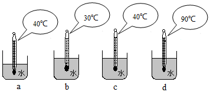
     
（1）杯中水的内能最大，因为；
（2）两杯中水的内能不好比较，因为．

【答案】$ d$，$ d$杯中水的质量比$ a$多，与$ b$、$ c$相同，且温度最高，$ a$、$ b$ ，$ a$杯中水的质量比$ b$少，但温度比$ b$高

## 2. 填空题

如图所示，往透明玻璃管内倒入少量酒精，然后用塞子塞紧管口，把一根绳子缠在玻璃管上，用手迅速来回拉动，很快发现塞子被向上弹出，玻璃管内及管口出现大量白雾．

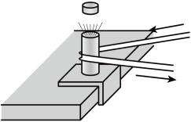
      
​（1）在拉动绳子的过程，玻璃管的内能 （选填“增加”“不变”或“减少”），这是通过（选填“做功”或“热传递”）的方式来改变共内能的；
​（2）在拉动绳子的过程，玻璃管内气体的内能（选填“增加”“不变”或“减少”），这是通过 （选填“做功”或“热传递”）的方式来改变其内能的；
​（3）当玻璃管内的气体将塞子弹出的过程，管内气体的内能；
​（4）塞子被弹出后，在飞行过程中，塞子的机械能（选填“增大”“不变”或“减小”），你判断的依据是；
​（5）白雾的主要成分是，它是如何形成的？ ．

【答案】增加    ， 做功    ， 增加    ， 热传递    ， 减少    ， 减小    ， 机械能转化为内能    ， 酒精    ， 酒精蒸气液化形成

## 3. 填空题（难度：适中）

如图是探究做功改变内能的实验，请回答下列问题．

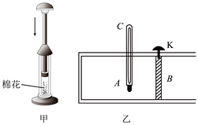
     
​（1）如图甲所示，在空气压缩引火仪的玻璃筒底部，放入一小团干燥的棉花，用力将活塞迅速下压，玻璃筒内的空气温度升高，空气的内能，空气的内能是通过 方式改变的；
​（2）如图乙所示，在气缸\( A\)中密封有压缩空气，\( B\)是一个被销钉\( K\)锁住的活塞，\( C\)是个温度计．若活塞与气缸壁间没有摩擦，当把销钉拔出后，活塞将向运动，温度计的示数将，该实验说明气体膨胀推动活塞对外做功时，内能减少．

【答案】增大，做功，右，减小

## 4. 填空题（难度：简单）

在物理课上，老师准备的两个实验装置如图所示，其中甲装置是一个配有活塞的厚玻璃筒，里面放一小团硝化棉；乙装置中平底烧瓶内装了少量的水．

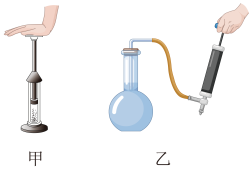
       
【实验现象】
​​（1）甲装置演示的实验：迅速压下活塞时，玻璃筒内的棉花燃烧起来；
​（2）乙装置演示的实验：用打气筒往烧瓶内打几下气后，可看到塞子跳起来，烧瓶中同时出现白雾．
【分析与结论】
​（1）对于甲装置：迅速压下活塞时，发生的能量转化是（要求说明哪个物体的什么形式的能量转化为哪个物体的什么形式的能量）；
​（2）甲、乙两装置的实验现象说明了

【答案】活塞的机械能转化为空气的内能    ，做功可以改变物体的内能

## 5. 填空题（难度：适中）

小梦注意到妈妈每天早上都是把做好的饭菜放在空气中冷却的，而厨房中适合用来冷却的另一种物质就是水．水和空气哪个的导热性能好呢？为此，小梦在两个相同的玻璃瓶中装入热牛奶，一个放在温度与室温相同的水中，另一个就放在空气中，为了尽量减少其他因素的影响，他把两个玻璃瓶都用木块垫起来，放在同一个桌面上，如图所示．实验时每隔一定的时间记录一次甲、乙两温度计的示数，得到的数据如表：

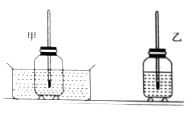
 
时间/\( \text{min}\)
0
2
4
6
8
10
12
14
16
18

甲的示数/\( \text{℃}\)
70
60
53
47
42
39
37
35
34
33

乙的示数/\( \text{℃}\)
70
65
61
58
55
52
50
48
46
44

​（1）根据法的思路，实验中要控制两瓶牛奶初始温度和相同；
​（2）通过分析实验数据得到，的导热性更好；
​（3）为了比较方便描述“冷却快慢”，我们可以引入“冷却速度”，类比“速度”的概念给“冷却速度”下一个定义： 叫作冷却速度，冷却速度的单位为（时间单位用：\( \text{min}\)）．

【答案】控制变量，质量，水，单位时间内下降的温度（或下降温度与时间的比值），$ \text{℃}\text{/min}$ 

## 6. 填空题

晓松同学在老师的指导下利用气压式喷雾器和数字式温度计验证“做功与物体内能变化关系”（如图）喷雾器中装一定量的水．

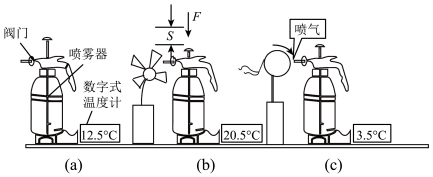
     
​（1）先安装好器材，关闭喷雾器的阀门，用数字温度计测出喷雾器内空气的温度，如图（\( a\)），手压活塞快速打气，如图（\( b\)）．实验现象：，这个实验说明：．
​（2）然后，打开喷嘴处的阀门，迅速放出喷雾器内的气体，如图（\( c\)）实验现象数字式温度计示数变小，这个实验说明： （\( c\)）瓶与（\( b\)）瓶比较，水的（选填“分子动能”或“分子势能”）变（选填“大”或“小”）．
​（3）（\( a\)）、（\( b\)）、（\( c\)）三瓶中的水内能最大的是瓶．

【答案】数字式温度计示数变大，外界对物体做功，物体内能增大，物体对外界做功，物体内能减少，分子动能，小     ，（$ b$）

## 7. 填空题（难度：适中）

小华同学在研究“物体内能改变的方法”时作了两个实验：

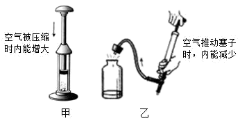
      
（1）如图（甲）所示，在一个配有活塞的厚玻璃筒里放黄豆大小的一小团硝化棉，把活塞迅速压下去，我们会看到 的现象，说明活塞对内部的气体，使气体的内能增大，升高．
（2）如图（乙）所示，在大口玻璃瓶内滴少量酒精，通过打气筒给瓶内打气，达到一定程度时，瓶塞跳出，同时还能看到（填物态变化名称）现象，其能量转化过程是转化为 ．

【答案】硝化棉燃烧，做功，温度，液化，内能，机械能

## 8. 

小明与小华为了探究泡沫塑料和棉絮的保温性能的好坏，两人设计并做了这样的实验：他们用这两种材料分别包着装有热水的密闭烧瓶，让它们自然冷却，利用温度计和计时器定时测量两烧瓶中的水温随时间变化的情况．

为保证实验的科学性，除了取大小、厚度相同的泡沫塑料和棉絮外，还应考虑影响水温变化的其他因素，即保持烧瓶相同、环境因素相同、水的和相同，这种科学探究方法叫做 ；

按实验计划操作，小明与小华把实验测得的时间和温度数据记录在下表中．
时间/\( \text{min}\)
0
10
20
30
40
…
150
180

泡沫塑料组水温/\( \text{℃}\)
90
74
65
60
57
…
21
20

棉絮组水温/\( \text{℃}\)
90
70
55
 
33
…
20
20

分析实验数据可知，他们实验时室内的温度是 ℃；从计时开始经过40\( min\)，泡沫塑料包的水温度降低了 ℃，而棉絮包的水温度降低了℃，由此你能看出，在这两种材料中，保温效果比较好的是；

小明与小华是采用了“在相同的时间内，比较水温降低多少”的方法来比较两种材料的保温性能的，你还可以采用的方法来比较两种材料的保温性能；

已知水温下降的特点：温度较高时，水温下降得较快，根据这一特点，时间为30min时，棉絮组的水温可能是下列选项中的（    ）；

下列图像中能表示水的温度随时间变化关系的是（    ）．

- A. 46℃
- B. 43℃
- C. 39℃
- D. 36℃
- A. 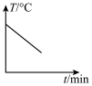
- B. 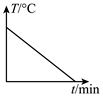
- C. 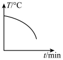
- D. 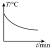

【答案】质量/初温/控制变量法，20     /33     /57     /泡沫塑料，降低相同的温度，比较所用的时间     ，B，D

## 9. （难度：简单）

小明将装有热奶的奶瓶放入室温的水中，容器中的水温约为20℃，热奶的温度约为90℃，同时，他还利用温度计和钟表测出温度的变化情况，并作出了水和热奶的温度随时间变化的关系曲线： 

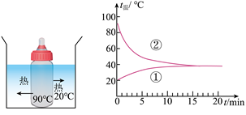

如图所示，其中曲线是表示热奶的温度随时间的变化情况，大约经过min 时间热奶和水温刚好达到一致．

参考这位同学实验的图象，你认为沸水放在房间里，温度自然降低的规律是（    ）

参考这位同学记录数据，如果你要喝一杯奶咖，可以有两种方式供你选择：
​A．先将烧开的热咖啡倒入杯中，立即将一匙冷牛奶加进杯中，然后冷却5min．
​B．先将烧开的热咖啡倒入杯中，冷却5min，然后加一匙冷牛奶；
认为方式 的冷却效果较好

- A. 先慢后快
- B. 先快后慢
- C. 均匀降低

【答案】②     /14，B，B
