# 知识点·分子动理论（同步练习）

> 教材：物理·九年级全一册·沪科技版2024新教材 ｜ 来源：国家中小学智慧教育平台·在线练习 ｜ 共 21 题

## 1. 单选题

用分子动理论解释下列现象，下列说法正确的是（    ）．

- A. “尘土飞扬”说明分子在不停的做无规则运动
- B. 5mL水与5mL酒精混合后总体积小于10mL，说明分子间有间隙
- C. 将石块研磨成粉状，说明分子变小了
- D. 水结成冰后分子就停止了运动

【答案】B

## 2. 单选题（难度：简单）

下列实例中属于扩散现象的是（    ）．

- A. 大雪纷飞
- B. 花香袭人
- C. 炊烟袅袅
- D. 尘土飞扬

【答案】B

## 3. 单选题（难度：适中）

我国的民谚、俗语和诗词中往往蕴含着丰富的物理知识．在下列几条民谚、俗语和诗词中，能够用分子动理论来解释的是（    ）．

- A. 绿树阴浓夏日长，楼台倒影入池塘
- B. 水晶帘动微风起，满架蔷薇一院香
- C. 坐井观天，所见甚小
- D. 余音绕梁，三日不绝

【答案】B

## 4. 单选题（难度：适中）

如图所示，在一杯水中滴入一大滴红墨水；在墨水落入水中沿途立即拉成一长串墨迹，形成这一现象的主要原因是（    ）．

- A. 红墨水在做机械运动
- B. 红墨水在扩散
- C. 水分子在做无规则运动
- D. 红墨水分子在做无规则运动

【答案】A

## 5. 单选题（难度：简单）

今年5月1日起不准在公共场所吸烟，公共场所一般张贴了如图所示的标志，这主要是考虑到在空气不流通的房间里，整个房间里就会充满烟味，这是因为（    ）．

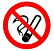

- A. 物质由分子组成
- B. 分子之间存在引力
- C. 分子之间存在斥力
- D. 分子都在不停地做无规则运动

【答案】D

## 6. 单选题

江西的名茶可谓多不胜数，婺源茗眉，上饶白眉，庐山云雾，浮瑶仙芝，狗牯脑，资溪白茶等等，如图中，下列关于泡茶、喝茶的物理知识正确的是（    ）．

     ​
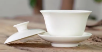

- A. 采摘的新鲜茶叶，一般采用加热使茶叶的水份快速升华，使茶叶变干
- B. 用热水才能很快泡出茶香、茶色，这是因为温度越高，扩散现象越明显
- C. 揭开杯盖，茶杯上方会冒“白气”，这些“白气”是汽化而形成的
- D. 喝茶时透过玻璃茶杯看到手指变粗，是由于光线发生反射

【答案】B

【解析】​​

​

## 7. 多选题

在图所示的各种现象中，主要说明分子间存在引力的是（    ）．

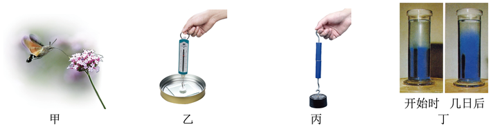

- A. 图甲：公园里四溢的花香引来了长喙天蛾吸食花蜜
- B. 图乙：把干净的玻璃板吊在弹簧测力计的下面，读出测力计的示数．使玻璃板水平接触水面，然后稍稍用力向上拉玻璃板，弹簧测力计的示数增大
- C. 图丙：将两个铅柱的底面削平、削干净，然后紧紧地压在一起，两个铅柱就会结合起来，甚至下面吊一个重物都不能把它们拉开
- D. 图丁：在量筒里装一半清水，用细管在水的下面注入密度比水大的硫酸铜水溶液，静放几天，原来明显的界面就逐渐变得模糊不清了

【答案】B/C

## 8. 单选题（难度：简单）

关于热现象，下列说法正确的是（    ）．

- A. 固体很难被压缩，表明固体分子间存在斥力
- B. 腌制咸鸭蛋，利用了分子在不停地做有规则运动
- C. 小米与大豆放在一起总体积变小，说明分子间有间隔
- D. 两个削平的铅块被紧压在一起不易分开，是因为分子间只有引力，没有斥力

【答案】A

## 9. 单选题（难度：简单）

如图所示，关于分子热运动理论，以下反映分子间有作用力的是（    ）．

- A. 气体扩散

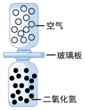
- B. 金块中的金原子

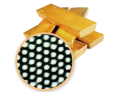
- C. 两个铅柱不分开

- D. 四溢的花香  

【答案】C

## 10. 多选题

关于图所示的四个情景，下列说法中正确的是（    ）．

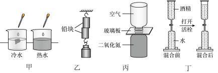

- A. 甲图：红墨水在热水中扩散得快，说明分子无规则运动的剧烈程度与温度有关
- B. 乙图：两个铅块没有被重物拉开说明分子间只存在引力
- C. 丙图：抽出玻璃板，两瓶内气体会混合在一起，说明气体间可以发生扩散现象
- D. 丁图：将一定量的水与酒精混合后总体积变小，说明分子间存在空隙

【答案】A/C/D

## 11. 单选题（难度：适中）

新型冠状病毒传播方式之一为飞沫传播，飞沫一般是直径大于5微米的含水颗粒，可以通过一定距离（一般认为1～2m）进入易感粘膜表面，一般不会长时间存留在空中．为此人要正确佩戴口罩，对易受到污染的物体表面经常进行消毒处理，下列说法正确的是（    ）．

- A. 飞沫能飞出1m外，是因为飞沫分子在运动的缘故
- B. 飞沫能附着于物体表面，是因为分子之间有吸引力的缘故
- C. 健康人戴口罩防止被感染，其防疫策略类似于在摩托车上安装消声器以减弱噪声
- D. 用紫外线可以对受病毒感染的物体进行消毒，是因为紫外线具有热作用

【答案】B

## 12. 单选题（难度：适中）

在以下四个图示的现象中，能够说明分子间存在引力的是（    ）．

- A. 抽去玻璃板后，两瓶中的气体逐渐混合

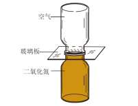
- B. 两根铅棒压紧后能够吊住大钩码

- C. 上下两层液体一段时间后互相进入对方

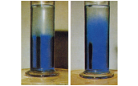
- D. 地球月亮互相吸引，月亮绕地球转动

【答案】B

## 13. 填空题（难度：简单）

今年由于气候异常，形成“八月桂花九月香”的奇异现象，“桂花飘香”说明分子在；人们喜欢将桂花用来泡茶喝、做桂花糕吃，口味异常丰富，这是现象．

【答案】永不停息的做无规则运动     ，扩散

## 14. 填空题（难度：适中）

如图所示为我国古老的医疗技法一刮痧，刮痧时要在皮肤上涂一些药油，当体表温度升高后，药物渗入人体的速度（选填“加快”“减慢”或“不变”）；在刮痧的过程中人们能闻到刺鼻的药味，这属于现象．

【答案】加快    ，扩散

## 15. 填空题

在抗击新型冠状病毒期间，社区工作人员为居民楼里喷洒消毒液，楼道里弥漫着消毒液味，能闻到消毒液的气味实质是现象，随着气温的升高，这种现象会（选择“加快”或“减慢”）．科学家为了说明戴口罩防护的重要性，用高速摄像机拍下打喷嚏的过程．如图所示，数万个几微米到几十微米的小液滴（气溶胶）组成高密度喷射物，最远可达8m，大量病毒随产生的小液滴传播开来．小液滴向四周飞散与前述闻到消毒液的气味实际上是（选填“相同”或“不同”）的物理现象．

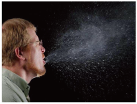

【答案】扩散     ，加快     ，不同

## 16. 填空题（难度：简单）

图中甲、乙、丙分别表示物质处于固、液、气三种物态中某一状态下分子的排列方式，若物质从甲状态变成乙状态的物态变化名称为；物质从丙状态变成乙状态需要热量．

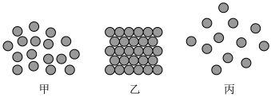

【答案】凝固，放出

## 17. 填空题（难度：适中）

按要求填空．
\( \text{（}\text{1}\text{）}\)如图甲，实验时应先向试管中注入 （选填“水”或“酒精”）至一半位置，再注入另一种液体直至充满，封闭管口，并将试管反复翻转，使水和酒精充分混合，观察液面位置，发现混合后与混合前相比，总体积变；
\( \text{（}\text{2}\text{）}\)如图乙，将两个表面 （选填“光滑”或“粗糙”）的铅块相互紧压，它们会粘在一起，此现象说明分子间有．

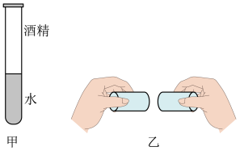

【答案】水     ，小     ，光滑     ，引力

## 18. 填空题

用如图甲、乙、丙所示的装置演示气体扩散现象，两个玻璃瓶口对口对接，中间用玻璃板隔开，其中\( B\)瓶装有密度比空气大的红棕色二氧化氮气体，\( A\)瓶装有空气，抽去玻璃板后，根据现象可知气体发生了扩散．此扩散现象说明．为了有力地证明气体发生扩散，对于玻璃瓶的三种放置方法，图放置最不合理．

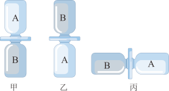

【答案】A瓶内出现红棕色气体     ，分子在永不停息做无规则运动     ，乙

## 19. 填空题（难度：简单）

小明和同学在研究分子动理论的相关实验．

      ​
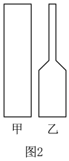
      
​（1）如图1，小明把一块表面干净的玻璃板挂在弹簧测力计的下面，测得示数为\( \text{2}\text{.}\text{5N}\)，手持弹簧测力计的上端，使玻璃板水平接触水面，再慢慢提起弹簧测力计，当玻璃板即将离开水面时，弹簧测力计的示数\( F\)  \( \text{2}\text{.}\text{5N}\)（选填“大于/小于/等于”），其中的原因是水分子和玻璃分子之间存在．
​（2）小华、小琴两个探究小组在进行酒精和水混合实验中，分别采用两种不同的设备，小华小组用的是图2甲所示的一端开口的直玻璃管，小琴小组用的是乙图所示的容器（甲乙底面积相同）．两组同学在进行实验时，都先注入一半体积的水，然后将另外一种液体注满设备．最后用食指堵住容器口并上下颠倒几次，发现容器中的液面降低，这说明了 ．通过比较你觉得小组的实验效果更好．

【答案】大于，引力，分子之间存在间隙，小琴（乙）

## 20. 填空题（难度：适中）

在学习了“分子动理论”后，小宇进行了以下几个小实验：

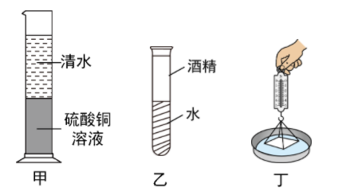
     
​（1）如图甲所示，小宇在一个圆柱形量筒中依次倒入蓝色的硫酸铜溶液和无色的水，放置30天后，液体变为均匀的淡蓝色，这说明．
​（2）如图乙所示，小宇先后将50mL水和50mL的酒精倒入玻璃管中，反复翻转几次后发现水和酒精的总体积小于100mL，这说明：；在直玻璃管中应先注入 ．为使实验现象更明显，应选用内径较 （填“细”或“粗”）的玻璃管．
​（3）如图丙所示，小宇用细线拴住玻璃板的四个角，用弹簧测力计勾住细线，将玻璃板平放在水面上与水面刚好接触，向上拉弹簧测力计时，发现测力计的示数变大了．这说明，这个理由可以用来解释固体很难被（填“拉伸”或“压缩”）．

【答案】分子永不停息的做无规则运动，分子间有间隙，水  ，细  ，分子间有引力，拉伸

## 21. 填空题

小明想知道消毒酒精的密度，用如图所示的家用电子秤、玻璃杯、注射器等进行测量．测量步骤如下：先给玻璃杯中倒入适量酒精，测得玻璃杯和酒精的总质量为\( \text{116g}\)；再用注射器从玻璃杯中抽取部分酒精，其体积为如图所示；最后测出剩余酒精和玻璃杯的总质量为100g．则：
（1）酒精的密度为 \( \text{kg/}{\text{m}}^{\text{3}}\)；
（2）测量结束整理器材时，小明发现电子秤显示的剩余酒精和玻璃杯的总质量减小为\( \text{99}\text{.}\text{8g}\)，其原因是酒精容易（填物态变化名称）．
（3）测量过程中闻到酒精的气味表明分子在不停地．

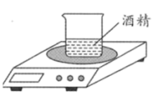
        ​
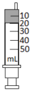

【答案】$ 0.8\times {10}^{3}$，汽化，做无规则的运动（或做无规则的热运动）
