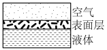
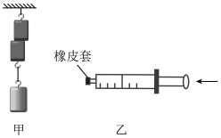
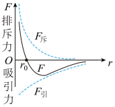

# 知识点·分子间作用力（同步练习）

> 教材：物理·九年级全一册·沪科技版2024新教材 ｜ 来源：国家中小学智慧教育平台·在线练习 ｜ 共 3 题

## 1. 填空题（难度：简单）

液体和空气接触的表面存在一个薄层﹣表面层，如图所示．由于液体分子做无规则运动，表面层就存在一些具有较大能量的分子，它们可以克服分子间相互作用的力，脱离液体跑到空气中去．其宏观表现就是液体的（填物态变化名称）

【答案】引     ，汽化

## 2. 填空题（难度：适中）

把两块表面干净的铅压紧，下面吊一个重物时不能把它们拉开（图甲），说明分子间存在；利用注射器抽取适量的水，再用橡皮套将针筒嘴封住，然后用力推入活塞，水不容易压缩（图乙），这说明了分子间存在着（均选填“引力”或“斥力”）．

【答案】引力     ，斥力

## 3. 填空题

如图所示为分子间作用力与距离关系的图像，\( {r}_{0}\)表示引力和斥力大小相等时分子间的距离，\( {F}_{\mathrm{斥}}\)表示斥力曲线，\( {F}_{\mathrm{引}}\)表示引力曲线，\( F\)表示合力曲线．当\( r>{r}_{0}\)时，分子间的作用力表现为 ．固体和液体很难被压缩，说明分子之间存在，分子间的\( {F}_{\mathrm{斥}}\)和\( {F}_{\mathrm{引}}\)，都随\( r\)的增大而．

【答案】引力，斥力，减小
