# 知识点·判断电压表的测量对象（同步练习）

> 教材：物理·九年级全一册·沪科技版2024新教材 ｜ 来源：国家中小学智慧教育平台·在线练习 ｜ 共 6 题

## 1. 单选题

小宁的探究小组在练习使用电压表时，军军把电压表接成了如图所示的电路．当闭合开关时所发生的现象是（   ）。

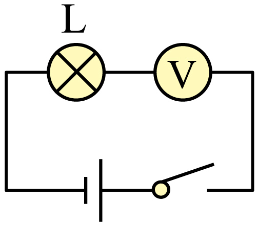

- A. 灯泡亮、电压表有示数
- B. 灯泡亮、电压表无示数
- C. 灯泡不亮、电压表有示数
- D. 灯泡不亮、电压表无示数

【答案】C

【解析】​

## 2. 单选题（难度：适中）

如图所示的四个图中，闭合开关​S后，用电压表测灯​L₁两端电压连接正确的是（　　）。

- A. 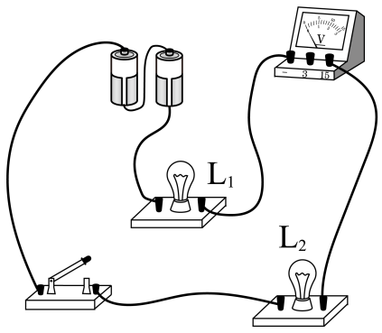
- B. 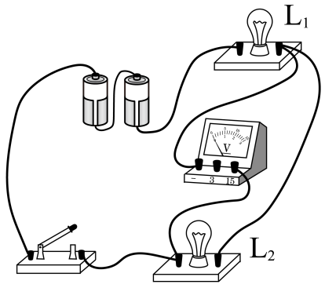
- C. 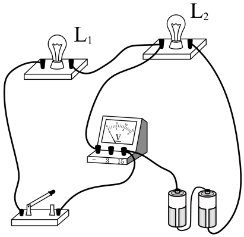
- D. 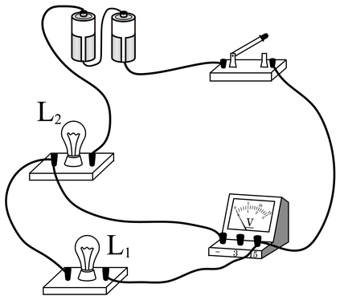

【答案】C

【解析】​

## 3. 单选题（难度：简单）

如图所示，开关S闭合时，要使电压表测灯L₂两端的电压，下列连接正确的电路图是（　　）。

- A. 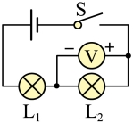
- B. 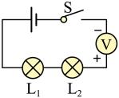
- C. 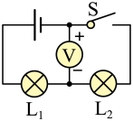
- D. 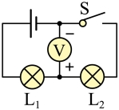

【答案】D

## 4. 填空题（难度：简单）

如图所示电路图中，电压表测量的是灯泡两端电压。

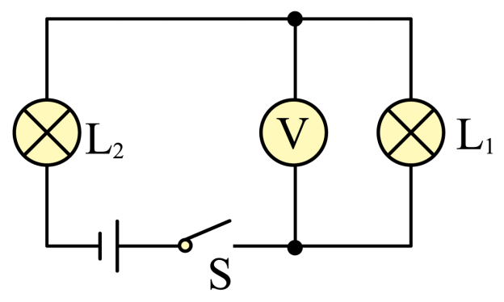

【答案】L1

【解析】​

## 5. 填空题（难度：适中）

如图所示，若开关S、S₁闭合，S₂断开，能发光的灯是，电压表所测的是两端的电压；若开关S、S₂闭合，S₁断开，那么能发光的灯是，电压表所测的是的两端电压；若开关S、S₁、S₂都闭合，那么能发光的是，电压表所测的是两端的电压。

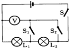

【答案】L1、L2，L1，L1、L2，电源，L1，L1

【解析】​

## 6. 填空题

如图所示，灯泡L₁、L₂、L₃是联的，电流表A测中的电流，电压表V₁测的电压，电压表V₂测的电压。

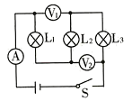

【答案】串，串联电路，灯L1、L2两端，灯L2、L3两端

【解析】​
