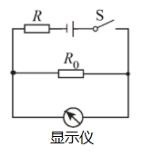
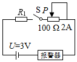

# 知识点·动态电路分析（同步练习）

> 教材：物理·九年级全一册·沪科技版2024新教材 ｜ 来源：国家中小学智慧教育平台·在线练习 ｜ 共 3 题

## 1. 单选题（难度：适中）

图是红外线测温仪原理示意图，R是热敏电阻，其阻值随温度的升高而减小，定值电阻R0为保护电阻。下列分析正确的是（     ）。

- A. 显示仪是由电流表改装成的
- B. 测较高温度时，R0两端的电压较大
- C. 增大R0的阻值，可增大测温仪的最大测量值
- D. 增大电源电压，可增大测温仪的最大测量值

【答案】B

【解析】​

由图可知R0与R串联。显示仪并联在R0两端，所以显示仪不可以为电流表，则为电压表，故A错误。当温度较高时，由题意可知，R电阻较小，总电阻较小，电源电压不变，则电流较大。两端电压较大，故B正确。测温仪最大测量值由量程决定，故CD错误。
考点分析：动态电路分析；电压表。

## 2. 单选题

如图所示，热敏电阻R1的阻值随温度的升高而减小，它在温度为80℃和100℃时的阻值分别为240Ω和200Ω；阻值不计的报警器在电流达到12mA时开始报警，超过25mA时将损坏；相关器材规格已在图中标明。当电路开始报警温度为100℃时，滑动变阻器接入电路的阻值和电路的最高报警温度分别用R0和t0表示，则（　　）。

- A. 不能求得R0的值
- B. 不能求得t0的值
- C. 将P向左移，可提高该电路开始报警时的温度
- D. 利用此电路，可将开始报警时的温度设定为80℃

【答案】B

【解析】​

由图可知，R1与变阻器R0串联。电路开始报警温度为100℃，电路中的总电阻R总= \( \frac{U}{I}\) = \( \frac{3V}{0.012A}\) =250Ω。当温度为100℃时，R1 = 200Ω，可得R0 = R总- R1 = 250Ω-200Ω=50Ω故A不正确。热敏电阻R1的阻值随温度的升高而减小，但题中没有具体图像，因此无法求解，故B正确。报警电流不变，即总电阻R1+ R0 =250Ω不变，将P向左移，则变阻器接入电路中电阻变小，R1接入电路中电阻会变大，而R1的阻值随温度升高而减小，其电阻变大时，温度应该降低，故C不正确。将开始报警时的温度定为80℃，由题可知，接入电路的电阻为240Ω，则变阻器接入电路的电阻R3 = 250Ω-240Ω=10Ω，在变阻器阻值变化范围以内，移动滑片，只能判断变阻器接入电路阻值变化，而不能读出具体阻值，故D不正确。故选择B。

考点分析：串联电路电阻规律；动态电路分析；欧姆定律计算。

## 3. 

如图甲所示是一种家庭水箱水位测量装置示意图，电源电压 18V 保持不变，电压表量程 0〜15V，电流表量程 0〜3A，R0是阻值为 10Ω的定值电阻，R1是长 20cm、阻值为 20Ω的电阻丝，滑片 P 把电阻丝与轻质弹簧的指针连在一起。圆柱体 M 长 80cm，底面积为 200cm²​​。当水位处于最高处时，M 刚好浸没在水中，滑片 P 恰好在R1的最上端。轻质弹簧阻值不计， M 全部露出水面前，弹簧的伸长长度△L 始终与受到的拉力 F 成正比，如图乙所示。
​​

​​

当水位下降时，电路中示数会随之减小的电表是。

当水位处于最高处时，电压表的示数为多少？

当水位下降，圆柱体露出水面部分的长度为 50cm 时，电流表示数为多少？（g 取 10N/kg）

【答案】电压表，

12V

，

0.9A

【解析】提示：解析视频请查看最后一题。

提示：解析视频请查看最后一题。

​

考点分析：欧姆定律应用；浮力计算；函数图像分析。
