# 知识点·升华和凝华（同步练习）

> 教材：物理·九年级全一册·沪科技版2024新教材 ｜ 来源：国家中小学智慧教育平台·在线练习 ｜ 共 20 题

## 1. 单选题（难度：简单）

寒冷的冬天，在玻璃门窗上常常会结出冰花，下列有关说法正确的是（    ）

- A. 冰花是室内空气中的水蒸气升华形成的
- B. 冰花是室内空气中的水蒸气凝华形成的
- C. 冰花是室外空气中的水蒸气凝华形成的
- D. 冰花是室外空气中的水蒸气升华形成的

【答案】B

【解析】​

## 2. 单选题（难度：简单）

唐诗是我国优秀的文学遗产之一，下列诗句中所包含的物态变化分析正确的是（    ）

- A. “露从今夜白，月是故乡明”，露的形成是汽化现象
- B. “蜡烛有心还惜别，替人垂泪到天明”，蜡烛“流泪”是液化现象
- C. “鸡声茅店月，人迹板桥霜”，霜的形成是凝华现象
- D. “晚来天欲雪，能饮一杯无”，雪的形成是升华现象

【答案】C

【解析】​

## 3. 单选题

小明同学发现一款的甜品，盛甜品碗的周围冒着白气，询问后得知，原来是下面盛水的碗里加了干冰. 拿去上面的碗，看到下面碗里的液体在“沸腾”着. 下列说法正确的是（    ）
   
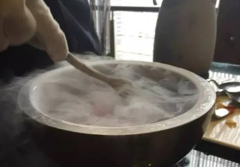

- A. 甜品周围的白气是空气中的水蒸气汽化的现象
- B. 甜品周围的白气是干冰升华成的二氧化碳气体
- C. 碗里液体“沸腾”是因为干冰升华使碗中的水吸热后沸腾
- D. 碗里液体“沸腾”是因为干冰升华成二氧化碳从水中冒出

【答案】D

【解析】​

## 4. 单选题（难度：简单）

寒冷冬季，气温持续在0℃以下，但冰雕作品会一天天变小，这是由于冰雕作品发生了什么物态变化（    ）

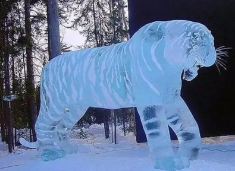

- A. 汽化
- B. 熔化
- C. 升华
- D. 凝华

【答案】C

【解析】​

## 5. 单选题（难度：简单）

金属在高温、低压下比较容易由固态直接变为气态，用此方法可以给照相机、望远镜及其他光学仪器的玻璃镜头进行真空镀膜，即在真空室内将金属或金属化合物加热，使金属蒸气喷到玻璃镜头上，从而镀上一层极薄的金属膜，这层金属膜可以改善玻璃镜头的光学性能，这层镀膜能镀上去的原理是（    ）

- A. 金属粘到玻璃镜头上
- B. 金属熔化后粘到玻璃镜头上
- C. 金属升华后再凝华到玻璃镜头上
- D. 金属升华到玻璃镜头上

【答案】C

【解析】​

## 6. 多选题（难度：简单）

实施人工降雨的一种方法是利用飞机在高空播撒干冰（固态二氧化碳），如图所示. 干冰进入云层，很快从周围吸收大量的热变成气体. 同时高空中的水蒸气放热变成小冰晶或者液化为小水滴，云中小冰晶和小水滴增多，从而形成降雨. 其中与干冰吸热变成气体以及水蒸气放热变成小冰晶相对应的物态变化是（    ）

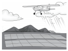

- A. 熔化
- B. 液化
- C. 升华
- D. 凝华

【答案】C/D

【解析】​

## 7. 多选题（难度：简单）

描述二十四节气的诗句中蕴含着丰富的物理知识，以下说法正确的是（    ）

- A. 霜降：“一朝秋暮露成霜”，霜的形成需要放热
- B. 大雪：“千树万树梨花开”，雪是水蒸气凝华形成的
- C. 小寒：“冰封万里雪皑皑”，水结冰时需要吸热
- D. 清明：“清明时节雨纷纷”，雨主要是由液化形成的

【答案】A/B/D

【解析】​

## 8. 多选题（难度：简单）

如图所示，自然界中的雪、雾、露、霜等现象，都是水这种物质发生物态变化形成的. 对这些现象的描述，正确的是（    ）

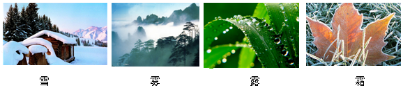

- A. 雪的形成是凝华现象，需要放热
- B. 雾的形成是汽化现象，需要吸热
- C. 露的形成是液化现象，需要放热
- D. 霜的形成是凝固现象，需要放热

【答案】A/C

【解析】​

## 9. 多选题（难度：适中）

夏天天气炎热，为了防止食物腐烂，以下说法正确的是（    ）

- A. 在运输车辆上放干冰，利用了干冰升华吸热给食品降温
- B. 把食材放在冰块上，利用冰升华吸热给食材降温
- C. 给放食材的盒子盖上湿毛巾，利用水的汽化吸热给食材降温
- D. 把食物放入冰箱内，利用冷凝剂液化吸热，使冰箱内部温度降低

【答案】A/C

【解析】​

## 10. 填空题（难度：简单）

自然界中的云、雨、雪、霜等现象，都是水的物态变化形成的. 其中雾和露都是由空气中的水蒸气遇冷（填物态变化名称，下同）形成的小水滴；雪和霜都是由空气中的水蒸气遇冷形成的小冰晶. 这些小水滴和小冰晶（填“吸热”或“放热”）后又会发生和，形成水蒸气，从而构成自然界的水循环，如图所示. 

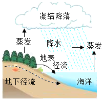

【答案】液化，凝华，吸热，汽化，升华

【解析】​

## 11. 填空题（难度：简单）

冻干食品是真空冷冻干燥食品的简称，也称FD食品（如图所示），它首先将食品中的水分速冻成冰，然后用高温加热使之直接变为水蒸气，食物因此而脱水干燥. 需要食用时，只需重新加水，食物就会恢复原来的面貌，色、香、味、形不变，在加工冻干食品的过程中，发生的物态变化是先后. 

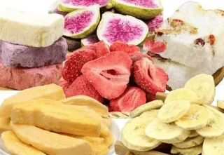

【答案】凝固，升华

【解析】​

## 12. 填空题（难度：简单）

如图所示，海面宛若仙境，这种现象通常称为“海浩”，它是冬季海面上形成的一种物理现象. 当海面空气温度降到零摄氏度以下时，海水温度高于空气温度，海水为水蒸气，水蒸气遇到冷空气后迅速为冰晶，从而形成“海浩”奇观. （均填物态变化名称）

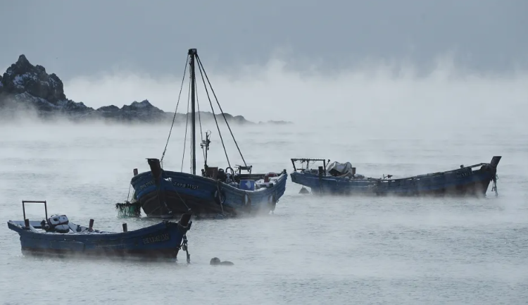

【答案】汽化，凝华

【解析】​

## 13. 多选题（难度：适中）

如图所示，将冰块放于易拉罐中并加入适量的盐，用筷子搅拌大约半分钟，用温度计测量罐中冰与盐水混合物的温度，可以看到冰水混合物的温度低于0℃，这时观察易拉罐的下部和底部，就会发现白霜. 下列说法正确的是（    ）

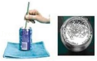

- A. 冰中加盐降低了冰的熔点
- B. 霜是周围空气中的水蒸气遇冷液化形成的
- C. 冰是晶体，熔化过程中温度保持不变
- D. 水蒸气形成白霜时吸收了热量

【答案】A/C

【解析】​

## 14. 填空题（难度：简单）

科技小组设计了一种灭火弹，弹内装有干冰（固态二氧化碳）. 当灭火弹投入火场，弹体破裂，干冰迅速（填写物态变化名称）成二氧化碳气体来达到阻燃灭火的目的，同时从周围（选填“吸收”或“放出”）大量的热，对燃烧物起到一定的冷却作用.

【答案】升华，吸收

【解析】​

## 15. 填空题（难度：适中）

农谚说“霜前冷，雪后寒”其中蕴含的道理是：“霜前冷”是因为气温低于0℃时，水蒸气形成霜：雪后寒是因为雪熔化或都要吸收热量，致使气温下降. （本题两空填物态变化名称）

【答案】凝华，升华

【解析】​

## 16. 填空题（难度：适中）

在冬奥会滑冰比赛中，为了消除冰刀滑行造成的划痕，使冰面恢复平整，常在比赛间隙进行“补冰”. “补冰”时，工作人员在冰面上浇水，并向浇水处喷撒干冰（固态二氧化碳）此过程中干冰迅速，从周围吸收大量的热，使划痕处的水成冰，实现快速“补冰”（均填物态变化名称）.

【答案】升华，凝固

【解析】​

## 17. 填空题（难度：简单）

神舟十三号返回舱着陆后，舱体有被“灼烧”的痕迹，如图所示，数据显示返回过程舱外温度达2000℃以上，为何舱内航天员依旧能“感觉良好”？这是因为防热材料在高温下由固态直接变为气态时，防热材料受热（填物态变化名称）的过程可以吸收大部分热量，剩余的热量可以通过隔热层阻挡住，最终传递到舱内的热量会大大减少，舱内还有温度调节系统进行降温，从而保证舱内温度始终在25℃左右. 

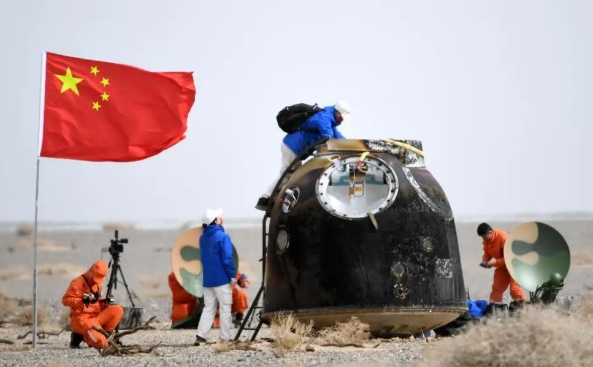

【答案】升华

【解析】​

## 18. 填空题（难度：简单）

“冰火花”是一种新型的降温材料，把它涂在人的皮肤上，会迅速凝成9℃的固态凝胶，几秒钟后又消失不见了，皮肤上也不会产生湿黏的感觉，使人感到凉爽，凝胶消失的过程属于现象，此过程需要（选填“吸收”或“放出”）热量.

【答案】升华，吸收

【解析】​

## 19. 填空题（难度：简单）

在观察“碘锤”中的物态变化时
\( \text{（}\text{1}\text{）}\)密闭的锤形玻璃泡内装有少量的碘颗粒，将玻璃泡浸入开水中，如图所示，仔细观察，会看到碘颗粒，同时玻璃泡内弥漫了紫色的，碘的这个物态变化叫（填物态变化名称），需要热. 
\( \text{（}\text{2}\text{）}\)将碘锤从开水中取出，在冷却过程中仔细观察，看到玻璃泡内发生的现象是碘蒸气渐渐变淡同时出现碘颗粒，碘的这个物态变化叫（填物态变化名称），需要热. 

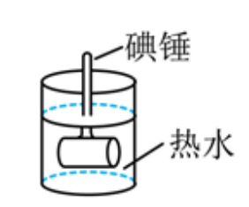

【答案】减少，碘蒸气，升华，吸，凝华，放

【解析】​

## 20. 填空题（难度：简单）

在做“碘的升华”实验中，有同学疑问：固态碘是否先变成液体再变成气体？下列两个实验都是为了演示“碘的升华”而设计的. 参阅表中几个温度的数据，分别对两个实验方案分析评价. 
实验方案1
实验方案2

如图所示，直接用酒精灯加热碘锤，发现试管内出现了紫色的碘蒸气.

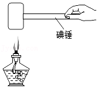

如图所示，放入水中加热碘锤，观察到碘锤中固态碘逐渐消失，紫色的碘蒸气充满碘锤
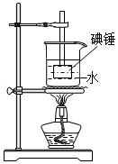

碘的熔点：113.5℃
碘的沸点：184.35℃
水的沸点：100℃
酒精灯火焰：800℃

在实验方案1中，酒精灯火焰的温度碘的熔点、沸点的温度，出现的碘蒸气可能是碘后，再形成的；
在实验方案2中，沸水的温度碘的熔点、沸点温度，碘（选填“可能”或“不可能”）熔化，试管中的气态只能是碘升华形成的. 
在做“碘的升华”的实验时，为了避免碘出现从固态→液态→气态，因此要控制加热温度碘的熔点温度，实验方案2更有说服力.

【答案】高于，熔化，汽化，低于，不可能，低于.

【解析】​
