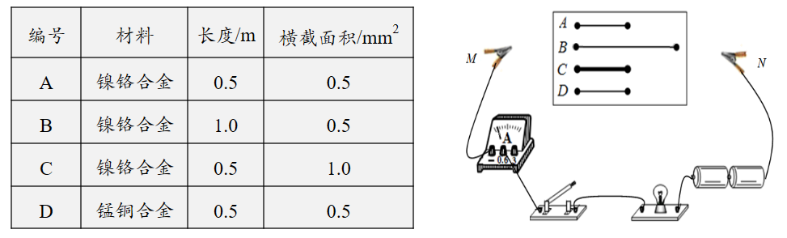
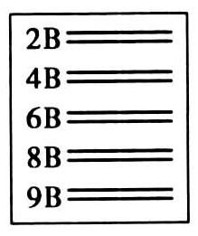
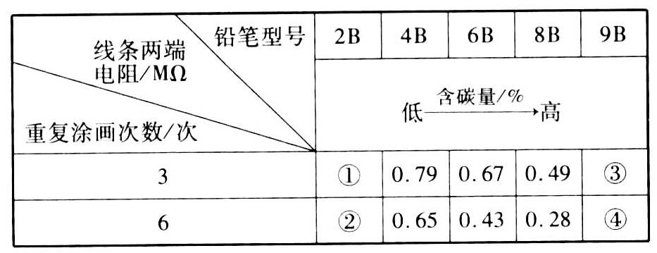
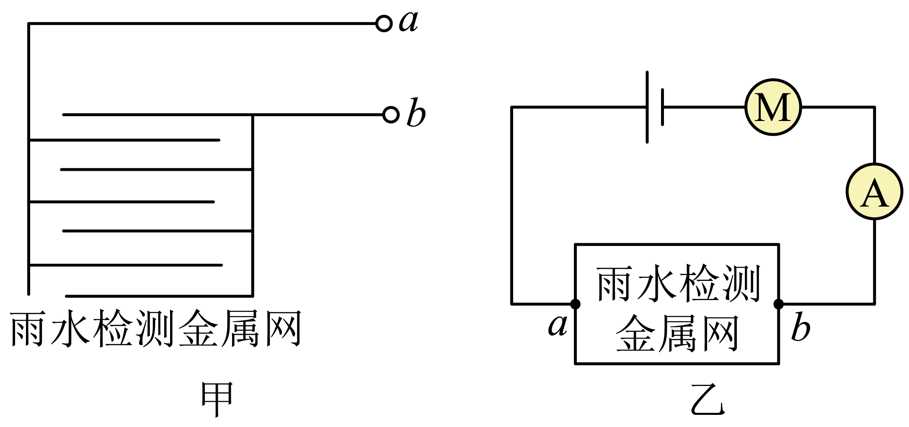
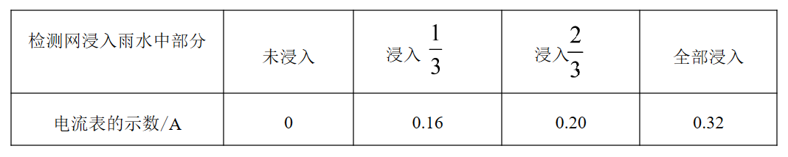

# 知识点·半导体（同步练习）

> 教材：物理·九年级全一册·沪科技版2024新教材 ｜ 来源：国家中小学智慧教育平台·在线练习 ｜ 共 3 题

## 1. 填空题（难度：简单）

在探究影响导体电阻大小的因素时，小明作出了如下猜想：导体的电阻可能与①导体的长度有关、②导体的横截面积有关、③导体的材料有关。实验室提供了4根电阻丝，其规格、材料如下表所示。
 

 
（1）按照图所示“探究影响导体电阻大小因素”的实验电路，在M、N之间分别接上不同的导体，则通过观察来比较导体电阻的大小，这种研究方法叫（填“等效替代法”或“转换法”）；
（2）为了验证上述猜想①，应该选用编号、两根电阻丝分别接入电路进行实验，这是应用法的研究思想；
（3）分别将A和D两电阻丝接入图电路中M、N两点间，电流表示数不相同，由此，初步得到的结论是：当长度和横截面积相同时，导体电阻跟有关；
（4）在最近几年，我国城乡许多地区进行了输电线路的改造，将原来细的输电线换成较粗的输电线，这样是为了输电线的电阻（选填“增大”或“减小”）。

【答案】电流表的示数，转换法，A，B，控制变量，材料，减小

【解析】​

## 2. 填空题（难度：适中）

小明测量不同型号铅笔在纸上涂画所得线条的电阻，实验步骤如下：
（a）用铅笔在纸上画出两段长为15cm的线条，在其中一段线条上重复涂画3次，在另一段线条上重复涂画6次；
（b）换用不同型号铅笔重复（a）的操作，得到多组等长等宽的线条，如图所示；
 

 
（c）测出每段线条两端的电阻记录在表中。
 

 
（1）实验能够实施的条件是铅笔笔芯是体；
（2）根据实验数据，可推测电阻最小的是。
         A．①    B．②       C．③     D．④

【答案】导体，D

【解析】​

## 3. 填空题

雨天乘车时，小华发现小车前挡风玻璃上的刮水器随着雨的大小，刮动的速度相应地发生变化。雨停后，刮水器自动停止工作。小华查阅相关资料后，发现它的工作电路中安装有“雨水检测金属网”装置。小华想，该装置究竟在刮水器工作中起到了什么作用，于是他自制了如图甲所示的雨水检测金属网（以下简称检测网），并设计了如图乙所示模拟电路进行探究。
 

 

 
（1）小华按照所设计的电路图连接电路，实验时，检测网未放入雨水中，电路处于断开状态，再将检测网放入雨水中，电路接通，表明雨水是（选填“导体”或“绝缘体”）。小华通过观察电路中电流表示数的变化，来判断电动机转速的变化，从而反映刮水器刮水速度的变化；
（2）将检测网竖立并浸入雨水中不同深度处进行实验，记录如上表数据：分析数据可知，检测网浸入雨水中深度越深，电流表示数越大。这说明a、b间接入电路的电阻在（选填“变大”或“变小”）。根据影响导体电阻大小的因素可知：a、b间接入电路的电阻变化是由导体的变化引起的；
（3）小华设计的电路在无雨水时，电动机不能转动，无法实现车窗的清洗。请你在不拆卸原电路的基础上，在该电路中加装一个电路元件，以解决此问题。加装的元件是：；简述你如何将加装的元件接入电路：。

【答案】导体，变小，横截面积大小，开关，开关与雨水检测金属网并联

【解析】​
