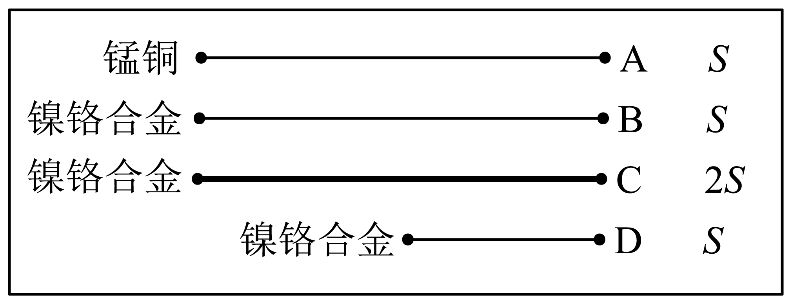
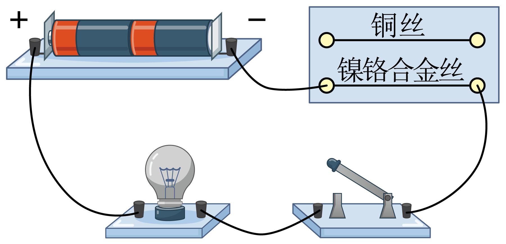

# 知识点·半导体和超导体（同步练习）

> 教材：物理·九年级全一册·沪科技版2024新教材 ｜ 来源：国家中小学智慧教育平台·在线练习 ｜ 共 3 题

## 1. 单选题（难度：适中）

用如图所示的实验装置探究“导体电阻的大小与哪些因素有关”。其中A为锰铜线，B、C、D为镍铬合金线，S表示横截面积，A、B、C的长度相同。则下列说法中正确的是（　　）

- A. 选择C、D可以探究电阻大小和长度是否有关
- B. 选择A、B可以探究电阻大小和材料是否有关
- C. 选择A、D可以探究电阻大小和长度是否有关
- D. 选择A、C可以探究电阻大小和横截面积是否有关

【答案】B

【解析】​

## 2. 单选题（难度：简单）

在“探究影响导体电阻大小的因素”的活动中，小文发现实验器材中金属丝只有一根，其它器材足够，如果要他完成下面的一些实验探究活动，其中他不可能完成的是（　　）

- A. 探究导体电阻与长度的关系
- B. 探究导体电阻与横截面积的关系
- C. 探究导体电阻与材料的关系
- D. 探究导体电阻与温度的关系

【答案】C

【解析】​

## 3. 单选题

用如图所示电路探究“影响电阻大小的因素”实验时，下列说法正确的是（　　）

- A. 根据图中的实验可以得出：导体电阻的大小与导体的材料有关
- B. 实验只需控制导体的材料相同
- C. 该电路探究导体的电阻大小与导体长度有关
- D. 该电路中不可以用小灯泡代替电流表判断电流强弱

【答案】A

【解析】​
