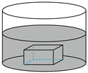

# 知识点·吸热、放热能力（同步练习）

> 教材：物理·九年级全一册·沪科技版2024新教材 ｜ 来源：国家中小学智慧教育平台·在线练习 ｜ 共 3 题

## 1. 单选题（难度：简单）

相同质量的水和食用油，放出了相同的热量（\( {c}_{\text{水}}>{c}_{\text{食用油}}\)），下列说法中正确的是（    ）．

- A. 水的末温较低
- B. 食用油的末温较低
- C. 水降低的温度较多
- D. 食用油降低的温度较多

【答案】D

## 2. 单选题（难度：适中）

质量和初温都相同的铁和铜，已知铁的比热容大于铜的比热容，它们吸收相同的热量后，将铁和铜相互接触，则下列有关说法正确的是（    ）．

- A. 铜向铁发生热传递
- B. 铁向铜发生热传递
- C. 铁和铜之间不发生热传递
- D. 无法确定

【答案】A

## 3. 单选题

如图所示，比热容不同的金属块和液体，金属块的温度低于液体的温度．把金属块投入液体中足够长的时间后，两者之间不再发生热传递（    ）．

- A. 过程中温度从液体传递到金属块
- B. 过程中液体放出的热量一定等于金属块吸收的热量
- C. 最后液体的温度一定等于金属块的温度
- D. 最后液体的内能一定等于金属块的内能

【答案】C
