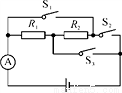
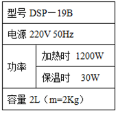

# 知识点·多档位问题（同步练习）

> 教材：物理·九年级全一册·沪科技版2024新教材 ｜ 来源：国家中小学智慧教育平台·在线练习 ｜ 共 3 题

## 1. （难度：简单）

某家用电热水器规格见下表，[已知C水=4.2×10³J/（kg•℃）]
正常工作电压
220V

低功率档
1100W

高功率档
2000W

（1）当电热水器用低功率档烧水时，求：正常工作时，①流过电热丝的电流；②电热丝的阻值。
（2）当它用高功率档正常工作时，把 50kg 的常温水升温 20℃，所用时间为 2500s求：①吸收的热量；②电热水器的效率。

【答案】

（1）①流过电热丝的电流为5A；

②电热丝的阻值为44Ω；

（2）①水吸收的热量为4.2×106J；

②电热水器的效率为84%。

【解析】​

## 2. （难度：适中）

​如图所示的电路中，电源电压不变，R₁=3Ω，R₂=6Ω。

​‎

 

（1）当S₁、S₃断开，S₂闭合时，电流表示数为1A，求电源电压。

（2）当S₁、S₃闭合，S₂断开时，求①电路中的总功率；②通电1min，电阻R₁产生的热量。

【答案】

（1）电源电压为9V；

（2）电路中的总功率为40.5W；通电1min，电阻<em><em>R</em></em><em><em>1</em></em>产生的热量为1620J。

【解析】​

## 3. （难度：简单）

某电热水瓶的铭牌如下表所示。若热水瓶内装满水，在额定电压下工作（外界大气压强为1个标准大气压）。求：

  
（1）保温时通过电热水瓶的电流是多少？
（2）加热10分钟电热水瓶消耗的电能是多少？
（3）若瓶内20℃的水加热10min正好烧开，则加热时电热水瓶的热效率是多少？
[已知C水=4.2×10³J/（kg•℃）]

【答案】

（1）0.14A；

（2）7.2×105J；

（3）加热时电热水瓶的热效率是93.3%。

【解析】​
