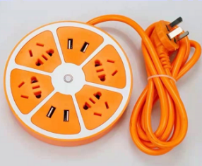
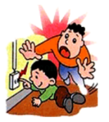
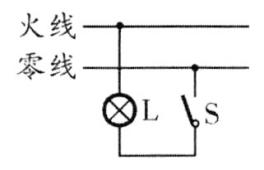
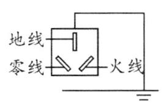
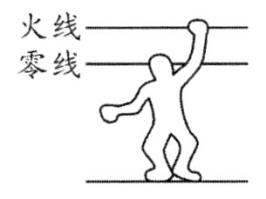
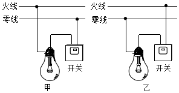

# 知识点·安全用电（同步练习）

> 教材：物理·九年级全一册·沪科技版2024新教材 ｜ 来源：国家中小学智慧教育平台·在线练习 ｜ 共 7 题

## 1. 单选题（难度：简单）

下列做法中，符合安全用电原则的是（    ）

- A. 用湿抹布擦拭插座
- B. 更换灯泡时先切断电源
- C. 搬动正在通电的电器
- D. 可在电线上晾晒衣服

【答案】B

【解析】​

## 2. 单选题（难度：简单）

触电事故的防范最重要的是要有安全用电的意识，遵守安全用电原则．为确保用电安全，下列做法正确的是（    ）

- A. 高大建筑的顶端安装避雷针
- B. 高压线下钓鱼
- C. 更换灯泡、搬动电器前可以不断开电源开关
- D. 保险装置、插座、导线、家用电器达到使用寿命时不需更换

【答案】A

【解析】​

## 3. 单选题

如图是某圆形插线排，以下插线排使用方法正确的是（    ）
 

- A. 手机充电器使用后一直留在插座上
- B. 可用湿布擦拭插线排上的灰尘
- C. 可在插线排上同时使用多个大功率用电器
- D. 插线排长时间不用要断开按钮开关

【答案】D

【解析】​

## 4. 单选题（难度：适中）

安全是人民生活和工农业生产的重要保障．如图所示的情景符合安全用电原则的有（    ）

- A. 
- B. 
- C. 
- D. 

【答案】C

【解析】​

## 5. 填空题（难度：简单）

对人体安全的电压应该不高于 \( \text{V}\)，因为根据欧姆定律\( I=U/R\)可知，电压越高，通过人体电流就会越，所以高压电对人体来说是非常危险的．

【答案】36，大

【解析】​

## 6. 填空题（难度：简单）

如图所示为家庭电路中白炽灯和开关的两种连接图，其中符合安全用电原则的是图．（选填“甲”或“乙”）
 

【答案】乙

【解析】​

## 7. 填空题（难度：简单）

在家庭电路中不能用湿手触摸开关，是因为在潮湿的情况下，人体的电阻会，在电压一定的情况下，通过人体的电流会（两空都选填“变大”“变小”或“不变”）；当人体成为电路的一部分时，就会有电流通过．如果电流达到一定大小，就会发生触电事故．人体触电，都是因为人体直接或间接与（选填“零”“火”“地”）线接触．

【答案】变小，变大，闭合，火

【解析】​
