# 知识点·安培定则（同步练习）

> 教材：物理·九年级全一册·沪科技版2024新教材 ｜ 来源：国家中小学智慧教育平台·在线练习 ｜ 共 15 题

## 1. 单选题（难度：适中）

如图所示，甲、乙为条形磁体，中间是电磁体，虚线是表示磁极间磁场分布情况的磁感线，则可以判断图中\( A\)、\( B\)、\( C\)、\( D\)四个磁极依次是（    ）。

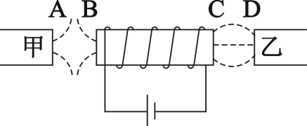

- A. \( N\)、\( S\)、\( N\)、\( N\)
- B. \( S\)、\( N\)、\( S\)、\( S\)
- C. \( S\)、\( S\)、\( N\)、\( S\)
- D. \( N\)、\( N\)、\( S\)、\( N\)

【答案】D

## 2. 填空题（难度：简单）

如图是牵牛花茎的照片。观察自然界中不同缠绕植物的茎，通过分析我么发现，如果把植物的缠绕方向看成通电螺线管中的电流方向，那么植物生长方向相当于通电螺线管的极。

【答案】北

## 3. 单选题（难度：简单）

如图所示，甲、乙两个电磁铁靠近放置，\( a\)、\( b\)和\( c\)、\( d\)分别接电源，那么（    ）。

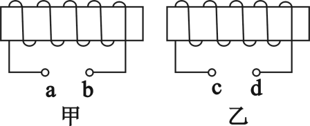

- A. \( a\)、\( c\)都接电源正极时，甲乙互相吸引
- B. \( b\)、\( c\)都接电源正极时，甲乙相互吸引
- C. \( a\)、\( c\)都接电源正极时，甲乙相互排斥
- D. \( b\)、\( d\)都接电源正极时，甲乙相互排斥

【答案】A

## 4. 单选题

如图所示，为使滑动变阻器的滑片\( P\)向右移动时，通电螺线管对条形磁铁的斥力变大，则电源和变阻器接入电路的方式可以是（    ）。

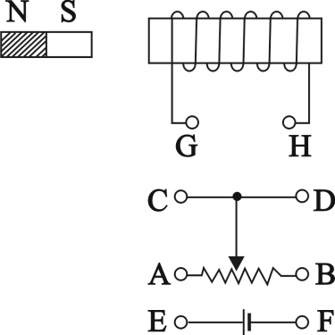

- A. \( G\)接\( F\)，\( E\)接\( B\)，\( D\)接\( H\)
- B. \( G\)接\( F\)，\( E\)接\( A\)，\( D\)接\( H\)
- C. \( G\)接\( E\)，\( F\)接\( B\)，\( D\)接\( H\)
- D. \( G\)接\( E\)，\( F\)接\( A\)，\( D\)接\( H\)

【答案】A

## 5. 填空题（难度：适中）

通电螺线管上方的小磁针静止时的指向如图所示，\( a\)端是电源的极，\( c\)端为通电螺线管的极。

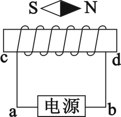

【答案】正，$ N$ 

## 6. 填空题

如图所示，光滑地面上有一小车，其上放一条形磁体，左侧地面固定一螺线管，当开关闭合时，小车将向运动。刚刚运动时，小车受到磁铁的摩擦力向。

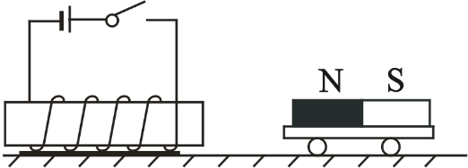

【答案】右，右

## 7. （难度：简单）

标出图甲中通电螺线管和小磁针的南北极（用“\( S\)”和“\( N\)”表示）。

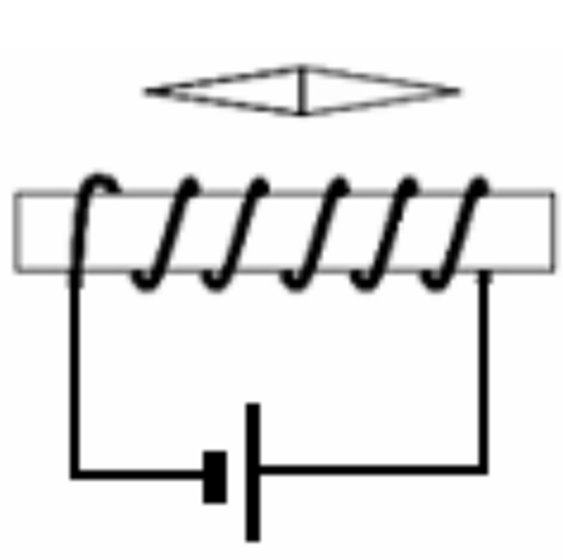

【答案】

    

## 8. （难度：适中）

如右图所示，请在图上标出通电螺线管周围\( a\)、\( b\)、\( c\)三点小磁针静止时的\( N\)极（用字母\( N\)表示）。

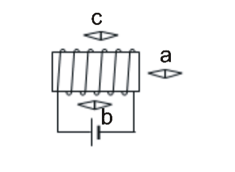

【答案】

    

## 9. 

请标出通电螺线管两端的极性，并画出图中放置的小磁针北极在螺线管通电时的受力方向（黑色部分表示小磁针的\( N\)极）。

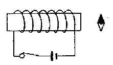

【答案】

    

## 10. （难度：简单）

在图中画出电源的正负极。

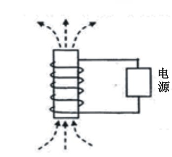

【答案】

    

## 11. （难度：适中）

根据图中通电螺线管的\( N\)极，标出磁感线方向、小磁针的\( N\)极，并在括号内标出电源的正、负极。

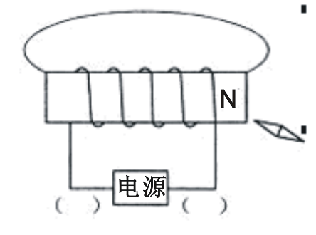

【答案】

    

## 12. 

根据图中电流表的“+”、“-”接线柱位置，标出电源的正、负极和小磁针的\( N\)、\( S\)极同时将磁针的\( N\)极涂黑。

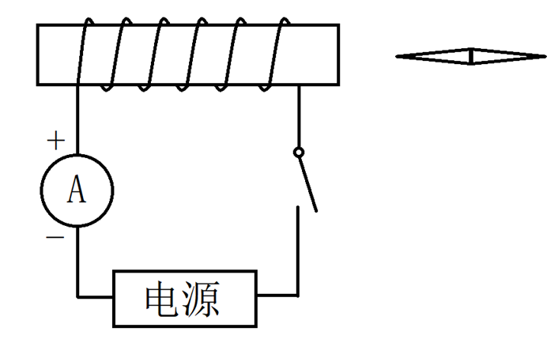

【答案】

    

## 13. （难度：简单）

小磁针静止时的指向如图所示。请你标出通电螺线管的极性，并用笔画线代替导线给通电螺线管绕线。

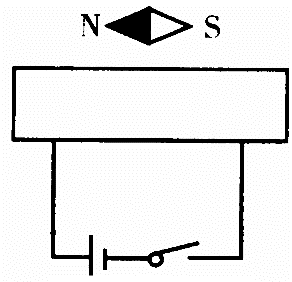

【答案】

    

## 14. （难度：适中）

通过通电螺线管外的磁场分布和方向，标出通电螺线管的极性，并用笔画线代替导线给通电螺线管绕线。

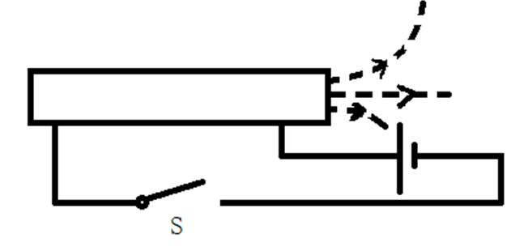

【答案】

    

## 15. 

根据发光二极管的连接方式以及通电螺线管内部小磁针的\( N\)、\( S\)极，同时画出通电螺线管的绕线。

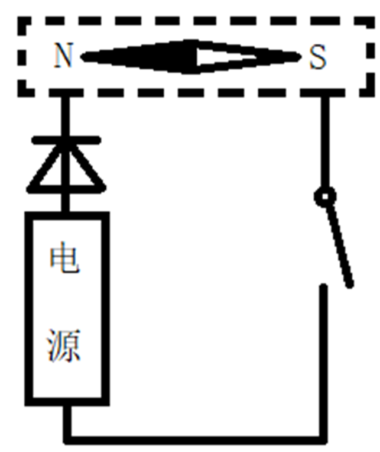

【答案】

    

