# 知识点·家庭电路（同步练习）

> 教材：物理·九年级全一册·沪科技版2024新教材 ｜ 来源：国家中小学智慧教育平台·在线练习 ｜ 共 46 题

## 1. 填空题（难度：简单）

空气开关和漏电保护器都是（选“串联”或“并联”）在电路中，但它们的作用是不同的，当电路中时，空气开关会自动切断电源，俗称跳闸；漏电保护器的作用是当人体直接或间接接触时（选填“火线”、“零线”或“地线”），电流经过人体流入大地，这时漏电保护器就会迅速断开电路，对人体起到保护作用．

【答案】串联，电流过大，火线

【解析】​

## 2. 填空题

暑假持续的“桑拿天”，居民家里的空调、电扇都闲不住，导致电路火灾时有发生，火警电话不断，消防车拉着警笛呼啸而出，赶往火灾现场. 调查发现，起火原因如出一辙：电线超负荷使电线内的金属导线发热引燃了外面的绝缘皮．根据学过的物理知识回答：
（1）“超负荷”是指电路中的（填“电流”或“电阻”）过大. 
（2）引起家庭电路中电流过大的原因是.

【答案】电流，总功率过大

【解析】​

## 3. 填空题（难度：适中）

保险丝是用合金制作的，电阻比较，熔点比较. 这是因为保险丝与导线之间是联连接，通过它们的电流和通电时间都，而保险丝比导线的电阻，根据公式\( Q=\) 可知，保险丝发热较多. 另外，保险丝的熔点比较，当达到它的熔点时，就会切断电路，起到保护作用.

【答案】铅锑；；；；；，；，大，低，串，相同，大，$ {I}^{2}Rt$，低

【解析】​

## 4. 填空题

家庭接入电路的用电器越多，总功率就越大，根据\( P=UI\)，可得\( I=\) ，电路中的总电流也就越大，根据焦耳定律\( Q=\)，导线、开关等处在相同时间内产生的热量越，如果超过电路的最大负荷，容易引起火灾.

【答案】$ P/U$，$ {I}^{2}Rt$， 多

【解析】​

## 5. 填空题（难度：简单）

某校已装有“\( \text{220V}\) \( \text{40W}\)”电灯\( 20\)盏，“\( \text{220V}\) \( \text{60}\text{W}\)”电灯\( \text{10}\)盏，全部正常工作的总电流为 \( \text{A}\)，应选用直径 \( \text{mm}\)的熔断器，（见下表）. 
几种常见的熔断器的规格 
直径
（\( \text{mm}\)）
额定电流
（\( \text{A}\)）
熔断电流
（\( \text{A}\)）
直径
（\( \text{mm}\)）
额定电流
（\( \text{A}\)）
熔断电流
（\( \text{A}\)）

0.71
3
6
1.02
6
12

0.81
3.75
7.5
1.25
7.5
15

0.98
5
10
1.51
10
20

【答案】6.4   ，1.25

【解析】​

## 6. 填空题（难度：简单）

如图为小红家的一个带开关、指示灯和多个插座的接线板. 接线板上的指示灯和插座之间是联；小红把接线板的插头插入家庭电路中的插座时，闭合接线板上的开关，出现“跳闸”现象，其原因可能是接线板中的电路发生了选填“开路”或“短路”. 

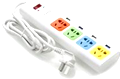

【答案】并，短路

【解析】​

## 7. 填空题

电工用如图方法检验家庭电路中是否有短路情况. 他先在进户线的干路上串联一个标有“\( \text{220V}\) \( \text{44W}\)”的白炽灯\({\text{L}}_{1}\)，然后断开房间里的所有开关，\( ab\)间加\( \text{220V}\)电压，发现\({\text{L}}_{1}\)正常发光，说明家庭电路中有短路情况，此时电路中的电流为 \( \text{A}\). 若闭合开关\(\text{S}\)，灯泡\({\text{L}}_{2}\) （选填“能”或“不能”）发光. 

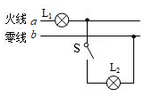

【答案】0.2，不能

【解析】​

## 8. （难度：适中）

保险丝能感应电器、电子产品非正常运作中产生的过热，从而自动切断回路以避免火灾的发生．如图所示是某电子产品中的电路，若\( A\)是一根熔断电流为\( \text{7A}\)的保险丝，\( B\)、\( C\)都是熔断电流为\( \text{5A}\)的保险丝，\( {R}_{1}=\text{16}\text{Ω}\)，\( {R}_{2}=10\text{Ω}\)．开关\({\text{S}}_{1}\)断开、\({\text{S}}_{2}\)闭合时，通过\( {R}_{2}\)的电流是\( \text{4.8 A}\). 

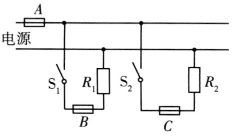

\( {R}_{1}\)和\( {R}_{2}\)的连接方式是（填“串联”或“并联”）；

当\({\text{S}}_{1}\)、\({\text{S}}_{2}\)同时闭合时，\( A\)、\( B\)、\( C\)中哪根保险丝将熔断？请通过计算说明．

【答案】并联；，

开关${\text{S}}_{1}$断开、${\text{S}}_{2}$闭合时，通过$ {R}_{2}$的电流是$4.8\text{A}$​

【解析】​

## 9. （难度：适中）

如图所示，是小华家用电热水壶烧开水时的情景.
​
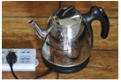

小华用电水壶将水烧开时，不慎有水溅入旁边的插座里，造成路，使空气开关跳闸，所有用电器停止工作.

质检部门检查发现，现在市场上有一些劣质插线板，其电源线线芯比合格产品要细很多，请根据所学知识解释使用这种插线板会存在什么隐患？

【答案】短（若不慎有水溅入旁边的插座里，会造成短路，电路电流过大，短路使空气开关跳闸，所有用电器停止工作），

在材料和长度一定时，伪劣电热器的电源线的芯线一般比合格产品的细，横截面积越小，电阻越大；在电流和通电时间一定时，电阻越大，电流产生的热量越多，越存在安全隐患.

【解析】​

## 10. 填空题

人们使用两脚插头台灯时，往往会随意插入两孔插座中. 如图所示，小明将台灯（图乙）的两插头插入家庭电路两孔插座（图甲）\(\text{CD}\)中（图丙是台灯的电路图，\(\text{AB}\)表示台灯的两插头），连接情况是\(\text{A}\)与\(\text{C}\)、\(\text{B}\)与\(\text{D}\)孔连接，闭合台灯开关\({\text{S}}_{1}\)，发现台灯\({\text{L}}_{1}\)不亮，电路中开关及导线良好，用测电笔测\( M\)点，氖管不发光，再测\( N\)点，测电笔发光，则可知台灯\({\text{L}}_{1}\)出现故障是（填“断路”或“短路”） 现象. 这种插入法，在断开开关情况下，接触台灯接点\( N\)时（填“会”或“不会”）触电. 

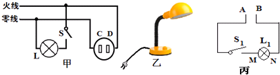

【答案】断路，会

【解析】​

## 11. 单选题（难度：适中）

如图所示的家庭电路，下列说法正确的是（   ）．  

​
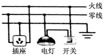

- A. 灯泡正常工作时两端的电压是36V
- B. 电灯和插座串联
- C. 开关与电灯并联
- D. 火线与零线之间的电压是220 V​

【答案】D

【解析】​

## 12. 单选题（难度：简单）

如图是小明设计的家庭电路的电路图，下列对此电路图的分析错误的是（   ）．  

​
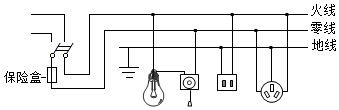

- A. 保险盒接法错误，保险盒应该安装在火线上
- B. 二孔插座接法错误，其左端导线应该接在零线上
- C. 开关和灯泡接法正确，开关接在零线上符合安全用电原则
- D. 三孔插座接法正确，使用电冰箱时，插头应插在三孔插座上​

【答案】C

【解析】​

## 13. 单选题（难度：简单）

如图所示是现在一般标准住宅户内配电系统方框图．关于空气开关和漏电保护器的作用，下列分析正确的是（    ）．  

​
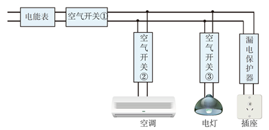

- A. 当电灯电流过大时，空气开关③将跳闸
- B. 当插座漏电时，空气开关①将跳闸
- C. 当空调电流过大时，漏电保护器会迅速切断电流
- D. 空气开关跳闸，问题解决后需更换新的空气开关​

【答案】A

【解析】​

## 14. 单选题

如图所示，小科在家庭电路图中设置了五处开关．小江觉得有几处开关无需设置，这几处开关是（   ）．

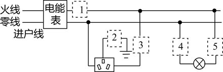

- A. 1、2
- B. 2、4
- C. 1、4
- D. 3、5

【答案】B

【解析】​

## 15. 单选题（难度：适中）

如图所示是简化后的家庭电路的接线电路图，由该图可知（     ）．

​
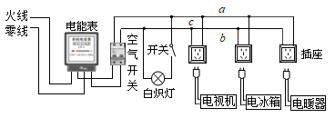

- A. 控制照明灯的开关可以和灯相互交换位置
- B. 电路中的照明灯、电视机和电冰箱是串联的
- C. 将验电笔插入两孔插座的左孔中，氖管不发光
- D. 电路中每多一个用电器工作电路的总电阻变大​

【答案】C

【解析】​

## 16. 单选题（难度：适中）

家庭里的电灯突然全部熄灭，用测电笔分别测双孔插座的两个孔，氖管都发光．据此他对故障作了下列四种判断，其中正确的是（     ）．

- A. 接在火线上的空气开关断开
- B. 室内线路发生短路
- C. 进户零线上的保险丝熔断
- D. 进户火线上保险丝熔断

【答案】C

【解析】​

## 17. 单选题（难度：简单）

试电笔是电工必备的检测设备，其结构如图所示．关于它的使用，以下说法错误的是（    ）

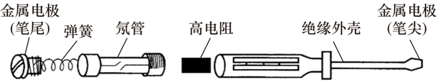

- A. 试电笔内部的高电阻、氖管、弹簧及笔尾只能按照如图所示的次序顺次装入测电笔中
- B. 当笔尖接触导线时，绝不允许用手或身体的其他部位再去接触笔尾
- C. 使用试电笔时，要保证导线、试电笔、人体与大地构成回路
- D. 一般来说，我们从氖管是否发光可以判断笔尖接触的是否是火线

【答案】B

【解析】​

## 18. 单选题

图为试电笔的结构图．下列说法正确的是（   ）．

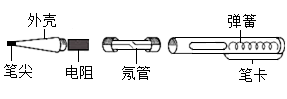

- A. 使用试电笔验电时手不能接触笔尖
- B. 使用试电笔时，若氖管发光，说明接触处与零线是连通的
- C. 使用试电笔验电时手不要接触笔卡
- D. 试电笔外壳是导体

【答案】A

【解析】​

## 19. 单选题

小明晚上做功课，把台灯插头插在书桌边的插座上，闭合台灯开关，发现台灯不亮．为了找出故障原因，小明把台灯插头插入其他插座，发现台灯能正常发光，用测电笔插入书桌边的插座孔进行检查，发现其中一个孔能使测电笔的氖管发光．故障原因可能是（     ）．

- A. 进户线火线上的熔丝烧断
- B. 书桌边的插座与零线断开
- C. 进户线零线断了
- D. 书桌边的插座与火线断开

【答案】B

【解析】​

## 20. 单选题

如图所示是某家庭电路，闭合开关\({\text{S}}_{1}\)、\({\text{S}}_{2}\)，\({\text{L}}_{1}\)灯发光，\({\text{L}}_{2}\)灯不发光．用试电笔分别接触\( c\)、\( d\)两点，氖管都发光．若电路中只有一处故障，则（     ）． 

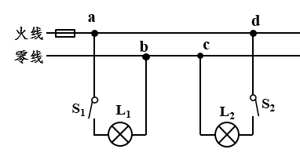

- A. \({\text{L}}_{1}\)短路
- B. \( bc\)间断路
- C. \({\text{L}}_{2}\)断路
- D. \( ad\)间断路

【答案】B

【解析】​

## 21. 单选题（难度：简单）

如图所示，将吹风机的插头插入插座，闭合吹风机的开关，吹风机不工作；闭合灯泡开关，灯泡亮．保持灯泡开关闭合，拔出插头，用测电笔分别接触插座的\( B\)、\( C\)两孔，发现接\( B\)时氖管不发光，接\( C\)时发光．若电路中只有一处故障，则故障可能是（     ）．

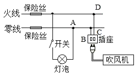

- A. 零线上保险丝烧断
- B. ​​​\(AB\)​间电路断路
- C. 插座短路
- D. ​​​\(CD\)​间电路断路

【答案】B

【解析】​

## 22. 单选题（难度：简单）

如图所示的电路中，闭合所有开关，所有灯正常发光．一段时间后三盏灯中突然有两盏灯\({\text{L}}_{2}\)、\({\text{L}}_{3}\)熄灭，经检查保险丝完好，在插座没有插入任何用电器的情况下，用试电笔插进插座的两孔，氖管均发光．造成这一现象的原因是（     ）．

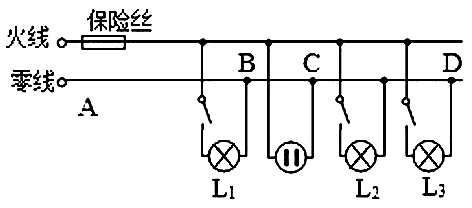

- A. 一定是插座发生短路了
- B. 一定是进户的零线\( BD\)之间断了
- C. 一定是进户的零线\( CD\)之间断了
- D. 一定是进户的零线\( BC\)之间断了

【答案】D

【解析】​

## 23. 单选题（难度：适中）

如图所示的家庭电路中，闭合开关后灯泡不亮．用试电笔检测插座的两孔，发现只有插入右孔时氖管才发光．用试电笔检测\( A\)点氖管发光，检测\( B\)点氖管不发光．发生这一现象的原因可能是（   ）．

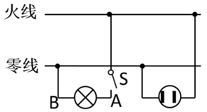

- A. 灯泡断路
- B. 灯泡短路
- C. 进户零线断路
- D. 进户火线断路

【答案】A

【解析】​

## 24. 单选题（难度：适中）

如图所示为某家庭的部分电路，电灯和电热器都在正常工作．当三孔插座上刚插上洗衣机的插头时，所有用电器都停止工作．经检查，发现有一根保险丝熔断了，拔出洗衣机的插头后，用测电笔测试三孔插座的左右两孔，氖管都发光．下列分析合理的是（     ）．

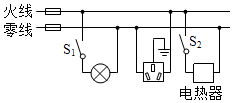

- A. 一定是火线上的保险丝熔断了
- B. 只断开\({\text{S}}_{1}\)，再用测电笔检测灯泡的两个接线柱，氖管都不发光
- C. 只断开\({\text{S}}_{2}\)，再用测电笔检测三孔插座的左右两孔，氖管都发光
- D. 断开\({\text{S}}_{1}\)和\({\text{S}}_{2}\)，再用测电笔检测三孔插座的左右两孔，氖管都发光

【答案】C

【解析】​

## 25. 单选题

电工师傅常用一只额定电压为\( \text{220V}\)的灯泡\({\text{L}}_{0}\)（检验灯泡）．取代保险丝来检查新安装的照明电路中每个支路的情况，如图所示．当\(\text{S}\)闭合后，再分别闭合\({\text{S}}_{1}\)、\({\text{S}}_{2}\)、\({\text{S}}_{3}\)（每次只能闭合其中之一）时，下列说法错误的是（     ）．

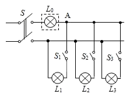

- A. 只闭合\(\text{S}\)、\({\text{S}}_{1}\)时，\({\text{L}}_{0}\)不亮，说明该支路断路
- B. 只闭合\(\text{S}\)、\({\text{S}}_{2}\)时，\({\text{L}}_{0}\)正常发光，说明该支路短路
- C. 只闭合\(\text{S}\)，\({\text{S}}_{3}\)时，\({\text{L}}_{0}\)发光呈暗红色，说明该支路正常
- D. 只闭合\(\text{S}\)、\({\text{S}}_{1}\)时，若\({\text{L}}_{0}\)正常发光，用试电笔检测\( A\)点氖管发光

【答案】D

【解析】​

## 26. 单选题（难度：简单）

用带指示灯的开关控制阳台的电灯；闭合开关，两灯都亮；断开开关，两灯都灭．使用过程中发现：指示灯因断路不亮，电灯照常发亮．下列连接方式符合上述现象的是（     ）．

- A. 
- B. 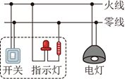
- C. 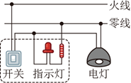
- D. 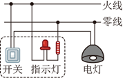

【答案】C

【解析】​

## 27. 单选题（难度：适中）

如图所示，是网站上所出售的一款在家庭电路中使用的定时插座，相应参数为：\( \text{10A}\text{﹣}\text{MAX 250V}\text{～}\)，该插座具有当用电器充满电时可自动切断电路，防止电池过充而被损，也可以按照我们所设定的时间给用电器供电的功能．关于定时插座下列说法正确的是（     ）．

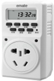

- A. 插座上的指示灯和多个插座是串联关系
- B. 该插座不可以让功率为\( \text{2300W}\)的用电器与该接线板进行连接
- C. 插座内只有火线和零线两根导线
- D. 正常情况下，该接线板上有2个插孔会使检测的测电笔氖管发光

【答案】D

【解析】​

## 28. 单选题（难度：简单）

为了保证人身安全，洗衣机、电冰箱、电饭锅等功率较大的电器都用三脚插头．如图所示为三孔式插座和三脚插头，下列有关说法正确的是（    ）

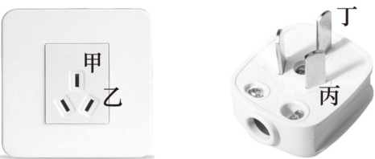

- A. 三孔式插座甲处是零线插孔
- B. 三孔式插座乙处是接地线孔
- C. 三脚插头丙处插入零线插孔
- D. 三脚插头丁处插入火线插孔

【答案】C

【解析】​

## 29. 单选题

今年“五一”假期，铁路接触网遭异物侵扰的新闻多次上热搜，铁路部门有明确规定：在高铁线路两侧各500米范围内，不得升放风筝．若导电性能好的金属丝风筝线散落在高铁接触网（高压电路）．上，会造成短路而使动车组失去动力．下列电路能解释上述现象的是（     ）．

- A. 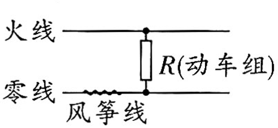
- B. 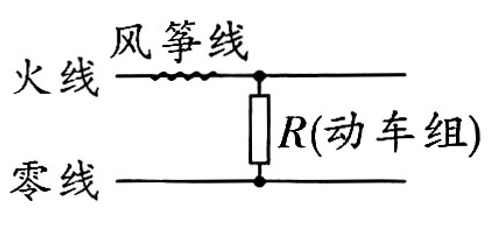
- C. 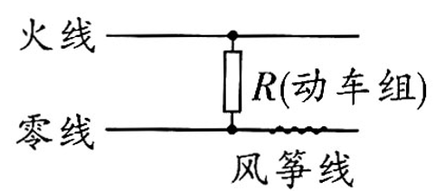
- D. 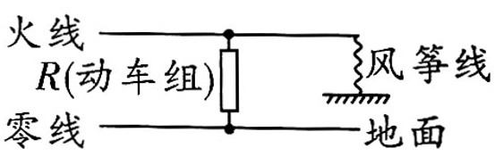

【答案】D

【解析】​

## 30. 单选题

如图是某款洗衣机及所用的三孔插座，它的铭牌标有“\( \text{220V}\) \( \text{150W}\)”．下列说法正确的是（     ）．

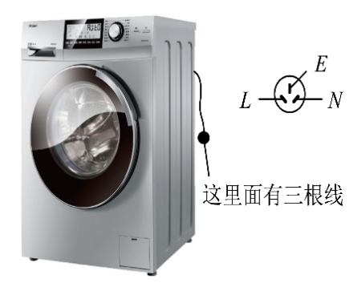

- A. 洗衣机只能在\( \text{220V}\)的电压下工作
- B. 洗衣机正常工作时，\( \text{10s}\)内会产生\( \text{1500J}\)的热量
- C. 洗衣机外壳和火线绝缘损坏，外壳带电时，总电路中的保险丝会熔断
- D. 洗衣机外壳和火线绝缘损坏，外壳带电时，电路中的漏电保护器会切断电流

【答案】D

【解析】​

## 31. 填空题（难度：简单）

我国家庭电路电压是 \( \text{V}\)，家庭电路中电视机和电灯的连接方式是（选填“串联”或“并联”）．的，控制电灯的开关应接在（选填“零”或“火”）．线上．

【答案】220，并联，火

【解析】​

## 32. 填空题（难度：适中）

春节小明随父母出游，在宾馆办理了入住，领到房卡．只有把房卡插入槽中，房间内的灯和插座才能有电．房卡的作用相当于一个（填电路元件名称）．接在干路上；房间里有电灯、电视等用电器，它们是联的；电灯与控制它的开关是联的．

【答案】开关，并，串

【解析】​

## 33. 填空题

小明同学想在家里安装一盏照明灯，如下图甲所示的是他设计的电路，图中虚线框1和2应连入开关和电灯，则开关应安装在（选填“1”或“2”）．框中，为了检测家庭电路中插座右孔连接的是不是火线，应使用如图（选填“乙”或“丙”）．所示的捏试电笔的方法． 

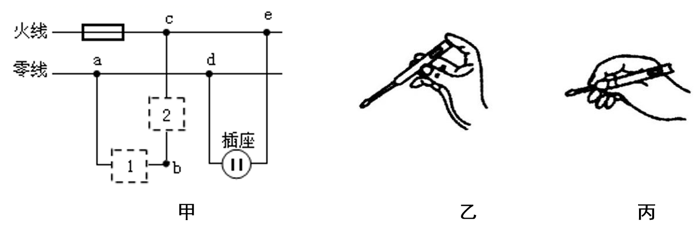

【答案】2，乙 

【解析】​

## 34. 填空题（难度：简单）

如图照明电路中电灯突然熄灭，用试电笔测\( a\)、\( b\)、\( c\)点，试电笔均发亮，测试\( d\)点不亮，故障是；试电笔发亮时，火线、试电笔、人体与大地构成联电路．  

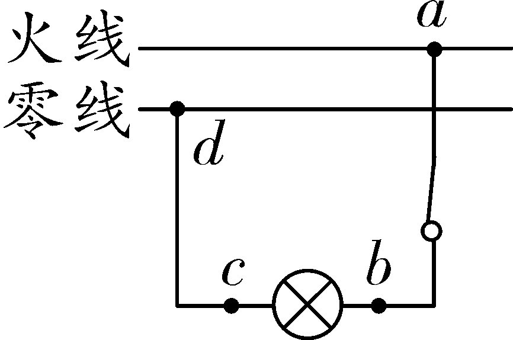

【答案】$ cd$段断路，串

【解析】​

## 35. 填空题（难度：适中）

如图所示，电灯和取暖器正常工作，在三孔插座上接入一个电饭锅后，取暖器突然停止工作，拔下电饭锅后，电灯正常发光．小李判断应该是发生了断路，于是用测电笔去判断故障位置．
​​​\(①\)​用测电笔检测三孔插座左右两孔都发光，则故障是图中间断路．（选填“\( AB\)” “\( AC\)” “\( CD\)”或“​​​\(BD\)​”）．
\( \text{②}\)当小李把图中电灯和取暖器的开关都断开后，再用测电笔去测三孔插座，此时测孔会发光．（填“左”或“右”）．
\( \text{③}\)小李还能根据家庭电路中的不同保护元件的响应情况来判断故障．汪老师家的漏电保护器跳闸了，马上判断出是电路中发生了．（选填“短路”“断路”或“漏电”）．

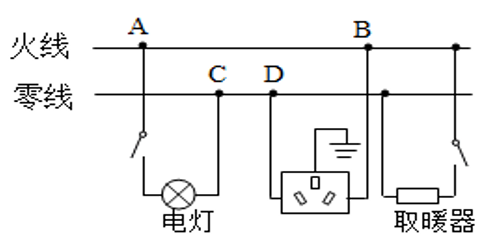

【答案】$ CD$   ，右  ，漏电

【解析】​

## 36. 填空题

如图所示，电工师傅用一只标有“\( \text{220V}\) \( \text{40W}\) ”的灯泡\({\text{L}}_{0}\)（检验灯泡）．取代保险丝来检查新安装的照明电路中各支路的情况，\({\text{L}}_{1}\)和\({\text{L}}_{2}\)均标有“\( \text{220V}\) \( \text{40W}\)”．当只闭合\(\text{S}\)、\({\text{S}}_{1}\)时，\({\text{L}}_{0}\)发光，\({\text{L}}_{1}\)不发光，说明\({\text{L}}_{1}\)发生（选填“断路”或“短路”）．故障，当只闭合\(\text{S}\)、\({\text{S}}_{2}\)时，\({\text{L}}_{0}\)和\({\text{L}}_{2}\)都呈暗红色，此时电路的总功率为 \( \text{W}\)．

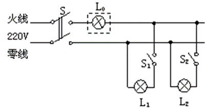

【答案】短路，20

【解析】​

## 37. 填空题（难度：简单）

教室里的电灯和电脑是联的．家庭电路中，导线绝缘皮容易破损或老化，裸露的导线相接触会发生短路，这时电路中的（选填“漏电保护器”或“空气开关”）．会跳闸保护电路．

【答案】并，空气开关

【解析】​

## 38. 填空题（难度：适中）

家庭电路中通常安装有电能表、空气开关和漏电保护器．如果站在地上的人不小心接触了火线，电流经过人体流入大地，会迅速切断电流，对人起到保护作用；当家庭电路中电流过大时，会自动断开，切断电路．

【答案】漏电保护器，空气开关

【解析】​

## 39. 填空题

如图所示是家庭电路的一部分．当用电器正常工作时，电路中\(A\)处和\( B\)处的电流大小关系是\( {I}_{A}\)  \( {I}_{B}\)；图中的漏电保护器在某些情况下会切断电路，分析：当站在地上的人不小心接触到\( C\)处裸露的电线时，漏电保护器切断电路．

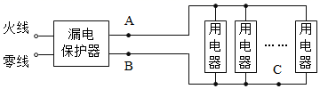

【答案】＝    ，不会

【解析】​

## 40. （难度：简单）

小红家卧室安装了两盏“\( \text{220V}\) \( \text{11W}\)”的壁灯\({\text{L}}_{1}\)、\({\text{L}}_{2}\) 和一个三孔插座，把它们正确地连接在家庭电路中，要求开关\(\text{S}\)只控制两盏电灯且都能正常发光．

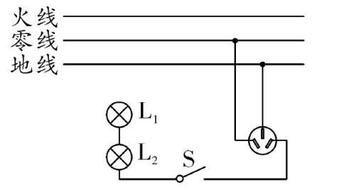

【答案】

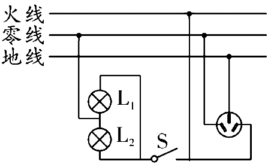     

【解析】​

## 41. 

现在许多宾馆都利用房卡取电，它相当于一个开关．只有房卡插入卡槽里，房间内的电灯和插座才能工作．如图所示是房间内已经连好的部分电路图，\(\text{S}_{1}\)是房卡开关，\(\text{S}_{2}\)是控制电灯的开关．为使电灯和插座都正常工作，请将电路图补充完整．  

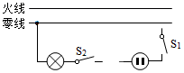

【答案】

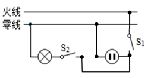      

【解析】​

## 42. （难度：简单）

如图甲为带开关和指示灯的三孔插座，插孔能供电时，指示灯亮；开关断开后，插孔不能供电，指示灯不亮；若指示灯损坏，闭合开关后插孔仍能供电．图乙为示意图，请完成接线．

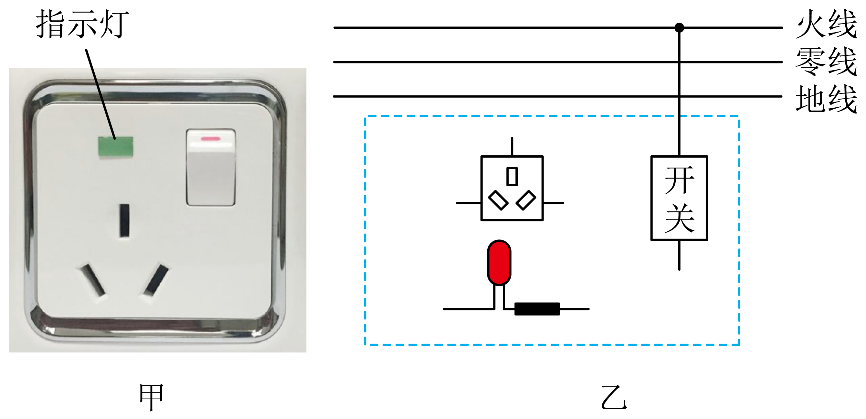

【答案】

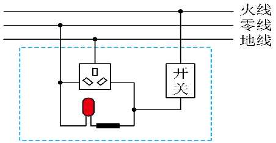     

【解析】​

## 43. （难度：适中）

如图甲是插线板，请将乙图的内部电路连接完整．要求：在开关断开时插线板上的指示灯不发光，插孔不能提供工作电压；在开关闭合时指示灯发光，插孔可提供工作电压；若指示灯损坏，开关闭合时插孔也能提供工作电压．

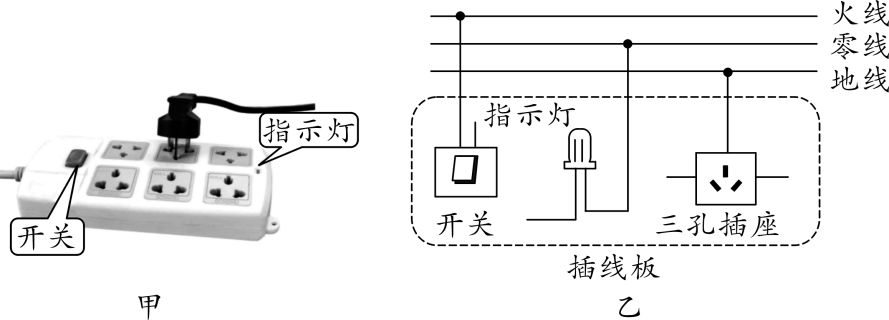

【答案】

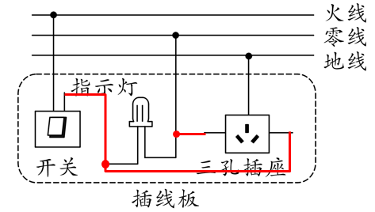     

【解析】​

## 44. （难度：适中）

连接家庭电路中的灯泡和插座．

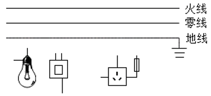

【答案】

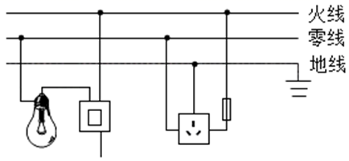     

【解析】​

## 45. 

如图为冰箱工作时的部分电路示意图．冰箱内照明灯由开关\(\text{S}_{1}\)控制，压缩机\(\text{M}\)由开关\(\text{S}_{2}\)控制．根据题意，将图连接完整，并符合安全用电原则．

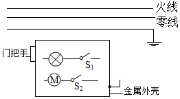

【答案】

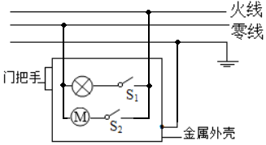     

【解析】​

## 46. 单选题（难度：适中）

如图所示是小军同学家庭电路的一部分．他闭合开关时灯泡正常发光，再将电风扇的插头插入插座中时，灯泡突然熄灭，检查时发现保险丝熔断了．其原因可能是（   ）．

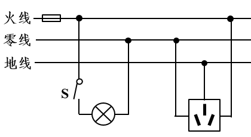

- A. 电风扇断路
- B. 灯泡的灯丝断路
- C. 电风扇的插头短路
- D. 电风扇的电功率很小

【答案】C

【解析】​
