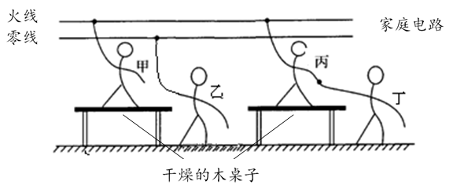
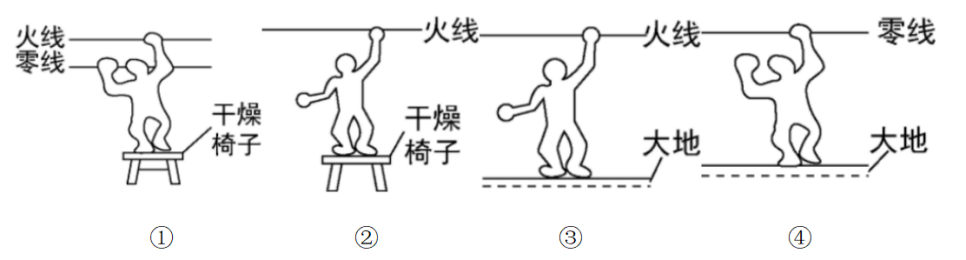
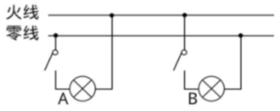
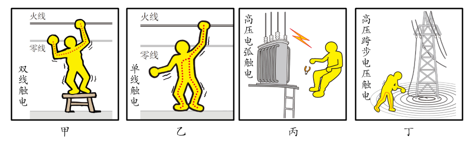

# 知识点·家庭电路触电与高压触电（同步练习）

> 教材：物理·九年级全一册·沪科技版2024新教材 ｜ 来源：国家中小学智慧教育平台·在线练习 ｜ 共 5 题

## 1. 单选题（难度：简单）

小明触摸电冰箱门时感到手“麻”，小明对造成手“麻”的原因作出如下的猜想，你认为其中猜想合理的是（    ）

- A. 火线断路
- B. 火线与电冰箱的金属外壳接触
- C. 火、零线短路
- D. 电冰箱的金属外壳接了地线

【答案】B

【解析】​

## 2. 单选题

如图所示，甲站在干燥的木桌上一只手接触到火线；乙站在地上一只手接触到零线；丙站在干燥的木桌上一只手接触到火线．此时，丁站在地面上用手去拉丙．则（   ）
 

- A. 甲、乙都会触电
- B. 甲、丙都会触电
- C. 乙、丁都会触电
- D. 丙、丁都会触电

【答案】D

【解析】​

## 3. 单选题（难度：适中）

如图中的哪些图所示的情况不会发生触电事故（    ）
 

- A. ②④
- B. ③④
- C. ①②
- D. ① ③

【答案】A

【解析】​

## 4. 填空题（难度：简单）

图中​A、​B两点均是灯头连接导线的螺丝，当电路中的开关都断开时，站在地上的人用手接触电路中的​A点，他触电；用手接触电路中的​B点，他触电．（均“会”或“不会”）．
 

【答案】会，不会

【解析】​

## 5. 填空题（难度：简单）

分析下列几幅图片．
 

      
​（1）图甲中，触电的原因是．
​（2）图乙中，触电的原因是．
​（3）图丙中，触电的原因是人体靠近带电体，产生电弧，与大地连通形成通路，造成触电．
​（4）图丁中，触电的原因是人体靠近高压带电体，产生电压，人体两脚连通形成通路，造成触电．
​（5）根据四幅图，可知常见触电的实质是人体直接或间接与连通，并通过或形成通路．总结出防止触电的措施是避免接触或靠近高压线．

【答案】人体与火线和零线连通形成通路，造成触电，人体与火线和大地连通形成通路，造成触电，高压，跨步，火线，大地，零线，火线

【解析】​
