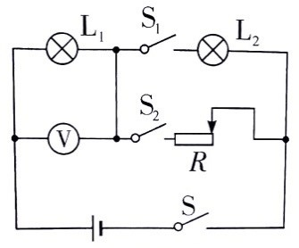
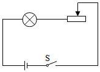
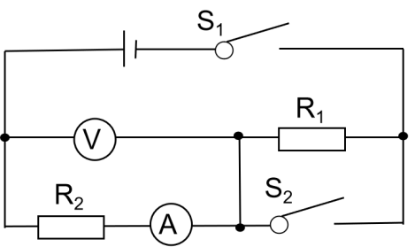

# 知识点·并联电路中电功率计算（同步练习）

> 教材：物理·九年级全一册·沪科技版2024新教材 ｜ 来源：国家中小学智慧教育平台·在线练习 ｜ 共 3 题

## 1. 填空题（难度：适中）

​如图所示，电源电压不变，灯泡L1标有“6V  3W”，灯泡L2标有“6V  6W”，灯泡的电阻均不变。只闭合开关S、S1时，恰好一盏灯正常发光，另一盏灯比正常发光暗，则电源电压为V。只闭合开关S、S2时，调节滑动变阻器滑片，使电压表示数为3V时，变阻器连入电路的阻值为Ω，此时小灯泡的实际功率为W。​

​​

​​​

【答案】9，24，0.75

【解析】​

## 2. 填空题

如图所示，已知灯泡标有“5V  2.5W”的字样，灯泡电阻恒定不变，滑动变阻器标有“30Ω  1A”的字样，电源电压为6V。闭合开关S，在保证电路安全的情况下移动滑片滑动变阻器的最小功率为W。
‎ 

【答案】0.5

## 3. 填空题（难度：简单）

​如图所示的电路，电源电压恒定不变，闭合开关S₁后再闭合开关S₂，电压表的示数将，电路的总功率将，电压表示数与电流表示数的比值将（以上均选填“变大”、“变小”或“不变”）。若互换电压表和电流表的位置，再闭合开关S₁、S₂，的情况下，表将会烧坏。​

​

【答案】变大，变大，不变，电流

【解析】​
