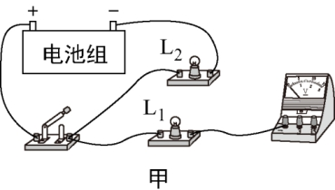
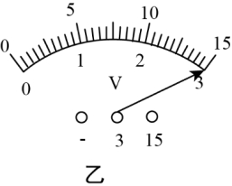
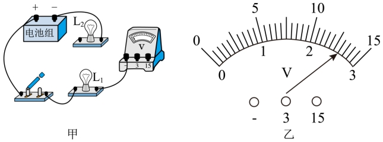
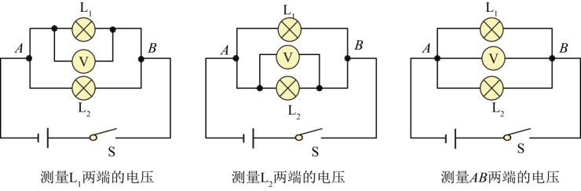
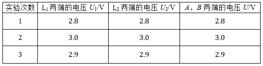

# 知识点·并联电路中电压关系的探究实验（同步练习）

> 教材：物理·九年级全一册·沪科技版2024新教材 ｜ 来源：国家中小学智慧教育平台·在线练习 ｜ 共 3 题

## 1. （难度：适中）

为探究并联电路中电压的规律，实验室提供的器材有：干电池组（电压为 3V）、电压表、多个不同规格的小灯泡、开关、导线若干。
​

   

请用笔画线代替导线，在图甲中把电路连接完整，要求电压表测量灯L₁两端的电压；

电路连接正确后进行实验，某小组分别测出灯L₁、L₂两端的电压和并联电路的总电压，电压表示数均相同，如图乙所示，其值为V。根据这一组数据，该小组得出并联电路中电压的规律是并联电路两端的总电压和各支路两端的电压相等。你认为实验操作过程的疏漏之处是。

【答案】

，3     /只进行一次实验就得到结论具有偶然性

【解析】​

## 2. 

为探究并联电路中电压的规律，实验室提供的器材有：干电池组（电压约为3V且保持不变）、电压表、多个小灯泡、开关、导线若干。
​

请用笔画线代替导线，在图甲中把电路连接完整，要求电压表测量灯L₁两端的电压；​

小明刚连完最后一根导线，两灯就亮了，则小明在实验操作中的不当之处是；

电路连接正确后进行实验，某小组分别测出小灯泡L₁、L₂两端的电压和并联电路的总电压，电压表示数相同，如图乙所示，其值为V。根据这组数据，该小组得出并联电路中电压的规律，你认为实验的疏漏之处是。纠正后得到并联电路中的电压规律为；

实验结束前，小明发现L₂熄灭了，但L₁仍然发光，则此时电压表的示数将（变大/不变/变小），L₂熄灭的原因是。

【答案】

     

，连接电路时，开关没有断开     ，2.6     /未换用不同规格的灯泡多次实验     /并联电路中，各支路两端电压相等，且等于电源电压，不变     /L2断路

【解析】​

## 3. 填空题（难度：简单）

在“探究并联电路的电压规律”实验中，小明同学设计了如图所示的电路。

  ​​​​

（1）在连接电路中，开关应该处于（选填“闭合”或“断开”）状态。
（2）根据如图连接好电路，闭合开关进行试触时，他发现电压表的指针反向偏转，其原因是。
（3）故障排除后，小明选用不同规格的灯泡，完成了三次实验，并记录了数据。分析上表中的数据，可得出的结论为：（请用语言文字准确叙述）。

【答案】断开，电压表正负接线柱接反，并联电路中，各支路两端电压都相等

【解析】​
